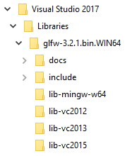
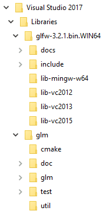
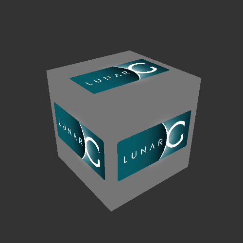
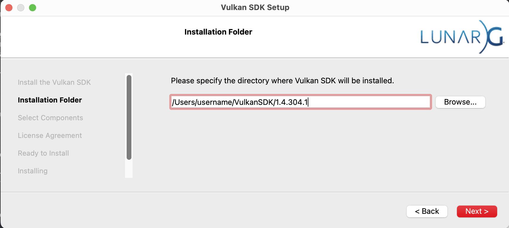
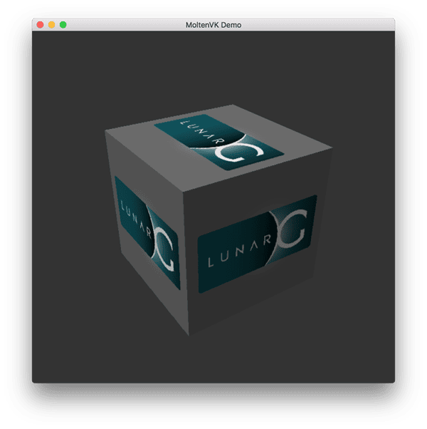
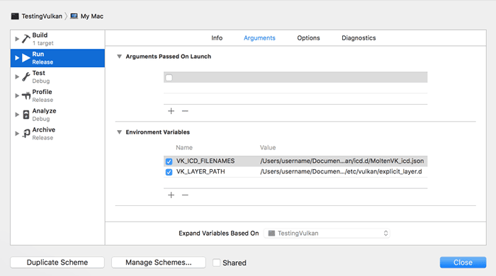

= 开发环境

:pp: {plus}{plus}

在本章中，我们将搭建用于开发 Vulkan 应用程序的环境，并安装一些有用的库。
除了编译器之外，我们用到的所有工具都兼容 Windows、Linux 和 macOS，
但它们的安装步骤略有不同，因此这里分开介绍。

== 获取代码

首先，我们需要从 https://github.com/KhronosGroup/Vulkan-Tutorial[GitHub 仓库]克隆本教程的代码。
这需要安装 https://git-scm.com/[git] 版本控制系统。

安装好 git 之后，我们就可以像这样在本地克隆仓库：

[,bash]
----
git clone https://github.com/KhronosGroup/Vulkan-Tutorial
----

这会把仓库克隆到一个新文件夹（位于当前文件夹内），名称为 `Vulkan-Tutorial`。各章的源文件位于 `attachments` 文件夹中。

== 依赖安装脚本

为了简化搭建过程，我们为 Windows 和 Linux 提供了依赖安装脚本：

=== Windows

在 Windows 上，我们提供了一个使用 vcpkg 安装所有必需依赖的脚本：

1. 确保你已安装 vcpkg。如果尚未安装，请按 https://github.com/microsoft/vcpkg 上的说明操作。
2. 运行 `scripts/install_dependencies_windows.bat` 脚本
3. 按照说明安装 Vulkan SDK

虽然我们借助 vcpkg 来实现这个安装脚本，但整个流程在下面都有详细说明，
不使用安装脚本、也不需要 vcpkg 同样可以完成。那只是为了简化搭建过程而提供的便利。

=== Linux

在 Linux 上，我们提供了一个能检测你的包管理器并安装所有必需依赖的脚本：

1. 运行 `scripts/install_dependencies_linux.sh` 脚本
2. 按照说明安装 Vulkan SDK

如果你更愿意手动安装依赖，或者使用的是 macOS，请按照下面针对具体平台的说明操作。

== 通用注意事项

=== Vulkan SDK

开发 Vulkan 应用程序最重要的一环是 SDK。
它包含头文件、标准验证层、调试工具以及 Vulkan 函数的加载器。
加载器会在运行时从驱动中查找函数，这一点与 OpenGL 的 GLEW 类似——如果你熟悉的话。

SDK 可以从 https://vulkan.lunarg.com/sdk/home[LunarG 网站]下载。

按提示完成安装，并留意 SDK 的安装位置。
我们要做的第一件事，是验证你的显卡和驱动是否正确支持 Vulkan。
进入 SDK 的安装目录，打开 `bin` 目录并运行 `vkcube` 示例。

这个目录里还有一个对开发很有用的程序。`slangc` 命令行程序用于把人类可读的
https://shader-slang.org/slang/user-guide/[Slang 着色语言] 编译成字节码。
我们会在 xref:03_Drawing_a_triangle/02_Graphics_pipeline_basics/01_Shader_modules.adoc[着色器模块]
一章中深入讲解。`bin` 目录还包含 Vulkan 加载器和验证层的二进制文件，
而 `lib` 目录包含库文件。

最后还有包含 Vulkan 头文件的 `include` 目录。你可以随意浏览其它文件，但本教程不会用到它们。

要自动设置 VulkanSDK 所使用的环境变量，以简化 CMake 工程配置和其它工具的使用，
我们建议在 Linux 上使用 `setup-env` 脚本。你可以把这个脚本加入终端的自启动项或 IDE 设置中，
确保这些环境变量在你所有的会话中都可用。

如果你收到错误信息，请确认驱动是最新的、包含 Vulkan 运行时，并且你的显卡受支持。
各大厂商驱动的链接见 xref:00_Introduction.adoc[简介章节]。

=== CMake
尽管跨平台项目开发有不少麻烦，CMake 已成为整个行业的标准工具。
它让开发者可以创建一份项目级的构建描述文件，由它负责设置和配置创建任何项目所需的全部支持工具。
也存在能实现类似能力的其它构建系统，比如 bazel，
但没有哪个像 CMake 这样被广泛使用和接受。
完整介绍 CMake 的用法超出了本教程的范围，
不过更多细节可以在 http://www.cmake.org[CMake] 找到。

Vulkan SDK 支持使用 find_package。要在你的项目中使用它，
可以把 *-config.cmake 的搜索路径加到 find_package 配置调用的 `HINTS` 部分，例如：
[,cmake]
----
find_package(slang CONFIG HINTS "$ENV{VULKAN_SDK}/lib/cmake")
----

未来 FindVulkan.cmake 可能会迁移到 *-config.cmake 标准，
但在撰写本文时，建议从 VulkanSamples 获取 FindVulkan.cmake，
因为 Kitware 提供的那个已被废弃，而且在 macOS 构建中存在缺陷。
你可以在代码目录的 link:/attachments/CMake/FindVulkan.cmake[FindVulkan.cmake] 中找到它。

FindVulkan.cmake 是项目专用的文件，你可以拿来按需修改，使它适配你的构建环境，
并进一步按你的需求定制。Khronos 在 VulkanSamples 中分发的那个版本经过充分测试，
是很好的起点。

要使用它，像这样把它加入 CMAKE_MODULE_PATH：
[,cmake]
----
list(APPEND CMAKE_MODULE_PATH "${CMAKE_CURRENT_LIST_DIR}/CMake")
----

这样，其它通过 Find*.cmake 分发的项目也可以放在同一个文件夹里。
可运行的工程示例见附带的 link:/attachments/CMakeLists.txt[CMakeLists.txt]。

Vulkan C{pp} 头文件还提供了 C{pp} 模块。C{pp} 模块的一大优势是：
它们带来 C{pp} 的全部好处，却没有长时间编译的开销。
要使用它们，必须为目标设备编译 .cppm 文件。

[NOTE]
====
Vulkan C{pp} 头文件中的模块支持仍处于实验阶段，可能无法适用于所有编译器。
除非你想做实验，否则建议**不要**使用它们。
====

要在附件模板中启用 Vulkan C{pp}20 模块，请这样配置 CMake：

[,bash]
----
cmake -DENABLE_CPP20_MODULE=ON ..
----

启用后，CMakeLists.txt 中包含了自动构建该模块所需的全部指令。相关片段如下：

[,cmake]
----
find_package (Vulkan REQUIRED)

# set up Vulkan C++ module (enabled when ENABLE_CPP20_MODULE=ON)
add_library(VulkanCppModule)
add_library(Vulkan::cppm ALIAS VulkanCppModule)

target_compile_definitions(VulkanCppModule PUBLIC
        VULKAN_HPP_DISPATCH_LOADER_DYNAMIC=1
        VULKAN_HPP_NO_STRUCT_CONSTRUCTORS=1
)

target_include_directories(VulkanCppModule PRIVATE "${Vulkan_INCLUDE_DIR}")

target_link_libraries(VulkanCppModule PUBLIC Vulkan::Vulkan)

set_target_properties(VulkanCppModule PROPERTIES CXX_STANDARD 20)

target_sources(VulkanCppModule
        PUBLIC
        FILE_SET cxx_modules TYPE CXX_MODULES
        BASE_DIRS "${Vulkan_INCLUDE_DIR}"
        FILES "${Vulkan_INCLUDE_DIR}/vulkan/vulkan.cppm"
)
----

VulkanCppModule 目标只需定义一次，然后把它加入使用它的项目的依赖中，它就会自动构建。
你也不必再向项目中添加 Vulkan::Vulkan。

[,cmake]
----
target_link_libraries (${PROJECT_NAME} Vulkan::cppm)
----

如果你选择保持模块关闭（默认情况），可以继续使用传统的基于头文件的包含方式
（例如 `#include <vulkan/vulkan_raii.hpp>`）。附件中的示例代码无论哪种方式都能编译，
只有当 `ENABLE_CPP20_MODULE=ON` 时（此时会定义 `USE_CPP20_MODULES`）才会导入该模块。

=== 窗口管理

如前所述，Vulkan 本身是一个与平台无关的 API，不包含创建窗口来显示渲染结果的工具。
为了利用 Vulkan 的跨平台优势，我们将使用 http://www.glfw.org/[GLFW 库]创建窗口，
它支持 Windows、Linux 和 macOS。也有其它库可用于这一目的，比如 https://www.libsdl.org/[SDL]，
但 GLFW 的优势在于，除了创建窗口之外，它还抽象掉了 Vulkan 中一些其它的平台相关细节。

一个不幸的缺点是 GLFW 无法在 Android 或 iOS 上工作，它只是桌面平台的方案。
SDL 确实提供移动端支持，不过移动端的窗口支持最好通过与操作系统对接来实现，
例如在 Android 上使用 JNI。

=== GLM

与 DirectX 12 不同，Vulkan 不包含线性代数运算库，所以我们必须自行下载一个。
http://glm.g-truc.net/[GLM] 是一个不错的库，专为图形 API 设计，也常与 OpenGL 配合使用。

=== 纹理库

Vulkan 本身不支持读取 png、jpeg 或 ktx 等各类纹理资源。
不过这个话题很大，完整深入讲解各种格式超出了本教程的范围。
本教程将使用 stb 作为加载纹理的依赖。
我们确实推荐你了解一下 ktx，以充分利用这种专为图形应用设计的纹理格式。

=== 建模库

模型格式数量繁多，各处都暴露了大量细节。总的来说，在使用 Vulkan 和其它图形 API 时，
最重要的信息是顶点信息、纹理坐标，可能还有漫反射颜色细节。
GLTF 是一种先进且功能丰富的模型格式，其特性可以通过跨平台库轻松支持。
不过本教程会使用 tinyobjloader，纯粹因为它简单。
我们只推荐在小型、不复杂的项目中使用 tinyobjloader 库。

== Windows

在 Windows 上开发，用 Visual Studio 最省事。CLion 在 Windows 上也很好用，
Android Studio 同样如此，但 Visual Studio 非常流行且支持完善，所以我们在这里讨论如何获取依赖。
要获得完整的 C++20 支持，你需要使用 2019 之后的任何版本。
下面列出的步骤是针对 VS 2022 编写的。

=== 包管理
在所有平台上，我们都建议使用包管理工具。Windows 原生并不依赖包管理，所以这个概念对它是陌生的。
不过微软推出了一个很棒的包管理工具，它确实可以跨平台工作。
VCPkg 还会帮你设置好所有必需的 CMake 配置。
关于如何在 Windows 项目中使用 CMake，我们建议参考
https://learn.microsoft.com/en-us/vcpkg/get_started/get-started?pivots=shell-powershell[这里]的出色文档。

这套设置让 Windows 开发者可以在 Visual Studio 中原生使用 CMake，两者集成得相当不错。
另一种选择是 http://jetbrains.com[CLion]，它在所有平台上都原生支持 CMakeLists.txt 工程，
工作方式与 Android Studio 完全一致。它也是一款免费的 IDE。

=== GLFW

如前所述，我们建议用 vcpkg 安装软件包，为此可以在命令行运行：`vcpkg install glfw3`

如果你不想用 vcpkg 安装，可以在 https://www.glfw.org/download.html[官方网站]找到 GLFW 的最新版本。

本教程将使用 64 位二进制文件，但你当然也可以选择以 32 位模式构建。
那样的话，请确保链接的是 Vulkan SDK 中 `Lib32` 目录下的二进制文件，而不是 `Lib`。
下载之后，把压缩包解压到一个方便的位置。
我们选择在文档目录下的 Visual Studio 目录中创建一个 `Libraries` 目录。

=== GLM

作为一个纯粹的图形 API，Vulkan 不包含线性代数运算库，所以我们必须自行下载一个。
GLM 也可以用 vcpkg 这样安装：vcpkg install glm

另一种选择是，GLM 是仅头文件的库，所以直接下载 https://glm.g-truc.net/[GLM] 即可，
它专为图形 API 设计，也常与 OpenGL 配合使用。

=== tinyobjloader

tinyobjloader 可以用 vcpkg 这样安装：vcpkg install tinyobjloader

== Linux

这些说明面向 Ubuntu、Fedora 和 Arch Linux 用户，
但你只要把与包管理器相关的命令换成适合自己的，也可能照样跟着做。
你需要一个支持 C{pp}20 的编译器（GCC 7+ 或 Clang 5+）。
你还需要 `cmake`。其中大部分内容可以通过 build-essentials 之类的更大软件包安装。

我们建议使用 CLion 或其它 IDE；不过就像 Linux 上的大多数事情一样，GUI 完全是可选的。

=== Vulkan 压缩包

在 Linux 上开发 Vulkan 应用程序，最重要的部分是 Vulkan 加载器、验证层，
以及几个用来测试你的机器是否支持 Vulkan 的命令行工具：

从 https://vulkan.lunarg.com/[LunarG] 下载 VulkanSDK 压缩包。
把解压后的 VulkanSDK 放在一个方便的位置，然后像这样为最新版本创建一个符号链接：

[,shell]
----
pushd vulkansdk
tar -xf vulkansdk-linux-x86_64-1.4.304.1.tar.xz
ln -s 1.4.304.1 default
----

然后把以下内容加入你的 ~/.bashrc 文件，让 Vulkan 的环境变量在所有地方都生效：

[,shell]
----
source ~/vulkanSDK/default/setup-env.sh
----

如果安装成功，Vulkan 部分就都就绪了。
记得运行 `vkcube`，确认你看到下面这个窗口弹出：

如果你收到错误信息，请确认驱动是最新的、包含 Vulkan 运行时，并且你的显卡受支持。
各大厂商驱动的链接见 xref:00_Introduction.adoc[简介章节]。

=== Ninja
Ninja 是一个快速的构建系统，CMake 在所有平台上都支持它。
我们建议用 `sudo apt install ninja-build` 安装。

=== X Window System 与 XFree86-VidModeExtension
这些库可能不在系统上，如果没有，可以用以下命令安装：
* `sudo apt install libxxf86vm-dev` 或 `dnf install libXxf86vm-devel`：
提供到 XFree86-VidModeExtension 的接口。
* `sudo apt install libxi-dev` 或 `dnf install libXi-devel`：提供到 X
Window System 的 XINPUT 扩展客户端接口。

=== GLFW

我们将用以下命令安装 GLFW：

[,bash]
----
sudo apt install libglfw3-dev
----
或
[,bash]
----
sudo dnf install glfw-devel
----
或
[,bash]
----
sudo pacman -S glfw-wayland # glfw-x11 for X11 users
----

=== GLM

它是仅头文件的库，可以从 `libglm-dev` 或 `glm-devel` 软件包安装：

[,bash]
----
sudo apt install libglm-dev
----
或
[,bash]
----
sudo dnf install glm-devel
----
或
[,bash]
----
sudo pacman -S glm
----

=== 配置 CLion（可选）

你可以从那里获取 http://jetbrains.com[CLion]。我们建议从 JetBrains Toolbox 安装，
这样它可以自动让 CLion 保持最新。要使用 CLion 这样的 IDE，
我们必须设置那些原本由终端执行时设置的环境变量

[,shell]
----
source ~/vulkanSDK/default/setup-env.sh
----
为此，打开 Settings，选择 “Build, Execution, Deployment”，再选择 CMake。
该窗口底部会有环境变量一栏。在那里添加 VULKAN_SDK=<fullPathToVulkanSDK>，
Vulkan 就能在编译时被找到。注意完整路径并不只是 VulkanSDK 的顶层文件夹。
在你的终端中运行以下命令以找到确切的路径
[,shell]
----
echo $VULKAN_SDK
----

为了方便（至少对运行时而言），我们建议把层安装到系统范围。为此，在终端中执行：
[,bash]
----
sudo cp $VULKAN_SDK/lib/libVkLayer_*.so /usr/local/lib/
sudo mkdir -p /usr/local/share/vulkan/explicit_layer.d
sudo cp $VULKAN_SDK/share/vulkan/explicit_layer.d/VkLayer_*.json /usr/local/share/vulkan/explicit_layer.d
----

或者，你也可以把 VK_LAYER_PATH 加到系统环境变量中，
指向 `$VULKAN_SDK/share/vulkan/explicit_layer.d`。另外，你还需要把 `$VULKAN_SDK/lib` 路径
加到 LD_LIBRARY_CONFIG 中。使用终端时，setup-env.sh 文件会替你完成所有这些事。

=== 配置 CMake 工程

现在你已经安装了所有依赖，我们可以为 Vulkan 建立一个基本的 CMake 工程，
并写一点代码来确认一切正常。

我们假设你已经有一些 CMake 的基本经验，比如了解变量和规则如何工作。
如果没有，你可以通过 https://cmake.org/cmake/help/book/mastering-cmake/cmake/Help/guide/tutorial/[这个教程] 快速入门。

现在你可以把本教程中的 link:/attachments/[attachments] 目录当作 Vulkan 工程的模板。
复制一份，重命名为 `HelloTriangle` 之类的名字，并删掉 `main.cpp` 中的所有代码。

现在你已经准备好开始 xref:03_Drawing_a_triangle/00_Setup/00_Base_code.adoc[真正的冒险] 了。

== macOS

这些说明假设你使用 Xcode 和 https://brew.sh/[Homebrew 包管理器]。
另外请记住，你至少需要 macOS 10.11，并且你的设备需要支持
https://en.wikipedia.org/wiki/Metal_(API)#Supported_GPUs[Metal API]。

=== Vulkan SDK

macOS 版本的 SDK 内部使用 https://github.com/KhronosGroup/MoltenVK[MoltenVK]。
macOS 上没有对 Vulkan 的原生支持，所以 MoltenVK 实际上是充当一层，
把 Vulkan API 调用翻译成 Apple 的 Metal 图形框架。
借此，你可以获得 Apple Metal 框架在调试和性能方面的好处。

下载 macOS 安装程序后，双击安装程序并按提示操作。
在 “Installation Folder” 这一步要记下安装位置。你在 Xcode 中创建工程时会需要引用它。

**注意**：在本教程中，`vulkansdk` 指你安装 VulkanSDK 的路径。

在 `vulkansdk/Applications` 文件夹中，你应该有一些可执行文件，
可以运行几个使用该 SDK 的演示程序。
运行 `vkcube` 可执行文件，你会看到：

=== GLFW

要在 macOS 上安装 GLFW，我们用 Homebrew 包管理器获取 `glfw` 软件包：

[,bash]
----
brew install glfw
----

=== GLM

它是仅头文件的库，可以从 `glm` 软件包安装：

[,bash]
----
brew install glm
----

=== 配置 Xcode

现在所有依赖都安装好了，我们可以为 Vulkan 建立一个基本的 Xcode 工程。
这里的大部分说明本质上都是大量的“管道”工作，以便把所有依赖链接到工程中。
另外请记住，在接下来的说明中，只要提到 `vulkansdk` 文件夹，
指的都是你解压 Vulkan SDK 的那个文件夹。

我们在任何地方都推荐使用 CMake，Apple 也不例外。关于如何在 Apple 上使用 CMake，
可以在 https://medium.com/practical-coding/migrating-to-cmake-in-c-and-getting-it-working-with-xcode-50b7bb80ae3d[这里] 找到示例。
我们在 VulkanSamples 项目中也有关于在 Apple 环境中使用 CMake 工程的文档。
它同时面向 iOS 和 Apple 桌面平台。

用 CMake 配合 XCode 生成器之后，打开生成的 Xcode 工程。
如果使用本教程的代码目录，可以在命令行中这样做：

[,shell]
----
cd code
cmake -G XCode
----

最后需要设置的是几个环境变量。
在 Xcode 工具栏中依次选择 `Product` > `Scheme` > `+Edit Scheme...+`，
然后在 `Arguments` 标签页中添加以下两个环境变量：

* VK_ICD_FILENAMES 设为 `vulkansdk/macOS/share/vulkan/icd.d/MoltenVK_icd.json`
* VK_LAYER_PATH 设为 `vulkansdk/macOS/share/vulkan/explicit_layer.d`

取消勾选 ‘shared’。它看起来应该像这样：

最后，一切就绪！

现在你已经准备好开始 xref:03_Drawing_a_triangle/00_Setup/00_Base_code.adoc[真正的内容] 了。

== Android

Vulkan 在 Android 上是一等公民 API，并得到广泛支持。
但使用它在窗口管理、构建系统等几个关键方面与桌面平台有所不同。
因此，虽然基础章节聚焦于桌面平台，本教程还有一个 xref:14_Android.adoc[专门的章节]，
带你搭建开发环境，并让教程代码在 Android 上跑起来。

== 配置 CMake 工程

现在你已经安装了所有依赖，我们可以为 Vulkan 建立一个基本的 CMake 工程，
并写一点代码来确认一切正常。

我们假设你已经有一些 CMake 的基本经验，比如了解变量和规则如何工作。
如果没有，你可以通过 https://cmake.org/cmake/help/book/mastering-cmake/cmake/Help/guide/tutorial/[这个教程] 快速入门。

`attachment\template` 文件夹包含一个 CMake 模板，
你可以用它为你选择的 IDE 在 `build` 文件夹中创建工程文件。
把它作为起点，跟着教程动手实践：

----
cd attachments\template
cmake -B build -S . -DCMAKE_TOOLCHAIN_FILE=[path\to\vcpkg]\scripts\buildsystems\vcpkg.cmake
----

或者，你也可以在 `attachments` 文件夹中做同样的事，这会创建一个包含教程所有章节的工程：

----
cd attachments
cmake -B build -S . -DCMAKE_TOOLCHAIN_FILE=[path\to\vcpkg]\scripts\buildsystems\vcpkg.cmake
----

恭喜，你已经准备好 xref:03_Drawing_a_triangle/00_Setup/00_Base_code.adoc[开始玩转 Vulkan] 了！
