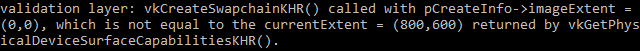

:pp: {plus}{plus}

= 交换链

Vulkan 没有「默认帧缓冲区」的概念，因此它需要一套基础设施来持有我们渲染所用的缓冲区，直到把这些图像显示到屏幕上。这套基础设施称为 *交换链*，在 Vulkan 中必须显式创建。交换链本质上是一个图像队列，队列中的图像等待被呈现到屏幕。我们的应用程序会获取其中一张图像并在其上绘制，然后把这张图像归还到队列。队列的具体工作方式以及从队列中呈现图像的条件，取决于交换链是如何设置的。不过，交换链的总体用途是让图像的呈现与屏幕的刷新率同步。

== 检查交换链支持

由于种种原因，并非所有显卡都能直接把图像呈现到屏幕上，例如有些显卡是为服务器设计的，根本没有显示输出。其次，由于图像呈现与窗口系统以及和窗口关联的表面紧密绑定，它并不属于 Vulkan 核心。你必须在查询到支持之后，启用 `VK_KHR_swapchain` 设备扩展。

为此，我们首先扩展 `createLogicalDevice` 函数，检查该扩展是否受支持。前面我们已经见过如何列出 `vk::raii::PhysicalDevice` 所支持的扩展，所以做这件事应该相当直接。注意 Vulkan 头文件提供了一个好用的宏 `vk::KHRSwapchainExtensionName`，它被定义为 `VK_KHR_swapchain`。使用这个宏的好处是，编译器能帮你发现拼写错误。

首先声明一个所需设备扩展的列表，类似之前要启用的验证层列表。

[,c++]
----
std::vector<const char*> requiredDeviceExtension = {
    vk::KHRSwapchainExtensionName};
----

需要注意，正如我们在上一章检查过的，呈现队列可用就意味着交换链扩展一定受支持。我们在 xref:../00_Setup/04_Logical_device_and_queues.adoc[创建逻辑设备]时已经把 `requiredDeviceExtension` 传给了 `vk::DeviceCreateInfo`，因此该扩展已经启用，这里不需要再写额外的设备创建代码。

== 查询交换链支持详情

仅仅检查交换链是否可用还不够，因为它可能和我们的窗口表面不兼容。创建交换链涉及的设置也比创建实例和设备多得多，所以在继续之前，我们还需要查询更多细节。

基本上有三类属性需要检查：

* 基本表面能力（交换链中图像的最小/最大数量，图像的最小/最大宽度和高度）
* 表面格式（像素格式、色彩空间）
* 可用的呈现模式

本节介绍如何查询包含这些信息的结构体。这些结构体的含义以及它们具体包含哪些数据，将在下一节讨论。

先从基本表面能力开始。这些属性查询起来很直接，会返回到单个 `vk::SurfaceCapabilitiesKHR` 结构体中。

[,c++]
----
auto surfaceCapabilities = physicalDevice.getSurfaceCapabilitiesKHR( *surface );
----

该函数在确定支持的能力时，会把指定的 `vk::SurfaceKHR` 窗口表面考虑在内。所有支持查询函数都把它作为第一个参数，因为它是交换链的核心组成部分。

下一步是查询支持的表面格式。

[,c++]
----
std::vector<vk::SurfaceFormatKHR> availableFormats = physicalDevice.getSurfaceFormatsKHR( *surface );
----

最后，查询支持的呈现模式的方式完全相同，使用 `vk::raii::PhysicalDevice::getSurfacePresentModesKHR`：

[,c++]
----
std::vector<vk::PresentModeKHR> availablePresentModes = physicalDevice.getSurfacePresentModesKHR( *surface );
----

现在所有细节都已齐备。对本教程而言，只要针对我们使用的窗口表面至少有一种受支持的图像格式和一种受支持的呈现模式，交换链支持就算足够。重要的是，只有在确认扩展可用之后，我们才应该尝试查询交换链支持。

== 为交换链选择合适的设置

交换链中可能仍有许多不同模式，其最优程度各不相同。现在我们写几个函数，为尽可能好的交换链找出合适的设置。需要确定三类设置：

* 表面格式（颜色深度）
* 呈现模式（把图像「交换」到屏幕的条件）
* 交换范围（交换链中图像的分辨率）

对每一项设置，我们心里都有一个理想值：如果可用就用它，否则就写一些逻辑来找次优的选择。

=== 表面格式

这项设置的函数一开始是这样。稍后我们会把 `SwapChainSupportDetails` 结构体的 `formats` 成员作为参数传入。

[,c++]
----
vk::SurfaceFormatKHR chooseSwapSurfaceFormat(std::vector<vk::SurfaceFormatKHR> const &availableFormats)
{
    assert(!availableFormats.empty());
    return availableFormats[0];
}
----

每个 `vk::SurfaceFormatKHR` 条目包含 `format` 和 `colorSpace` 成员。`format` 成员指定颜色通道及其类型。例如 `vk::Format::eB8G8R8A8Srgb` 表示按 B、G、R、alpha 的顺序存储各通道，每个通道为 8 位无符号整数，每像素共 32 位。`colorSpace` 成员通过 `vk::ColorSpaceKHR::eSrgbNonlinear` 标志指示是否支持 SRGB 色彩空间。

如果可用，色彩空间我们就用 SRGB，因为 link:http://stackoverflow.com/questions/12524623/[它能带来更准确的感知颜色]。它基本上也是图像的标准色彩空间，比如我们后面会用到的纹理。因此我们也应该使用 SRGB 颜色格式，其中最常用的一种是 `vk::Format::eB8G8R8A8Srgb`。

我们遍历列表，看看首选的组合是否可用：

[,c++]
----
const auto formatIt = std::ranges::find_if(
    availableFormats,
     { return format.format == vk::Format::eB8G8R8A8Srgb && format.colorSpace == vk::ColorSpaceKHR::eSrgbNonlinear; });
}
----

如果找不到，我们本可以按「好坏」给可用格式排序，但大多数情况下直接采用列出的第一个格式就可以了。

[,c++]
----
vk::SurfaceFormatKHR chooseSwapSurfaceFormat(const std::vector<vk::SurfaceFormatKHR>& availableFormats) {
    const auto formatIt = std::ranges::find_if(
        availableFormats,
         { return format.format == vk::Format::eB8G8R8A8Srgb && format.colorSpace == vk::ColorSpaceKHR::eSrgbNonlinear; });
    return formatIt != availableFormats.end() ? *formatIt : availableFormats[0];
}
----

=== 呈现模式

呈现模式可以说是交换链最重要的设置，因为它代表把图像显示到屏幕的实际条件。Vulkan 中有四种可用模式：

* `vk::PresentModeKHR::eImmediate`：应用程序提交的图像会立即传输到屏幕，这可能导致撕裂。
* `vk::PresentModeKHR::eFifo`：交换链是一个队列，显示器刷新时从队首取走一张图像，程序则把渲染好的图像插入队尾。如果队列已满，程序就必须等待。这是最接近现代游戏中垂直同步的模式。显示器刷新的那一刻称为「垂直消隐」。
* `vk::PresentModeKHR::eFifoRelaxed`：只有当应用程序迟到、且上一次垂直消隐时队列为空的情况下，该模式才与上一种不同。此时它不再等待下一次垂直消隐，而是在图像最终到达时立即传输。这可能造成可见的撕裂。
* `vk::PresentModeKHR::eMailbox`：这是第二种模式的另一种变体。队列满时它不会阻塞应用程序，而是直接用更新的图像替换已在队列中的图像。该模式可以在避免撕裂的同时尽可能快地渲染帧，延迟问题比标准垂直同步更少。这通常被称为「三缓冲」，不过仅仅存在三个缓冲区并不必然意味着帧率不受限制。

只有 `vk::PresentModeKHR::eFifo` 模式保证可用，所以我们同样得写一个函数来找可用的最佳模式：

[,c++]
----
vk::PresentModeKHR chooseSwapPresentMode(std::vector<vk::PresentModeKHR> const &availablePresentModes)
{
    return vk::PresentModeKHR::eFifo;
}
----

我认为如果不在意能耗，`vk::PresentModeKHR::eMailbox` 是很好的折中。它既能避免撕裂，又能通过一直渲染到垂直消隐前的最新图像来保持相当低的延迟。在更看重能耗的移动设备上，你大概应该改用 `vk::PresentModeKHR::eFifo`。现在我们遍历列表，看看 `vk::PresentModeKHR::eMailbox` 是否可用：

[,c++]
----
vk::PresentModeKHR chooseSwapPresentMode(std::vector<vk::PresentModeKHR> const &availablePresentModes)
{
    assert(std::ranges::any_of(availablePresentModes,  { return presentMode == vk::PresentModeKHR::eFifo; }));
    return std::ranges::any_of(availablePresentModes,
                                { return vk::PresentModeKHR::eMailbox == value; }) ?
               vk::PresentModeKHR::eMailbox :
               vk::PresentModeKHR::eFifo;
}
----

=== 交换范围

只剩最后一个主要属性，为此我们再添加一个函数：

[,c++]
----
vk::Extent2D chooseSwapExtent(vk::SurfaceCapabilitiesKHR const &capabilities)
{}
----

交换范围指交换链图像的分辨率，它几乎总是精确等于我们绘制所用窗口的分辨率_（以像素为单位）_（稍后会详细说明）。可能的分辨率范围定义在 `vk::SurfaceCapabilitiesKHR` 结构体中。Vulkan 通过设置 `currentExtent` 成员中的宽度和高度，来告诉我们就用窗口的分辨率。不过某些窗口管理器确实允许我们有所不同，这通过把 `currentExtent` 的宽度和高度设为特殊值来表示：`uint32_t` 的最大值。这种情况下，我们要在 `minImageExtent` 和 `maxImageExtent` 范围内挑选与窗口最匹配的分辨率。但我们必须以正确的单位来指定分辨率。

GLFW 在度量尺寸时使用两种单位：像素和 link:https://www.glfw.org/docs/latest/intro_guide.html#coordinate_systems[屏幕坐标]。例如我们之前创建窗口时指定的分辨率 `{WIDTH, HEIGHT}` 就是以屏幕坐标度量的。但 Vulkan 使用像素，所以交换范围也必须以像素为单位指定。不幸的是，如果你使用高 DPI 显示器（比如 Apple 的 Retina 显示器），屏幕坐标与像素并不对应。由于像素密度更高，窗口的像素分辨率会比屏幕坐标分辨率更大。因此，如果 Vulkan 没有替我们固定交换范围，我们就不能直接使用原来的 `{WIDTH, HEIGHT}`。此时必须先调用 `glfwGetFramebufferSize` 查询窗口的像素分辨率，再把它与最小和最大图像范围进行匹配。

[,c++]
----
#include <cstdint> // Necessary for uint32_t
#include <limits> // Necessary for std::numeric_limits
#include <algorithm> // Necessary for std::clamp

...

vk::Extent2D chooseSwapExtent(vk::SurfaceCapabilitiesKHR const &capabilities)
{
    // currentExtent is only set to the special "undefined" value described above
    // when the window manager lets us choose the extent ourselves; any other value
    // means the surface already dictates a fixed extent that we must use as-is.
    if (capabilities.currentExtent.width != std::numeric_limits<uint32_t>::max())
    {
        return capabilities.currentExtent;
    }
    int width, height;
    glfwGetFramebufferSize(window, &width, &height);

    return {
        std::clamp<uint32_t>(width, capabilities.minImageExtent.width, capabilities.maxImageExtent.width),
        std::clamp<uint32_t>(height, capabilities.minImageExtent.height, capabilities.maxImageExtent.height)
    };
}
----

这里使用 `clamp` 函数把 `width` 和 `height` 的值限制在实现所支持的最小与最大范围之间。

== 创建交换链

现在我们有了这些辅助函数来处理运行时要做的各项选择，终于掌握了创建一个可用交换链所需的全部信息。

创建 `createSwapChain` 函数，一开始先用这些调用的结果，并确保在 `initVulkan` 中于逻辑设备创建之后调用它。

[,c++]
----
void initVulkan() {
    createInstance();
    setupDebugMessenger();
    createSurface();
    pickPhysicalDevice();
    createLogicalDevice();
    createSwapChain();
}

void createSwapChain() {
    vk::SurfaceCapabilitiesKHR surfaceCapabilities = physicalDevice.getSurfaceCapabilitiesKHR( *surface );
    swapChainExtent = chooseSwapExtent(surfaceCapabilities);
    uint32_t minImageCount = chooseSwapMinImageCount(surfaceCapabilities);
    
    std::vector<vk::SurfaceFormatKHR> availableFormats = physicalDevice.getSurfaceFormatsKHR(*surface);
    swapChainSurfaceFormat = chooseSwapSurfaceFormat(availableFormats);
}
----

除了这些属性，我们还要决定交换链中希望有多少张图像。实现会规定它运行所需的最小数量：

[,c++]
----
uint32_t minImageCount = surfaceCapabilities.minImageCount;
----

不过，只按这个最小值来，有时我们可能得等待驱动完成内部操作，才能获取下一张可供渲染的图像。实践中，通常会在严格最小值之上多申请几张图像，给自己留出余量——下面的辅助函数至少申请三张图像，同时确保不超过实现支持的最大图像数，其中 `0` 是特殊值，表示没有上限：

[,c++]
----
uint32_t chooseSwapMinImageCount(vk::SurfaceCapabilitiesKHR const &surfaceCapabilities)
{
    auto minImageCount = std::max(3u, surfaceCapabilities.minImageCount);
    if ((0 < surfaceCapabilities.maxImageCount) && (surfaceCapabilities.maxImageCount < minImageCount))
    {
        minImageCount = surfaceCapabilities.maxImageCount;
    }
    return minImageCount;
}
----

按照 Vulkan 对象的传统，创建交换链对象需要填写一个很大的结构体。平心而论，交换链是相当复杂的对象，因此它属于 Vulkan 中较大的 createInfo 结构体之一：

[,c++]
----
vk::SwapchainCreateInfoKHR swapChainCreateInfo{.surface          = *surface,
                                               .minImageCount    = minImageCount,
                                               .imageFormat      = swapChainSurfaceFormat.format,
                                               .imageColorSpace  = swapChainSurfaceFormat.colorSpace,
                                               .imageExtent      = swapChainExtent,
                                               .imageArrayLayers = 1,
                                               .imageUsage       = vk::ImageUsageFlagBits::eColorAttachment,
                                               .imageSharingMode = vk::SharingMode::eExclusive,
                                               .preTransform     = surfaceCapabilities.currentTransform,
                                               .compositeAlpha   = vk::CompositeAlphaFlagBitsKHR::eOpaque,
                                               .presentMode      = chooseSwapPresentMode(availablePresentModes),
                                               .clipped          = true};
};
----

[,c++]
----
    .imageArrayLayers = 1,
----

`imageArrayLayers` 指定每张图像由多少层组成。除非你在开发立体 3D 应用，否则它始终是 `1`。

[,c++]
----
    .imageUsage = vk::ImageUsageFlagBits::eColorAttachment,
----

`imageUsage` 位域指定我们要把交换链中的图像用于何种操作。本教程中我们会直接渲染到这些图像上，也就是把它们用作颜色附件。也可能你会先渲染到另一张单独的图像，以便执行后处理之类的操作。那时你可以改用 `vk::ImageUsageFlagBits::eTransferDst` 之类的值，并通过内存操作把渲染好的图像传输到交换链图像上。

[,c++]
----
    .imageSharingMode = vk::SharingMode::eExclusive,
----

`imageSharingMode` 指定如何处理可能跨多个队列族使用的交换链图像。处理被多个队列访问的图像有两种方式：

* `vk::SharingMode::eExclusive`：图像在任一时刻只属于一个队列族，在另一个队列族中使用它之前必须显式转移所有权。该选项性能最好。
* `vk::SharingMode::eConcurrent`：图像可以跨多个队列族使用，无需显式转移所有权。

如果队列族不同，你可以使用并发模式，从而避免处理所有权转移那部分内容，因为其中涉及的一些概念更适合稍后讲解。并发模式要求你通过 `queueFamilyIndexCount` 和 `pQueueFamilyIndices` 参数预先指定在哪些队列族之间共享所有权。并发模式要求至少指定两个不同的队列族。如果图形队列族和呈现队列族是同一个——大多数硬件都是如此——那么我们应当坚持使用独占模式。

[,c++]
----
    .preTransform     = surfaceCapabilities.currentTransform,
----

如果受支持（见 `capabilities` 中的 `supportedTransforms`），我们可以指定对交换链中的图像应用某种变换，比如顺时针旋转 90 度或水平翻转。要表示不想要任何变换，只需指定当前变换即可。

[,c++]
----
    .compositeAlpha   = vk::CompositeAlphaFlagBitsKHR::eOpaque,
----

`compositeAlpha` 字段指定 alpha 通道是否应参与与窗口系统中其他窗口的混合。你几乎总是希望直接忽略 alpha 通道，因此使用 `vk::CompositeAlphaFlagBitsKHR::eOpaque`。

[,c++]
----
    .presentMode      = chooseSwapPresentMode(availablePresentModes),
    .clipped          = true};
----

`presentMode` 成员不言自明。如果 `clipped` 成员被设为 `vk::True`，就意味着我们不关心被遮挡像素的颜色，例如被前面的其他窗口遮住的部分。除非你确实需要回读这些像素并得到可预期的结果，否则启用裁剪能带来最佳性能。

[,c++]
----
swapChainCreateInfo.oldSwapchain = nullptr;
----

只剩下最后一个字段 `oldSwapChain`。在 Vulkan 中，交换链可能在应用程序运行期间变得无效或不再最优，例如窗口被调整了大小时。这种情况下，交换链实际上需要从头重建，并且必须在这个字段中指定对旧交换链的引用。这是一个复杂的主题，我们将在 xref:03_Drawing_a_triangle/04_Swap_chain_recreation.adoc[后续章节]中进一步了解。目前我们假设只会创建一个交换链，因此可以让该成员保持默认的 `nullptr`。

现在添加类成员来保存 `vk::SwapchainKHR` 对象及其图像：

[,c++]
----
vk::raii::SwapchainKHR swapChain;
std::vector<vk::Image> swapChainImages;
----

现在创建交换链只需调用 `vk::raii::SwapchainKHR` 的构造函数：

[,c++]
----
swapChain       = vk::raii::SwapchainKHR( device, swapChainCreateInfo );
swapChainImages = swapChain.getImages();
----

参数是逻辑设备和交换链创建信息。

现在运行应用程序，确认交换链能成功创建！如果此时在 `vkCreateSwapchainKHR` 中遇到访问违规错误，或者看到类似 `Failed to find 'vkGetInstanceProcAddress' in layer SteamOverlayVulkanLayer.dll` 的消息，请查看 xref:90_FAQ.adoc[常见问题解答]中关于 Steam 覆盖层的条目。

在启用验证层的情况下，试着删掉 `swapChainCreateInfo.imageExtent = extent;` 这一行。你会看到某个验证层立刻发现了这个错误，并打印出有用的提示信息：

== 获取交换链图像

交换链现在已创建完成，剩下的就是取得它包含的 `vk::Image` 对象句柄。后续章节的渲染操作中我们会引用这些句柄。

[,c++]
----
std::vector<vk::Image> swapChainImages = swapChain->getImages();
----

最后一件事：把我们为交换链图像选定的格式和范围保存到成员变量中。后续章节会用到它们。

[,c++]
----
vk::raii::SwapchainKHR swapChain = nullptr;
std::vector<vk::Image> swapChainImages;
vk::SurfaceFormatKHR   swapChainSurfaceFormat;
vk::Extent2D           swapChainExtent;
----

现在我们拥有了一组可以绘制、并且可以呈现到窗口的图像。xref:./02_Image_views.adoc[下一章]将开始介绍如何把这些图像设置为渲染目标，之后我们就进入真正的图形管线和绘制命令了！

link:/attachments/06_swap_chain_creation.cpp[C{pp} 代码]
