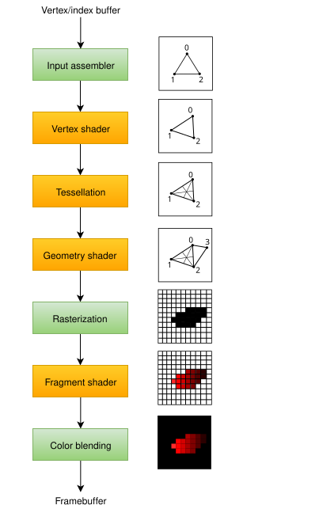

:pp: {plus}{plus}

= 简介

在接下来的几章中，我们将搭建一条图形管线，把它配置为绘制我们的第一个三角形。图形管线是一系列操作，把网格的顶点和纹理一路处理成渲染目标中的像素。下面是一个简化的概览图：

*输入装配器* 从你指定的缓冲区中收集原始顶点数据，还可以使用索引缓冲区来重复某些元素，而无需复制顶点数据本身。

*顶点着色器* 对每个顶点执行，通常施加变换，把顶点位置从模型空间转换到屏幕空间。它还会把逐顶点数据沿管线向下传递。

*细分着色器* 允许你按特定规则细分几何体，以提升网格质量。它常用于让砖墙、楼梯这类表面在近距离观看时不那么平坦。

*几何着色器* 对每个图元（三角形、线段、点）执行，可以丢弃它，也可以输出比输入更多的图元。这与细分着色器类似，但灵活得多。不过它在如今的应用程序中很少使用，因为在除 Intel 集成 GPU 之外的大多数显卡上性能都不太好。此外，几乎所有几何着色器的用例都可以用更现代的网格着色器管线来解决，后者和光线追踪一样是一套全新的管线方案，因此处于标准图形管线设置之外。我们将在后续的教程章节中讨论那套管线。

*光栅化阶段把图元拆分成片元* 片元就是图元在帧缓冲区上填充的像素元素。落在屏幕之外的片元会被丢弃，顶点着色器输出的属性则如图中所示在片元之间插值。通常，位于其他图元片元之后的片元也会在此因深度测试而被丢弃。

*片元着色器* 对每个存活的片元调用，决定片元被写入哪个（些）帧缓冲区，以及用什么样的颜色和深度值写入。它可以用来自顶点着色器的插值数据完成这些，这些数据可以包括纹理坐标和用于光照的法线等内容。

*颜色混合* 阶段执行各种操作，把映射到帧缓冲区同一像素的不同片元混合起来。片元可以简单地相互覆盖、相加，或者根据透明度进行混合。

图中绿色的阶段称为 *固定功能* 阶段。这些阶段允许你用参数微调其操作，但它们的工作方式是预先定义好的。

而橙色的阶段是 `programmable`（可编程）的，这意味着你可以把自己的代码上传到显卡，精确执行你想要的操作。例如，你可以用片元着色器实现从纹理、光照到光线追踪器的任何东西。这些程序同时在许多 GPU 核心上运行，并行处理大量对象，比如顶点和片元。

如果你以前用过 OpenGL、Direct3D 这类较旧的 API，就会习惯于用 `glBlendFunc`、`OMSetBlendState` 之类的调用随意修改任何管线设置。Vulkan 中的图形管线几乎完全不可变，所以如果你想更换着色器、绑定不同的帧缓冲区或修改混合函数，就必须从头重建管线。缺点是你得创建许多管线，以覆盖渲染操作中想使用的各种状态组合。不过，由于你在管线中要执行的所有操作都是预先已知的，驱动可以针对性地做更好的优化。

有些可编程阶段是否使用，取决于你想做什么。例如，如果只绘制简单几何体，可以禁用细分和几何阶段。如果你只关心深度值，也可以禁用片元着色器阶段，这对 link:https://en.wikipedia.org/wiki/Shadow_mapping[阴影贴图]生成很有用。

下一章我们会先创建把三角形画到屏幕上所需的两个可编程阶段：顶点着色器和片元着色器。混合模式、视口、光栅化等固定功能配置将在再下一章设置。在 Vulkan 中搭建图形管线的最后一步是描述输入和输出的帧缓冲区。

创建一个 `createGraphicsPipeline` 函数，在 `initVulkan` 中紧跟 `createImageViews` 之后调用。接下来的几章我们会持续完善这个函数。

[,c++]
----
void initVulkan() {
    createInstance();
    setupDebugMessenger();
    createSurface();
    pickPhysicalDevice();
    createLogicalDevice();
    createSwapChain();
    createImageViews();
    createGraphicsPipeline();
}

...

void createGraphicsPipeline() {

}
----

xref:./01_Shader_modules.adoc[下一章]将讨论真正把内容画到屏幕上所需的着色器模块。

link:/attachments/08_graphics_pipeline.cpp[C{pp} 代码]
