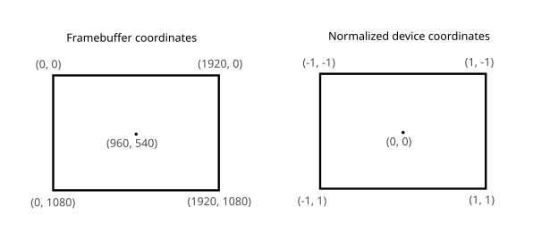
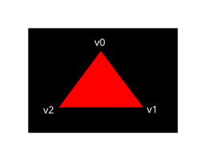
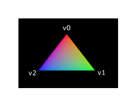

:pp: {plus}{plus}

= 着色器模块

与早期的 API 不同，Vulkan 中的着色器代码必须以字节码格式提供，而不是
https://en.wikipedia.org/wiki/OpenGL_Shading_Language[GLSL]、
https://shader-slang.org/slang/user-guide/[Slang]、
https://en.wikipedia.org/wiki/High-Level_Shading_Language[HLSL] 这类人类可读的语法。
这种字节码格式称为 https://www.khronos.org/spir[SPIR-V]，专为配合 Vulkan（一个 Khronos API）使用而设计。
它既可以用来编写图形着色器，也可以用来编写计算着色器，但本教程只关注
Vulkan 图形管线中用到的着色器。

使用字节码格式的好处在于，GPU 厂商编写的、把着色器代码转换为原生代码的编译器
要简单得多。过去的经验表明，面对 GLSL 这类人类可读的语法时，一些 GPU 厂商
对标准的解读相当随意。如果你恰好在这些厂商的 GPU 上编写较为复杂的着色器，
就可能遇到另一家厂商的驱动因语法错误而拒绝你的代码；更糟的是，着色器因编译器
缺陷而运行结果不同。像 SPIR-V 这样直白的字节码格式，有望避免这些问题。

不过，这并不意味着我们需要手写字节码。Khronos 发布了自己的厂商无关编译器，
它可以把 Slang 编译成 SPIR-V。这个编译器的设计目标是验证你的着色器代码
完全符合标准，并产出一个可以直接随程序分发的 SPIR-V 二进制文件。
你也可以把这个编译器作为库引入，在运行时生成 SPIR-V，但本教程不会这么做，
要等到以后的某一章讲到反射时再说。虽然我们可以通过 `slangc` 直接调用这个
编译器，但在本教程中我们会把它用在 cmake 构建流程里。

Slang 是一种采用 C 风格语法的着色语言。用它编写的程序有一个 main 入口点，
每个对象都会调用一次。与 HLSL 一样，Slang 用参数和返回值表示输入和输出，
并用注解说明这些变量与什么相关。这门语言包含许多辅助图形编程的特性，
例如内置的向量与矩阵原语。它还提供叉积、矩阵-向量乘法这类运算函数、
面向 AI 的自动微分，以及绕向量反射等。向量类型以 `float` 命名，后缀数字
表示元素个数。例如，一个 3D 位置会存放在 `float3` 中。

可以通过 `.x` 这样的成员访问单个分量，这称为 swizzle 运算符，但也可以
同时从多个分量构造新的向量。例如，表达式
`float3(1.0,2.0, 3.0).xy` 的结果是 `float2`。向量的构造函数还可以接受
向量对象与标量值的组合。例如，可以用
`float3(float2(1.0, 2.0), 3.0)` 构造一个 `float3`。

正如上一章提到的，我们需要编写一个顶点着色器和一个片元着色器，才能在屏幕上
画出一个三角形。接下来的两节将介绍这两段 Slang 代码，然后我会展示如何
生成 SPIR-V 二进制文件并把它加载到程序中。

== 顶点着色器

顶点着色器处理每一个传入的顶点。它以顶点的属性作为输入，例如世界坐标、颜色、
法线和纹理坐标。输出则是裁剪坐标下的最终位置，以及需要传递给片元着色器的
属性，例如颜色和纹理坐标。光栅化器随后会把这些值在片元之间插值，
从而产生平滑的渐变。

*裁剪坐标*是顶点着色器输出的四维向量，随后会被整个除以最后一个分量，
转换成*规范化设备坐标*。这些规范化设备坐标是
https://en.wikipedia.org/wiki/Homogeneous_coordinates[齐次坐标]，
它们把帧缓冲区映射到 [-1, 1] × [-1, 1] 的坐标系，大致如下图所示：

如果你以前接触过计算机图形学，应该已经熟悉这些概念了。如果你用过 OpenGL，
会注意到 Y 坐标的符号现在翻转了。Z 坐标则采用与 Direct3D 相同的范围，从 0 到 1。

第一个三角形不做任何变换，我们直接把三个顶点的位置指定为规范化设备坐标，
从而得到下面的形状：

我们可以让顶点着色器直接输出规范化设备坐标：把最后一个分量设为 `1`，
把这些坐标当作裁剪坐标输出即可。这样一来，从裁剪坐标转换到规范化设备坐标的
除法就不会改变任何东西。

通常这些坐标会存放在顶点缓冲区中，但在 Vulkan 里创建顶点缓冲区并填充数据
并不简单。因此，我决定把它推迟到我们享受过三角形出现在屏幕上的满足感之后。
在此期间，我们要做一点不那么正统的事：把坐标直接写进顶点着色器。
代码如下：

[,slang]
----
static float2 positions[3] = float2,
    float2(0.5, 0.5),
    float2(-0.5, 0.5)
);

struct VertexOutput {
    float4 sv_position : SV_Position;
};

[shader("vertex")]
VertexOutput vertMain(uint vid : SV_VertexID) {
    VertexOutput output;
    output.sv_position = float4(positions[vid], 0.0, 1.0);
    return output;
}
----

每个顶点都会调用一次 `vertMain` 函数。参数中带 `SV_VertexID` 注解的内置变量
保存当前顶点的索引。这通常是顶点缓冲区的索引，但在我们的例子里，它是硬编码
顶点数据数组的索引。着色器从常量数组中取出每个顶点的位置，再补上占位的
`z` 和 `w` 分量，得到裁剪坐标下的位置。内置注解 `SV_Position` 标记
VertexOutput 结构体中的输出。如果你熟悉 GLSL 或 HLSL 等其他着色语言，
有一点值得一提：这里没有任何绑定指令。这是 Slang 的特性。Slang 会按
声明顺序自动推断绑定。保存位置的数组声明为 static，是为了告诉编译器
我们在着色器中不需要任何绑定。爱观察的读者会注意到，我们把主函数命名为
vertMain 而不是 main，这是因为 Slang 和 SPIR-V 都支持在一个文件里拥有
多个入口点。当你处理的管线不止一个 vert/frag 着色器组合时，这一点很重要。
以光线追踪为例，即使是很简单的演示也会有四个或更多着色器，每个都不大，
却各自需要单独的文件，这很快就会变得笨拙。Slang 的另一个重要特性是可以
创建着色器库或模块；更深入地探索这门特性丰富的着色语言，就留给读者作为练习。

本教程会演示最佳实践：把着色器放在单个文件里。如果你懂 GLSL，
attachments 文件夹里有这些着色器的 GLSL 版本，它们是对应的直接翻译。

== 片元着色器

顶点着色器给出的位置围成一个三角形，在屏幕上覆盖一片由片元组成的区域。
片元着色器在这些片元上执行，为帧缓冲区（可能不止一个）生成颜色和深度。
下面这个简单的片元着色器把整个三角形都输出为红色：

[,slang]
----
[shader("fragment")]
float4 fragMain() : SV_Target
{
    return float4(1.0, 0.0, 0.0, 1.0);
}
----

和顶点着色器的 `vertMain` 函数对每个顶点调用一次一样，`fragMain` 入口函数
对每个片元调用一次。Slang 中的颜色是四分量向量，包含 R、G、B 和 alpha 通道，
取值范围为 [0, 1]。返回值上的 `SV_Target` 注解表示它是写入帧缓冲区的颜色。
实际上这个注解在这里是可选的：Slang 会自行从返回值推断渲染目标，即使着色器
写入多个帧缓冲区也是如此，所以只有当你想把某个输出显式固定到特定帧缓冲区
索引时，才需要 `SV_Target`。我们在这些示例中保留它，是为了清楚地表明
什么内容写到了哪里。红色直接以 `float4(1.0, 0.0, 0.0, 1.0)` 返回。

== 逐顶点颜色

把整个三角形画成红色并不怎么有趣，像下面这样是不是好看得多？

为此我们需要对两个着色器各做几处修改。首先，为三个顶点分别指定不同的颜色。
现在顶点着色器要像保存位置那样，也包含一个颜色数组：

[,slang]
----
static float3 colors[3] = float3,
    float3(0.0, 1.0, 0.0),
    float3(0.0, 0.0, 1.0)
);
----

现在我们只需把这些逐顶点颜色传给片元着色器，让它把插值后的值输出到帧缓冲区。
在顶点着色器中添加一个颜色输出，并在 `vertMain` 函数中写入它：

[,glsl]
----
struct VertexOutput {
    float3 color;
    float4 sv_position : SV_Position;
};

[shader("vertex")]
VertexOutput vertMain(uint vid : SV_VertexID) {
    VertexOutput output;
    output.sv_position = float4(positions[vid], 0.0, 1.0);
    output.color = colors[vid];
    return output;
}
----

接下来，我们需要在片元着色器中添加一个对应的参数：

[,glsl]
----
[shader("fragment")]
float4 fragMain(VertexOutput inVert) : SV_Target
{
    float3 color = inVert.color;
    return float4(color, 1.0);
}
----

输入变量不一定非要用相同的名字，不过如果它们位于同一个文件里，
不重复写一遍确实很方便。无论用哪种方式，它们都会通过 `location` 指令
指定的索引连接起来。`fragMain` 函数已改为在输出颜色的同时输出 alpha 值。
如上图所示，`fragColor` 的值会在三个顶点之间的片元上自动插值，
从而形成平滑的渐变。

== 编译着色器

在项目的根目录下创建一个名为 `shaders` 的目录，并把着色器保存到名为
`shader.slang` 的文件中。

`shader.slang` 的内容应该是：

[,slang]
----
static float2 positions[3] = float2,
    float2(0.5, 0.5),
    float2(-0.5, 0.5)
);

static float3 colors[3] = float3,
    float3(0.0, 1.0, 0.0),
    float3(0.0, 0.0, 1.0)
);

struct VertexOutput {
    float3 color;
    float4 sv_position : SV_Position;
};

[shader("vertex")]
VertexOutput vertMain(uint vid : SV_VertexID) {
    VertexOutput output;
    output.sv_position = float4(positions[vid], 0.0, 1.0);
    output.color = colors[vid];
    return output;
}

[shader("fragment")]
float4 fragMain(VertexOutput inVert) : SV_Target
{
    float3 color = inVert.color;
    return float4(color, 1.0);
}
----

现在我们要用 `slangc` 程序把它们编译成 SPIR-V 字节码。

*Windows*

创建一个 `compile.bat` 文件，内容如下：

[,bash]
----
C:/VulkanSDK/x.x.x.x/bin/slangc.exe shader.slang -target spirv -profile spirv_1_4 -emit-spirv-directly -fvk-use-entrypoint-name -entry vertMain -entry fragMain -o slang.spv
----

把 `slangc.exe` 的路径替换为你安装 Vulkan SDK 的位置。双击该文件即可运行。

*Linux*

创建一个 `compile.sh` 文件，内容如下：

[,bash]
----
/home/user/VulkanSDK/x.x.x.x/x86_64/bin/slangc shader.slang -target spirv -profile spirv_1_4 -emit-spirv-directly -fvk-use-entrypoint-name -entry vertMain -entry fragMain -o slang.spv
----

把 `slangc` 的路径替换为你安装 Vulkan SDK 的位置。用 `chmod +x compile.sh`
让脚本可执行，然后运行它。

*平台相关说明结束*

这两条命令让编译器读取 Slang 源文件，并通过 `-o`（output）标志直接输出
SPIR-V 1.4 字节码文件。

Note: SlangC 原生支持 SPIR-V 1.3 及以上版本，无需先输出 GLSL 再转成 SPIR-V。
虽然本教程的一切都能在 SPIR-V 1.0 下工作，但那需要我们把 Slang 着色器
拆成多个文件，这就引出一个问题：意义何在？面向 SPIR-V 1.4 意味着你使用的是
一个功能更完备的标准版本，而不是更老旧、限制更多的版本。

如果着色器里有语法错误，编译器会像你预期的那样告诉你行号和问题。
比如试着删掉一个分号，再运行一次编译脚本。也可以不带任何参数运行编译器，
看看它支持哪些标志。例如它还能把字节码输出为人类可读的格式，这样你就能
确切看到着色器在做什么，以及这一阶段应用了哪些优化。

在命令行里编译着色器是最直接的做法之一，但本教程采用的最佳方式是创建一个
CMake 函数：

[,cmake]
----
function (add_slang_shader_target TARGET)
  cmake_parse_arguments ("SHADER" "" "" "SOURCES" ${ARGN})
  set (SHADERS_DIR ${CMAKE_CURRENT_LIST_DIR}/shaders)
  set (ENTRY_POINTS -entry vertMain -entry fragMain)
  add_custom_command (
          OUTPUT ${SHADERS_DIR}
          COMMAND ${CMAKE_COMMAND} -E make_directory ${SHADERS_DIR}
  )
  add_custom_command (
          OUTPUT  ${SHADERS_DIR}/slang.spv
          COMMAND ${SLANGC_EXECUTABLE} ${SHADER_SOURCES} -target spirv -profile spirv_1_4 -emit-spirv-directly -fvk-use-entrypoint-name ${ENTRY_POINTS} -o slang.spv
          WORKING_DIRECTORY ${SHADERS_DIR}
          DEPENDS ${SHADERS_DIR} ${SHADER_SOURCES}
          COMMENT "Compiling Slang Shaders"
          VERBATIM
  )
  add_custom_target (${TARGET} DEPENDS ${SHADERS_DIR}/slang.spv)
endfunction()
----

然后就可以像这样把 Slang 构建步骤加到你的目标中：

[,cmake]
----
add_slang_shader_target( foo SOURCES ${SHADER_SLANG_SOURCES})
add_dependencies(bar foo)
----

== 加载着色器

既然已经有了生成 SPIR-V 着色器的方法，接下来就该把它们加载到程序里，
好在某个时刻接入图形管线。我们先写一个简单的辅助函数，
从文件中读取二进制数据。

[,c++]
----
#include <fstream>

...

static std::vector<char> readFile(const std::string& filename) {
    std::ifstream file(filename, std::ios::ate | std::ios::binary);

    if (!file.is_open()) {
        throw std::runtime_error("failed to open file!");
    }
}
----

`readFile` 函数会读取指定文件的全部字节，并以 `std::vector` 管理的字节数组
返回。我们先用两个标志打开文件：

* `ate`：从文件末尾开始读取
* `binary`：以二进制方式读取文件（避免文本转换）

从文件末尾开始读取的好处是，我们可以用读取位置确定文件大小，并分配缓冲区：

[,c++]
----
std::vector<char> buffer(file.tellg());
----

接着，我们可以回到文件开头，一次性读取所有字节：

[,c++]
----
file.seekg(0, std::ios::beg);
file.read(buffer.data(), static_cast<std::streamsize>(buffer.size()));
----

最后关闭文件并返回字节：

[,c++]
----
file.close();

return buffer;
----

现在我们在 `createGraphicsPipeline` 中调用这个函数，加载两个着色器的字节码：

[,c++]
----
void createGraphicsPipeline() {
    auto shaderCode = readFile("shaders/slang.spv");
}
----

打印缓冲区大小，检查它是否与文件的实际字节数一致，以确保着色器被正确加载。
注意代码是二进制数据，不需要以 null 结尾，稍后我们会明确指定它的大小。

== 创建着色器模块

在把代码传给管线之前，我们必须用 `vk::raii::ShaderModule` 对象把它包装起来。
为此我们创建一个辅助函数 `createShaderModule`。

[,c++]
----
[[nodiscard]] vk::raii::ShaderModule createShaderModule(const std::vector<char>& code) const
{
}
----

该函数接收装着字节码的缓冲区作为参数，并据此创建 `vk::raii::ShaderModule`。

创建着色器模块很直接，只需指定字节码缓冲区的指针及其长度。这些信息通过
`vk::ShaderModuleCreateInfo` 结构体给出。唯一需要注意的是，字节码大小
以字节为单位，而字节码指针是 `uint32_t` 指针而不是 `char` 指针。因此，
我们需要像下面这样用 `reinterpret_cast` 转换指针。做这种转换时，还要确保
数据满足 `uint32_t` 的对齐要求。好在我们把数据存放在 `std::vector` 中，
默认分配器已经保证数据满足最坏情况下的对齐要求。

[,c++]
----
vk::ShaderModuleCreateInfo createInfo{ .codeSize = code.size() * sizeof(char), .pCode = reinterpret_cast<const uint32_t*>(code.data()) };
----

然后就可以用构造函数创建 `vk::raii::ShaderModule`：

[,c++]
----
vk::raii::ShaderModule shaderModule{ device, createInfo };
----

参数与之前的对象创建函数相同：逻辑设备和创建信息结构体的引用。
创建着色器模块后，装着代码的缓冲区可以立即释放。
记得返回创建好的着色器模块：

[,c++]
----
return shaderModule;
----

着色器模块只是对之前从文件加载的着色器字节码以及其中定义的函数的一层薄包装。
把 SPIR-V 字节码编译、链接成 GPU 可执行的机器码，要等到创建图形管线时
才发生。这意味着管线创建一结束，我们就可以销毁着色器模块，因此我们会把它们
做成 `createGraphicsPipeline` 函数中的局部变量而不是类成员：

[,c++]
----
void createGraphicsPipeline() {
    vk::raii::ShaderModule shaderModule = createShaderModule(readFile("shaders/slang.spv"));
----

== 着色器阶段创建

要真正使用这些着色器，我们需要通过 `vk::PipelineShaderStageCreateInfo`
结构体把它们分配到特定的管线阶段，这属于实际创建管线过程的一部分。

我们先为顶点着色器填写结构体，同样是在 `createGraphicsPipeline` 函数中。

[,c++]
----
vk::PipelineShaderStageCreateInfo vertShaderStageInfo{ .stage = vk::ShaderStageFlagBits::eVertex, .module = shaderModule,  .pName = "vertMain" };
----

第一个参数是我们要操作的阶段。接下来两个参数指定包含着色器代码的模块，
以及要调用的函数，也就是_入口点_。
这意味着可以把多个片元着色器合并到一个着色器模块中，用不同的入口点区分
它们的行为。

还有一个（可选的）成员 `pSpecializationInfo`，我们这里不会用到，
但值得一谈。它允许你为着色器常量指定值。你可以只用一个着色器模块，
在创建管线时为其中用到的常量指定不同的值，从而配置它的行为。
这比在渲染时用变量配置着色器更高效，因为编译器可以做一些优化，
比如消除依赖这些值的 `if` 语句。
如果你没有这类常量，可以把该成员设为 `nullptr`，我们的结构体初始化会自动这样做。

为片元着色器修改这个结构体很简单：

[,c++]
----
vk::PipelineShaderStageCreateInfo fragShaderStageInfo{ .stage = vk::ShaderStageFlagBits::eFragment, .module = shaderModule, .pName = "fragMain" };
----

最后定义一个包含这两个结构体的数组，稍后在真正的管线创建步骤中我们会用它来引用它们。

[,c++]
----
vk::PipelineShaderStageCreateInfo shaderStages[] = {vertShaderStageInfo, fragShaderStageInfo};
----

管线中可编程阶段的描述就到这里。
在 xref:./02_Fixed_functions.adoc[下一章] 中，我们会看看固定功能阶段。

link:/attachments/09_shader_modules.cpp[C{pp} code] /
link:/attachments/09_shader_base.slang[Slang shader] /
link:/attachments/09_shader_base.vert[GLSL Vertex shader] /
link:/attachments/09_shader_base.frag[GLSL Fragment shader]
