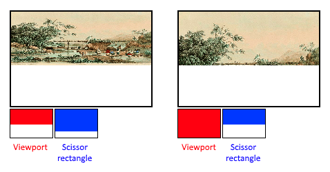

:pp: {plus}{plus}

= 固定功能

较早的图形 API 会为图形管线的多数阶段提供默认状态。在 Vulkan 中，大多数管线状态
都必须由你显式指定，因为它们会被固化到一个不可变的管线状态对象中。本章我们会
填写所有结构体，来配置这些固定功能操作。

== 动态状态

虽然管线状态中的 *大部分* 都需要固化进管线状态，但仍有少量状态 *可以*
在绘制时改变，而不必重建管线。例如视口大小、线宽和混合常量。
如果你想使用动态状态、把这些属性排除在管线之外，就需要像这样填写
`vk::PipelineDynamicStateCreateInfo` 结构体：

[,c++]
----
std::vector<vk::DynamicState> dynamicStates = {vk::DynamicState::eViewport, vk::DynamicState::eScissor};

vk::PipelineDynamicStateCreateInfo dynamicState{.dynamicStateCount = static_cast<uint32_t>(dynamicStates.size()), .pDynamicStates = dynamicStates.data()};
----

这样这些值的配置会被忽略，而你就能（也必须）在绘制时指定数据。
这让配置更灵活，对于视口和剪刀矩形这类状态非常普遍——如果把它们固化进管线状态，
配置反而会更复杂。

== 顶点输入

`vk::PipelineVertexInputStateCreateInfo` 结构体描述将传给顶点着色器的
顶点数据格式。它大致从两个方面描述：

* 绑定（Bindings）：数据之间的间隔，以及数据是逐顶点还是逐实例（参见 https://en.wikipedia.org/wiki/Geometry_instancing[instancing]）
* 属性描述（Attribute descriptions）：传给顶点着色器的属性类型、从哪个绑定加载、以及偏移量

因为我们现在把顶点数据直接硬编码在顶点着色器里，所以填写这个结构体时只需指明
暂时没有顶点数据需要加载。
我们会在顶点缓冲区那一章再回来讨论它。

[,c++]
----
vk::PipelineVertexInputStateCreateInfo vertexInputInfo;
----

`pVertexBindingDescriptions` 和 `pVertexAttributeDescriptions` 成员指向
结构体数组，这些结构体描述了前面提到的加载顶点数据的细节。
把这个结构体添加到 `createGraphicsPipeline` 函数中，紧跟在 `shaderStages`
数组之后。

== 输入装配

`vk::PipelineInputAssemblyStateCreateInfo` 结构体描述两件事：从顶点绘制什么
类型的几何体，以及是否启用图元重启。
前者由 `topology` 成员指定，可以取这样的值：

* `vk::PrimitiveTopology::ePointList`：从顶点生成点
* `vk::PrimitiveTopology::eLineList`：每两个顶点组成一条线，不复用
* `vk::PrimitiveTopology::eLineStrip`：每条线的结束顶点作为下一条线的起始顶点
* `vk::PrimitiveTopology::eTriangleList`：每三个顶点组成一个三角形，不复用
* `vk::PrimitiveTopology::eTriangleStrip`：每个三角形的第二个和第三个顶点作为下一个三角形的前两个顶点

通常顶点是按索引顺序从顶点缓冲区加载的，但使用 _元素缓冲区_ 时，
你可以自己指定要用的索引。
这让你可以做一些优化，比如复用顶点。
如果把 `primitiveRestartEnable` 成员设为 `vk::True`，就可以在 `Strip`
拓扑模式下用一个特殊索引 `0xFFFF` 或 `0xFFFFFFFF` 来断开线和三角形。

本教程从头到尾都打算绘制三角形，所以我们给这个结构体填以下数据：

[,c++]
----
vk::PipelineInputAssemblyStateCreateInfo inputAssembly{.topology = vk::PrimitiveTopology::eTriangleList};
----

== 视口与剪刀矩形

视口基本上描述了输出要渲染到帧缓冲区的哪个区域。
它几乎总是从 `(0, 0)` 到 `(width, height)`，本教程中也是如此。

[,c++]
----
vk::Viewport viewport{0.0f, 0.0f, static_cast<float>(swapChainExtent.width), static_cast<float>(swapChainExtent.height), 0.0f, 1.0f};
----

记住，交换链及其图像的大小可能与窗口的 `WIDTH` 和 `HEIGHT` 不同。
稍后交换链图像会被用作帧缓冲区，所以我们应该沿用它们的大小。

`minDepth` 和 `maxDepth` 值指定帧缓冲区要使用的深度值范围。
这些值必须在 `[0.0f, 1.0f]` 范围内，但 `minDepth` 可以高于 `maxDepth`。
如果你没有做任何特殊处理，就应该沿用标准值 `0.0f` 和 `1.0f`。

视口定义了从图像到帧缓冲区的变换，而剪刀矩形定义像素实际会被存储到哪个区域。
光栅化器会丢弃剪刀矩形之外的所有像素。
它们的作用更像过滤器，而不是变换。
二者的区别如下图所示。
注意左侧的剪刀矩形只是能得到那张图的众多可能之一，只要它比视口大即可。

所以如果我们想绘制到整个帧缓冲区，就应指定一个完全覆盖它的剪刀矩形：

[,c++]
----
vk::Rect2D scissor{vk::Offset2D{ 0, 0 }, swapChainExtent};
----

视口和剪刀矩形既可以在管线中静态指定，也可以作为动态状态在命令缓冲区中设置。
前者与其他状态的做法更一致，但把视口和剪刀矩形状态设为动态往往更方便，
因为它给你大得多的灵活性。
这种做法很普遍，所有实现都能处理这种动态状态而没有性能损失。

选择使用动态视口和剪刀矩形时，需要为管线启用相应的动态状态：

[,c++]
----
std::vector<vk::DynamicState> dynamicStates = {vk::DynamicState::eViewport, vk::DynamicState::eScissor};

vk::PipelineDynamicStateCreateInfo dynamicState{.dynamicStateCount = static_cast<uint32_t>(dynamicStates.size()), .pDynamicStates = dynamicStates.data()};
----

然后在创建管线时只需指定它们的数量：

[,c++]
----
vk::PipelineViewportStateCreateInfo viewportState{.viewportCount = 1, .scissorCount = 1};
----

实际的视口和剪刀矩形稍后会在绘制时设置。

使用动态状态，甚至可以在单个命令缓冲区中指定不同的视口和/或剪刀矩形。

如果不使用动态状态，就需要通过 `vk::PipelineViewportStateCreateInfo`
结构体在管线中设置视口和剪刀矩形。
这会使该管线的视口和剪刀矩形不可变。
任何对这些值的修改都要求用新值创建新的管线。

[,c++]
----
vk::PipelineViewportStateCreateInfo viewportState{.viewportCount = 1, .pViewports = &viewport, .scissorCount = 1, .pScissors = &scissor};
----

无论用哪种方式设置，某些显卡都支持使用多个视口和剪刀矩形，所以这些结构体成员
引用的是数组。
使用多个需要启用一项 GPU 特性（参见逻辑设备的创建）。

== 光栅化器

光栅化器接收顶点着色器给出的顶点所构成的几何体，把它变成片元，
交给片元着色器着色。
它还负责执行 https://en.wikipedia.org/wiki/Z-buffering[深度测试]、
https://en.wikipedia.org/wiki/Back-face_culling[面剔除] 和剪刀测试，
并且可以配置为输出填充整个多边形的片元，或者只输出边缘的片元（线框渲染）。
所有这些都通过 `vk::PipelineRasterizationStateCreateInfo` 结构体配置。

[,c++]
----
vk::PipelineRasterizationStateCreateInfo rasterizer{
    .depthClampEnable        = vk::False,
    .rasterizerDiscardEnable = vk::False,
    .polygonMode             = vk::PolygonMode::eFill,
    .cullMode                = vk::CullModeFlagBits::eBack,
    .frontFace               = vk::FrontFace::eClockwise,
    .depthBiasEnable         = vk::False,
    .lineWidth               = 1.0f};
----

如果把 `depthClampEnable` 设为 `vk::True`，那么超出近平面和远平面的片元会被
夹取到这两个平面，而不是被丢弃。
这在阴影贴图之类的特殊场景中很有用。
使用它需要启用一项 GPU 特性。

如果把 `rasterizerDiscardEnable` 设为 `vk::True`，几何体就永远不会经过
光栅化器阶段。
这基本上禁用了对帧缓冲区的任何输出。

`polygonMode` 决定几何体如何生成片元。
可用的模式有：

* `vk::PolygonMode::eFill`：用片元填充多边形的区域
* `vk::PolygonMode::eLine`：多边形边缘绘制为线
* `vk::PolygonMode::ePoint`：多边形顶点绘制为点

使用除填充之外的任何模式都需要启用一项 GPU 特性。

`cullMode` 变量决定使用哪种面剔除。
你可以禁用剔除、剔除正面、剔除背面，或者两者都剔除。

`frontFace` 变量指定被视为正面的面所采用的顶点顺序，可以是顺时针或逆时针。

光栅化器可以修改深度值：加上一个常量，或者根据片元的斜率施加偏移。
这有时用于阴影贴图，但我们不会用它。
把 `depthBiasEnable` 设为 `vk::False` 即可。

`lineWidth` 成员很直白，它用片元数量表示线的粗细。
支持的最大线宽取决于硬件，任何粗于 `1.0f` 的线都需要你启用 `wideLines`
GPU 特性。

== 多重采样

`vk::PipelineMultisampleStateCreateInfo` 结构体配置多重采样，这是实现
https://en.wikipedia.org/wiki/Multisample_anti-aliasing[抗锯齿] 的方法之一。
它的原理是合并光栅化到同一像素的多个多边形的片元着色器结果。
这主要发生在边缘处，而那里也正是锯齿伪影最明显的地方。
当只有一个多边形映射到某个像素时不必多次运行片元着色器，因此它比简单地以更高
分辨率渲染再降采样便宜得多。
启用它需要启用一项 GPU 特性。

[,c++]
----
vk::PipelineMultisampleStateCreateInfo multisampling{
    .rasterizationSamples = vk::SampleCountFlagBits::e1,
    .sampleShadingEnable = vk::False
};
----

我们会在后面的章节重新讨论多重采样，现在先保持禁用。

== 深度与模板测试

如果你使用深度缓冲和/或模板缓冲区，还需要通过
`vk::PipelineDepthStencilStateCreateInfo` 配置深度测试和模板测试。
我们现在还没有，所以可以直接传 `nullptr` 而不是这类结构体的指针。
我们会在深度缓冲那一章再回来讨论。

== 颜色混合

片元着色器返回颜色之后，该颜色需要与帧缓冲区中已有的颜色合并。
这种变换称为颜色混合，有两种做法：

* 混合新旧值，得到最终颜色
* 用按位运算组合新旧值

配置颜色混合有两类结构体。
第一个结构体 `vk::PipelineColorBlendAttachmentState` 包含每个附加帧缓冲区的
配置，第二个结构体 `vk::PipelineColorBlendStateCreateInfo` 包含 _全局_
 颜色混合设置。
在我们的场景中只有一个帧缓冲区：

[,c++]
----
vk::PipelineColorBlendAttachmentState colorBlendAttachment{
    .blendEnable    = vk::False,	    
    .colorWriteMask = vk::ColorComponentFlagBits::eR
    | vk::ColorComponentFlagBits::eG
    | vk::ColorComponentFlagBits::eB
    | vk::ColorComponentFlagBits::eA};
----

这个逐帧缓冲区的结构体让你可以配置第一种颜色混合方式。
将要执行的操作最好用下面的伪代码来说明：

[,c++]
----
if (blendEnable) {
    finalColor.rgb = (srcColorBlendFactor * newColor.rgb) <colorBlendOp> (dstColorBlendFactor * oldColor.rgb);
    finalColor.a = (srcAlphaBlendFactor * newColor.a) <alphaBlendOp> (dstAlphaBlendFactor * oldColor.a);
} else {
    finalColor = newColor;
}

finalColor = finalColor & colorWriteMask;
----

如果把 `blendEnable` 设为 `vk::False`，片元着色器给出的新颜色会原样通过。
否则会执行两次混合运算来计算新颜色。
得到的颜色会与 `colorWriteMask` 做按位与，以确定哪些通道真正通过。

颜色混合最常见的用法是实现 alpha 混合，即希望新颜色根据其不透明度与旧颜色混合。
此时 `finalColor` 应这样计算：

[,c++]
----
finalColor.rgb = newAlpha * newColor + (1 - newAlpha) * oldColor;
finalColor.a = newAlpha.a;
----

用下面的参数就可以实现：

[,c++]
----
vk::PipelineColorBlendAttachmentState colorBlendAttachment{
    .blendEnable         = vk::True,
    .srcColorBlendFactor = vk::BlendFactor::eSrcAlpha,
    .dstColorBlendFactor = vk::BlendFactor::eOneMinusSrcAlpha,
    .colorBlendOp        = vk::BlendOp::eAdd,
    .srcAlphaBlendFactor = vk::BlendFactor::eOne,
    .dstAlphaBlendFactor = vk::BlendFactor::eZero,
    .alphaBlendOp        = vk::BlendOp::eAdd,
    .colorWriteMask      = vk::ColorComponentFlagBits::eR
    | vk::ColorComponentFlagBits::eG
    | vk::ColorComponentFlagBits::eB
    | vk::ColorComponentFlagBits::eA};
----

你可以在规范里查阅 `vk::BlendFactor` 和 `vk::BlendOp` 枚举中所有可能的操作。

第二个结构体引用所有帧缓冲区的结构体数组，并允许你设置混合常量，
以便在上述计算中作为混合因子使用。

[,c++]
----
vk::PipelineColorBlendStateCreateInfo colorBlending{
    .logicOpEnable = vk::False,
    .logicOp = vk::LogicOp::eCopy,
    .attachmentCount = 1,
    .pAttachments = &colorBlendAttachment};
----

如果你想用第二种混合方式（按位组合），就应该把 `logicOpEnable` 设为 `vk::True`。
然后可以在 `logicOp` 字段中指定按位运算。
注意这会自动禁用第一种方式，效果等同于你把每个附加帧缓冲区的 `blendEnable`
都设为 `vk::False`！
在这个模式下 `colorWriteMask` 同样会被用来确定帧缓冲区中哪些通道真正受影响。
也可以像我们这里这样把两种方式都禁用，此时片元颜色会原样写入帧缓冲区。

== 管线布局

你可以在着色器中使用 `uniform` 值，它们是类似动态状态变量的全局量，
可以在绘制时修改，从而改变着色器的行为而无需重新创建着色器。
它们通常用于把变换矩阵传给顶点着色器，或者在片元着色器中创建纹理采样器。

这些 uniform 值需要在创建管线时通过创建 `vk::PipelineLayout` 对象来指定。
虽然我们到以后的章节才会用到它们，但仍然必须创建一个空的管线布局。

创建一个类成员来保存这个对象，因为稍后我们会从其他函数中引用它：

[,c++]
----
vk::raii::PipelineLayout pipelineLayout = nullptr;
----

然后在 `createGraphicsPipeline` 函数中创建这个对象：

[,c++]
----
vk::PipelineLayoutCreateInfo pipelineLayoutInfo{
    .setLayoutCount = 0,
    .pushConstantRangeCount = 0
};

pipelineLayout = vk::raii::PipelineLayout(device, pipelineLayoutInfo);
----

这个结构体还用于指定 _推送常量_，这是把动态值传给着色器的另一种方式，
我们可能会在以后的章节中介绍。

== 结论

固定功能状态就到这里！
从头配置这一切要花不少功夫，但好处是我们现在几乎完全清楚图形管线中
发生的每一件事！
这减少了因某些组件的默认状态不符合你的预期而遇到意外行为的可能。

在 xref:./03_Dynamic_rendering.adoc[下一步] 中，我们会配置动态渲染，
告诉图形管线将使用哪些附件以及如何使用它们。

link:/attachments/10_fixed_functions.cpp[C{pp} code] /
link:/attachments/09_shader_base.slang[Slang shader] /
link:/attachments/09_shader_base.vert[GLSL Vertex shader] /
link:/attachments/09_shader_base.frag[GLSL Fragment shader]
