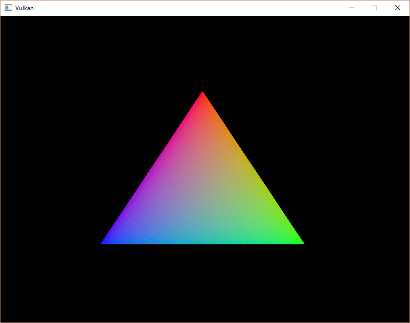
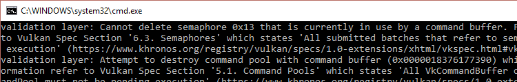

:pp: {plus}{plus}

= 渲染与呈现

本章就是所有内容汇聚到一起的地方。
我们将编写 `drawFrame` 函数，由主循环调用，把三角形放到屏幕上。
先创建这个函数，并从 `mainLoop` 中调用它：

[,c++]
----
void mainLoop() {
    while (!glfwWindowShouldClose(window)) {
        glfwPollEvents();
        drawFrame();
    }
}

...

void drawFrame() {

}
----

== 一帧的轮廓

从高层来看，在 Vulkan 中渲染一帧由一组通用步骤组成：

* 等待上一帧完成
* 从交换链获取一张图像
* 录制命令缓冲区，把场景绘制到该图像上
* 提交已录制的命令缓冲区
* 呈现交换链图像

虽然我们会在后续章节扩展绘制函数，但目前这就是渲染循环的核心。

// Add an image that shows an outline of the frame

== 同步

// Maybe add images for showing synchronization

Vulkan 的一个核心设计理念是：GPU 上执行的同步是显式的。
操作顺序由我们用各种同步原语来定义，这些原语告诉驱动我们希望事情按什么顺序运行。
这意味着许多开始让 GPU 执行工作的 Vulkan API 调用都是异步的，函数会在操作完成之前就返回。

本章中有若干事件必须显式排序，因为它们发生在 GPU 上，例如：

* 从交换链获取一张图像
* 执行绘制到所获取图像上的命令
* 把该图像呈现到屏幕，并归还给交换链

这些事件每一个都通过单次函数调用发起，但全部异步执行。
函数调用会在操作真正完成之前返回，执行顺序也未定义。
这就不妙了，因为每个操作都依赖前一个操作完成。
因此，我们需要研究可以用哪些原语来实现期望的顺序。

=== 信号量

二值信号量用于在队列操作之间建立顺序。
队列操作指的是我们提交到队列的工作，可以来自命令缓冲区，也可以来自函数内部，稍后我们会看到。
队列的例子包括图形队列和呈现队列。
信号量既用于在同一队列内排序工作，也用于在不同队列之间排序工作。

Vulkan 中恰好有两种信号量：二值信号量和时间线信号量。
由于本教程只使用二值信号量，我们不会讨论时间线信号量。
此后提到「信号量」时，都专指二值信号量。

二值信号量要么未发出信号，要么已发出信号。
它初始处于未发出信号的状态。
我们用二值信号量给队列操作排序的方式是：在一个队列操作中把同一个信号量作为「发出信号」信号量提供，在另一个队列操作中把它作为「等待」信号量提供。
例如，假设有信号量 S，以及我们想按顺序执行的队列操作 A 和 B。
我们告诉 Vulkan：操作 A 执行完成后会「发出」信号量 S，而操作 B 在开始执行前会「等待」信号量 S。
当操作 A 完成时，信号量 S 被发出信号，而操作 B 在 S 被发出信号之前不会开始。
操作 B 开始执行后，信号量 S 会自动重置回未发出信号状态，从而可以再次使用。

上述过程的伪代码：

----
vk::raii::CommandBuffer A, B = ... // record command buffers
vk::raii::Semaphore S = ...        // create a semaphore

// enqueue A, signal S when done - starts executing immediately
queue.submit(work: A, signal: S, wait: None)

// enqueue B, wait on S to start
queue.submit(work: B, signal: None, wait: S)
----

注意，在这个代码片段中，两次 `queue.submit()` 调用都会立即返回——等待只发生在 GPU 上。
CPU 会继续运行而不阻塞。
要让 CPU 等待，我们需要另一种同步原语，下面就来介绍。

=== 栅栏

栅栏的用途类似，也用于同步执行，不过它是对 CPU（也就是主机）上的执行进行排序。
具体来说，如果主机需要知道 GPU 何时完成了某件事，我们就使用栅栏。

与信号量类似，栅栏要么处于已发出信号状态，要么处于未发出信号状态。
每当我们提交工作去执行时，都可以给该工作附上一个栅栏。
工作完成后，栅栏会被发出信号。
然后我们可以让主机等待栅栏被发出信号，从而保证主机继续之前该工作已经完成。

一个具体的例子是截图。
假设我们已经完成了 GPU 上必要的工作。
现在需要把图像从 GPU 传输到主机，然后把内存保存到文件。
我们有执行传输的命令缓冲区 A，以及栅栏 F。
我们提交命令缓冲区 A 并附上栅栏 F，然后立即让主机等待 F 发出信号。
这会让主机阻塞，直到命令缓冲区 A 执行完毕。
因此，内存传输已经完成，主机保存文件到磁盘是安全的。

上述过程的伪代码：

----
vk::raii::CommandBuffer A = ... // record command buffer with the transfer
vk::raii::Fence F = ...         // create the fence

// enqueue A, start work immediately, signal F when done
queue.submit(work: A, fence: F)

device.waitForFences(F) // blocks execution until A has finished executing

save_screenshot_to_disk() // can't run until the transfer has finished
----

与信号量的例子不同，这个例子 _确实_ 会阻塞主机的执行。
这意味着主机除了等待执行完成之外不会做任何事情。
在这个场景中，我们必须确保传输完成，才能把截图保存到磁盘。

一般来说，除非必要，最好不要阻塞主机。
我们希望给 GPU 和主机都喂上有用的工作。
等待栅栏发出信号并不是有用的工作。
因此，我们更倾向于使用信号量，或者尚未介绍的其它同步原语来同步工作。

栅栏必须手动重置，才能回到未发出信号状态。
这是因为栅栏用于控制主机的执行，所以由主机决定何时重置栅栏。
相比之下，信号量用于在不涉及主机的情况下给 GPU 上的工作排序。

总结一下：信号量用于指定 GPU 上操作的执行顺序，而栅栏用于让 CPU 与 GPU 保持同步。

=== 该选哪个？

我们有两种同步原语可用，而且恰好有两处需要应用同步：交换链操作，以及等待上一帧完成。
交换链操作我们想用信号量，因为它们发生在 GPU 上，所以只要有可能，我们就不希望让主机干等。
等待上一帧完成则相反，我们想用栅栏，因为需要让主机等待。
这样我们就不会同时绘制超过一帧。
由于我们每帧都会重新录制命令缓冲区，所以在当前帧执行完毕之前，不能把下一帧的工作录制到该命令缓冲区中。
我们不希望在 GPU 还在使用命令缓冲区时覆盖它的现有内容。

== 创建同步对象

我们需要一个信号量来表明已从交换链获取到图像并且可以渲染，另一个信号量来表明渲染已完成、可以呈现，还需要一个栅栏来确保同一时间只渲染一帧。

创建三个类成员来存储这些信号量对象和栅栏对象：

[,c++]
----
vk::raii::Semaphore presentCompleteSemaphore = nullptr;
vk::raii::Semaphore renderFinishedSemaphore  = nullptr;
vk::raii::Fence     drawFence                = nullptr;
----

为了创建信号量，我们添加本部分教程最后一个 `create` 函数：`createSyncObjects`：

[,c++]
----
void initVulkan()
{
    createInstance();
    setupDebugMessenger();
    createSurface();
    pickPhysicalDevice();
    createLogicalDevice();
    createSwapChain();
    createImageViews();
    createGraphicsPipeline();
    createCommandPool();
    createCommandBuffer();
    createSyncObjects();
}

...

void createSyncObjects()
{
}
----

创建信号量需要填写 `vk::SemaphoreCreateInfo`，但在当前版本的 API 中，它实际上没有任何与本教程相关的字段：

[,c++]
----
void createSyncObjects()
{
  presentCompleteSemaphore = vk::raii::Semaphore(device, vk::SemaphoreCreateInfo());
  renderFinishedSemaphore  = vk::raii::Semaphore(device, vk::SemaphoreCreateInfo());
  drawFence                = vk::raii::Fence(device, {.flags = vk::FenceCreateFlagBits::eSignaled});
}
----

未来版本的 Vulkan API 或扩展可能会像其它结构一样，为 `vk::SemaphoreCreateInfo` 的 `flags` 与 `pNext` 成员添加功能。

接下来进入主绘制函数！

== 等待上一帧

在帧开始时，我们要等到上一帧完成，这样命令缓冲区和信号量才可用。
为此，调用 `vk::raii::Device::waitForFences`：

[,c++]
----
void drawFrame()
{
    auto fenceResult = device.waitForFences(*drawFence, vk::True, UINT64_MAX);
		if (fenceResult != vk::Result::eSuccess)
		{
			throw std::runtime_error("failed to wait for fence!");
		}
		device.resetFences(*drawFence);
}
----

`vk::raii::Device::waitForFences` 函数接受一个栅栏数组，并在主机上等待其中任意一个或全部栅栏发出信号后返回。
我们这里传入的 `vk::True` 表示要等待所有栅栏，不过在只有一个栅栏的情况下无所谓。
这个函数还有一个超时参数，我们把它设为 64 位无符号整数的最大值 `UINT64_MAX`，实际上就是禁用超时。

我们需要确保如果上一帧已经发生过，栅栏会被重置，这样之后才知道要等待它。

接下来，在上一帧完成后从交换链获取一张图像：

[,c++]
----
void drawFrame()
{
    ...
    auto [result, imageIndex] = swapChain.acquireNextImage(UINT64_MAX, *presentCompleteSemaphore, nullptr);
}
----

第一个参数指定图像变为可用的超时时间，单位为纳秒。
使用 64 位无符号整数的最大值意味着实际上禁用了超时。

接下来的两个参数指定同步对象，当呈现引擎用完该图像时它们会被发出信号。
那时我们就可以开始向该图像绘制。
可以指定信号量、栅栏或两者都指定。
这里我们使用 `presentCompleteSemaphore`。

该函数返回一对值：通常的 `vk::Result`，以及变为可用的交换链图像索引。
这个索引指向 `swapChainImages` 数组中的 `vk::Image`。
我们会用这个索引挑选对应的交换链图像视图，然后录制渲染到其中的命令。

== 录制命令缓冲区

拿到指定要使用哪张交换链图像的 `imageIndex` 之后，就可以录制命令缓冲区了。
现在调用 `recordCommandBuffer` 函数录制我们想要的命令。

[,c++]
----
recordCommandBuffer(imageIndex);
----

命令缓冲区录制完毕后，就可以提交它了。

== 提交命令缓冲区

队列提交与同步通过 `vk::SubmitInfo` 结构中的参数来配置。

[,c++]
----
vk::PipelineStageFlags waitDestinationStageMask( vk::PipelineStageFlagBits::eColorAttachmentOutput );
const vk::SubmitInfo   submitInfo{
    .waitSemaphoreCount   = 1,
    .pWaitSemaphores      = &*presentCompleteSemaphore,
    .pWaitDstStageMask    = &waitDestinationStageMask,
    .commandBufferCount   = 1,
    .pCommandBuffers      = &*commandBuffer,
    .signalSemaphoreCount = 1,
    .pSignalSemaphores    = &*renderFinishedSemaphore};
----

前三个参数指定在执行开始前要等待哪些信号量，以及在管线的哪些阶段等待。
我们希望等到图像可用后再写入颜色，所以指定图形管线中写入颜色附件的阶段。
这意味着理论上实现可以在图像尚不可用时就开始执行顶点着色器之类的工作。
`waitStages` 数组的每一项对应 `pWaitSemaphores` 中相同索引的信号量。

下一个参数指定实际要提交执行的命令缓冲区。我们只提交手中的单个命令缓冲区。

`pSignalSemaphores` 参数指定命令缓冲区执行完毕后要发出哪些信号量。
我们的场景中使用 `renderFinishedSemaphore`。

[,c++]
----
queue.submit(submitInfo, *drawFence);
----

现在可以用 `vk::raii::Queue::submit` 把命令缓冲区提交到图形队列。
该函数接受一个 `vk::SubmitInfo` 结构数组作为参数，以便在工作负载大得多时提高效率。
最后一个参数引用一个可选的栅栏，命令缓冲区执行完毕时它会被发出信号。
这样我们就能知道何时可以安全复用命令缓冲区，所以传入 `*drawFence`，并在下一帧等待它。

== 呈现

绘制一帧的最后一步是把结果提交回交换链，让它最终显示在屏幕上。
呈现通过 `drawFrame` 函数末尾的 `vk::PresentInfoKHR` 结构来配置。

[,c++]
----
const vk::PresentInfoKHR presentInfoKHR{
    .waitSemaphoreCount = 1,
    .pWaitSemaphores    = &*renderFinishedSemaphore,
    .swapchainCount     = 1,
    .pSwapchains        = &*swapChain,
    .pImageIndices      = &imageIndex};
----

前两个参数指定在呈现发生之前要等待哪些信号量，和 `vk::SubmitInfo` 一样。
由于我们要等命令缓冲区执行完毕，也就是三角形被绘制出来，所以取那些会被发出信号的信号量并等待它们，也就是使用 `renderFinishedSemaphore`。

接下来的两个参数指定要呈现图像到哪些交换链，以及每个交换链对应的图像索引。
这几乎总是单个。

[,c++]
----
presentInfoKHR.pResults = nullptr; // Optional
----

还有一个可选参数 `pResults`。
它允许你指定一个 `vk::Result` 数组，为每个交换链检查呈现是否成功。
如果你只用一个交换链，就不需要它，因为可以使用呈现函数的返回值。

[,c++]
----
result = queue.presentKHR(presentInfoKHR);
----

`vk::raii::Queue::presentKHR` 函数提交把图像呈现到交换链的请求。
我们会在下一章为 `vk::raii::SwapchainKHR::acquireNextImage` 与 `vk::raii::Queue::presentKHR` 添加错误处理，因为它们的失败并不一定意味着程序应该终止，这与我们目前见过的函数不同。

如果到目前为止你都做对了，那么运行程序时应该会看到类似下面的画面：

____
这个彩色三角形看起来可能与你通常在图形教程中看到的不太一样。
这是因为本教程让着色器在线性色彩空间中插值，然后再转换为 sRGB 色彩空间。
____

耶！
不过遗憾的是，启用验证层后你会发现，程序一关闭就会崩溃。
`debugCallback` 打印到终端的消息告诉了我们原因：

记住，`drawFrame` 中的所有操作都是异步的。
这意味着当我们退出 `mainLoop` 的循环时，绘制与呈现操作可能仍在进行。
在这种情况下清理资源可不是好主意。

为了解决这个问题，我们应该在退出 `mainLoop` 并销毁窗口之前，等待逻辑设备完成操作：

[,c++]
----
void mainLoop() {
    while (!glfwWindowShouldClose(window)) {
        glfwPollEvents();
        drawFrame();
    }

    device.waitIdle();
}
----

你也可以用 `vk::raii::Queue::waitIdle` 等待特定命令队列中的操作完成。
这些函数可以作为一种非常基础的同步手段。
你会看到，现在关闭窗口时程序能正常退出。

== 结语

在大约 500 多行代码之后，我们终于到了能在屏幕上看到东西的阶段！
启动一个 Vulkan 程序确实很费功夫，但要点在于：Vulkan 通过其显式性给了你极大的控制力。
我建议你现在花点时间重读代码，在脑中建立程序里所有 Vulkan 对象用途以及它们相互关系的模型。
从这里开始，我们会在此知识基础上扩展程序的功能。

另外，在后面的章节中，我们会讨论时间线信号量与内存屏障，进一步加深对 Vulkan 中同步的理解。
同步是发挥 Vulkan 真正威力的最大领域之一，所以它相当复杂。虽然前几次理解起来比较困难，但它确实是后续内容的基础。等到你的工具箱里有更多工具来处理更细微的事情时，真的会越来越容易。

xref:./03_Frames_in_flight.adoc[下一章]将扩展渲染循环，以处理多个飞行帧。

link:/attachments/15_hello_triangle.cpp[C{pp} 代码] /
link:/attachments/09_shader_base.slang[Slang 着色器] /
link:/attachments/09_shader_base.vert[GLSL 顶点着色器] /
link:/attachments/09_shader_base.frag[GLSL 片元着色器]
