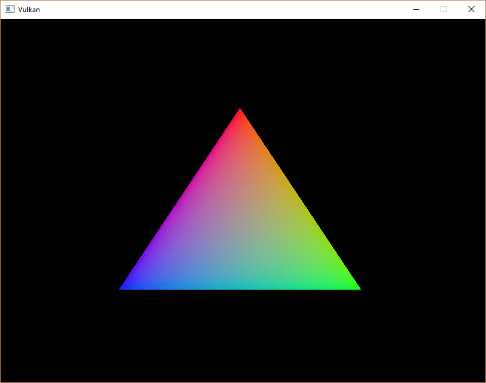
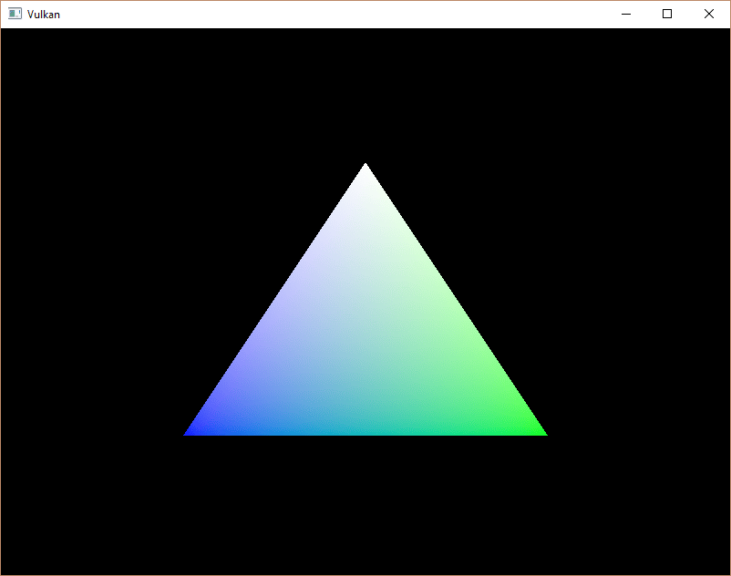

:pp: {plus}{plus}

= 创建顶点缓冲区

== 简介

Vulkan 中的缓冲区是用于存储任意数据的内存区域，显卡可以读取这些数据。
它们可以用来存储顶点数据（本章就是这么做的），也有许多其他用途，我们会在后续章节中探讨。
与我们目前处理过的 Vulkan 对象不同，缓冲区不会自动为自己分配内存。
前面几章的工作已经表明，Vulkan API 几乎把一切都交给程序员控制，内存管理就是其中之一。

== 创建缓冲区

新建 `createVertexBuffer` 函数，并在 `initVulkan` 中紧挨着 `createCommandBuffers` 之前调用它。

[,c++]
----
void initVulkan()
{
    createInstance();
    setupDebugMessenger();
    createSurface();
    pickPhysicalDevice();
    createLogicalDevice();
    createSwapChain();
    createImageViews();
    createGraphicsPipeline();
    createCommandPool();
    createVertexBuffer();
    createCommandBuffers();
    createSyncObjects();
}

...

void createVertexBuffer()
{
}
----

创建缓冲区需要填写 `vk::BufferCreateInfo` 结构体。

[,c++]
----
vk::BufferCreateInfo bufferInfo{.size        = sizeof(vertices[0]) * vertices.size(),
                                .usage       = vk::BufferUsageFlagBits::eVertexBuffer,
                                .sharingMode = vk::SharingMode::eExclusive};
----

`size` 字段指定缓冲区的大小（以字节为单位）。
用 `sizeof` 计算顶点数据的字节大小很直接。

`usage` 字段指明缓冲区中的数据将用于哪些用途。
可以用按位或同时指定多个用途。
我们的用例是顶点缓冲区，其他用途类型会在后续章节中介绍。

与交换链中的图像一样，缓冲区也可以由某个特定的队列族独占，或被多个队列族同时共享。
这个缓冲区只会由图形队列使用，所以我们可以采用独占访问。

还有一个 `flags` 字段，用于配置稀疏缓冲区内存。
它现在还不相关，所以留用默认值 `0`。

现在可以用 `vk::raii::Buffer` 构造函数创建缓冲区。
定义一个类成员来保存缓冲区句柄，命名为 `vertexBuffer`。

[,c++]
----
vk::raii::Buffer vertexBuffer = nullptr;

...

void createVertexBuffer() {
		vk::BufferCreateInfo bufferInfo{.size        = sizeof(vertices[0]) * vertices.size(),
		                                .usage       = vk::BufferUsageFlagBits::eVertexBuffer,
		                                .sharingMode = vk::SharingMode::eExclusive};
    vertexBuffer = vk::raii::Buffer(device, bufferInfo);
}
----

该缓冲区应当从创建起一直可用于渲染命令，直到程序结束，并且它不依赖交换链。

== 内存需求

缓冲区已经创建，但还没有为它分配任何内存。
为缓冲区分配内存的第一步，是用名字恰如其分的 `vk::raii::Buffer::getMemoryRequirements` 函数查询它的内存需求。

[,c++]
----
vk::MemoryRequirements memRequirements = vertexBuffer.getMemoryRequirements();
----

`vk::MemoryRequirements` 结构体有三个字段：

* `size`：所需内存的大小（以字节为单位），可能与 `bufferInfo.size` 不同。
* `alignment`：缓冲区在已分配内存区域中起始位置的字节偏移，取决于 `bufferInfo.usage` 和 `bufferInfo.flags`。
* `memoryTypeBits`：适用于该缓冲区的内存类型的位字段。

显卡可以提供多种不同类型的内存供分配。
每种内存在允许的操作和性能特征上各不相同。
我们需要结合缓冲区的需求和我们应用自身的需求，找出要使用的正确内存类型。
为此，我们新建 `findMemoryType` 函数。

[,c++]
----
uint32_t findMemoryType(uint32_t typeFilter, vk::MemoryPropertyFlags properties) {

}
----

首先需要用 `vk::raii::PhysicalDevice::getMemoryProperties` 查询可用内存类型的信息。

[,c++]
----
vk::PhysicalDeviceMemoryProperties memProperties = physicalDevice.getMemoryProperties();
----

`vk::PhysicalDeviceMemoryProperties` 结构体有两个数组：`memoryTypes` 和 `memoryHeaps`。
内存堆是各自独立的内存资源，例如专用 VRAM，以及 VRAM 用尽时在 RAM 中充当交换空间的部分。
不同类型的内存存在于这些堆之中。
现在我们只关心内存类型，而不关心它来自哪个堆，但你可以想象，这会影响性能。

先找出一个适合缓冲区本身的内存类型：

[,c++]
----
for (uint32_t i = 0; i < memProperties.memoryTypeCount; i++)
{
    if ((typeFilter & (1 << i)))
    {
        return i;
    }
}

throw std::runtime_error("failed to find suitable memory type!");
----

`typeFilter` 参数用于指定哪些内存类型是合适的位字段。
这意味着我们可以简单地遍历它们，检查对应位是否被置为 `1`，从而找到合适的内存类型的索引。

不过，我们关心的不只是适合顶点缓冲区的内存类型。
我们还需要能够把顶点数据写入那块内存。
`memoryTypes` 数组由 `vk::MemoryType` 结构体组成，它们指定每种内存所在的堆及其属性。
属性定义了内存的特殊特性，比如能否映射它，以便我们从 CPU 写入。
这个特性由 `vk::MemoryPropertyFlagBits::eHostVisible` 表示，但我们还需要使用 `vk::MemoryPropertyFlagBits::eHostCoherent` 属性。
映射内存时我们会看到原因。

现在可以修改循环，同时检查是否支持这个属性：

[,c++]
----
for (uint32_t i = 0; i < memProperties.memoryTypeCount; i++)
{
    if ((typeFilter & (1 << i)) && (memProperties.memoryTypes[i].propertyFlags & properties) == properties)
    {
        return i;
    }
}
----

我们可能需要不止一个属性，所以应该检查按位与的结果不仅非零，而且等于所需的属性位字段。
如果存在既适合缓冲区、又具备我们所需全部属性的内存类型，就返回它的索引，否则抛出异常。

== 内存分配

现在有了确定正确内存类型的方法，我们就可以填写 `vk::MemoryAllocateInfo` 结构体来实际分配内存。

[,c++]
----
vk::MemoryAllocateInfo memoryAllocateInfo{
    .allocationSize  = memRequirements.size,
    .memoryTypeIndex = findMemoryType(memRequirements.memoryTypeBits, vk::MemoryPropertyFlagBits::eHostVisible | vk::MemoryPropertyFlagBits::eHostCoherent)};
----

现在分配内存只需指定大小和类型，这两者都来自顶点缓冲区的内存需求和我们想要的属性。
定义一个类成员来保存内存句柄，并用 `vk::raii::DeviceMemory` 构造函数分配它。

[,c++]
----
vk::raii::Buffer       vertexBuffer       = nullptr;
vk::raii::DeviceMemory vertexBufferMemory = nullptr;

...

vertexBufferMemory = vk::raii::DeviceMemory(device, memoryAllocateInfo);
----

如果内存分配成功，现在就可以用 `vk::raii::Buffer::bindBufferMemory` 把这块内存与缓冲区关联起来：

[,c++]
----
vertexBuffer.bindMemory( *vertexBufferMemory, 0 );
----

第一个参数不言自明，第二个参数是内存区域内的偏移。
由于这块内存是专门为这个顶点缓冲区分配的，偏移就是 `0`。
如果偏移非零，则要求它能被 `memRequirements.alignment` 整除。

== 填充顶点缓冲区

现在该把顶点数据拷贝到缓冲区了。
做法是用 `vk::raii::DeviceMemory::mapMemory` 把缓冲区内存 https://en.wikipedia.org/wiki/Memory-mapped_I/O[映射] 到 CPU 可访问的内存中。

[,c++]
----
void* data = vertexBufferMemory.mapMemory(0, bufferInfo.size);
----

这个函数让我们访问指定内存资源中由偏移和大小定义的一块区域。
这里的偏移和大小分别是 `0` 和 `bufferInfo.size`。

[,c++]
----
void* data = vertexBufferMemory.mapMemory(0, bufferInfo.size);
memcpy(data, vertices.data(), bufferInfo.size);
vertexBufferMemory.unmapMemory();
----

现在只需用 `memcpy` 把顶点数据拷到映射内存，再用 `vk::raii::DeviceMemory::unmapMemory` 解除映射。
遗憾的是，驱动可能不会立即把数据拷贝到缓冲区内存，比如因为缓存。
也有可能对缓冲区的写入在映射内存中还不可见。
有两种办法处理这个问题：

* 使用主机一致的内存堆，由 `vk::MemoryPropertyFlagBits::eHostCoherent` 表示
* 在写入映射内存之后调用 `vk::raii::Device::flushMappedMemoryRanges`，在从映射内存读取之前调用 `vk::raii::Device::invalidateMappedMemoryRanges`

我们采用了第一种做法，它确保映射内存始终与已分配内存的内容一致。
请记住，这可能比显式刷新性能略差，但下一章我们会看到为什么这无关紧要。

刷新内存范围或使用一致的内存堆，意味着驱动会知道我们对缓冲区的写入，但这并不意味着它们在 GPU 上已经可见。
向 GPU 传输数据是在后台发生的操作，规范只是 https://docs.vulkan.org/spec/latest/chapters/synchronization.html#synchronization-submission-host-writes[告诉我们]，它保证在下一次调用 `vk::raii::Queue::submit` 时完成。

== 绑定顶点缓冲区

现在剩下的就是在渲染操作期间绑定顶点缓冲区。
我们扩展 `recordCommandBuffer` 函数来完成这件事。

[,c++]
----
commandBuffer.bindPipeline(vk::PipelineBindPoint::eGraphics, *graphicsPipeline);

commandBuffer.bindVertexBuffers(0, *vertexBuffer, {0});

commandBuffer.draw(static_cast<uint32_t>(vertices.size()), 1, 0, 0);
----

`vk::raii::CommandBuffer::bindVertexBuffers` 函数用于把顶点缓冲区绑定到绑定，就像上一章设置的那个。
第一个参数是绑定的起始偏移。
第二个参数是要绑定的缓冲区数组。
最后一个参数是一个同样大小的字节偏移数组，表示从何处开始读取顶点数据。
你还应该修改对 `vk::CommandBuffer::draw` 的调用，改为传入缓冲区中的顶点数量，而不是硬编码的数字 `3`。

现在运行程序，你应该会再次看到熟悉的三角形：

试着修改 `vertices` 数组，把顶部顶点的颜色改成白色：

[,c++]
----
const std::vector<Vertex> vertices = {
    {{0.0f, -0.5f}, {1.0f, 1.0f, 1.0f}},
    {{0.5f, 0.5f}, {0.0f, 1.0f, 0.0f}},
    {{-0.5f, 0.5f}, {0.0f, 0.0f, 1.0f}}
};
----

再次运行程序，你应该会看到：

在 xref:./02_Staging_buffer.adoc[暂存缓冲区] 一章中，我们会介绍另一种把顶点数据拷贝到顶点缓冲区的方法，它性能更好，但需要多做一些工作。

link:/attachments/19_vertex_buffer.cpp[C{pp} 代码] /
link:/attachments/19_shader_vertexbuffer.slang[slang 着色器] /
link:/attachments/19_shader_vertexbuffer.vert[GLSL 顶点着色器] /
link:/attachments/19_shader_vertexbuffer.frag[GLSL 片元着色器]
