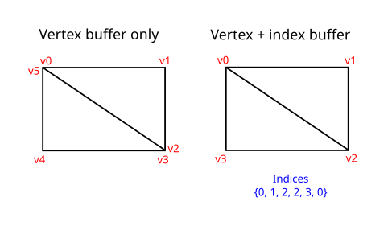
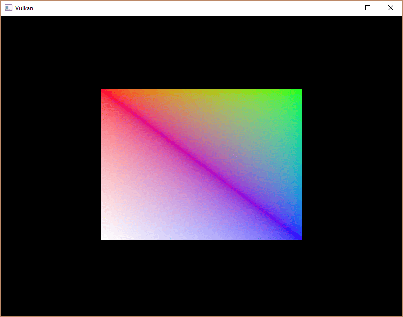

:pp: {plus}{plus}

= 索引缓冲区

== 简介

在真实应用中渲染的 3D 网格，常常会在多个三角形之间共享顶点。
即使只是绘制一个矩形这样简单的事情，就已经出现这种情况了：

绘制一个矩形需要两个三角形，也就是说我们需要一个包含六个顶点的顶点缓冲区。
问题在于有两个顶点的数据需要重复，造成 50% 的冗余。
网格越复杂，情况越糟，顶点平均会被三个三角形复用。
解决这个问题的办法是使用 _索引缓冲区_。

索引缓冲区本质上是一个指向顶点缓冲区的指针数组。
它让你可以重排顶点数据，并为多个顶点复用已有数据。
上面的示意图展示了：如果顶点缓冲区包含四个互不相同的顶点，这个矩形的索引缓冲区会是什么样子。
前三个索引定义右上角的三角形，后三个索引定义左下角三角形的顶点。

== 创建索引缓冲区

本章我们要修改顶点数据并添加索引数据，以绘制示意图中那样的矩形。
修改顶点数据以表示四个角：

[,c++]
----
const std::vector<Vertex> vertices = {
    {{-0.5f, -0.5f}, {1.0f, 0.0f, 0.0f}},
    {{0.5f, -0.5f}, {0.0f, 1.0f, 0.0f}},
    {{0.5f, 0.5f}, {0.0f, 0.0f, 1.0f}},
    {{-0.5f, 0.5f}, {1.0f, 1.0f, 1.0f}}
};
----

左上角是红色，右上角是绿色，右下角是蓝色，左下角是白色。
我们再添加一个新数组 `indices`，用来表示索引缓冲区的内容。
它应与示意图中的索引一致，以绘制右上角和左下角的三角形。

[,c++]
----
const std::vector<uint16_t> indices = {
    0, 1, 2, 2, 3, 0
};
----

根据 `vertices` 中条目的数量，索引缓冲区可以使用 `uint16_t` 或 `uint32_t`。
目前我们可以继续使用 `uint16_t`，因为用到的互不相同的顶点少于 65535 个。

和顶点数据一样，索引也需要上传到一个 `vk::raii::Buffer` 中，GPU 才能访问它们。
定义两个新的类成员来保存索引缓冲区的资源：

[,c++]
----
vk::raii::Buffer       vertexBuffer       = nullptr;
vk::raii::DeviceMemory vertexBufferMemory = nullptr;
vk::raii::Buffer       indexBuffer        = nullptr;
vk::raii::DeviceMemory indexBufferMemory  = nullptr;
----

现在要添加的 `createIndexBuffer` 函数与 `createVertexBuffer` 几乎完全相同：

[,c++]
----
void initVulkan()
{
    ...
    createVertexBuffer();
    createIndexBuffer();
    ...
}

void createIndexBuffer()
{
		vk::DeviceSize bufferSize = sizeof(indices[0]) * indices.size();

		auto [stagingBuffer, stagingBufferMemory] =
		    createBuffer(bufferSize, vk::BufferUsageFlagBits::eTransferSrc, vk::MemoryPropertyFlagBits::eHostVisible | vk::MemoryPropertyFlagBits::eHostCoherent);

		void *data = stagingBufferMemory.mapMemory(0, bufferSize);
		memcpy(data, indices.data(), (size_t) bufferSize);
		stagingBufferMemory.unmapMemory();

		std::tie(indexBuffer, indexBufferMemory) =
		    createBuffer(bufferSize, vk::BufferUsageFlagBits::eIndexBuffer | vk::BufferUsageFlagBits::eTransferDst, vk::MemoryPropertyFlagBits::eDeviceLocal);

		copyBuffer(stagingBuffer, indexBuffer, bufferSize);
}
----

只有两处明显不同。
`bufferSize` 现在等于索引数量乘以索引类型的大小，索引类型可以是 `uint16_t` 或 `uint32_t`。
`indexBuffer` 的用途应该是 `vk::BufferUsageFlagBits::eIndexBuffer`，而不是 `vk::BufferUsageFlagBits::eVertexBuffer`，这是理所当然的。
除此之外，流程完全一样。
我们创建一个暂存缓冲区，把 `indices` 的内容拷贝进去，然后再拷贝到最终的设备本地索引缓冲区。

== 使用索引缓冲区

使用索引缓冲区进行绘制，需要对 `recordCommandBuffer` 做两处修改。
首先需要绑定索引缓冲区，就像我们绑定顶点缓冲区那样。
区别在于，你只能有一个索引缓冲区。
遗憾的是，无法为每个顶点属性使用不同的索引，所以即使只有一个属性不同，我们仍不得不完全复制顶点数据。

[,c++]
----
commandBuffers[frameIndex].bindVertexBuffers(0, *vertexBuffer, {0});
commandBuffers[frameIndex].bindIndexBuffer(*indexBuffer, 0, vk::IndexType::eUint16);
----

索引缓冲区通过 `vk::raii::CommandBuffer::bindIndexBuffer` 绑定，它的参数是索引缓冲区、进入其中的字节偏移以及索引数据的类型。
如前所述，可能的类型是 `vk::IndexType::eUint16` 和 `vk::IndexType::eUint32`。

仅仅绑定索引缓冲区还不会带来任何变化，我们还需要修改绘制命令，告诉 Vulkan 使用索引缓冲区。
删掉 `vk::raii::CommandBuffer::draw` 那一行，换成 `vk::raii::CommandBuffer::drawIndexed`：

[,c++]
----
commandBuffer.drawIndexed(static_cast<uint32_t>(indices.size()), 1, 0, 0, 0);
----

对这个函数的调用与 `vk::raii::CommandBuffer::draw` 非常相似。
前两个参数指定索引数量和实例数量。
我们没有使用实例化，所以只指定 `1` 个实例。
索引数量表示将传给顶点着色器的顶点数量。
下一个参数指定进入索引缓冲区的偏移，使用值 `1` 会让显卡从第二个索引开始读取。
倒数第二个参数指定在按索引访问顶点缓冲区之前加到顶点索引上的偏移。
最后一个参数指定实例化的偏移，我们没有使用它。

现在运行程序，你应该会看到：

你现在知道如何通过索引缓冲区复用顶点来节省内存了。
在将来加载复杂 3D 模型的章节中，这一点会尤为重要。

上一章已经提到，应该从单次内存分配中分配多个资源（如缓冲区），但实际上你还可以更进一步。
https://developer.nvidia.com/vulkan-memory-management[驱动开发者建议] 把多个缓冲区（如顶点缓冲区和索引缓冲区）也存进单个 `vk::raii::Buffer`，并在 `vk::raii::CommandBuffer::bindVertexBuffers` 这类命令中使用偏移。
这样做的好处是数据更紧凑，对缓存更友好。
如果多个资源不在同一次渲染操作中使用，甚至可以复用同一块内存，当然前提是它们的数据会被刷新。
这被称为 _别名（aliasing）_，一些 Vulkan 函数有显式标志来表明你想这么做。

在 xref:05_Uniform_buffers/00_Descriptor_set_layout_and_buffer.adoc[下一章] 中，我们将学习如何把频繁变化的参数传给 GPU。

link:/attachments/21_index_buffer.cpp[C{pp} 代码] /
link:/attachments/19_shader_vertexbuffer.slang[slang 着色器] /
link:/attachments/19_shader_vertexbuffer.vert[GLSL 顶点着色器] /
link:/attachments/19_shader_vertexbuffer.frag[GLSL 片元着色器]
