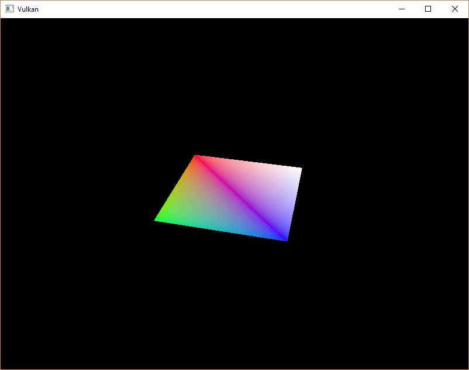

:pp: {plus}{plus}

= 描述符池与描述符集

== 简介

上一章中的描述符集布局描述了可以绑定的描述符类型。
在本章中，我们会为每个 `vk::raii::Buffer` 资源创建一个描述符集，把它绑定到统一缓冲区描述符上。

== 描述符池

描述符集不能直接创建，必须像命令缓冲区那样从池中分配。
描述符集对应的这个池，不出所料地叫做_描述符池_。
我们写一个新函数 `createDescriptorPool` 来创建它。

[,c++]
----
void initVulkan()
{
    ...
    createUniformBuffers();
    createDescriptorPool();
    ...
}

...

void createDescriptorPool()
{
}
----

首先需要用 `vk::DescriptorPoolSize` 结构体描述我们的描述符集将包含哪些描述符类型、每种各多少个。

[,c++]
----
vk::DescriptorPoolSize poolSize{ .type = vk::DescriptorType::eUniformBuffer, .descriptorCount = MAX_FRAMES_IN_FLIGHT };
----

每个飞行帧我们都会分配一个这样的描述符。
`vk::DescriptorPoolSize` 由主结构体 `vk::DescriptorPoolCreateInfo` 引用：

[,c++]
----
vk::DescriptorPoolCreateInfo poolInfo{ .flags = vk::DescriptorPoolCreateFlagBits::eFreeDescriptorSet, .maxSets = MAX_FRAMES_IN_FLIGHT, .poolSizeCount = 1, .pPoolSizes = &poolSize };
----

除了可用的单个描述符的最大数量之外，我们还需要指定最多可以分配多少个描述符集。

这个结构体有一个与命令池类似的可选标志，用来决定是否可以单独释放某个描述符集。
由于 `vk::raii::DescriptorSets` 析构时会销毁底层的 `vk::DescriptorSet`，我们需要把它设为 `vk::DescriptorPoolCreateFlagBits::eFreeDescriptorSet` 来允许这种操作。

[,c++]
----
vk::raii::DescriptorPool descriptorPool = nullptr;

...

descriptorPool = vk::raii::DescriptorPool(device, poolInfo);
----

新增一个类成员来保存描述符池的句柄，并调用 `vk::raii::DescriptorPool` 构造函数创建它。

== 描述符集

现在可以分配描述符集本身了。
为此新增 `createDescriptorSets` 函数：

[,c++]
----
void initVulkan()
{
    ...
    createDescriptorPool();
    createDescriptorSets();
    ...
}

...

void createDescriptorSets()
{
}
----

描述符集的分配用 `vk::DescriptorSetAllocateInfo` 结构体来描述。
你需要指定从中分配的描述符池、要分配的描述符集数量，以及作为其基础的描述符集布局：

[,c++]
----
std::vector<vk::DescriptorSetLayout> layouts(MAX_FRAMES_IN_FLIGHT, *descriptorSetLayout);
vk::DescriptorSetAllocateInfo        allocInfo{.descriptorPool     = descriptorPool,
                                               .descriptorSetCount = static_cast<uint32_t>(layouts.size()),
                                               .pSetLayouts        = layouts.data()};
----

在我们的例子中，会为每个飞行帧创建一个描述符集，它们都使用相同的布局。
不幸的是，我们确实需要该布局的所有副本，因为接下来的函数需要一个与描述符集数量相匹配的数组。

新增一个类成员来保存描述符集句柄，并用 `vk::raii::Device::allocateDescriptorSets` 分配它们：

[,c++]
----
vk::raii::DescriptorPool             descriptorPool = nullptr;
std::vector<vk::raii::DescriptorSet> descriptorSets;

...

descriptorSets = device.allocateDescriptorSets(allocInfo);
----

描述符集现在已经分配好了，但其中的描述符仍然需要配置。
现在添加一个循环来填充每个描述符：

[,c++]
----
for (size_t i = 0; i < MAX_FRAMES_IN_FLIGHT; i++)
{
}
----

引用缓冲区的描述符（比如我们的统一缓冲区描述符）用 `vk::DescriptorBufferInfo` 结构体来配置。
这个结构体指定缓冲区，以及其中存放该描述符数据的那片区域。

[,c++]
----
for (size_t i = 0; i < MAX_FRAMES_IN_FLIGHT; i++)
{
    vk::DescriptorBufferInfo bufferInfo{ .buffer = uniformBuffers[i], .offset = 0, .range = sizeof(UniformBufferObject) };
}
----

如果你要覆盖整个缓冲区（就像本例这样），也可以把 range 设为 `vk::WholeSize`。
描述符的配置通过 `vk::raii::Device::updateDescriptorSets` 函数更新，它接受一个 `vk::WriteDescriptorSet` 结构体数组作为参数。

[,c++]
----
vk::DescriptorBufferInfo bufferInfo{.buffer = uniformBuffers[i], .offset = 0, .range = sizeof(UniformBufferObject)};
vk::WriteDescriptorSet   descriptorWrite{.dstSet          = descriptorSets[i],
                                         .dstBinding      = 0,
                                         .dstArrayElement = 0,
                                         .descriptorCount = 1,
                                         .descriptorType  = vk::DescriptorType::eUniformBuffer,
                                         .pBufferInfo     = &bufferInfo};
----

前两个字段指定要更新的描述符集和绑定。
我们把统一缓冲区的绑定索引设为 `0`。
记住描述符可以是数组，所以还需要指定要更新的数组起始索引。
我们没有使用数组，因此索引就是 `0`。

我们还需要再次指定描述符类型。
可以一次性更新数组中的多个描述符，从索引 `dstArrayElement` 开始。
`descriptorCount` 字段指定要更新多少个数组元素。

最后一个字段引用一个包含 `descriptorCount` 个结构体的数组，这些结构体才真正配置描述符。
具体要用三者中的哪一个，取决于描述符的类型。
`pBufferInfo` 字段用于引用缓冲区数据的描述符。这个结构体里还有本示例未用到的成员：
`pImageInfo` 用于引用图像数据的描述符，`pTexelBufferView` 用于引用缓冲区视图的描述符。
我们的描述符基于缓冲区，所以只用到 `pBufferInfo`。

[,c++]
----
device.updateDescriptorSets(descriptorWrite, {});
----

更新通过 `vk::raii::Device::updateDescriptorSets` 应用。
它接受两个数组作为参数：一个 `vk::WriteDescriptorSet` 数组和一个 `vk::CopyDescriptorSet` 数组。
顾名思义，后者可用于在描述符之间互相复制。

== 使用描述符集

现在需要修改 `recordCommandBuffer` 函数，用 `vk::raii::CommandBuffer::bindDescriptorSets` 把每帧对应的描述符集真正绑定到着色器中的描述符上。
这一步要在 `vk::raii::CommandBuffer::drawIndexed` 调用之前完成：

[,c++]
----
commandBuffers[frameIndex].bindDescriptorSets(vk::PipelineBindPoint::eGraphics, pipelineLayout, 0, *descriptorSets[frameIndex], nullptr);
commandBuffer.drawIndexed(static_cast<uint32_t>(indices.size()), 1, 0, 0, 0);
----

与顶点缓冲区和索引缓冲区不同，描述符集并非图形管线独有。
因此我们需要指明，是要把描述符集绑定到图形管线还是计算管线。
下一个参数是描述符所基于的布局。
再往后的两个参数指定第一个描述符集的索引，以及要绑定的描述符集数组。
我们稍后会回到这一点。
最后一个参数指定一个用于动态描述符的偏移量数组。
我们会在后面的章节中讨论它。

如果你现在运行程序，会注意到很遗憾什么都看不见。
问题在于，由于我们在投影矩阵中做了 Y 轴翻转，顶点现在按逆时针顺序绘制，而不是顺时针顺序。
这触发了背面剔除，导致任何几何体都画不出来。
转到 `createGraphicsPipeline` 函数，修改 `vk::PipelineRasterizationStateCreateInfo` 中的 `frontFace` 来纠正它：

[,c++]
----
vk::PipelineRasterizationStateCreateInfo rasterizer{.depthClampEnable        = vk::False,
                                                    .rasterizerDiscardEnable = vk::False,
                                                    .polygonMode             = vk::PolygonMode::eFill,
                                                    .cullMode                = vk::CullModeFlagBits::eBack,
                                                    .frontFace               = vk::FrontFace::eCounterClockwise,
                                                    .depthBiasEnable         = vk::False,
                                                    .lineWidth               = 1.0f};
----

再次运行程序，现在应该能看到下面的画面：

矩形变成了正方形，因为投影矩阵现在会做宽高比校正。
`updateUniformBuffer` 会处理窗口尺寸变化，所以我们不需要在 `recreateSwapChain` 中重新创建描述符集。

== 对齐要求

到目前为止，我们一直略过了一个问题：C{pp} 结构体中的数据究竟应该如何与着色器中的 uniform 定义相匹配。
看起来只要在两边使用相同的类型就足够了：

[,c++]
----
struct UniformBufferObject
{
    glm::mat4 model;
    glm::mat4 view;
    glm::mat4 proj;
};

struct UniformBuffer
{
    float4x4 model;
    float4x4 view;
    float4x4 proj;
};
ConstantBuffer<UniformBuffer> ubo;
----

然而，事情并没有这么简单。
例如，试着把结构体和着色器改成这样：

[,c++]
----
struct UniformBufferObject
{
    glm::vec2 foo;
    glm::mat4 model;
    glm::mat4 view;
    glm::mat4 proj;
};

struct UniformBuffer {
    float2 foo;
    float4x4 model;
    float4x4 view;
    float4x4 proj;
};
ConstantBuffer<UniformBuffer> ubo;
----

重新编译着色器和程序并运行，你会发现之前一直调好的那个彩色方块消失了！
这是因为我们没有考虑_对齐要求_。

Vulkan 要求结构体中的数据在内存中以特定方式对齐，例如：

* 标量必须按 N 对齐（给定 32 位浮点数时 N = 4 字节）。
* `float2` 必须按 2N 对齐（= 8 字节）
* `float3` 或 `float4` 必须按 4N 对齐（= 16 字节）
* 嵌套结构体必须按其成员的基础对齐向上取整到 16 的倍数来对齐。
* `float4x4` 矩阵必须与 `float4` 具有相同的对齐。

你可以在 https://docs.vulkan.org/spec/latest/chapters/interfaces.html#interfaces-resources-layout[规范] 中找到完整的对齐要求列表。

我们最初只含三个 `mat4` 字段的着色器本来就满足对齐要求。
每个 `mat4` 的大小是 4 x 4 x 4 = 64 字节，所以 `model` 的偏移是 `0`，`view` 的偏移是 64，`proj` 的偏移是 128。
这些都是 16 的倍数，因此它工作正常。

新结构体以一个只有 8 字节大小的 `vec2` 开头，于是把所有偏移都打乱了。
现在 `model` 的偏移是 `8`，`view` 是 `72`，`proj` 是 `136`，它们都不是 16 的倍数。
要解决这个问题，可以使用 C{pp}11 引入的 https://en.cppreference.com/w/cpp/language/alignas[`alignas`] 说明符：

[,c++]
----
struct UniformBufferObject
{
    glm::vec2 foo;
    alignas(16) glm::mat4 model;
    glm::mat4 view;
    glm::mat4 proj;
};
----

如果现在重新编译并运行程序，应该能看到着色器再次正确接收到矩阵值。

幸运的是，有一种办法可以让我们在_大多数_时候不必操心这些对齐要求。
我们可以在包含 GLM 之前定义 `GLM_FORCE_DEFAULT_ALIGNED_GENTYPES`：

[,c++]
----
#define GLM_FORCE_DEFAULT_ALIGNED_GENTYPES
#include <glm/glm.hpp>
----

这会强制 GLM 使用已经为我们指定好对齐要求的 `vec2` 和 `mat4` 版本。
加上这个定义之后，就可以去掉 `alignas` 说明符，程序应该仍然能正常工作。

不幸的是，一旦开始使用嵌套结构体，这种方法就可能失效。
看看下面 C{pp} 代码中的定义：

[,c++]
----
struct Foo
{
    glm::vec2 v;
};

struct UniformBufferObject
{
    Foo f1;
    Foo f2;
};
----

以及下面的着色器定义：

[,c++]
----
struct Foo
{
    vec2 v;
};

struct UniformBuffer
{
    Foo f1;
    Foo f2;
};
ConstantBuffer<UniformBuffer> ubo;
----

在这种情况下，`f2` 的偏移会是 `8`，但由于它是嵌套结构体，本应是 `16`。
这时你必须自己指定对齐：

[,c++]
----
struct UniformBufferObject
{
    Foo f1;
    alignas(16) Foo f2;
};
----

这些坑正是始终显式指定对齐的好理由。
这样你就不会被对齐错误那些奇怪的症状打个措手不及。

[,c++]
----
struct UniformBufferObject
{
    alignas(16) glm::mat4 model;
    alignas(16) glm::mat4 view;
    alignas(16) glm::mat4 proj;
};
----

删除 `foo` 字段后记得重新编译着色器。

== 多个描述符集

正如一些结构体和函数调用所暗示的，实际上可以同时绑定多个描述符集。
创建管线布局时，你需要为每个描述符集指定一个描述符集布局。
然后着色器就可以像这样引用特定的描述符集：

[,c++]
----
struct UniformBuffer
{
};
ConstantBuffer<UniformBuffer> ubo;
----

你可以利用这个特性，把每个对象各不相同的描述符和共享的描述符放进不同的描述符集。
这样就能避免在多次绘制调用之间重新绑定大部分描述符，可能更高效。

在 xref:06_Texture_mapping/00_Images.adoc[接下来的章节] 中，我们会在此基础之上为场景添加纹理。

link:/attachments/23_descriptor_sets.cpp[C{pp} 代码]  /
link:/attachments/22_shader_ubo.slang[slang 着色器] /
link:/attachments/22_shader_ubo.vert[GLSL 顶点着色器] /
link:/attachments/22_shader_ubo.frag[GLSL 片元着色器]
