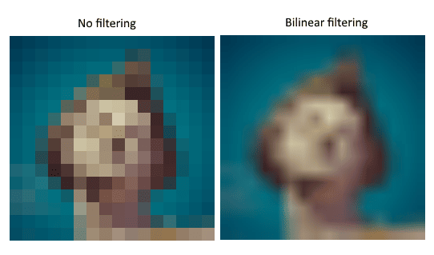
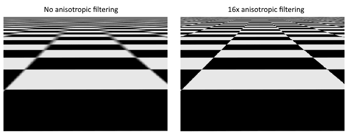
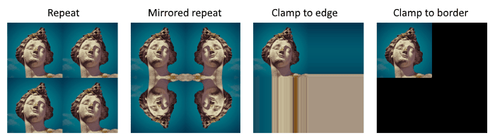
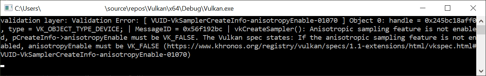

:pp: {plus}{plus}

= 图像视图与采样器

本章我们要再创建两个资源，图形管线需要它们来对图像进行采样。
第一个资源我们在处理交换链图像时已经见过，第二个则是全新的——它关系到着色器如何从图像中读取纹素。

== 纹理图像视图

我们在交换链图像和帧缓冲区那里已经看到，图像是通过图像视图访问的，而不是直接访问。
我们也需要为纹理图像创建这样一个图像视图。

添加一个类成员来保存纹理图像的 `vk::raii::ImageView`，并新建 `createTextureImageView` 函数，在里面创建它：

[,c++]
----
vk::raii::ImageView textureImageView = nullptr;

...

void initVulkan()
{
    ...
    createTextureImage();
    createTextureImageView();
    createVertexBuffer();
    ...
}

...

void createTextureImageView()
{
}
----

这个函数的代码可以直接以 `createImageViews` 为基础。
你需要改动的只有两处：`format` 和 `image`：

[,c++]
----
vk::ImageViewCreateInfo viewInfo{
    .image            = image,
    .viewType         = vk::ImageViewType::e2D,
    .format           = format,
    .subresourceRange = {.aspectMask = vk::ImageAspectFlagBits::eColor, .baseMipLevel = 0, .levelCount = 1, .baseArrayLayer = 0, .layerCount = 1}};
----

我省略了显式的 `viewInfo.components` 初始化，因为它本来就会默认初始化为 `vk::ComponentSwizzle::eIdentity`。
调用 `vk::raii::ImageView` 构造函数即可完成图像视图的创建：

[,c++]
----
textureImageView = vk::raii::ImageView(device, viewInfo);
----

由于大部分逻辑都是从 `createImageViews` 复制来的，你也许想把它抽象成一个新的 `createImageView` 函数：

[,c++]
----
vk::raii::ImageView createImageView(vk::Image const &image, vk::Format format)
{
  vk::ImageViewCreateInfo viewInfo{
      .image            = image,
      .viewType         = vk::ImageViewType::e2D,
      .format           = format,
      .subresourceRange = {.aspectMask = vk::ImageAspectFlagBits::eColor, .baseMipLevel = 0, .levelCount = 1, .baseArrayLayer = 0, .layerCount = 1}};
  return vk::raii::ImageView(device, viewInfo);
}
----

现在 `createTextureImageView` 函数可以简化为：

[,c++]
----
void createTextureImageView()
{
  textureImageView = createImageView(*textureImage, vk::Format::eR8G8B8A8Srgb);
}
----

`createImageViews` 则可以简化为：

[,c++]
----
void createImageViews()
{
  assert(swapChainImageViews.empty());

  swapChainImageViews.reserve(swapChainImages.size());
  for ( auto &image: swapChainImages )
  {
    swapChainImageViews.emplace_back(createImageView(image, swapChainSurfaceFormat.format));
  }
}
----

== 采样器

着色器可以直接从图像中读取纹素，但当图像用作纹理时，这种做法并不常见。
纹理通常通过采样器访问，采样器会施加过滤和变换，计算出最终取回的颜色。

这些过滤器有助于处理诸如过采样之类的问题。
设想一张纹理被映射到图元上，而片元的数量多于纹素。
如果你只是为每个片元的纹理坐标取最近的纹素，就会得到第一张图那样的结果：

如果你通过线性插值把最近的 4 个纹素组合起来，就会得到右侧那样更平滑的结果。
当然，你的应用可能有美术风格上的要求，更偏向左边的样式（想想 Minecraft），但在常规图形应用中，右边才是首选。
采样器对象会在从纹理读取颜色时自动为你施加这种过滤。

欠采样是相反的问题：纹素比片元多。
当以锐利的角度采样棋盘格这类高频图案时，这会导致走样：

如左图所示，纹理在远处变成一团模糊。
解决方案是 https://en.wikipedia.org/wiki/Anisotropic_filtering[各向异性过滤]，采样器同样可以自动施加。

除了这些过滤器，采样器还能处理变换。
它通过 _寻址模式_ 决定当你尝试读取图像之外的纹素时会发生什么。
下图展示了其中一些可能性：

我们现在要新建 `createTextureSampler` 函数来设置这样一个采样器对象。
稍后我们会用这个采样器在着色器中从纹理读取颜色。

[,c++]
----
void initVulkan()
{
    ...
    createTextureImage();
    createTextureImageView();
    createTextureSampler();
    ...
}

...

void createTextureSampler()
{
}
----

采样器通过 `vk::SamplerCreateInfo` 结构体配置，它指定了采样器应施加的所有过滤和变换。

[,c++]
----
vk::SamplerCreateInfo samplerInfo{.magFilter = vk::Filter::eLinear, .minFilter = vk::Filter::eLinear};
----

`magFilter` 和 `minFilter` 字段指定如何对放大或缩小的纹素进行插值。
放大对应上文描述的过采样问题，缩小则对应欠采样。
可选值是 `vk::Filter::eNearest` 和 `vk::Filter::eLinear`，分别对应上面图片中展示的模式。

[,c++]
----
vk::SamplerCreateInfo samplerInfo{.magFilter    = vk::Filter::eLinear,
                                  .minFilter    = vk::Filter::eLinear,
                                  .mipmapMode   = vk::SamplerMipmapMode::eLinear,
                                  .addressModeU = vk::SamplerAddressMode::eRepeat,
                                  .addressModeV = vk::SamplerAddressMode::eRepeat,
                                  .addressModeW = vk::SamplerAddressMode::eRepeat};
----

寻址模式可以用 `addressMode` 字段按轴分别指定。
可用的值列在下面。
其中大部分都在上图中有演示。
注意坐标轴称为 U、V、W，而不是 X、Y、Z。
这是纹理空间坐标的惯例。

* `vk::SamplerAddressMode::eRepeat`：超出图像尺寸时重复纹理。
* `vk::SamplerAddressMode::eMirroredRepeat`：与 repeat 类似，但超出尺寸时反转坐标，使图像镜像。
* `vk::SamplerAddressMode::eClampToEdge`：超出图像尺寸时取距离坐标最近的边缘的颜色。
* `vk::SamplerAddressMode::eMirrorClampToEdge`：与 clamp to edge 类似，但改用与最近边缘相对的那条边缘。
* `vk::SamplerAddressMode::eClampToBorder`：在图像尺寸之外采样时返回纯色。

这里用哪种寻址模式其实无所谓，因为本教程不会在图像之外采样。
不过 repeat 模式大概是最常用的，因为它可以用来平铺地板、墙壁之类的纹理。

[,c++]
----
vk::PhysicalDeviceProperties properties = physicalDevice.getProperties();
vk::SamplerCreateInfo        samplerInfo{.magFilter        = vk::Filter::eLinear,
                                         .minFilter        = vk::Filter::eLinear,
                                         .mipmapMode       = vk::SamplerMipmapMode::eLinear,
                                         .addressModeU     = vk::SamplerAddressMode::eRepeat,
                                         .addressModeV     = vk::SamplerAddressMode::eRepeat,
                                         .addressModeW     = vk::SamplerAddressMode::eRepeat,
                                         .anisotropyEnable = vk::True,
                                         .maxAnisotropy    = properties.limits.maxSamplerAnisotropy};
----

`anisotropyEnable` 字段指定是否启用各向异性过滤。
除非担心性能，否则没有理由不用它。
`maxAnisotropy` 字段限制可用于计算最终颜色的纹素采样数量。
值越低性能越好，但结果质量越差。
要知道能用多大的值，我们需要像这样查询物理设备的属性：

[,c++]
----
vk::PhysicalDeviceProperties properties = physicalDevice.getProperties();
----

如果你查阅 `vk::PhysicalDeviceProperties` 结构体的文档，会看到它包含一个名为 `limits` 的 `vk::PhysicalDeviceLimits` 成员。
这个结构体又有一个名为 `maxSamplerAnisotropy` 的成员，这就是 `maxAnisotropy` 可以指定的最大值。
如果追求最高质量，直接使用这个值即可。
你既可以在程序开始时查询属性再传给需要它的函数，也可以在 `createTextureSampler` 函数内部查询。

[,c++]
----
vk::PhysicalDeviceProperties properties = physicalDevice.getProperties();
vk::SamplerCreateInfo        samplerInfo{.magFilter        = vk::Filter::eLinear,
                                         .minFilter        = vk::Filter::eLinear,
                                         .mipmapMode       = vk::SamplerMipmapMode::eLinear,
                                         .addressModeU     = vk::SamplerAddressMode::eRepeat,
                                         .addressModeV     = vk::SamplerAddressMode::eRepeat,
                                         .addressModeW     = vk::SamplerAddressMode::eRepeat,
                                         .anisotropyEnable = vk::True,
                                         .maxAnisotropy    = properties.limits.maxSamplerAnisotropy,
                                         .compareEnable    = vk::False,
                                         .compareOp        = vk::CompareOp::eAlways};
----

[,c++]
----
samplerInfo.borderColor = vk::BorderColor::eIntOpaqueBlack;
----

`borderColor` 字段指定在使用 clamp to border 寻址模式于图像之外采样时返回哪种颜色。
可以返回黑色、白色或透明色，浮点或整数格式均可。
但不能指定任意颜色。

[,c++]
----
samplerInfo.unnormalizedCoordinates = vk::False;
----

`unnormalizedCoordinates` 字段指定用哪种坐标系来寻址图像中的纹素。
如果该字段为 `vk::True`，你就可以直接使用 `[0, texWidth)` 和 `[0, texHeight)` 范围内的坐标。
如果为 `vk::False`，则所有轴上都用 `[0, 1)` 范围来寻址纹素。
实际应用几乎总是使用规范化坐标，因为这样就可以用完全相同的坐标使用不同分辨率的纹理。

[,c++]
----
samplerInfo.compareEnable = vk::False;
samplerInfo.compareOp = vk::CompareOp::eAlways;
----

如果启用了比较函数，纹素会先与某个值比较，比较结果用于过滤操作。
这主要用于阴影贴图上的 https://developer.nvidia.com/gpugems/GPUGems/gpugems_ch11.html[百分比接近过滤]。
我们会在后续章节中看到它。

[,c++]
----
samplerInfo.mipmapMode = vk::SamplerMipmapMode::eLinear;
samplerInfo.mipLodBias = 0.0f;
samplerInfo.minLod = 0.0f;
samplerInfo.maxLod = 0.0f;
----

这些字段都与 mipmap 有关。
我们会在 link:/Generating_Mipmaps[后续章节] 中讨论 mipmap，简单说它是另一种可以施加的过滤方式。

采样器的工作方式到此就完全确定了。
添加一个类成员来保存采样器对象的句柄，并用 `vkCreateSampler` 创建采样器：

[,c++]
----
vk::raii::ImageView    textureImageView   = nullptr;
vk::raii::Sampler      textureSampler     = nullptr;

...

void createTextureSampler()
{
    ...

    textureSampler = vk::raii::Sampler(device, samplerInfo);
}
----

注意采样器在任何地方都没有引用 `vk::Image`。
采样器是一个独立的对象，提供从纹理中提取颜色的接口。
它可以应用到任何图像上，无论是 1D、2D 还是 3D。
这与许多旧 API 不同，它们把纹理图像和过滤合并成单一状态。

== 各向异性设备特性

如果现在就运行程序，你会看到类似这样的验证层消息：

这是因为各向异性过滤实际上是一个可选的设备特性。
我们需要修改 `createLogicalDevice` 函数来请求它：

[,c++]
----
vk::StructureChain<vk::PhysicalDeviceFeatures2, vk::PhysicalDeviceVulkan13Features, vk::PhysicalDeviceExtendedDynamicStateFeaturesEXT> featureChain = {
    {.features = {.samplerAnisotropy = true } },            // vk::PhysicalDeviceFeatures2
    {.synchronization2 = true, .dynamicRendering = true },  // vk::PhysicalDeviceVulkan13Features
    {.extendedDynamicState = true }                         // vk::PhysicalDeviceExtendedDynamicStateFeaturesEXT
};
----

尽管现代显卡几乎不可能不支持它，我们还是应该更新 `isDeviceSuitable` 来检查它是否可用：

[,c++]
----
bool isDeviceSuitable(VkPhysicalDevice device)
{
    ...

		auto features                 = physicalDevice.template getFeatures2<vk::PhysicalDeviceFeatures2,
		                                                                     vk::PhysicalDeviceVulkan13Features,
		                                                                     vk::PhysicalDeviceExtendedDynamicStateFeaturesEXT>();
		bool supportsRequiredFeatures = features.template get<vk::PhysicalDeviceFeatures2>().features.samplerAnisotropy &&
		                                features.template get<vk::PhysicalDeviceVulkan13Features>().dynamicRendering &&
		                                features.template get<vk::PhysicalDeviceVulkan13Features>().synchronization2 &&
		                                features.template get<vk::PhysicalDeviceExtendedDynamicStateFeaturesEXT>().extendedDynamicState;

		// Return true if the physicalDevice meets all the criteria
		return supportsVulkan1_3 && supportsGraphics && supportsAllRequiredExtensions && supportsRequiredFeatures;
}
----

`vk::raii::PhysicalDevice::getFeatures2` 重用了 `vk::PhysicalDeviceFeatures` 结构体，通过设置布尔值来表示哪些特性受支持，而不是被请求。

除了强制要求支持各向异性过滤，也可以干脆不用它，改为按条件设置：

[,c++]
----
samplerInfo.anisotropyEnable = vk::False;
samplerInfo.maxAnisotropy = 1.0f;
----

在 xref:./02_Combined_image_sampler.adoc[下一章] 中，我们会把图像和采样器对象交给着色器，把纹理绘制到正方形上。

link:/attachments/25_sampler.cpp[C{pp} 代码] /
link:/attachments/22_shader_ubo.slang[slang 着色器] /
link:/attachments/22_shader_ubo.vert[GLSL 顶点着色器] /
link:/attachments/22_shader_ubo.frag[GLSL 片元着色器]
