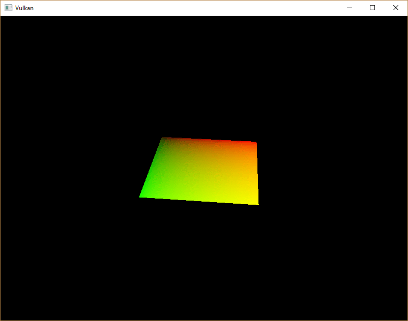
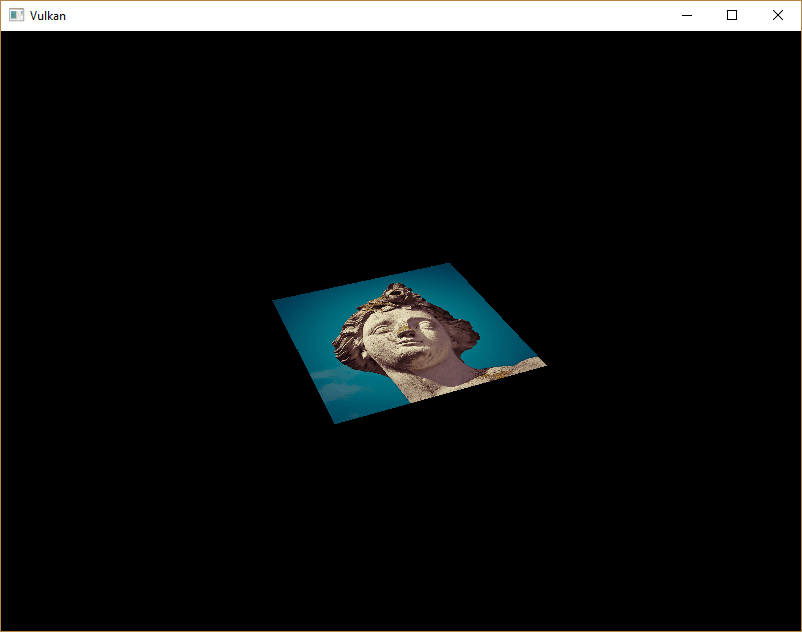
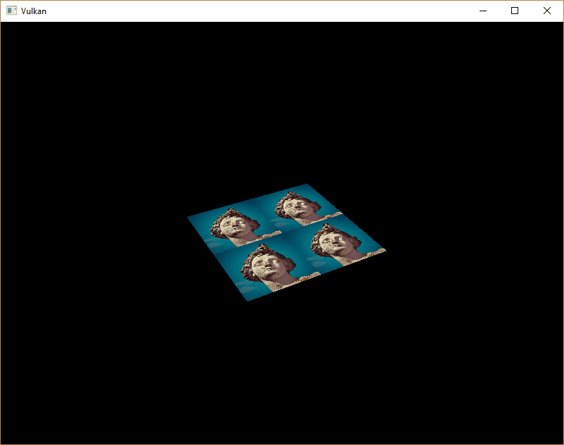
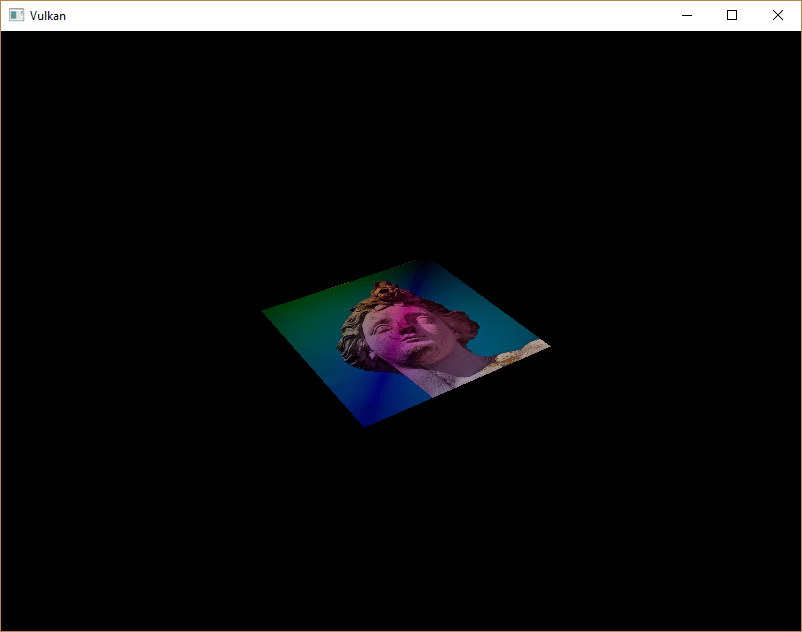

:pp: {plus}{plus}

= 组合图像采样器

== 简介

本教程在统一缓冲区部分首次接触了描述符。
本章我们会看一种新的描述符类型：_组合图像采样器_。
这种描述符让着色器可以通过采样器对象访问图像资源，就像我们在上一章创建的那个采样器。

值得一提的是，Vulkan 通过不同的描述符类型，为着色器中访问纹理的方式提供了灵活性。虽然本教程使用的是_组合图像采样器_，但 Vulkan 也支持为采样器（`vk::DescriptorType::eSampler`）和采样图像（`vk::DescriptorType::eSampledImage`）使用独立的描述符。使用独立描述符可以把同一个采样器复用到多张图像上，也可以用不同的采样参数访问同一张图像。当你有很多使用相同采样配置的纹理时，这样做会更高效。不过，组合图像采样器通常更方便，而且由于缓存使用经过优化，在某些硬件上性能更好。

我们先修改描述符集布局、描述符池和描述符集，把这样的组合图像采样器描述符包含进去。
之后，我们会给 `Vertex` 添加纹理坐标来替换颜色值，并修改片元着色器，让它从纹理读取颜色，而不是只对顶点颜色做插值。

== 更新描述符

找到 `createDescriptorSetLayout` 函数，为组合图像采样器描述符添加一个 `vk::DescriptorSetLayoutBinding`。
我们直接把它放在统一缓冲区之后的那个绑定位置：

[,c++]
----
std::array<vk::DescriptorSetLayoutBinding, 2> bindings{
    {{.binding = 0, .descriptorType = vk::DescriptorType::eUniformBuffer, .descriptorCount = 1, .stageFlags = vk::ShaderStageFlagBits::eVertex},
     {.binding = 1, .descriptorType = vk::DescriptorType::eCombinedImageSampler, .descriptorCount = 1, .stageFlags = vk::ShaderStageFlagBits::eFragment}}};

vk::DescriptorSetLayoutCreateInfo layoutInfo{.bindingCount = static_cast<uint32_t>(bindings.size()), .pBindings = bindings.data()};
----

务必把 `stageFlags` 设置为表明我们打算在片元着色器中使用组合图像采样器描述符。
片元的颜色正是在那里确定的。
在顶点着色器中使用纹理采样也是可行的，例如用 https://en.wikipedia.org/wiki/Heightmap[高度图] 动态变形顶点网格。

我们还必须创建更大的描述符池，为组合图像采样器的分配留出空间，方法是往 `vk::DescriptorPoolCreateInfo` 中添加另一个类型为 `vk::DescriptorType::eCombinedImageSampler` 的 `vk::PoolSize`。
转到 `createDescriptorPool` 函数，修改它，为该描述符加上一个 `vk::DescriptorPoolSize`：

[,c++]
----
std::array<vk::DescriptorPoolSize, 2> poolSize{{{.type = vk::DescriptorType::eUniformBuffer, .descriptorCount = MAX_FRAMES_IN_FLIGHT},
                                                {.type = vk::DescriptorType::eCombinedImageSampler, .descriptorCount = MAX_FRAMES_IN_FLIGHT}}};
vk::DescriptorPoolCreateInfo          poolInfo{.flags         = vk::DescriptorPoolCreateFlagBits::eFreeDescriptorSet,
                                               .maxSets       = MAX_FRAMES_IN_FLIGHT,
                                               .poolSizeCount = static_cast<uint32_t>(poolSize.size()),
                                               .pPoolSizes    = poolSize.data()};
----

描述符池不足是验证层抓不到的一类问题的好例子：从 Vulkan 1.1 起，如果池不够大，`vk::raii::Device::allocateDescriptorSets` 可能失败并抛出 `vk::OutOfPoolMemoryError` 异常，但驱动也可能在内部尝试解决这个问题。
这意味着有时（取决于硬件、池大小和分配大小）驱动会放过超出描述符池上限的分配。
有时 `vk::raii::Device::allocateDescriptorSets` 则会失败并抛出 `vk::OutOfPoolMemoryError` 异常。
如果分配在某些机器上成功、在另一些机器上失败，这会格外令人沮丧。

由于 Vulkan 把分配的责任交给了驱动，创建描述符池时就不再严格要求只能分配对应 `descriptorCount` 成员所指定数量的某类描述符（`vk::DescriptorType::eCombinedImageSampler` 等）。
不过，这样做仍然是最佳实践，而且将来如果你启用 https://vulkan.lunarg.com/doc/view/latest/windows/best_practices.html[最佳实践验证]，`VK_LAYER_KHRONOS_validation` 会针对这类问题发出警告。

最后一步是把实际的图像和采样器资源绑定到描述符集中的描述符上。
转到 `createDescriptorSets` 函数。

[,c++]
----
for (size_t i = 0; i < MAX_FRAMES_IN_FLIGHT; i++)
{
    vk::DescriptorBufferInfo bufferInfo{.buffer = uniformBuffers[i], .offset = 0, .range = sizeof(UniformBufferObject)};
    vk::DescriptorImageInfo  imageInfo{.sampler = textureSampler, .imageView = textureImageView, .imageLayout = vk::ImageLayout::eShaderReadOnlyOptimal};

    ...
}
----

组合图像采样器结构的资源必须通过 `vk::DescriptorImageInfo` 结构体指定，就像统一缓冲区描述符的缓冲区资源通过 `vk::DescriptorBufferInfo` 结构体指定一样。
上一章创建的对象就在这里汇合。

[,c++]
----
std::array<vk::WriteDescriptorSet, 2> descriptorWrites{{{.dstSet          = descriptorSets[i],
                                                         .dstBinding      = 0,
                                                         .dstArrayElement = 0,
                                                         .descriptorCount = 1,
                                                         .descriptorType  = vk::DescriptorType::eUniformBuffer,
                                                         .pBufferInfo     = &bufferInfo},
                                                        {.dstSet          = descriptorSets[i],
                                                         .dstBinding      = 1,
                                                         .dstArrayElement = 0,
                                                         .descriptorCount = 1,
                                                         .descriptorType  = vk::DescriptorType::eCombinedImageSampler,
                                                         .pImageInfo      = &imageInfo}}};
device.updateDescriptorSets(descriptorWrites, {});
----

描述符必须像缓冲区那样用这个图像信息更新。
这次我们用 `pImageInfo` 数组而不是 `pBufferInfo`。
描述符现在可以被着色器使用了！

== 纹理坐标

纹理映射还有一个重要的要素没有提到，那就是每个顶点的实际纹理坐标，通常称为「uv 坐标」。
纹理坐标决定了图像实际上如何映射到几何体上。

[,c++]
----
struct Vertex
{
    glm::vec2 pos;
    glm::vec3 color;
    glm::vec2 texCoord;

    static vk::VertexInputBindingDescription getBindingDescription()
    {
        return { 0, sizeof(Vertex), vk::VertexInputRate::eVertex };
    }

    static std::array<vk::VertexInputAttributeDescription, 3> getAttributeDescriptions()
    {
        return {{{.location = 0, .binding = 0, .format = vk::Format::eR32G32Sfloat, .offset = offsetof(Vertex, pos)},
		         {.location = 1, .binding = 0, .format = vk::Format::eR32G32B32Sfloat, .offset = offsetof(Vertex, color)},
		         {.location = 2, .binding = 0, .format = vk::Format::eR32G32Sfloat, .offset = offsetof(Vertex, texCoord)}}};
    }
};
----

修改 `Vertex` 结构体，为纹理坐标添加一个 `vec2`。
还要记得添加一个 `vk::VertexInputAttributeDescription`，这样我们才能在顶点着色器中把纹理坐标作为输入访问。
这是把纹理坐标传给片元着色器、在正方形表面进行插值的必要条件。
颜色在着色器小节末尾的另一个示例中会用到，但显示图像并不需要它，可以删掉。
只要记得同步更新 `vertices` 数组和着色器即可。

[,c++]
----
const std::vector<Vertex> vertices = {
    {{-0.5f, -0.5f}, {1.0f, 0.0f, 0.0f}, {1.0f, 0.0f}},
    {{0.5f, -0.5f}, {0.0f, 1.0f, 0.0f}, {0.0f, 0.0f}},
    {{0.5f, 0.5f}, {0.0f, 0.0f, 1.0f}, {0.0f, 1.0f}},
    {{-0.5f, 0.5f}, {1.0f, 1.0f, 1.0f}, {1.0f, 1.0f}}
};
----

本教程中，我直接用从左上角的 `0, 0` 到右下角的 `1, 1` 的坐标把纹理铺满正方形。
欢迎你试验不同的坐标。
试试用小于 `0` 或大于 `1` 的坐标，看看寻址模式的实际效果！

== 着色器

最后一步是修改着色器，从纹理采样颜色。
我们首先需要修改顶点着色器，把纹理坐标传递给片元着色器：

[,slang]
----
struct VSInput {
    float2 inPos;
    float3 inColor;
    float2 inTexCoord;
};

struct UniformBuffer {
    float4x4 model;
    float4x4 view;
    float4x4 proj;
};
ConstantBuffer<UniformBuffer> ubo;

struct VSOutput
{
    float4 pos : SV_Position;
    float3 fragColor;
    float2 fragTexCoord;
};

[shader("vertex")]
VSOutput vertMain(VSInput input) {
    VSOutput output;
    output.pos = mul(ubo.proj, mul(ubo.view, mul(ubo.model, float4(input.inPos, 0.0, 1.0))));
    output.fragColor = input.inColor;
    output.fragTexCoord = input.inTexCoord;
    return output;
}

[shader("fragment")]
float4 fragMain(VSOutput vertIn) : SV_TARGET {
   return float4(vertIn.fragTexCoord, 0.0, 1.0);
}
----

你应该会看到类似下图的结果。
记得重新编译着色器！

绿色通道表示水平坐标，红色通道表示垂直坐标。
黑色和黄色的角证实了纹理坐标在正方形上从 `0, 0` 到 `1, 1` 正确插值。
用颜色来可视化数据，是着色器编程中相当于 `printf` 调试的手段——在别无更好办法的时候！

在 Slang 中，采样器就代表一个组合图像采样器描述符。
在片元着色器中为它添加引用：

[,slang]
----
Sampler2D texture;
----

对于其他类型的图像，有等价的 `sampler1D` 和 `sampler3D` 类型。
注意这里要使用正确的绑定。

[,slang]
----
[shader("fragment")]
float4 fragMain(VSOutput vertIn) : SV_TARGET {
   return texture.Sample(vertIn.fragTexCoord);
}
----

纹理通过内置的 `texture` 函数采样。
它接受一个 `sampler` 和坐标作为参数。
采样器会自动在后台处理过滤与变换。
现在运行程序，你应该能在正方形上看到纹理：

试着把纹理坐标放大到大于 `1` 的值，来试验寻址模式。
例如，在使用 `VK_SAMPLER_ADDRESS_MODE_REPEAT` 时，下面的片元着色器会产生下图中的结果：

[,glsl]
----
[shader("fragment")]
float4 fragMain(VSOutput vertIn) : SV_TARGET {
   return texture.Sample(vertIn.fragTexCoord * 2.0);
}
----

你也可以用顶点颜色来调整纹理颜色：

[,slang]
----
[shader("fragment")]
float4 fragMain(VSOutput vertIn) : SV_TARGET {
   return float4(vertIn.fragColor * texture.Sample(vertIn.fragTexCoord).rgb, 1.0);
}
----

我在这里把 RGB 和 alpha 通道分开处理，以免缩放 alpha 通道。

现在你知道如何在着色器中访问图像了！
如果与同样会在帧缓冲区中被写入的图像结合使用，这是一项非常强大的技术。
你可以把这些图像作为输入，实现后处理、3D 世界中的相机画面之类的酷炫效果。

在 xref:07_Depth_buffering.adoc[下一章] 中，我们会学习如何添加深度缓冲，以便正确地排序物体。

link:/attachments/26_texture_mapping.cpp[C{pp} 代码] /
link:/attachments/26_shader_textures.slang[slang 着色器] /
link:/attachments/26_shader_textures.vert[GLSL 顶点着色器] /
link:/attachments/26_shader_textures.frag[GLSL 片元着色器]
