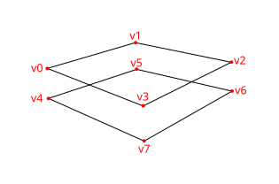
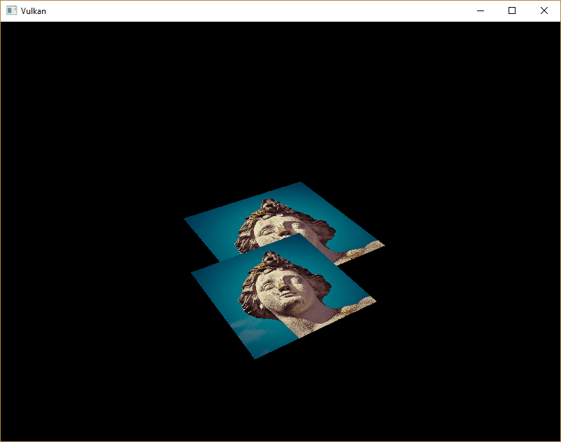
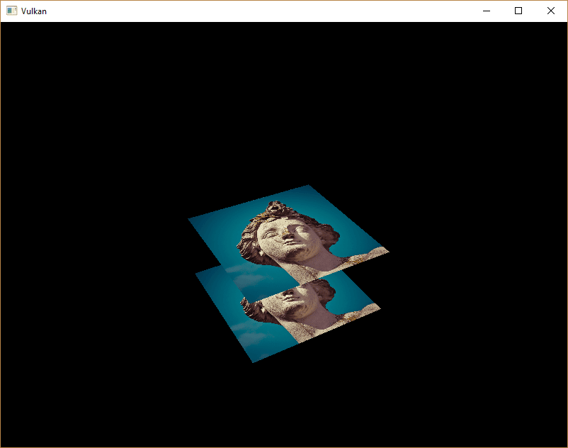

:pp: {plus}{plus}

= 深度缓冲

== 简介

到目前为止我们处理的几何体已经投影到 3D 空间，但它仍然是完全平的。
本章我们会给位置添加一个 Z 坐标，为 3D 网格做准备。
我们会用这第三个坐标在当前正方形上叠加一个正方形，看看几何体未按深度排序时会出现什么问题。

== 3D 几何体

修改 `Vertex` 结构体，把位置改用 3D 向量，并更新对应的 `vk::VertexInputAttributeDescription` 中的 `format`：

[,c++]
----
struct Vertex {
    glm::vec3 pos;
    glm::vec3 color;
    glm::vec2 texCoord;

    ...

    static std::array<vk::VertexInputAttributeDescription, 3> getAttributeDescriptions() {
        return {
            vk::VertexInputAttributeDescription(0, 0, vk::Format::eR32G32B32Sfloat, offsetof(Vertex, pos)),
            vk::VertexInputAttributeDescription(1, 0, vk::Format::eR32G32B32Sfloat, offsetof(Vertex, color)),
            vk::VertexInputAttributeDescription(2, 0, vk::Format::eR32G32Sfloat, offsetof(Vertex, texCoord))
        };

        ...
    }
};
----

接下来，把 `inPosition` 的类型从 `float2` 改为 `float3`，让顶点着色器接受并变换 3D 坐标作为输入：

[,glsl]
----
struct VSInput {
    float3 inPosition;
    ...
};

...

[shader("vertex")]
VSOutput vertMain(VSInput input) {
    VSOutput output;
    output.pos = mul(ubo.proj, mul(ubo.view, mul(ubo.model, float4(input.inPosition, 1.0))));
    output.fragColor = input.inColor;
    output.fragTexCoord = input.inTexCoord;
    return output;
}
----

记得之后重新编译着色器！

最后，更新 `vertices` 容器，加入 Z 坐标：

[,c++]
----
const std::vector<Vertex> vertices = {
    {{-0.5f, -0.5f, 0.0f}, {1.0f, 0.0f, 0.0f}, {0.0f, 0.0f}},
    {{0.5f, -0.5f, 0.0f}, {0.0f, 1.0f, 0.0f}, {1.0f, 0.0f}},
    {{0.5f, 0.5f, 0.0f}, {0.0f, 0.0f, 1.0f}, {1.0f, 1.0f}},
    {{-0.5f, 0.5f, 0.0f}, {1.0f, 1.0f, 1.0f}, {0.0f, 1.0f}}
};
----

如果现在运行程序，你应该会看到和之前完全相同的结果。
是时候添加一些额外的几何体，让场景更有意思，并演示本章要解决的问题了。
复制这些顶点，在当前正方形正下方再定义一个正方形的位置，像这样：

使用 `-0.5f` 的 Z 坐标，并为多出来的正方形添加合适的索引：

[,c++]
----
const std::vector<Vertex> vertices = {
    {{-0.5f, -0.5f, 0.0f}, {1.0f, 0.0f, 0.0f}, {0.0f, 0.0f}},
    {{0.5f, -0.5f, 0.0f}, {0.0f, 1.0f, 0.0f}, {1.0f, 0.0f}},
    {{0.5f, 0.5f, 0.0f}, {0.0f, 0.0f, 1.0f}, {1.0f, 1.0f}},
    {{-0.5f, 0.5f, 0.0f}, {1.0f, 1.0f, 1.0f}, {0.0f, 1.0f}},

    {{-0.5f, -0.5f, -0.5f}, {1.0f, 0.0f, 0.0f}, {0.0f, 0.0f}},
    {{0.5f, -0.5f, -0.5f}, {0.0f, 1.0f, 0.0f}, {1.0f, 0.0f}},
    {{0.5f, 0.5f, -0.5f}, {0.0f, 0.0f, 1.0f}, {1.0f, 1.0f}},
    {{-0.5f, 0.5f, -0.5f}, {1.0f, 1.0f, 1.0f}, {0.0f, 1.0f}}
};

const std::vector<uint16_t> indices = {
    0, 1, 2, 2, 3, 0,
    4, 5, 6, 6, 7, 4
};
----

现在运行程序，你会看到类似埃舍尔风格插画的效果：

问题在于下方正方形的片元被绘制到了上方正方形的片元之上，只是因为它在索引数组中排在后面。
有两种方法可以解决：

* 把所有绘制调用按深度从后到前排序
* 使用深度缓冲区进行深度测试

第一种方法常用于绘制透明物体，因为顺序无关的透明是个难题。
不过，按深度排序片元的问题更常见的解法是使用_深度缓冲区_。
深度缓冲区是一个额外的附件，它像颜色附件存储每个位置的颜色那样，存储每个位置的深度。
每次光栅化器产生一个片元，深度测试都会检查新片元是否比之前的更近。
如果不是，新片元就会被丢弃。
通过深度测试的片元会把自己的深度写入深度缓冲区。
和颜色输出一样，你也可以在片元着色器中操作这个值。

[,c++]
----
#define GLM_FORCE_DEPTH_ZERO_TO_ONE
#include <glm/glm.hpp>
#include <glm/gtc/matrix_transform.hpp>
----

GLM 生成的透视投影矩阵默认使用 OpenGL 的 `-1.0` 到 `1.0` 深度范围。
我们需要用 `GLM_FORCE_DEPTH_ZERO_TO_ONE` 定义把它配置成 Vulkan 的 `0.0` 到 `1.0` 范围。

== 深度图像与视图

深度附件和颜色附件一样，也是基于图像的。
区别在于交换链不会自动为我们创建深度图像。
我们只需要一张深度图像，因为同一时间只有一个绘制操作在运行。
深度图像同样需要三件套资源：图像、内存和图像视图。

[,c++]
----
vk::raii::Image        depthImage       = nullptr;
vk::raii::DeviceMemory depthImageMemory = nullptr;
vk::raii::ImageView    depthImageView   = nullptr;
----

新建 `createDepthResources` 函数来设置这些资源：

[,c++]
----
void initVulkan()
{
    ...
    createCommandPool();
    createDepthResources();
    createTextureImage();
    ...
}

...

void createDepthResources()
{
}
----

创建深度图像相当直接。
它的分辨率应与颜色附件相同，由交换链范围决定；用途应适合深度附件；使用最优平铺和设备本地内存。
唯一的问题是：深度图像用什么格式才合适？
格式必须包含深度分量，在 `vk::Format` 中以 `_D??_` 表示。

与纹理图像不同，我们不一定需要特定格式，因为我们不会在程序中直接访问纹素。
它只需要有合理的精度，在实际应用中至少 24 位是常见的。
有几种格式满足这个要求：

* `vk::Format::eD32Sfloat`：深度用 32 位浮点
* `vk::Format::eD32SfloatS8Uint`：深度用 32 位有符号浮点，另加 8 位模板分量
* `vk::Format::eD24UnormS8Uint`：深度用 24 位浮点，另加 8 位模板分量

模板分量用于 https://en.wikipedia.org/wiki/Stencil_buffer[模板测试]，这是一种可以与深度测试结合的额外测试。
我们会在后续章节中看到。

我们完全可以只用 `vk::Format::eD32Sfloat` 格式，因为它的支持极其普遍（见硬件数据库），但在可能的情况下为应用增加一点灵活性总是好的。
我们要写一个 `findSupportedFormat` 函数，它接收按从最期望到最不期望排序的候选格式列表，并检查第一个受支持的格式：

[,c++]
----
vk::Format findSupportedFormat(const std::vector<vk::Format>& candidates, vk::ImageTiling tiling, vk::FormatFeatureFlags features)
{
}
----

格式的支持情况取决于平铺模式和用途，所以我们也必须把它们作为参数。
可以用 `physicalDevice.getFormatProperties` 函数查询格式的支持情况：

[,c++]
----
for (const auto format : candidates) {
    vk::FormatProperties props = physicalDevice.getFormatProperties(format);
}
----

`vk::FormatProperties` 结构体包含三个字段：

* `linearTilingFeatures`：线性平铺下支持的用例
* `optimalTilingFeatures`：最优平铺下支持的用例
* `bufferFeatures`：缓冲区支持的用例

这里只与前两个相关，具体检查哪一个取决于函数的 `tiling` 参数：

[,c++]
----
if (((tiling == vk::ImageTiling::eLinear) && ((props.linearTilingFeatures & features) == features)) ||
    ((tiling == vk::ImageTiling::eOptimal) && ((props.optimalTilingFeatures & features) == features)))
{
    return format;
}
----

如果没有任何候选格式支持所需的用途，我们可以返回一个特殊值，或者直接抛出异常：

[,c++]
----
vk::Format findSupportedFormat(const std::vector<vk::Format>& candidates, vk::ImageTiling tiling, vk::FormatFeatureFlags features) {
    for (const auto format : candidates) {
        vk::FormatProperties props = physicalDevice.getFormatProperties(format);

        if (((tiling == vk::ImageTiling::eLinear) && ((props.linearTilingFeatures & features) == features)) ||
            ((tiling == vk::ImageTiling::eOptimal) && ((props.optimalTilingFeatures & features) == features)))
        {
          return format;
        }
    }

    throw std::runtime_error("failed to find supported format!");
}
----

现在用这个函数创建一个 `findDepthFormat` 辅助函数，挑选一个包含深度分量、且支持用作深度附件的格式：

[,c++]
----
vk::Format findDepthFormat()
{
    return findSupportedFormat({vk::Format::eD32Sfloat, vk::Format::eD32SfloatS8Uint, vk::Format::eD24UnormS8Uint},
                               vk::ImageTiling::eOptimal,
                               vk::FormatFeatureFlagBits::eDepthStencilAttachment);
}
----

这种情况下务必使用 `vk::FormatFeatureFlagBits` 而不是 `vk::ImageUsageFlagBits`。
这些候选格式都包含深度分量，但后两个还包含模板分量。
我们暂时还用不到它，但在这些格式的图像上做布局转换时必须考虑到这一点。
`vulkan/vulkan_format_traits.hpp` 头文件中提供了 `vk::hasDepthComponent`、`vk::hasStencilComponent` 这样的简单辅助函数。

在 `createDepthResources` 中调用该函数查找深度格式：

[,c++]
----
vk::Format depthFormat = findDepthFormat();
----

现在我们已经掌握了调用 `createImage` 和 `createImageView` 辅助函数所需的全部信息：

[,c++]
----
std::tie(depthImage, depthImageMemory) = createImage(swapChainExtent.width, swapChainExtent.height, depthFormat, vk::ImageTiling::eOptimal, vk::ImageUsageFlagBits::eDepthStencilAttachment, vk::MemoryPropertyFlagBits::eDeviceLocal);
depthImageView                         = createImageView(depthImage, depthFormat, vk::ImageAspectFlagBits::eDepth);
----

不过，`createImageView` 函数目前假定子资源总是 `vk::ImageAspectFlagBits::eColor`，所以我们需要把该字段改成参数：

[,c++]
----
vk::raii::ImageView createImageView(vk::raii::Image& image, vk::Format format, vk::ImageAspectFlags aspectFlags)
{
    ...
		vk::ImageViewCreateInfo viewInfo{
        ...
		    .subresourceRange = {.aspectMask = aspectFlags, ...}};
    ...
}
----

更新对该函数的所有调用，传入正确的 aspect：

[,c++]
----
swapChainImageViews.emplace_back(createImageView(image, swapChainSurfaceFormat.format, vk::ImageAspectFlagBits::eColor));
...
depthImageView = createImageView(depthImage, depthFormat, vk::ImageAspectFlagBits::eDepth);
...
textureImageView = createImageView(*textureImage, vk::Format::eR8G8B8A8Srgb, vk::ImageAspectFlagBits::eColor);
----

深度图像的创建就到这里。
我们不需要映射它，也不需要往它里面拷贝别的图像，因为我们会像颜色附件那样在命令缓冲区开始时清除它。

== 命令缓冲区

=== 清除值

由于我们现在有多个需要清除为 `vk::AttachmentLoadOp::eClear` 的附件（颜色和深度），我们也需要指定多个清除值。
转到 `recordCommandBuffer`，创建并添加一个名为 `clearDepth` 的额外 `vk::ClearValue` 变量：

[,c++]
----
vk::ClearValue clearColor = vk::ClearColorValue(0.0f, 0.0f, 0.0f, 1.0f);
vk::ClearValue clearDepth = vk::ClearDepthStencilValue(1.0f, 0);
----

Vulkan 中深度缓冲区的深度范围是 `0.0` 到 `1.0`，其中 `1.0` 位于远视平面，`0.0` 位于近视平面。
深度缓冲区中每个点的初始值应当是最远的可能深度，也就是 `1.0`。

=== 动态渲染

深度图像已经设置好了，现在我们要在 `recordCommandBuffer` 中使用它。
这属于动态渲染的一部分，和设置颜色输出图像类似。

首先为深度图像指定一个新的渲染附件：

[,c++]
----
vk::RenderingAttachmentInfo depthAttachmentInfo = {
    .imageView   = depthImageView,
    .imageLayout = vk::ImageLayout::eDepthAttachmentOptimal,
    .loadOp      = vk::AttachmentLoadOp::eClear,
    .storeOp     = vk::AttachmentStoreOp::eDontCare,
    .clearValue  = clearDepth};
----

并把它加入动态渲染信息结构体：

[,c++]
----
vk::RenderingInfo renderingInfo = {
    ...
    .pDepthAttachment     = &depthAttachmentInfo};
----

=== 显式转换深度图像布局

与颜色附件一样，深度附件也需要处于适合目标用途的正确布局。为此我们需要额外发出一个屏障，确保渲染期间深度图像可以被用作深度附件。
深度图像首次访问发生在早期片元测试管线阶段，而且因为我们有一个会_清除_内容的加载操作，所以应该指定写入的访问掩码。

由于现在多了一种图像类型（深度），先给 `transition_image_layout` 函数添加一个图像 aspect 的新参数：

[,c++]
----
void transition_image_layout(
    ...
    vk::ImageAspectFlags    image_aspect_flags)
{
    vk::ImageMemoryBarrier2 barrier = {
        ...
        .subresourceRange    = {
            .aspectMask     = image_aspect_flags,
            .baseMipLevel   = 0,
            .levelCount     = 1,
            .baseArrayLayer = 0,
            .layerCount     = 1}};
}
----

现在在 `recordCommandBuffer` 中命令缓冲区的开头添加新的图像布局转换：

[,c++]
----
commandBuffers[currentFrame].begin({});
// Before starting rendering, transition the swapchain image to vk::ImageLayout::eColorAttachmentOptimal
transition_image_layout(
    ...
    vk::ImageAspectFlagBits::eColor);
    
// Transition depth image to depth attachment optimal layout
transition_image_layout(
    *depthImage,
    vk::ImageLayout::eUndefined,
    vk::ImageLayout::eDepthAttachmentOptimal,
    vk::AccessFlagBits2::eDepthStencilAttachmentWrite,
    vk::AccessFlagBits2::eDepthStencilAttachmentWrite,
    vk::PipelineStageFlagBits2::eEarlyFragmentTests | vk::PipelineStageFlagBits2::eLateFragmentTests,
    vk::PipelineStageFlagBits2::eEarlyFragmentTests | vk::PipelineStageFlagBits2::eLateFragmentTests,
    vk::ImageAspectFlagBits::eDepth);
----

与颜色图像不同，这里不需要多个屏障。既然一帧结束后我们并不关心深度附件的内容，就总可以从 `vk::ImageLayout::eUndefined` 转换。这个布局的特殊之处在于，你总可以把它用作源，而不必关心之前发生了什么。

还要确保调整所有其他 `transition_image_layout` 函数调用，传入正确的图像 aspect：

[,c++]
----
// Before starting rendering, transition the swapchain image to COLOR_ATTACHMENT_OPTIMAL
transition_image_layout(
    ...
    // Also need to specify this for color images
    vk::ImageAspectFlagBits::eColor);
----

== 深度与模板状态

深度附件现在可以使用了，但还需要在图形管线中启用深度测试。
它通过 `vk::PipelineDepthStencilStateCreateInfo` 结构体配置：

[,c++]
----
vk::PipelineDepthStencilStateCreateInfo depthStencil{
    .depthTestEnable       = vk::True,
    .depthWriteEnable      = vk::True,
    .depthCompareOp        = vk::CompareOp::eLess,
    .depthBoundsTestEnable = vk::False,
    .stencilTestEnable     = vk::False};
----

`depthTestEnable` 字段指定是否应把新片元的深度与深度缓冲区比较，以判断它们是否应被丢弃。
`depthWriteEnable` 字段指定通过深度测试的片元的新深度是否应真正写入深度缓冲区。

`depthCompareOp` 字段指定用于保留或丢弃片元的比较方式。
我们沿用深度越小越近的惯例，所以新片元的深度应当_更小_。

`depthBoundsTestEnable`、`minDepthBounds` 和 `maxDepthBounds` 字段用于可选的深度边界测试。
简单说，它让你只保留落在指定深度范围内的片元。
我们不会使用这个功能。

`stencilTestEnable`、`front` 和 `back` 字段配置模板缓冲区操作，本教程同样不会使用它们。
如果你想使用这些操作，就必须确保深度/模板图像的格式包含模板分量。

如果动态渲染设置包含深度模板附件，就必须始终指定深度模板状态：

更新 `pipelineCreateInfoChain` 结构体链，引用我们刚填好的深度模板状态，同时添加正在使用的深度格式的引用：

[,c++]
----
vk::StructureChain<vk::GraphicsPipelineCreateInfo, vk::PipelineRenderingCreateInfo> pipelineCreateInfoChain = {
    {.stageCount          = 2,
     ...
     .pDepthStencilState  = &depthStencil,
     ...},
    {.colorAttachmentCount = 1, .pColorAttachmentFormats = &swapChainSurfaceFormat.format, .depthAttachmentFormat = depthFormat}};
----

如果现在运行程序，你应该会看到几何体的片元已经正确排序：

== 处理窗口尺寸变化

窗口尺寸改变时，深度缓冲区的分辨率也应随之变化，与新的颜色附件分辨率匹配。
此时应扩展 `recreateSwapChain` 函数，重新创建深度资源：

[,c++]
----
void recreateSwapChain()
{
    int width = 0, height = 0;
		while (width == 0 || height == 0)
		{
        glfwGetFramebufferSize(window, &width, &height);
        glfwWaitEvents();
		}

    device.waitIdle(device);

    cleanupSwapChain();
    createSwapChain();
    createImageViews();
    createDepthResources();
}
----

恭喜，你的应用现在终于可以渲染任意的 3D 几何体并让它看起来正确了。
我们会在 xref:08_Loading_models.adoc[下一章] 中通过绘制一个带纹理的模型来试试！

link:/attachments/27_depth_buffering.cpp[C{pp} 代码] /
link:/attachments/27_shader_depth.slang[slang 着色器] /
link:/attachments/27_shader_depth.vert[GLSL 顶点着色器] /
link:/attachments/27_shader_depth.frag[GLSL 片元着色器]
