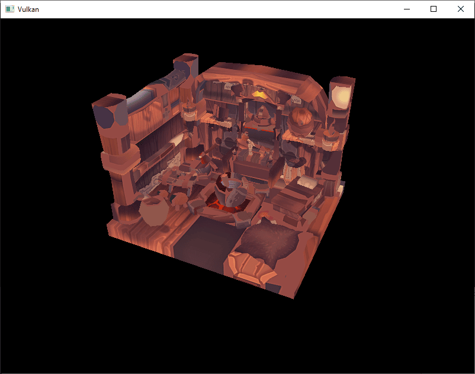
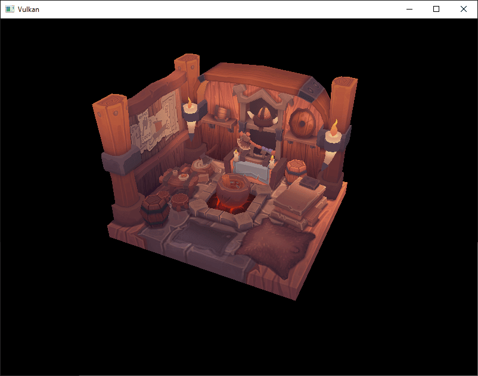

:pp: {plus}{plus}

= 加载模型

== 简介

你的程序现在可以渲染带纹理的 3D 网格了，但 `vertices` 和 `indices` 数组里当前的几何体还不太有意思。
在本章中，我们会扩展这个程序，从真正的模型文件加载顶点和索引，好让显卡真正干点活。

许多图形 API 教程会在这样一章里让读者自己编写 OBJ 加载器。
问题在于，任何稍微有意思的 3D 应用很快就会需要这种文件格式不支持的特性，比如骨骼动画。
在本章中我们_确实会_从 OBJ 模型加载网格数据，但重点更多放在把网格数据集成到程序本身，而不是从文件加载的细节上。

== 库

我们将使用 https://github.com/syoyo/tinyobjloader[tinyobjloader] 库从 OBJ 文件加载顶点和面。
它速度很快，而且很容易集成，因为和 stb_image 一样是单文件库。
它在 xref:02_Development_environment.adoc[开发环境] 一章中已经提到过，应该已经包含在本教程这一部分所需的依赖里。

== 更新片元着色器

回到 xref:06_Texture_mapping/02_Combined_image_sampler.adoc[组合图像采样器] 一章，我们把采样得到的纹理颜色乘以插值后的逐顶点颜色，以演示两者是如何结合的：

[,slang]
----
return float4(vertIn.fragColor * texture.Sample(vertIn.fragTexCoord).rgb, 1.0);
----

我们即将加载的模型把光照直接烘焙进了纹理，并没有设置有意义的逐顶点颜色，所以那次乘法只会给模型染上不想要的颜色。把片元着色器的 `fragMain` 改回直接采样纹理，不涉及逐顶点颜色：

[,slang]
----
return texture.Sample(vertIn.fragTexCoord);
----

如果跳过这一步，等你读到本章末尾时，模型渲染出来的颜色会明显不对。

== 示例网格

本章还不会启用光照，所以最好使用一个把光照烘焙进纹理的示例模型。
找这类模型的一个简单办法，是在 https://sketchfab.com/[Sketchfab] 上寻找 3D 扫描模型。
该网站上的许多模型都以 OBJ 格式提供，并且采用宽松的许可证。

对本教程而言，我选择的是 https://sketchfab.com/3d-models/viking-room-a49f1b8e4f5c4ecf9e1fe7d81915ad38[Viking room] 模型，作者是 https://sketchfab.com/nigelgoh[nigelgoh]（https://web.archive.org/web/20200428202538/https://sketchfab.com/3d-models/viking-room-a49f1b8e4f5c4ecf9e1fe7d81915ad38[CC BY 4.0]）。
我调整了模型的尺寸和朝向，让它可以直接替换当前的几何体：

* xref:attachment$assets/viking_room.obj[viking_room.obj]
* xref:attachment$assets/viking_room.png[viking_room.png]

你也可以随意用自己的模型，但要确保它只包含一种材质，且尺寸大约为 1.5 x 1.5 x 1.5 单位。
如果比这更大，你就得修改视图矩阵。
把模型文件放到 `shaders` 和 `textures` 旁边新建的 `models` 目录中，把纹理图像放到 `textures` 目录中。

在程序里新增两个配置变量，分别定义模型和纹理的路径：

[,c++]
----
constexpr uint32_t WIDTH                = 800;
constexpr uint32_t HEIGHT               = 600;
const std::string  MODEL_PATH           = "models/viking_room.obj";
const std::string  TEXTURE_PATH         = "textures/viking_room.png";
----

然后修改 `createTextureImage`，改用这个路径变量：

[,c++]
----
stbi_uc* pixels = stbi_load(TEXTURE_PATH.c_str(), &texWidth, &texHeight, &texChannels, STBI_rgb_alpha);
----

== 加载顶点与索引

我们现在要从模型文件加载顶点和索引，所以你应该删掉全局的 `vertices` 和 `indices` 数组。
把它们替换成作为类成员的非 const 容器：

[,c++]
----
std::vector<Vertex>    vertices;
std::vector<uint32_t>  indices;
vk::raii::Buffer       vertexBuffer       = nullptr;
vk::raii::DeviceMemory vertexBufferMemory = nullptr;
vk::raii::Buffer       indexBuffer        = nullptr;
vk::raii::DeviceMemory indexBufferMemory  = nullptr;
----

你应该把索引的类型从 `uint16_t` 改成 `uint32_t`，因为顶点数量会远超 65535。
稍显复杂的写法 `vk::IndexTypeValue<decltype(indices)::value_type>::value` 会自动取出索引的类型。

[,c++]
----
commandBuffer.bindIndexBuffer(*indexBuffer, 0, vk::IndexTypeValue<decltype(indices)::value_type>::value);
----

tinyobjloader 库的引入方式和 STB 库相同。
包含 `tiny_obj_loader.h` 文件，并确保在某个源文件中定义 `TINYOBJLOADER_IMPLEMENTATION`，以包含函数体并避免链接错误：

[,c++]
----
#define TINYOBJLOADER_IMPLEMENTATION
#include <tiny_obj_loader.h>
----

接下来我们编写一个 `loadModel` 函数，用它借助这个库把网格的顶点数据填入 `vertices` 和 `indices` 容器。
它应该在创建顶点缓冲区和索引缓冲区之前被调用：

[,c++]
----
void initVulkan()
{
    ...
    loadModel();
    createVertexBuffer();
    createIndexBuffer();
    ...
}

...

void loadModel()
{
}
----

调用 `tinyobj::LoadObj` 函数即可把模型加载到该库的数据结构中：

[,c++]
----
void loadModel()
{
		tinyobj::attrib_t                attrib;
		std::vector<tinyobj::shape_t>    shapes;
		std::vector<tinyobj::material_t> materials;
		std::string                      warn, err;

		if (!tinyobj::LoadObj(&attrib, &shapes, &materials, &warn, &err, MODEL_PATH.c_str()))
		{
			throw std::runtime_error(warn + err);
		}
}
----

OBJ 文件由位置、法线、纹理坐标和面组成。
面由任意数量的顶点组成，每个顶点通过索引引用一个位置、法线和/或纹理坐标。
这样一来，不仅可以复用整个顶点，还可以复用单个属性。

`attrib` 容器通过其 `attrib.vertices`、`attrib.normals` 和 `attrib.texcoords` 向量保存所有位置、法线和纹理坐标。
`shapes` 容器包含所有独立的对象及其面。
每个面由一组顶点组成，每个顶点包含位置、法线和纹理坐标属性的索引。
OBJ 模型还可以为每个面定义材质和纹理，但我们会忽略这些。

`err` 字符串包含加载文件时发生的错误，`warn` 字符串包含加载文件时发生的警告，比如缺少材质定义。
只有 `LoadObj` 函数返回 `false` 时，加载才算真正失败。
如前所述，OBJ 文件中的面实际上可以包含任意数量的顶点，而我们的应用只能渲染三角形。
幸运的是，`LoadObj` 有一个可选参数可以自动把这类面三角化，该参数默认开启。

我们会把文件中的所有面合并成一个模型，所以只需遍历所有形状：

[,c++]
----
for (const auto& shape : shapes)
{
}
----

三角化功能已经确保每个面有三个顶点，所以现在可以直接遍历顶点并把它们原样放进 `vertices` 向量：

[,c++]
----
for (const auto& shape : shapes)
{
    for (const auto& index : shape.mesh.indices)
    {
        Vertex vertex{};

        vertices.push_back(vertex);
        indices.push_back(indices.size());
    }
}
----

为简单起见，我们暂时假设每个顶点都是唯一的，因此索引就简单地自增。
`index` 变量的类型是 `tinyobj::index_t`，包含 `vertex_index`、`normal_index` 和 `texcoord_index` 成员。
我们需要用这些索引在 `attrib` 数组中查找实际的顶点属性：

[,c++]
----
vertex.pos = {
    attrib.vertices[3 * index.vertex_index + 0],
    attrib.vertices[3 * index.vertex_index + 1],
    attrib.vertices[3 * index.vertex_index + 2]
};

vertex.texCoord = {
    attrib.texcoords[2 * index.texcoord_index + 0],
    attrib.texcoords[2 * index.texcoord_index + 1]
};

vertex.color = {1.0f, 1.0f, 1.0f};
----

可惜 `attrib.vertices` 数组是 `float` 值数组，而不是 `glm::vec3` 之类的东西，所以你需要把索引乘以 `3`。
类似地，每个条目有两个纹理坐标分量。
偏移 `0`、`1` 和 `2` 用于访问 X、Y 和 Z 分量，对于纹理坐标则是 U 和 V 分量。

现在运行程序，你应该会看到类似下面的结果：

很好，几何体看起来是正确的，但纹理出了什么问题？
OBJ 格式假设的坐标系中，垂直坐标 `0` 表示图像底部，而我们上传到 Vulkan 的图像采用的是从上到下的方向，其中 `0` 表示图像顶部。
把纹理坐标的垂直分量翻转过来即可解决：

[,c++]
----
vertex.texCoord = {
    attrib.texcoords[2 * index.texcoord_index + 0],
    1.0f - attrib.texcoords[2 * index.texcoord_index + 1]
};
----

再次运行程序，现在你应该能看到正确的结果：

有了这样的演示，之前所有的辛苦终于开始有回报了！

____
随着模型旋转，你可能会注意到背面（墙的内侧）看起来有点奇怪。
这是正常的，只是因为模型本来就不是为从那个方向观看而设计的。
____

== 顶点去重

可惜我们还没有真正利用索引缓冲区。
`vertices` 向量中包含大量重复的顶点数据，因为许多顶点被多个三角形共用。
我们应该只保留唯一的顶点，并在它们出现时借助索引缓冲区复用。
一种直接的实现方式是使用 `map` 或 `unordered_map` 记录唯一顶点及对应的索引：

[,c++]
----
#include <unordered_map>

...

std::unordered_map<Vertex, uint32_t> uniqueVertices{};

for (const auto& shape : shapes)
{
    for (const auto& index : shape.mesh.indices)
    {
        Vertex vertex{};

        ...

				auto [it, inserted] = uniqueVertices.insert({vertex, static_cast<uint32_t>(vertices.size())});
				if (inserted)
				{
            vertices.push_back(vertex);
				}

				indices.push_back(it->second);
    }
}
----

每次从 OBJ 文件读到一个顶点，我们都插入 `{ vertex, index }` 键值对，其中索引是 `vertices` 数组当前的大小。
只有当顶点确实被 `inserted` 时，才会同时设置索引值。否则，该 `vertex` 在 map 中的索引保持不变。
而如果顶点被 `inserted`，我们就把它存入 `vertices`。
无论哪种情况，该顶点在 `vertices` 向量中的索引都会被加入 `indices` 向量。

程序现在会编译失败，因为把 `Vertex` 结构体这样的用户自定义类型用作哈希表的键，需要我们实现两个函数：相等性测试和哈希计算。
前者很容易实现，只需在 `Vertex` 结构体中重载 `==` 运算符：

[,c++]
----
bool operator==(const Vertex& other) const
{
    return pos == other.pos && color == other.color && texCoord == other.texCoord;
}
----

为 `Vertex` 实现哈希函数，需要为 `std::hash<T>` 指定一个模板特化。
哈希函数是个复杂的话题，但 https://en.cppreference.com/w/cpp/utility/hash[cppreference.com 建议]采用下面这种方法，把结构体的各个字段组合起来，构造出质量尚可的哈希函数：

[,c++]
----
namespace std
{
    template<> struct hash<Vertex>
    {
        size_t operator()(Vertex const& vertex) const
        {
            return ((hash<glm::vec3>()(vertex.pos) ^ (hash<glm::vec3>()(vertex.color) << 1)) >> 1) ^ (hash<glm::vec2>()(vertex.texCoord) << 1);
        }
    };
}
----

这段代码应该放在 `Vertex` 结构体之外。
GLM 类型的哈希函数需要通过下面的头文件引入：

[,c++]
----
#define GLM_ENABLE_EXPERIMENTAL
#include <glm/gtx/hash.hpp>
----

这些哈希函数定义在 `gtx` 文件夹中，这意味着严格来说它仍是 GLM 的实验性扩展。
因此，你需要定义 `GLM_ENABLE_EXPERIMENTAL` 才能使用它。
这意味着该 API 在未来的 GLM 新版本中可能发生变化，但实际上这个 API 非常稳定。

现在你应该可以成功编译并运行程序了。
如果查看 `vertices` 的大小，你会看到它从 11,484 降到了 3,566！
这意味着每个顶点平均被大约 3 个三角形复用。
这无疑为我们节省了大量 GPU 内存。

在 xref:09_Generating_Mipmaps.adoc[下一章]中，我们将学习一种改善纹理渲染的技术。

link:/attachments/28_model_loading.cpp[C{pp} 代码] /
link:/attachments/27_shader_depth.slang[slang 着色器] /
link:/attachments/27_shader_depth.vert[GLSL 顶点着色器] /
link:/attachments/27_shader_depth.frag[GLSL 片元着色器]
