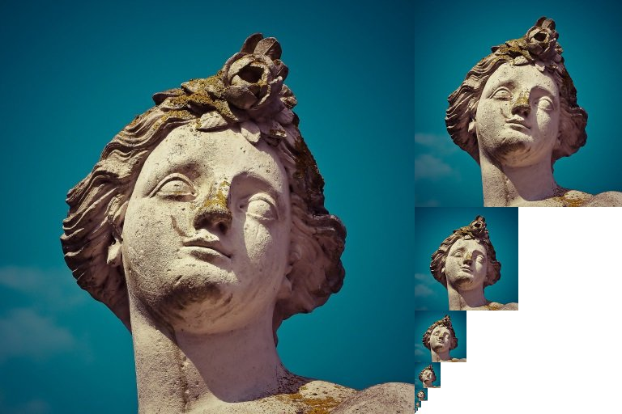
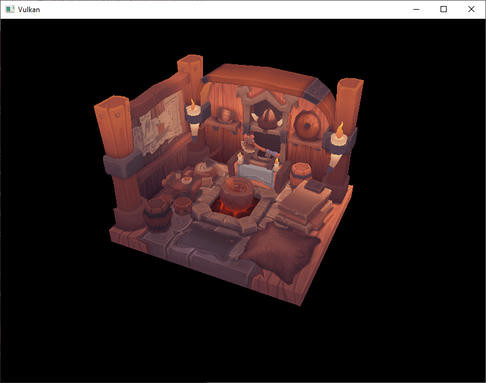
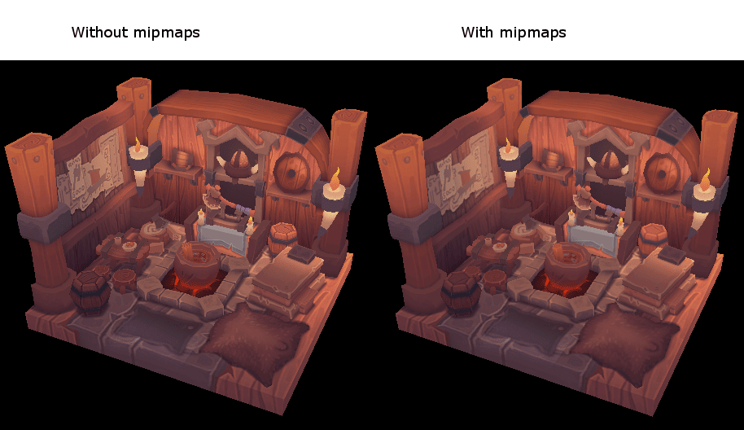
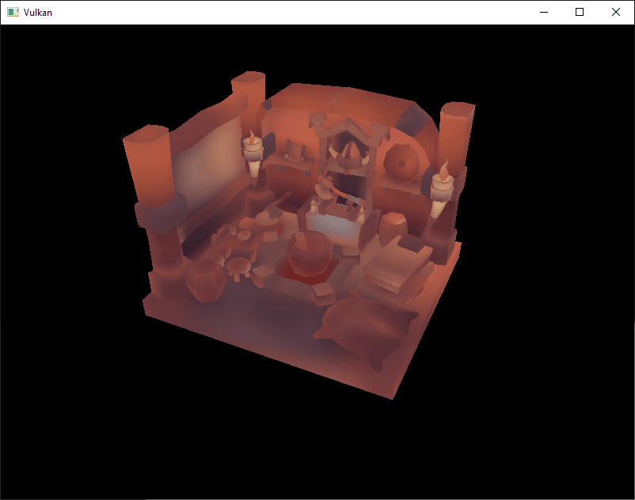

:pp: {plus}{plus}

= 生成 mipmap

== 简介

我们的程序现在可以加载并渲染 3D 模型了。
在本章中，我们再添加一项功能：mipmap 生成。
mipmap 在游戏和渲染软件中被广泛使用，而 Vulkan 让我们可以完全控制它们的创建方式。

mipmap 是预先计算好的、缩小版的图像。
每一张新图像的宽和高都是上一张的一半。
mipmap 被用作一种_细节层次_（_Level of Detail_，LOD）。
离相机较远的对象会从较小的 mip 图像中采样纹理。
使用较小的图像可以提升渲染速度，并避免 https://en.wikipedia.org/wiki/Moir%C3%A9_pattern[摩尔纹] 之类的瑕疵。
下面是 mipmap 的一个示例：

== 创建图像

在 Vulkan 中，每一张 mip 图像都存储在 `vk::Image` 的不同_mip 层级_中。
mip 层级 0 是原始图像，层级 0 之后的 mip 层级通常被称为 _mip 链_。

mip 层级的数量在创建 `vk::Image` 时指定。
到目前为止，我们一直把这个值设为 1。
我们需要根据图像的尺寸计算 mip 层级的数量。
首先，添加一个类成员来保存这个数量：

[,c++]
----
...
uint32_t               mipLevels          = 0;
vk::raii::Image        textureImage       = nullptr;
...
----

在 `createTextureImage` 中加载纹理之后，就可以算出 `mipLevels` 的值：

[,c++]
----
int            texWidth, texHeight, texChannels;
stbi_uc       *pixels    = stbi_load(TEXTURE_PATH.c_str(), &texWidth, &texHeight, &texChannels, STBI_rgb_alpha);
...
mipLevels = static_cast<uint32_t>(std::floor(std::log2(std::max(texWidth, texHeight)))) + 1;
----

这会计算出 mip 链中的层级数量。
`max` 函数选出最大的维度。
`log2` 函数计算该维度可以被 2 整除多少次。
`floor` 函数处理最大维度不是 2 的幂的情况。
加上 `1` 是为了让原始图像也有一个 mip 层级。

要使用这个值，我们需要修改 `createImage`、`createImageView` 和 `transitionImageLayout` 函数，让它们可以指定 mip 层级数量。
给这些函数添加一个 `mipLevels` 参数：

[,c++]
----
std::pair<vk::raii::Image, vk::raii::DeviceMemory>
    createImage(uint32_t                width,
                uint32_t                height,
                uint32_t                mipLevels,
                vk::Format              format,
                vk::ImageTiling         tiling,
                vk::ImageUsageFlags     usage,
                vk::MemoryPropertyFlags properties) {
    vk::ImageCreateInfo imageInfo{
        .imageType     = vk::ImageType::e2D,
        .format        = format,
        .extent        = {width, height, 1},
        .mipLevels     = mipLevels,
    ...
}
----

[,c++]
----
vk::raii::ImageView createImageView(vk::Image const &image, vk::Format format, vk::ImageAspectFlags aspectFlags, uint32_t mipLevels) const
{
		vk::ImageViewCreateInfo viewInfo{
		    .image            = image,
		    .viewType         = vk::ImageViewType::e2D,
		    .format           = format,
		    .subresourceRange = {.aspectMask = aspectFlags, .levelCount = mipLevels, .layerCount = 1}};
    ...
}
----

[,c++]
----
void transitionImageLayout(
    vk::raii::CommandBuffer &commandBuffer, vk::raii::Image const &image, vk::ImageLayout oldLayout, vk::ImageLayout newLayout, uint32_t mipLevels)
{
		vk::ImageMemoryBarrier barrier{
		    .oldLayout           = oldLayout,
		    .newLayout           = newLayout,
		    .srcQueueFamilyIndex = vk::QueueFamilyIgnored,
		    .dstQueueFamilyIndex = vk::QueueFamilyIgnored,
		    .image               = image,
		    .subresourceRange    = {.aspectMask = vk::ImageAspectFlagBits::eColor, .levelCount = mipLevels, .layerCount = 1}};
    ...
----

把所有对这些函数的调用都改成正确的值：

[,c++]
----
std::tie(depthImage, depthImageMemory) = createImage(swapChainExtent.width,
                                                     swapChainExtent.height,
                                                     1,
                                                     depthFormat,
                                                     vk::ImageTiling::eOptimal,
                                                     vk::ImageUsageFlagBits::eDepthStencilAttachment,
                                                     vk::MemoryPropertyFlagBits::eDeviceLocal);
...
std::tie(textureImage, textureImageMemory) =
    createImage(texWidth,
                texHeight,
                mipLevels,
                vk::Format::eR8G8B8A8Srgb,
                vk::ImageTiling::eOptimal,
                vk::ImageUsageFlagBits::eTransferSrc | vk::ImageUsageFlagBits::eTransferDst | vk::ImageUsageFlagBits::eSampled,
                vk::MemoryPropertyFlagBits::eDeviceLocal);
----

[,c++]
----
swapChainImageViews.emplace_back(createImageView(image, swapChainSurfaceFormat.format, vk::ImageAspectFlagBits::eColor, 1));
...
depthImageView = createImageView(depthImage, depthFormat, vk::ImageAspectFlagBits::eDepth, 1);
...
textureImageView = createImageView(*textureImage, vk::Format::eR8G8B8A8Srgb, vk::ImageAspectFlagBits::eColor, mipLevels);
----

在上一章里，`createTextureImage` 分别调用了三次 `beginSingleTimeCommands` 和 `endSingleTimeCommands`：一次用于布局转换，一次用于缓冲区到图像的拷贝，一次用于最后转换到着色器读取布局。
生成 mipmap 会为每个 mip 层级额外增加一次 blit 和两次布局转换，为其中每一次都新开一个命令缓冲区会很浪费。
所以改为：`createTextureImage` 只在开始时调用一次 `beginSingleTimeCommands`，把转换、拷贝以及整个 `generateMipmaps` 都录制到同一个命令缓冲区中，最后只在最末尾调用一次 `endSingleTimeCommands`。
`beginSingleTimeCommands` 和 `endSingleTimeCommands` 本身没有变化——我们只是调用得没那么频繁了：

[,c++]
----
vk::raii::CommandBuffer commandBuffer = beginSingleTimeCommands();
transitionImageLayout(commandBuffer, textureImage, vk::ImageLayout::eUndefined, vk::ImageLayout::eTransferDstOptimal, mipLevels);
----

== 生成 mipmap

我们的纹理图像现在有多个 mip 层级了，但暂存缓冲区只能用来填充 mip 层级 0。
其它层级仍未定义。
要填充这些层级，我们需要根据已有的这一个层级生成数据。
我们将使用 `vk::raii::CommandBuffer::blitImage` 命令。
该命令执行拷贝、缩放和过滤操作。
我们会多次调用它，把数据 _blit_ 到纹理图像的每个层级。

`vk::raii::CommandBuffer::blitImage` 被视为传输操作，所以我们必须告知 Vulkan，我们打算把纹理图像同时用作传输的源和目标。
在 `createTextureImage` 中给纹理图像的用途标志加上 `vk::ImageUsageFlagBits::eTransferSrc`：

[,c++]
----
...
std::tie(textureImage, textureImageMemory) =
    createImage(texWidth,
                texHeight,
                mipLevels,
                vk::Format::eR8G8B8A8Srgb,
                vk::ImageTiling::eOptimal,
                vk::ImageUsageFlagBits::eTransferSrc | vk::ImageUsageFlagBits::eTransferDst | vk::ImageUsageFlagBits::eSampled,
                vk::MemoryPropertyFlagBits::eDeviceLocal);
...
----

和其它图像操作一样，`vk::raii::CommandBuffer::blitImage` 也取决于它所操作的图像的布局。
我们可以把整张图像转换到 `vk::ImageLayout::eGeneral`，但这很可能会很慢。
为了获得最佳性能，源图像应处于 `vk::ImageLayout::eTransferSrcOptimal`，目标图像应处于 `vk::ImageLayout::eTransferDstOptimal`。
Vulkan 允许我们独立地转换图像的每个 mip 层级。
每次 blit 只涉及两个 mip 层级，所以我们可以在各条 blit 命令之间把每个层级转换到最优布局。

`transitionImageLayout` 只对整张图像执行布局转换，因此我们需要再写几条管线屏障命令。
删掉 `createTextureImage` 中现有的到 `vk::ImageLayout::eShaderReadOnlyOptimal` 的转换：

[,c++]
----
...
transitionImageLayout(commandBuffer, textureImage, vk::ImageLayout::eUndefined, vk::ImageLayout::eTransferDstOptimal, mipLevels);
copyBufferToImage(commandBuffer, stagingBuffer, textureImage, static_cast<uint32_t>(texWidth), static_cast<uint32_t>(texHeight));
//transitioned to vk::ImageLayout::eShaderReadOnlyOptimal while generating mipmaps
...
----

这会让纹理图像的每个层级都停留在 `vk::ImageLayout::eTransferDstOptimal`。
每个层级在读取它的 blit 命令完成之后，都会被转换到 `vk::ImageLayout::eShaderReadOnlyOptimal`。

现在我们来编写生成 mipmap 的函数：

[,c++]
----
void generateMipmaps(vk::raii::CommandBuffer &commandBuffer,
                     vk::raii::Image         &image,
                     int32_t                  texWidth,
                     int32_t                  texHeight,
                     uint32_t                 mipLevels) {
    vk::ImageMemoryBarrier barrier = {
        .srcAccessMask       = vk::AccessFlagBits::eTransferWrite,
        .dstAccessMask       = vk::AccessFlagBits::eTransferRead,
        .oldLayout           = vk::ImageLayout::eTransferDstOptimal,
        .newLayout           = vk::ImageLayout::eTransferSrcOptimal,
        .srcQueueFamilyIndex = vk::QueueFamilyIgnored,
        .dstQueueFamilyIndex = vk::QueueFamilyIgnored,
        .image               = image,
        .subresourceRange    = {.aspectMask = vk::ImageAspectFlagBits::eColor, .levelCount = 1, .layerCount = 1}};
}
----

我们会进行多次转换，所以会复用这个 `vk::ImageMemoryBarrier`。
上面设置的字段在所有屏障中都保持不变。
`subresourceRange.miplevel`、`oldLayout`、`newLayout`、`srcAccessMask` 和 `dstAccessMask` 会在每次转换时修改。

[,c++]
----
int32_t mipWidth  = texWidth;
int32_t mipHeight = texHeight;

for (uint32_t i = 1; i < mipLevels; i++)
{
}
----

这个循环会录制每一条 `vk::raii::CommandBuffer::blitImage` 命令。
注意循环变量从 1 开始，而不是 0。

[,c++]
----
barrier.subresourceRange.baseMipLevel = i - 1;
barrier.oldLayout                     = vk::ImageLayout::eTransferDstOptimal;
barrier.newLayout                     = vk::ImageLayout::eTransferSrcOptimal;
barrier.srcAccessMask                 = vk::AccessFlagBits::eTransferWrite;
barrier.dstAccessMask                 = vk::AccessFlagBits::eTransferRead;

commandBuffer.pipelineBarrier(vk::PipelineStageFlagBits::eTransfer, vk::PipelineStageFlagBits::eTransfer, {}, {}, {}, barrier);
----

首先，我们把层级 `i - 1` 转换到 `vk::ImageLayout::eTransferSrcOptimal`。
这次转换会等待层级 `i - 1` 被填充完毕——要么来自上一条 blit 命令，要么来自 `vk::raii::CommandBuffer::copyBufferToImage`。
当前的 blit 命令会等待这次转换完成。

[,c++]
----
vk::ImageBlit blit = {.srcSubresource = {.aspectMask = vk::ImageAspectFlagBits::eColor, .mipLevel = i - 1, .layerCount = 1},
                      .srcOffsets     = std::array<vk::Offset3D, 2>({{}, {mipWidth, mipHeight, 1}}),
                      .dstSubresource = {.aspectMask = vk::ImageAspectFlagBits::eColor, .mipLevel = i, .layerCount = 1},
                      .dstOffsets     = std::array<vk::Offset3D, 2>({{}, {1 < mipWidth ? mipWidth / 2 : 1, 1 < mipHeight ? mipHeight / 2 : 1, 1}})};
----

接下来，我们指定 blit 操作中使用的区域。
源 mip 层级是 `i - 1`，目标 mip 层级是 `i`。
`srcOffsets` 数组的两个元素决定了数据从哪个 3D 区域 blit 出来。
`dstOffsets` 决定数据要 blit 到哪个区域。
`dstOffsets[1]` 的 X 和 Y 维度要除以 2，因为每个 mip 层级的大小都是上一级的一半。
`srcOffsets[1]` 和 `dstOffsets[1]` 的 Z 维度必须是 1，因为 2D 图像的深度为 1。

[,c++]
----
commandBuffer.blitImage(image, vk::ImageLayout::eTransferSrcOptimal, image, vk::ImageLayout::eTransferDstOptimal, blit, vk::Filter::eLinear);
----

现在，我们录制 blit 命令。
注意 `image` 同时用于 `srcImage` 和 `dstImage` 参数。
这是因为我们在同一张图像的不同层级之间做 blit。
源 mip 层级刚刚被转换到 `vk::ImageLayout::eTransferSrcOptimal`，而目标层级因为 `createTextureImage` 中的转换仍处于 `vk::ImageLayout::eTransferDstOptimal`。

如果你使用的是专用传输队列（如 xref:04_Vertex_buffers/02_Staging_buffer.adoc[暂存缓冲区] 中所建议的），请注意：`vk::raii::CommandBuffer::blitImage` 必须提交到具备图形能力的队列。

最后一个参数让我们可以指定 blit 中使用的 `vk::Filter`。
这里的过滤选项与创建 `vk::raii::Sampler` 时相同。
我们使用 `vk::Filter::eLinear` 来启用插值。

[,c++]
----
barrier.oldLayout     = vk::ImageLayout::eTransferSrcOptimal;
barrier.newLayout     = vk::ImageLayout::eShaderReadOnlyOptimal;
barrier.srcAccessMask = vk::AccessFlagBits::eTransferRead;
barrier.dstAccessMask = vk::AccessFlagBits::eShaderRead;

commandBuffer.pipelineBarrier(vk::PipelineStageFlagBits::eTransfer, vk::PipelineStageFlagBits::eFragmentShader, {}, {}, {}, barrier);
----

这个屏障把 mip 层级 `i - 1` 转换到 `vk::ImageLayout::eShaderReadOnlyOptimal`。
这次转换会等待当前的 blit 命令完成。
所有采样操作都会等待这次转换完成。

[,c++]
----
    ...
    if (1 < mipWidth)
    {
      mipWidth /= 2;
    }
    if (1 < mipHeight)
    {
      mipHeight /= 2;
    }
}
----

在循环末尾，我们把当前的 mip 尺寸除以 2。
在除法之前会检查每个维度，确保该维度永远不会变成 0。
这可以处理图像不是正方形的情况，因为其中一个 mip 维度会先于另一个维度到达 1。
发生这种情况时，该维度在剩余所有层级中都应保持为 1。

[,c++]
----
		barrier.subresourceRange.baseMipLevel = mipLevels - 1;
		barrier.oldLayout                     = vk::ImageLayout::eTransferDstOptimal;
		barrier.newLayout                     = vk::ImageLayout::eShaderReadOnlyOptimal;
		barrier.srcAccessMask                 = vk::AccessFlagBits::eTransferWrite;
		barrier.dstAccessMask                 = vk::AccessFlagBits::eShaderRead;

		commandBuffer.pipelineBarrier(vk::PipelineStageFlagBits::eTransfer, vk::PipelineStageFlagBits::eFragmentShader, {}, {}, {}, barrier);
}
----

最后，我们再插入一条管线屏障。
这个屏障把最后一个 mip 层级从 `vk::ImageLayout::eTransferDstOptimal` 转换到 `vk::ImageLayout::eShaderReadOnlyOptimal`。
循环没有处理这一点，因为最后一个 mip 层级永远不会作为 blit 的源。

最后，在 `createTextureImage` 中添加对 `generateMipmaps` 的调用，并在所有操作都录制进我们本章开头打开的单次命令缓冲区之后，结束这个命令缓冲区：

[,c++]
----
transitionImageLayout(commandBuffer, textureImage, vk::ImageLayout::eUndefined, vk::ImageLayout::eTransferDstOptimal, mipLevels);
copyBufferToImage(commandBuffer, stagingBuffer, textureImage, static_cast<uint32_t>(texWidth), static_cast<uint32_t>(texHeight));
//transitioned to vk::ImageLayout::eShaderReadOnlyOptimal while generating mipmaps
generateMipmaps(commandBuffer, textureImage, texWidth, texHeight, mipLevels);
endSingleTimeCommands(std::move(commandBuffer));
----

我们的纹理图像的 mipmap 现在填充完毕了。

== 线性过滤支持

使用 `vk::raii::CommandBuffer::blitImage` 这样的内置函数来生成所有 mip 层级非常方便，但遗憾的是，并不能保证所有平台都支持它。
它要求我们使用的纹理图像格式支持线性过滤，这可以用 `vk::raii::PhysicalDevice::getFormatProperties` 函数来检查。
我们会在 `generateMipmaps` 函数中为此添加一项检查。

首先，添加一个指定图像格式的参数：

[,c++]
----
void createTextureImage()
{
    ...
    generateMipmaps(commandBuffer, textureImage, vk::Format::eR8G8B8A8Srgb, texWidth, texHeight, mipLevels);
}

void generateMipmaps(vk::raii::CommandBuffer &commandBuffer,
                     vk::raii::Image         &image,
                     vk::Format               imageFormat,
                     int32_t                  texWidth,
                     int32_t                  texHeight,
                     uint32_t                 mipLevels)
{
    ...
}
----

在 `generateMipmaps` 函数中，用 `vk::raii::PhysicalDevice::getFormatProperties` 查询纹理图像格式的属性：

[,c++]
----
void generateMipmaps(vk::raii::CommandBuffer &commandBuffer,
                     vk::raii::Image         &image,
                     vk::Format               imageFormat,
                     int32_t                  texWidth,
                     int32_t                  texHeight,
                     uint32_t                 mipLevels)
{
    // Check if image format supports linear blit-ing
    vk::FormatProperties formatProperties = physicalDevice->getFormatProperties(imageFormat);
    ...
----

`vk::FormatProperties` 结构体有三个字段：`linearTilingFeatures`、`optimalTilingFeatures` 和 `bufferFeatures`，它们分别描述该格式在不同使用方式下的可用特性。
我们创建的纹理图像使用最优平铺格式，所以需要检查 `optimalTilingFeatures`。
线性过滤特性的支持情况可以用 `vk::FormatFeatureFlagBits::eSampledImageFilterLinear` 检查：

[,c++]
----
if (!(formatProperties.optimalTilingFeatures & vk::FormatFeatureFlagBits::eSampledImageFilterLinear))
{
  throw std::runtime_error("texture image format does not support linear blitting!");
}
----

这种情况下有两种替代方案。
你可以实现一个函数，在常见的纹理图像格式中搜索_确实_支持线性 blit 的格式；也可以用 https://github.com/nothings/stb/blob/master/stb_image_resize.h[stb_image_resize] 之类的库在软件中实现 mipmap 生成。
然后，每个 mip 层级都可以用与加载原始图像相同的方式加载到图像中。

需要注意的是，实践中在运行时生成 mipmap 层级并不常见。
通常它们会被预先生成，与基础层级一起存放在纹理文件中，以提高加载速度。
在软件中实现缩放并从文件加载多个层级，留作读者的练习。

== 采样器

`vk::raii::Image` 保存 mipmap 数据，而 `vk::raii::Sampler` 控制渲染时如何读取这些数据。
Vulkan 允许我们指定 `minLod`、`maxLod`、`mipLodBias` 和 `mipmapMode`（“Lod” 意为 “Level of Detail”，即细节层次）。
采样纹理时，采样器按下面的伪代码选择 mip 层级：

[,c++]
----
lod = getLodLevelFromScreenSize(); //smaller when the object is close, may be negative
lod = clamp(lod + mipLodBias, minLod, maxLod);

level = clamp(floor(lod), 0, texture.mipLevels - 1);  //clamped to the number of mip levels in the texture

if (mipmapMode == vk::SamplerMipmapMode::eNearest)
{
    color = sample(level);
}
else
{
    color = blend(sample(level), sample(level + 1));
}
----

如果 `samplerInfo.mipmapMode` 是 `vk::SamplerMipmapMode::eNearest`，`lod` 会选择要采样的 mip 层级。
如果 mipmap 模式是 `vk::SamplerMipmapMode::eLinear`，`lod` 会用于选择两个要采样的 mip 层级。
这两个层级被采样，然后结果进行线性混合。

采样操作也受 `lod` 影响：

[,c++]
----
if (lod <= 0)
{
    color = readTexture(uv, magFilter);
}
else
{
    color = readTexture(uv, minFilter);
}
----

如果对象离相机很近，就使用 `magFilter` 作为过滤器。
如果对象离相机较远，就使用 `minFilter`。
通常 `lod` 是非负的，只有在靠近相机时才为 0。
`mipLodBias` 让我们可以强制 Vulkan 使用比通常更低的 `lod` 和 `level`。

要看到本章的效果，我们需要为 `textureSampler` 选择取值。
我们已经把 `minFilter` 和 `magFilter` 设置为使用 `vk::Filter::eLinear`。
我们只需要为 `minLod`、`maxLod`、`mipLodBias` 和 `mipmapMode` 选择取值。

[,c++]
----
void createTextureSampler()
{
    vk::PhysicalDeviceProperties properties = physicalDevice.getProperties();
		vk::SamplerCreateInfo        samplerInfo{
		    .magFilter        = vk::Filter::eLinear,
		    .minFilter        = vk::Filter::eLinear,
		    .mipmapMode       = vk::SamplerMipmapMode::eLinear,
		    .addressModeU     = vk::SamplerAddressMode::eRepeat,
		    .addressModeV     = vk::SamplerAddressMode::eRepeat,
		    .addressModeW     = vk::SamplerAddressMode::eRepeat,
		    .mipLodBias       = 0.0f,
		    .anisotropyEnable = vk::True,
		    .maxAnisotropy    = properties.limits.maxSamplerAnisotropy,
		    .compareEnable    = vk::False,
		    .compareOp        = vk::CompareOp::eAlways,
		    .minLod           = 0.0f,
		    .maxLod           = vk::LodClampNone};
    ...
}
----

在上面的代码中，我们把采样器设置为在缩小和放大时都使用线性过滤，并在 mip 层级之间做线性插值。我们还将 mip 层级偏置设为 0.0f。

`minLod` 和 `maxLod` 通过钳制最小和最大 LOD 值，有效地设定要使用的 mip 层级范围。把 `minLod` 设为 `0.0f`、`maxLod` 设为 `vk::LodClampNone`，就能确保使用完整的 mip 层级范围。

现在运行程序，你应该会看到：

由于我们的场景非常简单，差别并不明显。
但仔细看的话，会有细微的差别。

最明显的差别是纸张上的文字。
使用 mipmap 时，文字变得平滑了。
不使用 mipmap 时，文字有生硬的边缘，还有摩尔纹造成的缺口。

你可以试着调整采样器设置，看看它们如何影响 mipmap。
例如，通过修改 `minLod`，你可以强制采样器不使用最低的 mip 层级：

[,c++]
----
samplerInfo.minLod = static_cast<float>(mipLevels / 2);
----

这些设置会产生下面这张图像：

当对象离相机更远时，就会这样使用更高的 mip 层级。

xref:10_Multisampling.adoc[下一章]将带我们了解多重采样，以生成更平滑的图像。

link:/attachments/29_mipmapping.cpp[C{pp} 代码] /
link:/attachments/27_shader_depth.slang[slang 着色器] /
link:/attachments/27_shader_depth.vert[GLSL 顶点着色器] /
link:/attachments/27_shader_depth.frag[GLSL 片元着色器]
