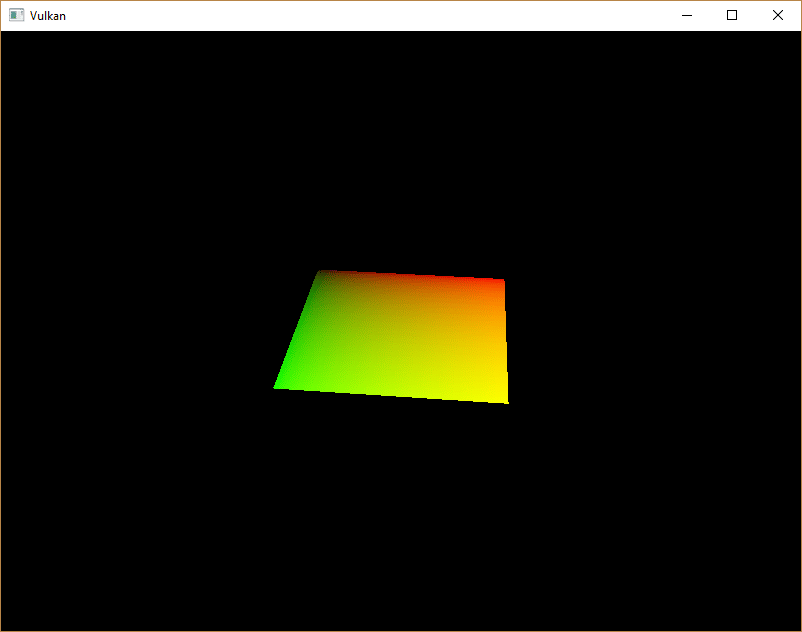
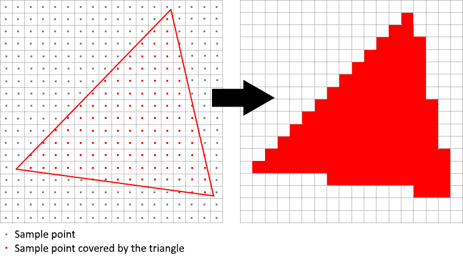
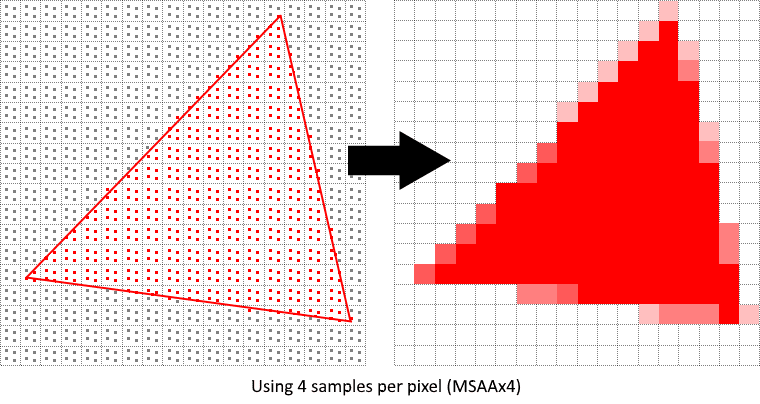
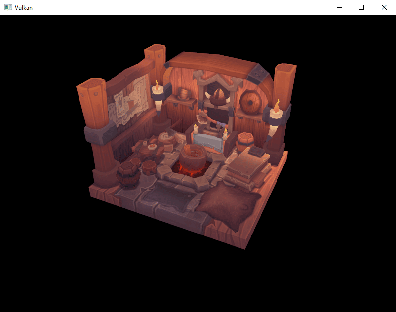
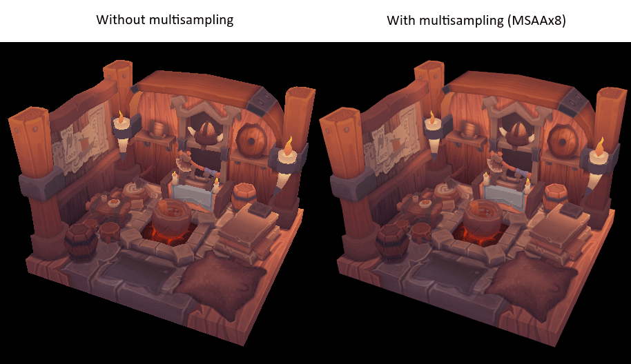
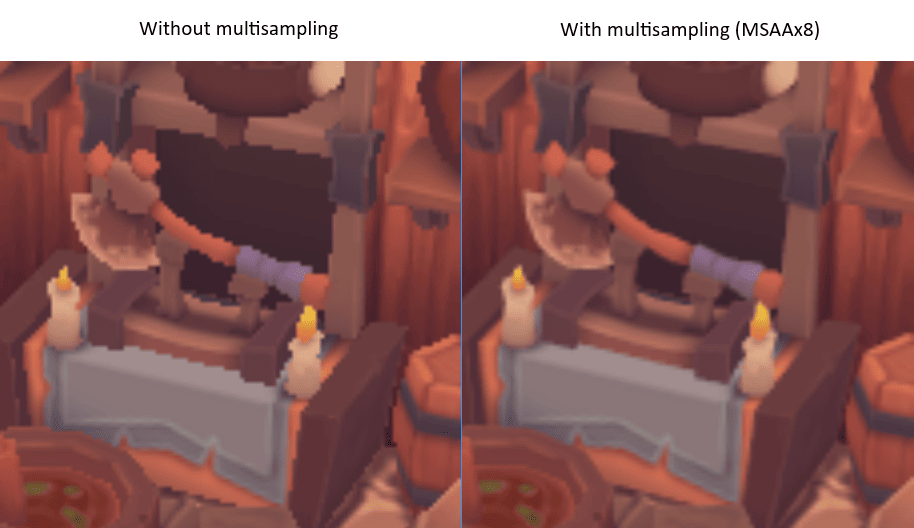
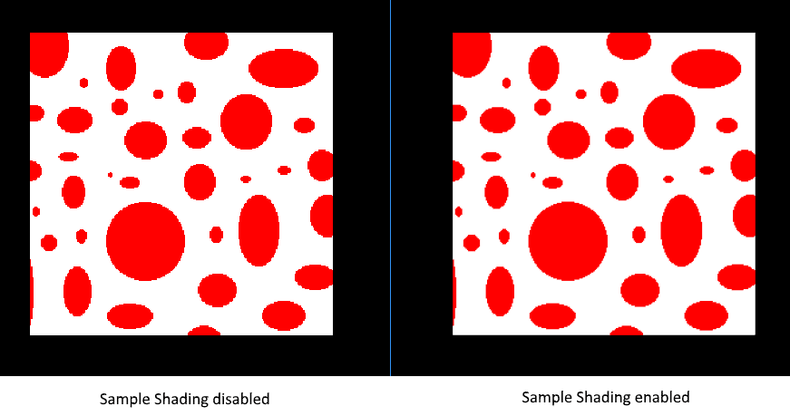

:pp: {plus}{plus}

= 多重采样

== 简介

我们的程序现在可以为纹理加载多个细节层次，从而修复渲染远处物体时的瑕疵。
现在图像平滑了许多；但仔细观察，你会注意到绘制的几何图形边缘有锯齿状的图案。
在我们早期渲染一个四边形时，这一点尤其明显：

这种不想要的效果叫做「走样」（aliasing），它是可用于渲染的像素数量有限造成的。
由于目前还不存在分辨率无限的显示器，所以它在某种程度上总是可见的。
有很多方法可以解决它，本章我们将聚焦其中比较流行的一种： https://en.wikipedia.org/wiki/Multisample_anti-aliasing[多重采样抗锯齿]（MSAA）。

在普通渲染中，像素颜色基于单个采样点确定，这个点大多数情况下是屏幕上目标像素的中心。
如果绘制的线条有一部分穿过某个像素，但没有覆盖到采样点，该像素就会保持空白，从而产生锯齿状的「阶梯」效果。

MSAA 的做法是对每个像素使用多个采样点（名字由此而来）来确定它的最终颜色。
可以想见，采样点越多结果越好，但计算开销也越大。

在我们的实现中，我们将使用可用的最大采样数。
具体到你的应用，这未必总是最佳方案；如果最终结果满足你的质量要求，那么为了更高的性能而使用更少的采样数可能更好。

== 获取可用的采样数

我们先确定硬件可以使用多少个采样。
大多数现代 GPU 至少支持 8 个采样，但这个数字并不保证处处相同。
我们添加一个新的类成员来记录它：

[,c++]
----
...
vk::SampleCountFlagBits msaaSamples = vk::SampleCountFlagBits::e1;
...
----

默认情况下，我们每个像素只使用一个采样，这等价于不做多重采样，此时最终图像保持不变。
确切的最大采样数可以从与所选物理设备关联的 `vk::PhysicalDeviceProperties` 中取得。
我们同时使用了深度缓冲区，所以必须同时考虑颜色和深度的采样数。
两者都支持的最高采样数就是我们能支持的最大值。
添加一个函数来获取这些信息：

[,c++]
----
vk::SampleCountFlagBits getMaxUsableSampleCount() {
  vk::PhysicalDeviceProperties physicalDeviceProperties = physicalDevice->getProperties();

  vk::SampleCountFlags counts = physicalDeviceProperties.limits.framebufferColorSampleCounts & physicalDeviceProperties.limits.framebufferDepthSampleCounts;
  if (counts & vk::SampleCountFlagBits::e64) { return vk::SampleCountFlagBits::e64; }
  if (counts & vk::SampleCountFlagBits::e32) { return vk::SampleCountFlagBits::e32; }
  if (counts & vk::SampleCountFlagBits::e16) { return vk::SampleCountFlagBits::e16; }
  if (counts & vk::SampleCountFlagBits::e8) { return vk::SampleCountFlagBits::e8; }
  if (counts & vk::SampleCountFlagBits::e4) { return vk::SampleCountFlagBits::e4; }
  if (counts & vk::SampleCountFlagBits::e2) { return vk::SampleCountFlagBits::e2; }

  return vk::SampleCountFlagBits::e1;
}
----

现在我们用这个函数在物理设备选择过程中设置 `msaaSamples` 变量。
为此，稍微扩展 `pickPhysicalDevice` 函数：

[,c++]
----
void pickPhysicalDevice()
{
  ...
  physicalDevice = *devIter;
  msaaSamples    = getMaxUsableSampleCount();
  ...
}
----

== 设置渲染目标

在 MSAA 中，每个像素都在一个离屏缓冲区里进行采样，然后再渲染到屏幕。
这个新缓冲区与我们一直渲染到的普通图像略有不同 —— 它们必须能够为每个像素存储多于一个采样。
多重采样缓冲区一旦创建，就必须解析到默认帧缓冲区（它每个像素只存储一个采样）。
这就是为什么我们必须创建一个额外的渲染目标并修改当前的绘制流程。
我们只需要一个渲染目标，因为同一时间只有一个绘制操作处于活动状态，这与深度缓冲区的情况相同。
添加以下类成员：

[,c++]
----
...
vk::raii::Image        colorImage       = nullptr;
vk::raii::DeviceMemory colorImageMemory = nullptr;
vk::raii::ImageView    colorImageView   = nullptr;
...
----

这张新图像必须为每个像素存储所需的采样数，因此在创建图像的过程中我们需要把这个数字传给 `vk::ImageCreateInfo`。
给 `createImage` 函数添加一个 `numSamples` 参数：

[,c++]
----
std::pair<vk::raii::Image, vk::raii::DeviceMemory>
    createImage(uint32_t                width,
                uint32_t                height,
                uint32_t                mipLevels,
                vk::SampleCountFlagBits numSamples,
                vk::Format              format,
                vk::ImageTiling         tiling,
                vk::ImageUsageFlags     usage,
                vk::MemoryPropertyFlags properties)
{
  vk::ImageCreateInfo imageInfo{.imageType     = vk::ImageType::e2D,
                                .format        = format,
                                .extent        = {width, height, 1},
                                .mipLevels     = mipLevels,
                                .arrayLayers   = 1,
                                .samples       = numSamples,
                                .tiling        = tiling,
                                .usage         = usage,
                                .sharingMode   = vk::SharingMode::eExclusive,
                                .initialLayout = vk::ImageLayout::eUndefined};
    ...
----

目前先把该函数的所有调用改用 `vk::SampleCountFlagBits::e1` —— 随着实现的推进，我们会把它替换成合适的值：

[,c++]
----
std::tie(depthImage, depthImageMemory) = createImage(swapChainExtent.width,
                                                     swapChainExtent.height,
                                                     1,
                                                     vk::SampleCountFlagBits::e1,
                                                     depthFormat,
                                                     vk::ImageTiling::eOptimal,
                                                     vk::ImageUsageFlagBits::eDepthStencilAttachment,
                                                     vk::MemoryPropertyFlagBits::eDeviceLocal);
...
std::tie(textureImage, textureImageMemory) =
    createImage(texWidth,
                texHeight,
                mipLevels,
                vk::SampleCountFlagBits::e1,
                vk::Format::eR8G8B8A8Srgb,
                vk::ImageTiling::eOptimal,
                vk::ImageUsageFlagBits::eTransferSrc | vk::ImageUsageFlagBits::eTransferDst | vk::ImageUsageFlagBits::eSampled,
                vk::MemoryPropertyFlagBits::eDeviceLocal);
----

现在我们创建一个多重采样的颜色缓冲区。
添加一个 `createColorResources` 函数，注意这里我们把 `msaaSamples` 作为 `createImage` 的参数传入。
我们还只使用一个 mip 层级，因为在每像素采样数大于 1 的情况下，这是 Vulkan 规范强制要求的。
另外，这个颜色缓冲区不需要 mipmap，因为它不会被当作纹理使用：

[,c++]
----
void createColorResources()
{
  vk::Format colorFormat = swapChainSurfaceFormat.format;

  std::tie(colorImage, colorImageMemory) = createImage(swapChainExtent.width,
                                                       swapChainExtent.height,
                                                       1,
                                                       msaaSamples,
                                                       colorFormat,
                                                       vk::ImageTiling::eOptimal,
                                                       vk::ImageUsageFlagBits::eTransientAttachment | vk::ImageUsageFlagBits::eColorAttachment,
                                                       vk::MemoryPropertyFlagBits::eDeviceLocal);
  colorImageView                         = createImageView(colorImage, colorFormat, vk::ImageAspectFlagBits::eColor, 1);
}
----

为保持一致，把该函数的调用放在 `createDepthResources` 之前：

[,c++]
----
void initVulkan()
{
  ...
  createColorResources();
  createDepthResources();
  ...
}
----

现在多重采样的颜色缓冲区已经就位，该处理深度了。
修改 `createDepthResources`，更新深度缓冲区使用的采样数：

[,c++]
----
void createDepthResources()
{
  ...
  std::tie(depthImage, depthImageMemory) = createImage(swapChainExtent.width,
                                                       swapChainExtent.height,
                                                       1,
                                                       msaaSamples,
                                                       depthFormat,
                                                       vk::ImageTiling::eOptimal,
                                                       vk::ImageUsageFlagBits::eDepthStencilAttachment,
                                                       vk::MemoryPropertyFlagBits::eDeviceLocal);
  ...
}
----

再更新 `recreateSwapChain`，让窗口大小改变时新的颜色图像能以正确的分辨率重新创建：

[,c++]
----
void recreateSwapChain()
{
  ...
  createImageViews();
  createColorResources();
  createDepthResources();
  ...
}
----

最初的 MSAA 设置已经完成，现在我们该在图形管线中使用这个新资源并看看结果了！

== 使用新附件

首先，修改 `createGraphicsPipeline`，让图形管线使用多于一个采样：

[,c++]
----
void createGraphicsPipeline()
{
  ...
  vk::PipelineMultisampleStateCreateInfo multisampling{.rasterizationSamples = msaaSamples};
  ...
}
----

然后我们需要扩展 `recordCommandBuffer`。
除了分别把 `swapChainImages[imageIndex]` 和 `depthImage` 从 `vk::ImageLayout::eUndefined` 转换到 `vk::ImageLayout::eColorAttachmentOptimal` 和 `vk::ImageLayout::eDepthAttachmentOptimal`，我们还需要把新的多重采样 `colorImage` 从 `vk::ImageLayout::eUndefined` 转换到 `vk::ImageLayout::eColorAttachmentOptimal`：

[,c++]
----
void recordCommandBuffer(uint32_t imageIndex)
{
  ...
  // Transition the multisampled color image to vk::ImageLayout::eColorAttachmentOptimal
  transition_image_layout(
      *colorImage,
      vk::ImageLayout::eUndefined,
      vk::ImageLayout::eColorAttachmentOptimal,
      vk::AccessFlagBits2::eColorAttachmentWrite,
      vk::AccessFlagBits2::eColorAttachmentWrite,
      vk::PipelineStageFlagBits2::eColorAttachmentOutput,
      vk::PipelineStageFlagBits2::eColorAttachmentOutput,
      vk::ImageAspectFlagBits::eColor);
  ...
}
----

接下来，在通过 `vk::CommandBuffer::beginRendering` 提交的 `vk::RenderingInfo` 中，我们不再把 `swapChainImageViews[imageIndex]` 用作颜色附件，而是把 `colorImageView` 用作颜色附件，把 `swapChainImageViews[imageIndex]` 用作解析图像视图，并把解析模式设为 `vk::ResolveModeFlagBits::eAverage`：

[,c++]
----
void recordCommandBuffer(uint32_t imageIndex)
{
  ...
  // Color attachment (multisampled) with resolve attachment
  vk::RenderingAttachmentInfo colorAttachment = {
      .imageView          = colorImageView,
      .imageLayout        = vk::ImageLayout::eColorAttachmentOptimal,
      .resolveMode        = vk::ResolveModeFlagBits::eAverage,
      .resolveImageView   = swapChainImageViews[imageIndex],
      .resolveImageLayout = vk::ImageLayout::eColorAttachmentOptimal,
      .loadOp             = vk::AttachmentLoadOp::eClear,
      .storeOp            = vk::AttachmentStoreOp::eStore,
      .clearValue         = clearColor};
  ...
}
----

现在运行程序，你应该会看到下面的结果：

与 mipmap 生成时一样，差异可能不会立刻显现。
仔细观察，你会发现边缘不再那么锯齿分明，整幅图像相比原来也平滑了一些。

近距离观察某条边缘时，差异更加明显：

== 质量改进

当前的 MSAA 实现有一些局限，在细节较多的场景中可能影响输出图像的质量。
例如，我们目前没有解决着色器走样可能带来的问题，也就是说
MSAA 只让几何图形的边缘变平滑，而不处理内部填充。
这可能导致这样一种情况：屏幕上的多边形看起来平滑，但如果它上面的纹理包含高对比度的颜色，纹理看起来仍然有锯齿。
一种应对办法是启用 https://docs.vulkan.org/spec/latest/chapters/vertexpostproc.html#primsrast-sampleshading[采样着色]（Sample Shading），它能进一步提升图像质量，但要付出额外的性能代价：

[,c++]
----
void createLogicalDevice()
{
  ...
  vk::StructureChain<vk::PhysicalDeviceFeatures2, vk::PhysicalDeviceVulkan13Features, vk::PhysicalDeviceExtendedDynamicStateFeaturesEXT> featureChain = {
      {.features = {.sampleRateShading = vk::True, .samplerAnisotropy = vk::True}},        // vk::PhysicalDeviceFeatures2
  ...
}

void createGraphicsPipeline()
{
  ...
  vk::PipelineMultisampleStateCreateInfo multisampling{
      .rasterizationSamples = msaaSamples,
      .sampleShadingEnable  = vk::True,        // enable sample shading in the pipeline
      .minSampleShading     = 0.2f             // min fraction for sample shading; closer to one is smoother
  };
  ...
}
----

在这个例子里，我们让采样着色保持关闭，但在某些场景下质量提升会很明显：

== 下一步

走到这一步花了不少功夫，但你现在终于有了一个不错的 Vulkan 程序基础。
不过本教程系列并未到此结束 —— 你现在掌握的 Vulkan 基本原理，应该足以让你开始探索更多特性，比如：

* 推送常量和实例化渲染，在 xref:16_Multiple_Objects.adoc[渲染多个对象] 中有所涉及
* xref:17_Multithreading.adoc[使用 Vulkan 进行多线程编程]
* xref:11_Compute_Shader.adoc[计算着色器]
* 动态统一变量、分离的图像与采样器描述符、管线缓存以及多个子通道 —— 本系列没有涉及，但在 Khronos 维护的
  https://github.com/KhronosGroup/Vulkan-Samples[Vulkan-Samples] 仓库中有演示

当前程序可以从很多方面扩展，比如添加 Blinn-Phong 光照、后处理效果和阴影贴图。
尽管 Vulkan 很显式，但许多概念的工作原理仍然相同，所以你应该能从其他 API 的教程中学到这些效果是如何实现的。

link:/attachments/30_multisampling.cpp[C{pp} 代码] /
link:/attachments/27_shader_depth.slang[slang 着色器] /
link:/attachments/27_shader_depth.vert[GLSL 顶点着色器] /
link:/attachments/27_shader_depth.frag[GLSL 片元着色器]
