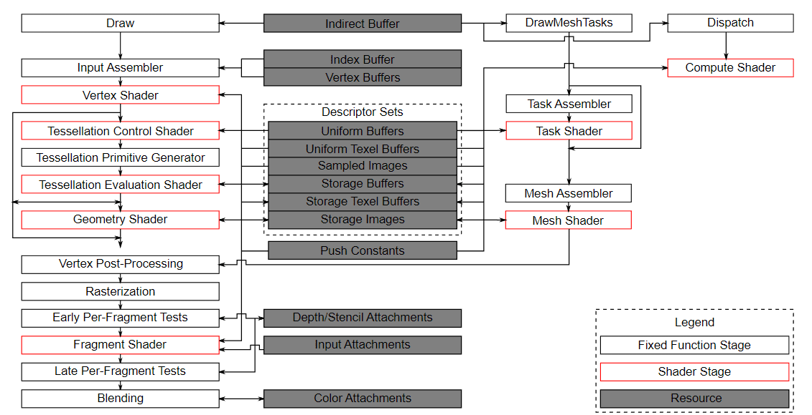
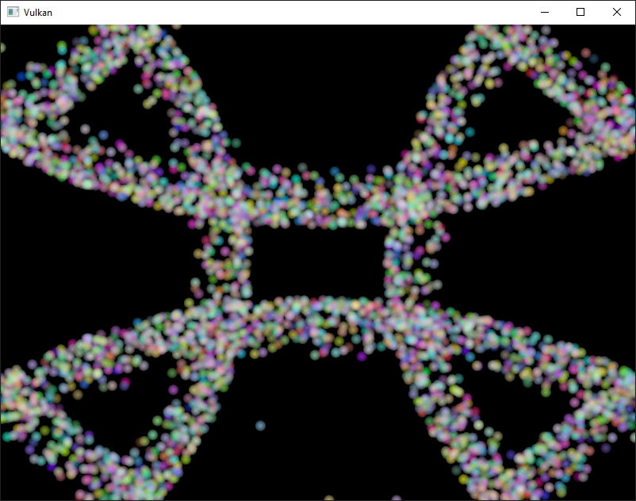
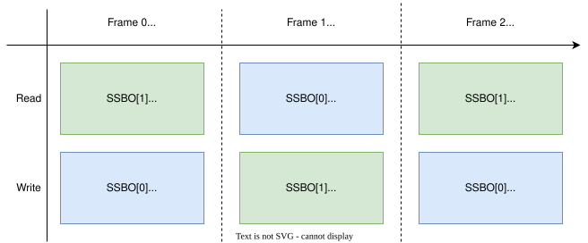
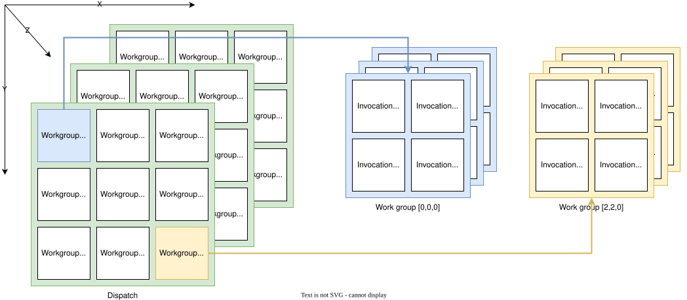

:pp: {plus}{plus}

= 计算着色器

== 简介

在这个附加章节中，我们来看看计算着色器。
到此为止，前面所有章节处理的都是 Vulkan 管线中传统的图形部分。
但与 OpenGL 这类较旧的 API 不同，Vulkan 中计算着色器的支持是强制的。
这意味着你可以在任何可用的 Vulkan 实现上使用计算着色器，无论是高端桌面 GPU 还是低功耗嵌入式设备。

这打开了图形处理器（GPU）通用计算（GPGPU）的世界，无论你的应用运行在哪里。
GPGPU 意味着你可以在 GPU 上进行通用计算，而这传统上一直是 CPU 的领域。
但随着 GPU 越来越强大、越来越灵活，许多原本需要 CPU 通用计算能力的工作负载，现在都可以在 GPU 上实时完成。

GPU 计算能力的一些应用示例包括图像处理、可见性测试、后处理、高级光照计算、动画、物理（例如粒子系统）等等。
你甚至可以用计算来做纯粹的非可视计算工作，完全不需要任何图形输出，例如数值计算或与 AI 相关的事情。
这被称为「无头计算」（headless compute）。

== 优势

在 GPU 上进行计算量很大的运算有几个好处。
最明显的一个是把工作从 CPU 卸载出去。
另一个是不需要在 CPU 的主存与 GPU 的内存之间搬运数据。
所有数据都可以留在 GPU 上，不必等待来自主存的缓慢传输。

除此之外，GPU 高度并行，其中一些拥有数万个小型计算单元。
这使得它们往往比只有少量大型计算单元的 CPU 更适合高度并行的工作流。

== Vulkan 管线

需要知道的是，计算与管线的图形部分是完全分离的。
官方的 Vulkan 规范中的管线框图清楚地展示了这一点：

在这张图里，左边是管线中传统的图形部分，右边是若干不属于这个图形管线的阶段，其中就包括（计算着色器）阶段。
由于计算着色器阶段与图形管线是分离的，我们可以在任何认为合适的地方使用它。
这与例如片元着色器非常不同，后者总是作用于顶点着色器变换后的输出。

图的中央还表明，例如描述符集同样会被计算使用，所以我们学过的关于描述符布局、描述符集和描述符的一切在这里也同样适用。

== 一个示例

本章要实现的一个易于理解的示例是基于 GPU 的粒子系统。
这类系统在许多游戏里都有使用，通常包含成千上万个粒子，需要以交互式的帧率更新。
渲染这样一个系统需要两个主要部分：以顶点缓冲区形式传入的顶点，以及依据某个方程更新它们的方法。

「经典」的基于 CPU 的粒子系统会把粒子数据存放在系统主存中，然后用 CPU 更新它们。
更新之后，顶点需要再次传输到 GPU 内存，这样它才能在下一帧显示更新后的粒子。
最直接的做法是为每一帧用新数据重建顶点缓冲区。
这非常昂贵。
取决于你的实现，还有其他选择，比如映射 GPU 内存让 CPU 可以写入（在桌面系统上称为「resizable BAR」，在集成 GPU 上则是统一内存），或者干脆使用主机本地缓冲区（由于 PCI-E 带宽限制，这会是最慢的方法）。
但无论选择哪种缓冲区更新方式，你总是需要一次到 CPU 的「往返」。

使用基于 GPU 的粒子系统后，这种往返就不再需要了。
顶点只在开始时上传到 GPU，之后所有更新都在 GPU 内存中用计算着色器完成。
这样做更快的主要原因之一是 GPU 与其本地内存之间的带宽高得多。
在基于 CPU 的场景中，你会受限于主存和 PCI-express 带宽，而这往往只是 GPU 内存带宽的一小部分。

在带有专用计算队列的 GPU 上这样做时，你可以在图形管线的渲染部分并行更新粒子。
这称为「异步计算」（async compute），属于本教程未涉及的高级主题。

下面是本章代码的截图。
这里显示的粒子由计算着色器直接在 GPU 上更新，没有任何 CPU 交互：

== 数据操作

在本教程中，我们已经了解了不同的缓冲区类型，比如用于传递图元的顶点缓冲区和索引缓冲区，以及用于向着色器传递数据的统一缓冲区。
我们也使用图像做了纹理映射。
但到此为止，我们总是用 CPU 写入数据，只在 GPU 上读取。

计算着色器引入的一个重要概念，是能够任意地从缓冲区读取并 *写入* 缓冲区。
为此，Vulkan 提供了两种专用的存储类型。

=== 着色器存储缓冲区对象（SSBO）

着色器存储缓冲区（SSBO）允许着色器从缓冲区读取并写入缓冲区。
它的用法与使用统一缓冲区对象类似。
最大的区别在于，你可以把其他缓冲区类型别名到 SSBO，而且它们可以任意大。

回到基于 GPU 的粒子系统，你现在可能会想：顶点既要被计算着色器更新（写入），又要被顶点着色器读取（绘制），而这两种用途看起来需要不同的缓冲区类型，该怎么办？

其实并非如此。
在 Vulkan 中，你可以为缓冲区和图像指定多种用途。
所以，要让粒子顶点缓冲区既能作为顶点缓冲区（在图形通道中使用）、又能作为存储缓冲区（在计算通道中使用），你只需用这两个用途标志创建缓冲区：

[,c++]
----
vk::BufferCreateInfo bufferInfo{};
...
bufferInfo.usage = vk::BufferUsageFlagBits::eVertexBuffer | vk::BufferUsageFlagBits::eStorageBuffer | vk::BufferUsageFlagBits::eTransferDst;
...

shaderStorageBuffers[i] = vk::raii::Buffer(*device, bufferInfo);
----

用 `bufferInfo.usage` 设置的两个标志 `vk::BufferUsageFlagBits::eVertexBuffer` 和 `vk::BufferUsageFlagBits::eStorageBuffer` 告诉实现：我们希望把这个缓冲区用于两种不同的场景——在顶点着色器中作为顶点缓冲区，以及作为存储缓冲区。
注意我们还加上了 `vk::BufferUsageFlagBits::eTransferDst` 标志，以便把数据从主机传输到 GPU。
这一点至关重要，因为我们希望着色器存储缓冲区只留在 GPU 内存中（`vk::MemoryPropertyFlagBits::eDeviceLocal`），所以需要把数据从主机传输到这个缓冲区。

下面是使用 `createBuffer` 辅助函数的同样代码：

[,c++]
----
vk::raii::Buffer shaderStorageBufferTemp({});
vk::raii::DeviceMemory shaderStorageBufferTempMemory({});
createBuffer(bufferSize, vk::BufferUsageFlagBits::eStorageBuffer | vk::BufferUsageFlagBits::eVertexBuffer | vk::BufferUsageFlagBits::eTransferDst, vk::MemoryPropertyFlagBits::eDeviceLocal, shaderStorageBufferTemp, shaderStorageBufferTempMemory);
copyBuffer(stagingBuffer, shaderStorageBufferTemp, bufferSize);
shaderStorageBuffers.emplace_back(std::move(shaderStorageBufferTemp));
shaderStorageBuffersMemory.emplace_back(std::move(shaderStorageBufferTempMemory));
----

在 Slang 中访问这种缓冲区的声明如下：

[,slang]
----
struct Particle {
	float2 position;
	float2 velocity;
    float4 color;
};

struct ParticleSSBO {
    Particle particles;
};
StructuredBuffer<ParticleSSBO> particlesIn;
RWStructuredBuffer<ParticleSSBO> particlesOut;
----

在这个示例中，我们有一个带类型的 SSBO，每个粒子都有位置和速度值（见 `Particle` 结构体）。
这个 SSBO 随后包含不限数量的粒子，因为它被放进没有上限的 StructuredBuffer 中，而且对 particlesIn 来说它是只读缓冲区。对于 particlesOut，我们把它放进 RWStructedBuffer。
无需指定 SSBO 中元素的数量，这是它相对于例如统一缓冲区的一个优势。

在计算着色器中写入这样的存储缓冲区对象很直接，与在 C{pp} 侧写入缓冲区类似：

[,slang]
----
particlesOut[index].particles.position = particlesIn[index].particles.position + particlesIn[index].particles.velocity.xy * ubo.deltaTime;
----

=== 存储图像

_注意，本章不会进行图像操作。
这一段只是为了提醒读者，计算着色器也可以用于图像操作。_

存储图像允许你从图像读取并写入图像。
典型用例包括对纹理应用图像效果、做后处理（这其实非常相似）或生成 mipmap。

图像也是类似的做法：

[,c++]
----
vk::ImageCreateInfo imageInfo {};
...
imageInfo.usage = vk::ImageUsageFlagBits::eSampled | vk::ImageUsageFlagBits::eStorage;
...

textureImage = std::make_unique<vk::raii::SwapchainKHR>( *device, swapChainCreateInfo );
----

用 `imageInfo.usage` 设置的两个标志 `vk::ImageUsageFlagBits::eSampled` 和 `vk::ImageUsageFlagBits::eStorage` 告诉实现：我们希望把这幅图像用于两种不同的场景——在片元着色器中作为被采样的图像，以及在计算着色器中作为存储图像；

存储图像在 Slang 中的声明，与例如片元着色器中使用的采样图像类似：

[,slang]
----
[vk::image_format("r32f")] Texture2D<float> inputImage;
[vk::image_format("r32f")] RWTexture2D<float> outputImage;
----

这里有几个不同之处：额外的属性（比如用于指定图像格式的 `r32f`）、只读的 Texture2D 与读写的 RWTexture2D 这两种用法的区分。
最后但同样重要的是，我们需要用 `RWTexture2D` 类型来声明存储图像。

在计算着色器中读写存储图像，使用的是数组下标语法：

[,slang]
----
float3 pixel = inputImage[int2(gl_GlobalInvocationID.xy)].rgb;
outputImage[int2(gl_GlobalInvocationID.xy)] = pixel;
----

== 计算队列族

在 xref:03_Drawing_a_triangle/00_Setup/03_Physical_devices_and_queue_families.adoc[物理设备与队列族] 一章中，我们已经了解了队列族，以及如何选择图形队列族。
计算使用队列族的属性标志位 `vk::QueueFlagBits::eCompute`。
所以如果要做计算工作，就需要从支持计算的队列族中取一个队列。

注意，Vulkan 要求支持图形操作的实现至少有一个同时支持图形和计算操作的队列族，但实现也可能提供专用的计算队列。
这种专用计算队列（不带图形位）暗示着异步计算队列。
不过为了保持本教程对初学者友好，我们会使用一个既能做图形操作、又能做计算操作的队列。
这也会让我们免于处理若干高级同步机制。

对于我们的计算示例，需要稍微修改设备创建代码：

[,c++]
----
std::vector<vk::QueueFamilyProperties> queueFamilyProperties = physicalDevice->getQueueFamilyProperties();

// get the first index into queueFamilyProperties which supports graphics and compute
auto graphicsAndComputeQueueFamilyProperty =
  std::find_if( queueFamilyProperties.begin(),
                queueFamilyProperties.end(),
                 { return (qfp.queueFlags & vk::QueueFlagBits::eGraphics && qfp.queueFlags & vk::QueueFlagBits::eCompute); } );
graphicsAndComputeIndex = static_cast<uint32_t>( std::distance( queueFamilyProperties.begin(), graphicsAndComputeQueueFamilyProperty ) );
----

修改后的队列族索引选择代码现在会尝试找到一个同时支持图形和计算的队列族。

然后我们可以在 `createLogicalDevice` 中从这个队列族获取一个计算队列：

[,c++]
----
computeQueue = std::make_unique<vk::raii::Queue>( *device, graphicsAndComputeIndex, 0 );
----

== 计算着色器阶段

在图形示例中，我们使用了不同的管线阶段来加载着色器和访问描述符。
计算着色器通过 `vk::ShaderStageFlagBits::eCompute` 管线以类似方式访问。
所以加载计算着色器与加载顶点着色器完全一样，只是着色器阶段不同。
我们会在接下来的段落中详细讨论这一点。
计算还为描述符和管线引入了一种新的绑定点类型 `vk::PipelineBindPoint::eCompute`，我们稍后必须使用它。

== 加载计算着色器

在应用中加载计算着色器与加载任何其他着色器一样。
唯一真正的区别是我们需要使用上面提到的 `vk::ShaderStageFlagBits::eCompute`。

[,c++]
----
auto computeShaderCode = readFile("shaders/slang.spv");

vk::PipelineShaderStageCreateInfo computeShaderStageInfo({}, vk::ShaderStageFlagBits::eCompute, shaderModule, "compMain");
...
----

== 准备着色器存储缓冲区

前面我们了解到，可以用着色器存储缓冲区把任意数据传给计算着色器。
在这个示例中，我们会把粒子数组上传到 GPU，这样就可以直接在 GPU 内存中操作它。

在 xref:03_Drawing_a_triangle/03_Drawing/03_Frames_in_flight.adoc[飞行帧] 一章中，我们讨论了按飞行帧复制资源，以便让 CPU 和 GPU 都保持忙碌。
首先，我们为缓冲区对象及其背后的设备内存声明一个向量：

[,c++]
----
std::vector<vk::raii::Buffer> shaderStorageBuffers;
std::vector<vk::raii::DeviceMemory> shaderStorageBuffersMemory;
----

然后，在 `createShaderStorageBuffers` 函数中，按照我们的 RAII 做法，我们会清空这些向量，以清理其中已经创建的对象。

[,c++]
----
shaderStorageBuffers.clear();
shaderStorageBuffersMemory.clear();
----

有了这套设置，我们就可以开始把初始粒子信息移到 GPU 了。
我们首先在主机侧初始化一个粒子向量：

[,c++]
----
// Initialize particles
std::default_random_engine rndEngine((unsigned)time(nullptr));
std::uniform_real_distribution<float> rndDist(0.0f, 1.0f);

// Initial particle positions on a circle
std::vector<Particle> particles(PARTICLE_COUNT);
for (auto& particle : particles) {
    float r = 0.25f * sqrtf(rndDist(rndEngine));
    float theta = rndDist(rndEngine) * 2.0f * 3.14159265358979323846f;
    float x = r * cosf(theta) * HEIGHT / WIDTH;
    float y = r * sinf(theta);
    particle.position = glm::vec2(x, y);
    particle.velocity = normalize(glm::vec2(x,y)) * 0.00025f;
    particle.color = glm::vec4(rndDist(rndEngine), rndDist(rndEngine), rndDist(rndEngine), 1.0f);
}
----

然后我们在主机内存中创建一个 xref:04_Vertex_buffers/02_Staging_buffer.adoc[暂存缓冲区]，用来存放初始的粒子属性：

[,c++]
----
    vk::DeviceSize bufferSize = sizeof(Particle) * PARTICLE_COUNT;

    // Create a staging buffer used to upload data to the gpu
    vk::raii::Buffer stagingBuffer({});
    vk::raii::DeviceMemory stagingBufferMemory({});
    createBuffer(bufferSize, vk::BufferUsageFlagBits::eTransferSrc, vk::MemoryPropertyFlagBits::eHostVisible | vk::MemoryPropertyFlagBits::eHostCoherent, stagingBuffer, stagingBufferMemory);

    void* dataStaging = stagingBufferMemory.mapMemory(0, bufferSize);
    memcpy(dataStaging, particles.data(), (size_t)bufferSize);
    stagingBufferMemory.unmapMemory();
----

以这个暂存缓冲区作为源，我们随后创建每帧的着色器存储缓冲区，并把粒子属性从暂存缓冲区拷贝到每一个里面：

[,c++]
----
    // Copy initial particle data to all storage buffers
    for (size_t i = 0; i < MAX_FRAMES_IN_FLIGHT; i++) {
        vk::raii::Buffer shaderStorageBufferTemp({});
        vk::raii::DeviceMemory shaderStorageBufferTempMemory({});
        createBuffer(bufferSize, vk::BufferUsageFlagBits::eStorageBuffer | vk::BufferUsageFlagBits::eVertexBuffer | vk::BufferUsageFlagBits::eTransferDst, vk::MemoryPropertyFlagBits::eDeviceLocal, shaderStorageBufferTemp, shaderStorageBufferTempMemory);
        copyBuffer(stagingBuffer, shaderStorageBufferTemp, bufferSize);
        shaderStorageBuffers.emplace_back(std::move(shaderStorageBufferTemp));
        shaderStorageBuffersMemory.emplace_back(std::move(shaderStorageBufferTempMemory));
    }
}
----

== 描述符

为计算设置描述符与图形几乎完全相同。
唯一的区别是描述符需要设置 `vk::ShaderStageFlagBits::eCompute`，才能被计算阶段访问：

[,c++]
----
 std::array layoutBindings{
            vk::DescriptorSetLayoutBinding(0, vk::DescriptorType::eUniformBuffer, 1, vk::ShaderStageFlagBits::eCompute, nullptr),
 };
...
----

注意这里可以组合着色器阶段，所以如果你希望描述符既能被顶点阶段访问、又能被计算阶段访问（例如一个在两个阶段间共享参数的统一缓冲区），就为这两个阶段都设置位：

[,c++]
----
layoutBindings[0].stageFlags = vk::ShaderStageFlagBits::eVertex | vk::ShaderStageFlagBits::eCompute;
----

下面是我们的示例的描述符设置。
布局是这样的：

[,c++]
----
std::array layoutBindings{
    vk::DescriptorSetLayoutBinding(0, vk::DescriptorType::eUniformBuffer, 1, vk::ShaderStageFlagBits::eCompute, nullptr),
    vk::DescriptorSetLayoutBinding(1, vk::DescriptorType::eStorageBuffer, 1, vk::ShaderStageFlagBits::eCompute, nullptr),
    vk::DescriptorSetLayoutBinding(2, vk::DescriptorType::eStorageBuffer, 1, vk::ShaderStageFlagBits::eCompute, nullptr)
};

vk::DescriptorSetLayoutCreateInfo layoutInfo({}, layoutBindings.size(), layoutBindings.data());
computeDescriptorSetLayout = std::make_unique<vk::raii::DescriptorSetLayout>( *device, layoutInfo );
----

看这个设置，你可能会奇怪：我们只渲染一个粒子系统，为什么着色器存储缓冲区对象会有两个布局绑定？
这是因为粒子位置是逐帧基于 delta time 更新的。
这意味着每一帧都需要知道上一帧的粒子位置，这样才能用新的 delta time 更新它们，并把结果写入自己的 SSBO：

为此，计算着色器需要能够访问上一帧和当前帧的 SSBO。
在我们的描述符设置中，这是通过把两者都传给计算着色器来实现的。
参见 `storageBufferInfoLastFrame` 和 `storageBufferInfoCurrentFrame`：

[,c++]
----
for (size_t i = 0; i < MAX_FRAMES_IN_FLIGHT; i++) {
    vk::DescriptorBufferInfo bufferInfo(uniformBuffers[i], 0, sizeof(UniformBufferObject));

    vk::DescriptorBufferInfo storageBufferInfoLastFrame(shaderStorageBuffers[(i - 1) % MAX_FRAMES_IN_FLIGHT], 0, sizeof(Particle) * PARTICLE_COUNT);
    vk::DescriptorBufferInfo storageBufferInfoCurrentFrame(shaderStorageBuffers[i], 0, sizeof(Particle) * PARTICLE_COUNT);
    std::array descriptorWrites{
        vk::WriteDescriptorSet( computeDescriptorSets[i], 0, 0, 1, vk::DescriptorType::eUniformBuffer, nullptr, &bufferInfo ),
        vk::WriteDescriptorSet( computeDescriptorSets[i], 1, 0, 1, vk::DescriptorType::eStorageBuffer, nullptr, &storageBufferInfoLastFrame),
        vk::WriteDescriptorSet( computeDescriptorSets[i], 2, 0, 1, vk::DescriptorType::eStorageBuffer, nullptr, &storageBufferInfoCurrentFrame),
    };
    device->updateDescriptorSets(descriptorWrites, {});
}
----

记住，我们还需要从描述符池中申请 SSBO 的描述符类型：

[,c++]
----
std::array poolSize {
    vk::DescriptorPoolSize( vk::DescriptorType::eUniformBuffer, MAX_FRAMES_IN_FLIGHT),
    vk::DescriptorPoolSize(  vk::DescriptorType::eStorageBuffer, MAX_FRAMES_IN_FLIGHT * 2)
};
----

我们需要把从池中申请的 `vk::DescriptorType::eStorageBuffer` 类型数量翻倍，因为我们的描述符集引用了上一帧和当前帧的 SSBO。

== 计算管线

由于计算不是图形管线的一部分，我们不能使用 `device->createGraphicsPipeline`。
相反，我们需要用 `device->createComputePipeline` 创建一个专门的计算管线来运行计算命令。
由于计算管线不涉及任何光栅化状态，它的状态比图形管线少得多：

[,c++]
----
vk::PipelineLayoutCreateInfo pipelineLayoutInfo({}, 1, &**computeDescriptorSetLayout);

computePipelineLayout = std::make_unique<vk::raii::PipelineLayout>( *device, pipelineLayoutInfo );
----

设置要简单得多，因为我们只需要一个着色器阶段和一个管线布局。
管线布局的工作方式与图形管线相同：

[,c++]
----
vk::ComputePipelineCreateInfo pipelineInfo({}, computeShaderStageInfo, *computePipelineLayout);
computePipeline = std::make_unique<vk::raii::Pipeline>(device->createComputePipeline( nullptr, pipelineInfo));
----

== 计算空间

在深入了解计算着色器如何工作、以及如何向 GPU 提交计算工作负载之前，我们需要先谈谈两个重要的计算概念：*工作组* 和 *调用*。
它们定义了计算工作负载如何被 GPU 的计算硬件在三个维度（x、y 和 z）上处理的抽象执行模型。

*工作组* 定义了计算工作负载如何由 GPU 的计算硬件组成并处理。
你可以把它们看作 GPU 必须逐项完成的工作项。
工作组维度由应用在录制命令缓冲区时通过派发命令设置。

而每个工作组又是一组执行同一个计算着色器的 *调用*。
调用有可能并行运行，其维度在计算着色器中设置。
单个工作组内的调用可以访问共享内存。

下图展示了这两者在三个维度上的关系：

工作组（由 `computeCommandBuffers[frameIndex]->dispatch` 定义）和调用（由计算着色器中的本地尺寸定义）的维度数量取决于输入数据的组织方式。
例如，如果你处理的是一维数组，就像本章这样，那么两者都只需指定 x 维度。

举个例子：如果我们派发的工作组数量为 [64, 1, 1]，计算着色器的本地尺寸为 [32, 32, 1]，那么我们的计算着色器会被调用 64 x 32 x 32 = 65,536 次。

注意工作组数量和本地尺寸的最大值因实现而异，所以你应该总是检查 `vk::PhysicalDeviceLimits` 中与计算相关的 `maxComputeWorkGroupCount`、`maxComputeWorkGroupInvocations` 和 `maxComputeWorkGroupSize` 限制。

== 计算着色器

现在我们已经了解了搭建计算着色器管线所需的各个部分，是时候看看计算着色器本身了。
我们学过的关于使用 GLSL 着色器的一切（例如顶点和片元着色器）同样适用于计算着色器。
语法是相同的，许多概念（比如在应用与着色器之间传递数据）也是一样的。
但也有一些重要的区别。

一个用于更新线性粒子数组的非常基础的计算着色器可能长这样：

[,slang]
----
struct Particle {
	float2 position;
	float2 velocity;
    float4 color;
};

struct UniformBuffer {
    float deltaTime;
};
ConstantBuffer<UniformBuffer> ubo;

struct ParticleSSBO {
    Particle particles;
};
StructuredBuffer<ParticleSSBO> particlesIn;
RWStructuredBuffer<ParticleSSBO> particlesOut;

[shader("compute")]
[numthreads(256,1,1)]
void compMain(uint3 threadId : SV_DispatchThreadID)
{
    uint index = threadId.x;

    particlesOut[index].particles.position = particlesIn[index].particles.position + particlesIn[index].particles.velocity.xy * ubo.deltaTime;
    particlesOut[index].particles.velocity = particlesIn[index].particles.velocity;

    // Flip movement at window border
    if ((particlesOut[index].particles.position.x <= -1.0) || (particlesOut[index].particles.position.x >= 1.0)) {
        particlesOut[index].particles.velocity.x = -particlesOut[index].particles.velocity.x;
    }
    if ((particlesOut[index].particles.position.y <= -1.0) || (particlesOut[index].particles.position.y >= 1.0)) {
        particlesOut[index].particles.velocity.y = -particlesOut[index].particles.velocity.y;
    }

}
----

着色器的上半部分包含着色器输入的声明。
首先是与绑定 0 对应的统一缓冲区对象，这是本教程已经介绍过的内容。
下面我们声明 Particle 结构体，它与 C{pp} 代码中的声明相匹配。
绑定 1 指向包含上一帧粒子数据的着色器存储缓冲区对象（见描述符设置）。绑定 2 指向当前帧的 SSBO，也就是我们将用这个着色器更新的那个。

一个有趣的地方是与计算空间相关的这个仅计算可用的声明：

[,slang]
----
[numthreads(256,1,1)]
----

它定义了当前工作组中这个计算着色器的调用次数。
如前所述，这是计算空间的本地部分。
由于我们处理的是一维线性粒子数组，在 `[numthreads(x,y,z)]` 中只需为 x 维度指定一个数字。

`compMain` 函数随后从上一帧的 SSBO 读取，并把更新后的粒子位置写入当前帧的 SSBO。
与其他着色器类型类似，计算着色器有自己的一套内建输入变量。
我们传入的 ThreadId 是一个变量，它在当前派发范围内唯一标识当前的计算着色器调用。它通过 `SV_DispatchThreadID` 注解获得这一能力。
我们用它来索引粒子数组。

== 运行计算命令

=== 派发

现在该真正让 GPU 去做计算了。
这是通过在命令缓冲区中调用 `computeCommandBuffers[frameIndex]->dispatch` 完成的。
虽然不完全准确，但对计算而言，一次派发就相当于一次绘制调用，正如 `commandBuffers[frameIndex]->draw` 对图形那样。
它最多可以在三个维度上派发指定数量的计算工作项。

[,c++]
----
computeCommandBuffers[frameIndex]->begin({});
...

computeCommandBuffers[frameIndex]->bindPipeline(vk::PipelineBindPoint::eCompute, *computePipeline);
computeCommandBuffers[frameIndex]->bindDescriptorSets(vk::PipelineBindPoint::eCompute, *computePipelineLayout, 0, {computeDescriptorSets[frameIndex]}, {});

computeCommandBuffers[frameIndex]->dispatch( PARTICLE_COUNT / 256, 1, 1 );

...

computeCommandBuffers[frameIndex]->end();
----

`computeCommandBuffers[frameIndex]->dispatch` 会在 x 维度派发 `PARTICLE_COUNT / 256` 个本地工作组。
由于我们的粒子数组是线性的，另外两个维度保持为 1，从而形成一维派发。
但为什么要用（数组中的）粒子数量除以 256？
因为在前一段中我们规定，工作组中的每个计算着色器会执行 256 次调用。
所以如果我们有 4096 个粒子，就会派发 16 个工作组，每个工作组运行 256 次计算着色器调用。
要把这两个数字选对，通常需要一些调试和性能分析，具体取决于你的工作负载和运行硬件。
如果你的粒子数量是动态的、并不总能被例如 256 整除，你总可以在计算着色器开头使用 `gl_GlobalInvocationID`，并在全局调用索引大于粒子数量时从着色器返回。

正如计算管线那样，计算命令缓冲区的状态也比图形命令缓冲区少得多。
不需要开始渲染通道，也不需要设置视口。

=== 提交工作

由于我们的示例同时做计算和图形操作，每帧我们会分别向图形队列和计算队列各提交一次（见 `drawFrame` 函数）：

[,c++]
----
...
computeQueue->submit(submitInfo, **computeInFlightFences[frameIndex]);
...
graphicsQueue->submit(submitInfo, **inFlightFences[frameIndex]);
----

第一次向计算队列的提交用计算着色器更新粒子位置，第二次提交随后使用更新后的数据绘制粒子系统。

=== 同步图形与计算

同步是 Vulkan 的重要部分，在把计算与图形结合使用时更是如此。
同步错误或缺失，可能导致顶点阶段在计算着色器尚未完成更新（写入）粒子时就开始绘制（读取）它们（读后写危险），或者计算着色器开始更新仍被管线顶点部分使用的粒子（写后读危险）。

所以我们必须正确地同步图形与计算负载，确保这些情况不会发生。
做法有多种，取决于你如何提交计算工作负载；但在我们这个分两次提交的场景中，我们会使用 xref:03_Drawing_a_triangle/03_Drawing/02_Rendering_and_presentation.adoc[信号量] 和 xref:03_Drawing_a_triangle/03_Drawing/02_Rendering_and_presentation.adoc[栅栏] 来确保顶点着色器在计算着色器更新完顶点之前不会开始取顶点。

这是必要的，因为即使两次提交有先后顺序，也无法保证它们在 GPU 上按这个顺序执行。
加入等待信号量和发信号量可以确保这个执行顺序。

所以我们先在 `createSyncObjects` 中为计算工作新增一组同步原语。
与图形栅栏一样，计算栅栏在创建时处于已发出信号状态，否则第一次绘制会在等待栅栏发出信号时超时，详见 xref:03_Drawing_a_triangle/03_Drawing/02_Rendering_and_presentation.adoc[这里]：

[,c++]
----
std::vector<std::unique_ptr<vk::raii::Fence>> computeInFlightFences;
std::vector<std::unique_ptr<vk::raii::Semaphore>> computeFinishedSemaphores;
...
computeInFlightFences.resize(MAX_FRAMES_IN_FLIGHT);
computeFinishedSemaphores.resize(MAX_FRAMES_IN_FLIGHT);

for (size_t i = 0; i < MAX_FRAMES_IN_FLIGHT; i++) {
    ...
    computeFinishedSemaphores[i] = std::make_unique<vk::raii::Semaphore>(*device, vk::SemaphoreCreateInfo());
    computeInFlightFences[i] = std::make_unique<vk::raii::Fence>(*device, vk::FenceCreateInfo(vk::FenceCreateFlagBits::eSignaled));
}
----

然后我们用这些来同步计算缓冲区提交与图形提交：

[,c++]
----
{
    // Compute submission
    while ( vk::Result::eTimeout == device->waitForFences(**computeInFlightFences[frameIndex], vk::True, UINT64_MAX) )
        ;

    updateUniformBuffer(frameIndex);
    device->resetFences( **computeInFlightFences[frameIndex] );
    computeCommandBuffers[frameIndex]->reset();
    recordComputeCommandBuffer();

    const vk::SubmitInfo submitInfo({}, {}, {**computeCommandBuffers[frameIndex]}, { **computeFinishedSemaphores[frameIndex]});
    computeQueue->submit(submitInfo, **computeInFlightFences[frameIndex]);
}
{
    // Graphics submission
    while ( vk::Result::eTimeout == device->waitForFences(**inFlightFences[frameIndex], vk::True, UINT64_MAX))
...

    device->resetFences(  **inFlightFences[frameIndex] );
    commandBuffers[frameIndex]->reset();
    recordCommandBuffer(imageIndex);

    vk::Semaphore waitSemaphores[] = {**presentCompleteSemaphore[frameIndex], **computeFinishedSemaphores[frameIndex]};
    vk::PipelineStageFlags waitDestinationStageMask[] = { vk::PipelineStageFlagBits::eVertexInput, vk::PipelineStageFlagBits::eColorAttachmentOutput };
    const vk::SubmitInfo submitInfo( waitSemaphores, waitDestinationStageMask, {**commandBuffers[frameIndex]}, {**renderFinishedSemaphore[frameIndex]} );
    graphicsQueue->submit(submitInfo, **inFlightFences[frameIndex]);
----

与 xref:03_Drawing_a_triangle/03_Drawing/02_Rendering_and_presentation.adoc[信号量] 一章中的示例类似，这套设置会让计算着色器立即运行，因为我们没有指定任何等待信号量。
注意上面我们用花括号限定作用域，以确保使用的 RAII 临时变量有机会在计算阶段和图形阶段之间自行清理。
这没问题，因为在提交计算工作之前，我们已经用 `device->waitForFences` 命令等待当前帧的计算命令缓冲区执行完毕。

另一方面，图形提交需要等待计算工作完成，这样它才不会在计算缓冲区还在更新顶点时开始取顶点。
所以我们等待当前帧的 `computeFinishedSemaphores`，并让图形提交在消费顶点的 `vk::PipelineStageFlagBits::eVertexInput` 阶段等待。

但它还需要等待呈现，这样片元着色器才不会在图像被呈现之前输出到颜色附件。
所以我们在当前帧的 `imageAvailableSemaphores` 上、于 `vk::PipelineStageFlagBits::eColorAttachmentOutput` 阶段等待。

=== 时间线信号量：一种改进的同步机制

上面描述的同步方式使用二值信号量，它们只有简单的已发出信号/未发出信号状态。虽然这在许多场景下都工作良好，但 Vulkan 还提供了一种更强大的同步原语：时间线信号量。

时间线信号量最初作为扩展引入，后来在 Vulkan 1.2 中被提升为核心特性。与二值信号量不同，时间线信号量有一个 64 位无符号整数计数值，可以等待并发出信号到特定值。相比二值信号量，这带来了几个优势：

1. *可复用性*：单个时间线信号量可以用于多个同步点，减少所需的信号量数量。
2. *主机同步*：时间线信号量可以从主机（CPU）发出信号并等待，无需向队列提交命令。
3. *乱序发信号*：你可以把时间线信号量发出信号到比当前正在等待的值更高的值，从而实现更灵活的同步模式。
4. *多个待处理信号*：与只能有一次待处理信号的二值信号量不同，时间线信号量可以有多个待处理信号。

让我们看看如何把粒子系统示例改为使用时间线信号量，而不是二值信号量：

首先，我们需要在创建逻辑设备时启用时间线信号量特性：

[,c++]
----
vk::PhysicalDeviceTimelineSemaphoreFeaturesKHR timelineSemaphoreFeatures;
timelineSemaphoreFeatures.timelineSemaphore = vk::True;
// Chain this to your device creation info
----

我们不再创建多个二值信号量，而是创建一个时间线信号量：

[,c++]
----
vk::SemaphoreTypeCreateInfo semaphoreType{ .semaphoreType = vk::SemaphoreType::eTimeline, .initialValue = 0 };
semaphore = vk::raii::Semaphore(device, {.pNext = &semaphoreType});
timelineValue = 0;
----

在绘制帧函数中，我们使用递增的时间线值来协调计算与图形之间的工作：

[,c++]
----
// Update timeline value for this frame
uint64_t computeWaitValue = timelineValue;
uint64_t computeSignalValue = ++timelineValue;
uint64_t graphicsWaitValue = computeSignalValue;
uint64_t graphicsSignalValue = ++timelineValue;
----

对于计算提交，我们使用时间线信号量提交信息结构体：

[,c++]
----
vk::TimelineSemaphoreSubmitInfo computeTimelineInfo{
    .waitSemaphoreValueCount = 1,
    .pWaitSemaphoreValues = &computeWaitValue,
    .signalSemaphoreValueCount = 1,
    .pSignalSemaphoreValues = &computeSignalValue
};

vk::PipelineStageFlags waitStages[] = {vk::PipelineStageFlagBits::eComputeShader};

vk::SubmitInfo computeSubmitInfo{
    .pNext = &computeTimelineInfo,
    .waitSemaphoreCount = 1,
    .pWaitSemaphores = &*semaphore,
    .pWaitDstStageMask = waitStages,
    .commandBufferCount = 1,
    .pCommandBuffers = &*computeCommandBuffers[frameIndex],
    .signalSemaphoreCount = 1,
    .pSignalSemaphores = &*semaphore
};

computeQueue.submit(computeSubmitInfo, nullptr);
----

图形提交同样如此：

[,c++]
----
vk::PipelineStageFlags waitStage = vk::PipelineStageFlagBits::eVertexInput;
vk::TimelineSemaphoreSubmitInfo graphicsTimelineInfo{
    .waitSemaphoreValueCount = 1,
    .pWaitSemaphoreValues = &graphicsWaitValue,
    .signalSemaphoreValueCount = 1,
    .pSignalSemaphoreValues = &graphicsSignalValue
};

vk::SubmitInfo graphicsSubmitInfo{
    .pNext = &graphicsTimelineInfo,
    .waitSemaphoreCount = 1,
    .pWaitSemaphores = &*semaphore,
    .pWaitDstStageMask = &waitStage,
    .commandBufferCount = 1,
    .pCommandBuffers = &*commandBuffers[frameIndex],
    .signalSemaphoreCount = 1,
    .pSignalSemaphores = &*semaphore
};

graphicsQueue.submit(graphicsSubmitInfo, nullptr);
----

在呈现之前，我们等待图形工作完成：

[,c++]
----
vk::SemaphoreWaitInfo waitInfo{
    .semaphoreCount = 1,
    .pSemaphores = &*semaphore,
    .pValues = &graphicsSignalValue
};

// Wait for graphics to complete before presenting
auto result = device.waitSemaphores(waitInfo, UINT64_MAX);
if (result != vk::Result::eSuccess)
{
    throw std::runtime_error("failed to wait for semaphore!");
}

vk::PresentInfoKHR presentInfo{
    .waitSemaphoreCount = 0, // No binary semaphores needed
    .pWaitSemaphores = nullptr,
    .swapchainCount = 1,
    .pSwapchains = &*swapChain,
    .pImageIndices = &imageIndex
};
----

这种时间线信号量方案相比二值信号量实现有几个好处：

1. *简化资源管理*：每个飞行帧只需要一个信号量，而不是多个。
2. *更显式的同步*：时间线值让操作之间的依赖关系一目了然。
3. *减少开销*：同步对象更少，管理它们的开销也就更小。
4. *更灵活的同步模式*：时间线信号量能实现一些用二值信号量很难做到的复杂同步场景。

时间线信号量在存在多个相互依赖操作的场景中特别有用，比如我们这种先计算后图形的流程，或者当你需要在主机与设备之间同步时。它们提供了更强大、更灵活的同步机制，可以在简化代码的同时支持更复杂的同步模式。

== 绘制粒子系统

前面我们了解到 Vulkan 中的缓冲区可以有多种用途，所以我们创建了包含粒子的着色器存储缓冲区，同时带有着色器存储缓冲区位和顶点缓冲区位。
这意味着我们可以像前几章使用「纯」顶点缓冲区那样，用这个着色器存储缓冲区来绘制。

我们首先设置与粒子结构体匹配的顶点输入状态：

[,c++]
----
struct Particle {
    ...

    static std::array<vk::VertexInputAttributeDescription, 2> getAttributeDescriptions() {
        return {
            vk::VertexInputAttributeDescription( 0, 0, vk::Format::eR32G32Sfloat, offsetof(Particle, position) ),
            vk::VertexInputAttributeDescription( 1, 0, vk::Format::eR32G32B32A32Sfloat, offsetof(Particle, color) ),
        };
    }
};
----

注意我们没有把 `velocity` 加入顶点输入属性，因为它只被计算着色器使用。

然后我们像使用任何顶点缓冲区那样绑定并绘制它：

[,c++]
----
commandBuffers[frameIndex]->bindVertexBuffers(0, { *shaderStorageBuffers[frameIndex] }, {0});

commandBuffers[frameIndex]->draw( PARTICLE_COUNT, 1, 0, 0 );
----

== 小结

在本章中，我们学习了如何使用计算着色器把工作从 CPU 卸载到 GPU。
如果没有计算着色器，现代游戏和应用中的许多效果要么无法实现，要么会慢得多。
但计算比图形有更多的用例，本章只让你窥见其中一角。
所以现在你知道了如何使用计算着色器，也许想看看一些高级计算主题，比如：

* 共享内存
* https://github.com/KhronosGroup/Vulkan-Samples/tree/master/samples/performance/async_compute[异步计算]
* 原子操作
* https://www.khronos.org/blog/vulkan-subgroup-tutorial[子组]

你可以在 https://github.com/KhronosGroup/Vulkan-Samples/tree/master/samples/api[Khronos 官方的 Vulkan Samples 仓库] 中找到一些高级计算示例。

link:/attachments/31_compute_shader.cpp[C{pp} 代码] /
link:/attachments/31_shader_compute.slang[Slang 着色器] /
link:/attachments/31_shader_compute.vert[GLSL 顶点着色器] /
link:/attachments/31_shader_compute.frag[GLSL 片元着色器] /
link:/attachments/31_shader_compute.comp[GLSL 计算着色器]
