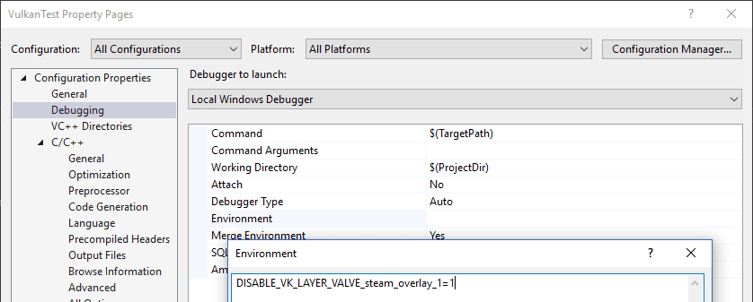

= 常见问题解答

本页列出你在开发 Vulkan 应用时可能遇到的常见问题的解决方案。

== 在核心验证层中遇到访问冲突错误

请确认 MSI Afterburner / RivaTuner Statistics Server 没有在运行，因为它与 Vulkan 存在一些兼容性问题。

== 我看不到验证层的任何消息，或验证层不可用

首先，请确保程序退出后终端仍然保持打开，好让验证层有机会打印错误信息。
在 Visual Studio 中，你可以用 Ctrl-F5 而不是 F5 运行程序；在 Linux 上，则可以从终端窗口运行程序。
如果仍然没有任何消息，而你又确信验证层已经开启，那就按照 https://vulkan.lunarg.com/doc/view/1.3.280.0/windows/getting_started.html[这一页] 上的「Verify the Installation」说明，确认 Vulkan SDK 已正确安装。
另外还要确保 SDK 版本至少为 1.1.106.0，以支持 `VK_LAYER_KHRONOS_validation` 层。

== vkCreateSwapchainKHR 在 SteamOverlayVulkanLayer64.dll 中触发错误

这看起来是 Steam 客户端测试版的兼容性问题。
有几种可行的规避办法：

* 退出 Steam 测试版计划。
* 把环境变量 `DISABLE_VK_LAYER_VALVE_steam_overlay_1` 设为 `1`
* 在注册表 `HKEY_LOCAL_MACHINE\SOFTWARE\Khronos\Vulkan\ImplicitLayers` 下删除 Steam 覆盖层的 Vulkan 层条目

示例：

== vkCreateInstance 因 VK_ERROR_INCOMPATIBLE_DRIVER 而失败

如果你在 MacOS 上使用最新的 MoltenVK SDK，`vkCreateInstance` 可能返回 `VK_ERROR_INCOMPATIBLE_DRIVER` 错误。
这是因为 https://vulkan.lunarg.com/doc/sdk/1.3.216.0/mac/getting_started.html[Vulkan SDK 1.3.216 或更新版本] 要求你启用 `VK_KHR_PORTABILITY_subset` 扩展才能使用 MoltenVK，因为它目前尚未完全符合规范。

你必须把 `VK_INSTANCE_CREATE_ENUMERATE_PORTABILITY_BIT_KHR` 标志添加到 `VkInstanceCreateInfo`，并把 `VK_KHR_PORTABILITY_ENUMERATION_EXTENSION_NAME` 添加到实例扩展列表。

代码示例：

[,c++]
----
...

std::vector<const char*> requiredExtensions;

for(uint32_t i = 0; i < glfwExtensionCount; i++) {
    requiredExtensions.emplace_back(glfwExtensions[i]);
}

requiredExtensions.emplace_back(vk::KHRPortabilityEnumerationExtensionName);

vk::InstanceCreateInfo createInfo(vk::InstanceCreateFlagBits::eEnumeratePortabilityKHR, &appInfo, {}, requiredExtensions);
instance = std::make_unique<vk::raii::Instance>(context, createInfo);
----
