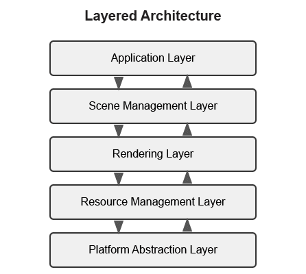
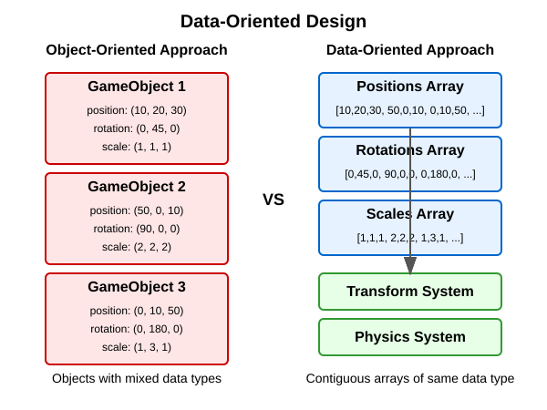
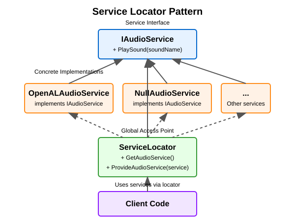

:pp: {plus}{plus}

= 附录

== 架构模式详解

本附录深入介绍现代渲染引擎与游戏引擎中常用的架构模式。这些模式在「引擎架构」主章节中已有引用，而主教程的重点是基于组件的架构。

[[layered-architecture]]
=== 分层架构

分层架构是最基础的架构模式之一：系统被划分为若干独立的层，每一层承担明确的职责。

==== 渲染引擎中的典型分层

1. *平台抽象层* - 为平台相关的功能提供一致的接口。
2. *资源管理层* - 管理资产的加载、缓存与卸载。
3. *渲染层* - 负责渲染管线、着色器以及与图形 API 的交互。
4. *场景管理层* - 管理场景图、空间划分与剔除。
5. *应用层* - 处理用户输入、游戏逻辑以及高层的应用流程。

==== 分层架构的优点

* 关注点清晰分离
* 更易于理解和维护
* 可以替换或修改单个层而不影响其他层
* 便于对各个层单独测试

==== 实现示例

[source,cpp]
----
// Platform Abstraction Layer
class Platform {
public:
    virtual void Initialize() = 0;
    virtual void* CreateWindow(int width, int height) = 0;
    virtual void ProcessEvents() = 0;
    // ...
};

// Resource Management Layer
class ResourceManager {
public:
    virtual Texture* LoadTexture(const std::string& path) = 0;
    virtual Mesh* LoadMesh(const std::string& path) = 0;
    // ...
};

// Rendering Layer
class Renderer {
public:
    virtual void Initialize(Platform* platform) = 0;
    virtual void RenderScene(Scene* scene) = 0;
    // ...
};

// Scene Management Layer
class SceneManager {
public:
    virtual void AddEntity(Entity* entity) = 0;
    virtual void UpdateScene(float deltaTime) = 0;
    // ...
};

// Application Layer
class Application {
private:
    Platform* platform;
    ResourceManager* resourceManager;
    Renderer* renderer;
    SceneManager* sceneManager;

public:
    void Run() {
        platform->Initialize();
        renderer->Initialize(platform);

        // Main loop
        while (running) {
            platform->ProcessEvents();
            sceneManager->UpdateScene(deltaTime);
            renderer->RenderScene(sceneManager->GetActiveScene());
        }
    }
};
----

[[data-oriented-design]]
=== 数据导向设计

数据导向设计（Data-Oriented Design，DOD）着眼于为高效处理而组织数据，而不是围绕对象来组织代码。

==== 核心概念

1. *数据布局* - 以对缓存友好的访问模式组织数据。
2. *系统* - 批量处理数据，通常使用 SIMD 指令。
3. *实体-组件-系统（Entity-Component-System，ECS）* - DOD 原则的一种常见实现。

==== 数据导向设计的优点

* 缓存利用率更高
* 内存使用更高效
* 更容易并行化
* 可以带来显著的性能提升

==== 实现示例

[source,cpp]
----
// A simple ECS implementation
struct TransformData {
    std::vector<glm::vec3> positions;
    std::vector<glm::quat> rotations;
    std::vector<glm::vec3> scales;
};

struct RenderData {
    std::vector<Mesh*> meshes;
    std::vector<Material*> materials;
};

class TransformSystem {
private:
    TransformData& transformData;

public:
    TransformSystem(TransformData& data) : transformData(data) {}

    void Update(float deltaTime) {
        // Process all transforms in bulk
        for (size_t i = 0; i < transformData.positions.size(); ++i) {
            // Update transforms
        }
    }
};

class RenderSystem {
private:
    RenderData& renderData;
    TransformData& transformData;

public:
    RenderSystem(RenderData& rData, TransformData& tData)
        : renderData(rData), transformData(tData) {}

    void Render() {
        // Render all entities in bulk
        for (size_t i = 0; i < renderData.meshes.size(); ++i) {
            // Render mesh with transform
        }
    }
};
----

[[service-locator-pattern]]
=== 服务定位器模式

服务定位器（Service Locator）模式提供一个全局的服务访问点，同时不让使用方与具体实现耦合。

==== 核心概念

1. *服务接口* - 定义服务的契约。
2. *服务提供者* - 实现服务接口。
3. *服务定位器* - 负责提供服务的访问。

==== 服务定位器模式的优点

* 让服务的使用方与提供者解耦
* 便于替换服务
* 便于用模拟服务进行测试

==== 实现示例

[source,cpp]
----
// Audio service interface
class IAudioService {
public:
    virtual ~IAudioService() = default;
    virtual void PlaySound(const std::string& soundName) = 0;
    virtual void StopSound(const std::string& soundName) = 0;
};

// Concrete audio service
class OpenALAudioService : public IAudioService {
public:
    void PlaySound(const std::string& soundName) override {
        // Implementation using OpenAL
    }

    void StopSound(const std::string& soundName) override {
        // Implementation using OpenAL
    }
};

// Service locator
class ServiceLocator {
private:
    static IAudioService* audioService;
    static IAudioService nullAudioService; // Default null service

public:
    static void Initialize() {
        audioService = &nullAudioService;
    }

    static IAudioService& GetAudioService() {
        return *audioService;
    }

    static void ProvideAudioService(IAudioService* service) {
        if (service == nullptr) {
            audioService = &nullAudioService;
        } else {
            audioService = service;
        }
    }
};

// Usage example
void PlayGameSound() {
    ServiceLocator::GetAudioService().PlaySound("explosion");
}
----

=== 架构模式对比分析

下面是对本附录讨论过的各架构模式的对比分析：

|===
| 模式 | 优势 | 劣势 | 适用场景

| 分层架构
a| * 关注点清晰分离
  * 易于理解
  * 适合初学者
a| * 容易造成「层膨胀」
  * 可能引入不必要的间接层
  * 逐层转发可能带来性能开销
a| * 较小的引擎
  * 教学项目
  * 清晰度比性能更重要时

| 基于组件的架构
a| * 高度灵活、模块化
  * 促进代码复用
  * 避免过深的继承层次
  * 更容易扩展新功能
a| * 初期实现更复杂
  * 调试可能更困难
  * 组件查找可能带来性能开销
a| * 现代渲染引擎
  * 对象类型多样的系统
  * 需要频繁扩展的项目

| 数据导向设计
a| * 性能出色
  * 对缓存友好的内存访问
  * 适合并行处理
a| * 不如 OOP 直观
  * 学习曲线更陡
  * 可能让代码更难读
a| * 性能关键的系统
  * 移动平台
  * 需要处理大量同类数据的系统

| 服务定位器模式
a| * 让服务提供者与使用方解耦
  * 便于测试
  * 支持在运行时替换服务
a| * 可能隐藏依赖关系
  * 存在运行时错误的风险
  * 全局状态带来的顾虑
a| * 横切关注点
  * 需要运行时配置的系统
  * 松耦合至关重要时
|===

== 高级渲染技术

本节概述现代渲染引擎中常用的高级渲染技术。要了解更全面的内容，请参考以下优秀资料：

* *Physically Based Rendering: From Theory to Implementation* - https://www.pbr-book.org/
* *Real-Time Rendering* - https://www.realtimerendering.com/
* *GPU Gems* 系列 - https://developer.nvidia.com/gpugems/gpugems/contributors

=== 延迟渲染

延迟渲染把几何计算与光照计算分离到不同的通道中，对于光源众多的场景可能更高效：

1. *几何通道* - 把场景几何渲染到 G-buffer 纹理（位置、法线、反照率等）。
2. *光照通道* - 使用 G-buffer 纹理进行光照计算。

=== Forward+ 渲染

Forward+（或称分块前向）渲染兼有前向渲染的简洁性与延迟渲染的部分效率优势：

1. *光源剔除通道* - 把屏幕划分为若干区块，确定哪些光源影响每个区块。
2. *前向渲染通道* - 只用在每个区块内起作用的光源来渲染场景几何。

=== 基于物理的渲染（PBR）

PBR 通过模拟真实世界中光线与表面的交互方式，力求做出更逼真的材质：

1. *材质参数* - 使用具有物理意义的参数（反照率、金属度、粗糙度等）来定义材质。
2. *BRDF* - 使用基于物理的双向反射分布函数。
3. *基于图像的光照* - 使用环境贴图提供环境光。

=== 高级相机技术

本节介绍在 3D 应用中实现复杂相机系统的高级技术：

* *相机碰撞*：为相机实现碰撞体积，防止它穿墙而过
* *上下文感知定位*：根据环境调整相机位置（例如在开阔区域拉远，在狭窄空间拉近）
* *智能取景*：调整相机取景，让角色和重要物体都留在画面内
* *预测式跟随*：预测角色运动，以减少相机滞后
* *相机遮挡透明化*：让遮挡视线的物体部分透明
* *动态视野*：根据移动速度或环境上下文调整 FOV

== 结语

这些架构模式与渲染技术为设计你的渲染引擎提供了基础。在实践中，大多数引擎会组合使用这些模式，以应对系统的不同方面。

设计引擎架构时，请考虑以下几点：

1. *性能需求* - 不同模式的性能特征各不相同。
2. *灵活性需求* - 你为将来的扩展需要多少灵活性？
3. *团队规模与经验* - 对较小的团队来说，更复杂的架构可能更难驾驭。
4. *项目范围* - 小项目可能不需要完整 ECS 那样的复杂度。

xref:Building_a_Simple_Engine/Engine_Architecture/02_architectural_patterns.adoc[返回引擎架构：架构模式]
xref:Building_a_Simple_Engine/Engine_Architecture/05_rendering_pipeline.adoc[返回引擎架构：渲染管线]
