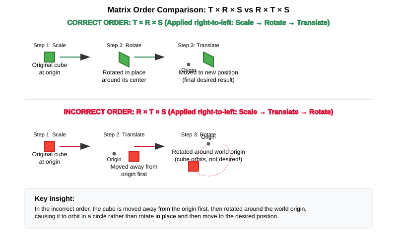

:pp: {plus}{plus}

= 相机与变换：数学基础

== 3D 图形的数学基础

在深入实现相机之前，先回顾一下构成 3D 图形编程基础的核心数学概念。理解这些概念，对于实现一个健壮的相机系统至关重要。

=== 3D 图形中的向量

向量是 3D 图形的基础，因为它们表示空间中的位置、方向和移动。在我们的 Vulkan 应用中，主要会用到：

* *3D 向量 (x, y, z)*：用于表示位置、方向和法线
* *4D 向量 (x, y, z, w)*：用于变换中的齐次坐标

==== 向量在图形学中为何重要

在我们的相机系统中，向量承担着几个关键作用：

* 相机的位置用一个 3D 向量表示
* 相机的观察方向是一个 3D 向量
* 用于确定相机朝向的「上」方向同样是一个向量

==== 向量运算及其应用

* *加法与减法*：用于计算相对位置和移动
  - 示例：`newPosition = currentPosition + movementDirection * speed`

* *标量乘法*：用于缩放移动和方向
  - 示例：把速度乘以小于 1 的系数来减慢相机移动

* *点积*：计算两个向量的点积。对归一化向量来说，结果等于两向量夹角的余弦值。
  - 应用：判断物体是否朝向相机、计算光照强度

==== 右手定则

右手定则是 3D 图形与数学中的一种约定，用于确定坐标系的朝向以及叉积的方向。

* *用于叉积*：计算 A × B 时：

  1. 让右手食指指向向量 A 的方向
  2. 让中指指向向量 B 的方向（与 A 垂直）
  3. 此时拇指指向叉积结果的方向

* *用于坐标系*：在右手坐标系中：

  1. 让右手食指沿 X 轴正方向
  2. 让中指沿 Y 轴正方向
  3. 拇指便指向 Z 轴正方向

[source,cpp]
----
// The cross product direction follows the right-hand rule
glm::vec3 xAxis(1.0f, 0.0f, 0.0f);  // Point right (positive X)
glm::vec3 yAxis(0.0f, 1.0f, 0.0f);  // Point up (positive Y)

// Cross product gives the Z axis in a right-handed system
glm::vec3 zAxis = glm::cross(xAxis, yAxis);  // Points forward (positive Z)
// zAxis will be (0.0f, 0.0f, 1.0f)

// If we reverse the order, we get the opposite direction
glm::vec3 negativeZ = glm::cross(yAxis, xAxis);  // Points backward (negative Z)
// negativeZ will be (0.0f, 0.0f, -1.0f)
----

* *叉积*：生成一个与两个输入向量都垂直的向量
  - 应用：由「前」向量和「上」向量生成相机的「右」向量
  - 方向遵循右手定则（见上文）

* *归一化*：保持方向不变，把长度设为 1
  - 应用：保证无论朝哪个方向移动，速度都一致

[source,cpp]
----
// Vector operations using GLM
glm::vec3 a(1.0f, 2.0f, 3.0f);
glm::vec3 b(4.0f, 5.0f, 6.0f);

// Addition - combining positions or offsets
glm::vec3 sum = a + b; // (5.0, 7.0, 9.0)

// Dot product - useful for lighting calculations
float dotProduct = glm::dot(a, b); // 32.0
// If vectors are normalized, dot product = cosine of angle between them
float cosAngle = glm::dot(glm::normalize(a), glm::normalize(b)); // ~0.974

// Cross product - creating perpendicular vectors (e.g., camera orientation)
glm::vec3 crossProduct = glm::cross(a, b); // (-3.0, 6.0, -3.0)

// Normalization - ensuring consistent movement speeds
glm::vec3 normalized = glm::normalize(a); // (0.267, 0.535, 0.802)
----

=== 矩阵与变换

矩阵用于表示 3D 空间中的变换。在 Vulkan 和其他图形 API 中，我们通常用 4×4 矩阵来表示齐次坐标下的变换。

==== 为什么使用 4×4 矩阵

尽管我们在 3D 空间中工作，却使用 4×4 矩阵，原因如下：

1. 它们能在表示旋转和缩放的同时表示平移（移动）
2. 它们可以通过相乘组合出复杂的变换
3. 它们作用于齐次坐标 (x, y, z, w)，而透视投影正需要这种坐标

==== 常见的变换矩阵

* *平移矩阵*：在 3D 空间中移动物体
  - 在相机系统中：移动相机位置

* *旋转矩阵*：绕某个轴旋转物体
  - 在相机系统中：改变相机的观察方向

* *缩放矩阵*：改变物体的大小
  - 相机较少用到，但对场景中的物体很重要

* *模型矩阵*：组合各种变换，把物体放到世界空间中
  - 确定物体相对于世界原点的位置

* *视图矩阵*：把世界空间变换到相机空间
  - 本质上是把整个世界放到相机的相对位置上

* *投影矩阵*：把相机空间变换到裁剪空间
  - 定义 3D 物体如何投影到 2D 屏幕
  - 控制透视、视场角和可见范围（近/远平面）

[source,cpp]
----
// Matrix transformations using GLM
// Translation matrix - moving an object
glm::mat4 translationMatrix = glm::translate(glm::mat4(1.0f), glm::vec3(1.0f, 2.0f, 3.0f));

// Rotation matrix (45 degrees around Y axis) - turning an object
glm::mat4 rotationMatrix = glm::rotate(glm::mat4(1.0f), glm::radians(45.0f), glm::vec3(0.0f, 1.0f, 0.0f));

// Scale matrix - resizing an object
glm::mat4 scaleMatrix = glm::scale(glm::mat4(1.0f), glm::vec3(2.0f, 2.0f, 2.0f));

// Combining transformations (scale, then rotate, then translate)
// Order matters! The rightmost transformation is applied first
glm::mat4 modelMatrix = translationMatrix * rotationMatrix * scaleMatrix;
----

==== 矩阵顺序很重要

矩阵相乘的顺序至关重要，因为变换是从右到左应用的。顺序弄错，物体的最终位置和朝向可能完全不同。

看一个实际的例子：如果你想让一个立方体绕自身中心旋转，然后再把它移动到一个新位置，就必须按正确的顺序应用变换：

[source,cpp]
----
// CORRECT: Scale first, then rotate, then translate
// This rotates the cube around its own center, then moves it
glm::mat4 modelMatrix = translationMatrix * rotationMatrix * scaleMatrix;

// WRONG: Translate first, then rotate
// This would move the cube away from origin, then rotate it around the world origin
// The cube would orbit around the world center instead of rotating in place!
glm::mat4 wrongMatrix = rotationMatrix * translationMatrix * scaleMatrix;
----

在我们的相机管线中：`projectionMatrix * viewMatrix * modelMatrix * vertex`
每个变换都为下一阶段准备数据，改变这个顺序就会破坏渲染管线。

==== 可视化示例：为什么矩阵顺序很重要

下图展示了变换立方体时，正确的与错误的矩阵相乘顺序之间的差别：

.Matrix Transformation Order Comparison

==== 行主序与列主序表示

在图形编程中处理矩阵时，理解行主序与列主序表示之间的区别很重要：

* *行主序（Row-Major）*：矩阵元素在内存中按行存储
  - DirectX 以及 C/C++ 的多维数组采用这种布局
  - 访问方式为 `M[row][column]`

* *列主序（Column-Major）*：矩阵元素在内存中按列存储
  - OpenGL、GLSL 以及 GLM 默认采用这种布局
  - 访问方式为 `M[column][row]`（就内存布局而言）

[source,cpp]
----
// Row-major vs Column-major representation of a 3x3 matrix
// For a matrix:
// [ a b c ]
// [ d e f ]
// [ g h i ]

// Row-major memory layout:
// [a, b, c, d, e, f, g, h, i]

// Column-major memory layout:
// [a, d, g, b, e, h, c, f, i]

// In GLM, matrices are column-major by default
glm::mat4 matrix = glm::mat4(1.0f);  // Identity matrix in column-major format

// When passing matrices to Vulkan shaders, you need to be aware of the layout
// Vulkan expects column-major by default, matching GLM's default
----

==== Vulkan 与矩阵布局

Vulkan 同时支持行主序和列主序格式，但你需要指明使用的是哪一种：

* 默认情况下，Vulkan 期望矩阵采用列主序格式
* 可以在着色器中使用 `row_major` 限定符指定行主序格式
* GLM（常与 Vulkan 搭配使用）默认采用列主序，但可以配置为行主序

实际影响：

* 根据布局的不同，矩阵相乘的顺序可能需要反过来
* 调试时，矩阵元素看起来可能与数学记号中的位置互为转置
* 在不同 API 之间移植代码时，矩阵布局可能需要转置

=== 仿射变换

仿射变换是计算机图形学中的基本概念，它保持平行线（但不一定保持角度或距离）。它是 3D 图形中大多数常见运算的表示基础。

==== 仿射变换的性质

一个仿射变换可以表示为以下两部分的组合：

* 线性变换（旋转、缩放、错切）
* 平移（移动）

用数学语言来说，仿射变换可以写成：

[stem]
++++
f(x) = Ax + b
++++

其中 A 是矩阵（线性变换），b 是向量（平移）。

==== 为什么仿射变换在图形学中重要

* 它们保持共线性（直线上的点仍在直线上）
* 它们保持直线上距离的比例
* 它们能表示 3D 图形中我们需要的全部常见变换
* 它们可以通过矩阵乘法高效地复合（组合）

==== 用齐次坐标表示仿射变换

在 3D 图形中，我们用 4×4 矩阵和齐次坐标来表示仿射变换：

[source,cpp]
----
// A 4×4 matrix representing an affine transformation
// [ R R R Tx ]
// [ R R R Ty ]
// [ R R R Tz ]
// [ 0 0 0  1 ]
// Where R represents rotation/scaling/shearing and T represents translation

// Example of an affine transformation matrix in GLM
glm::mat4 affineTransform = glm::mat4(
    glm::vec4(r11, r12, r13, tx),  // First row
    glm::vec4(r21, r22, r23, ty),  // Second row
    glm::vec4(r31, r32, r33, tz),  // Third row
    glm::vec4(0.0f, 0.0f, 0.0f, 1.0f)  // Last row is always (0,0,0,1) for affine transformations
);
----

==== 仿射变换的实际应用

在我们的 Vulkan 应用中，执行的几乎所有变换都是仿射变换：
* 在场景中移动物体（平移）
* 旋转物体使其朝向不同方向
* 缩放物体使其变大或变小
* 组合这些操作，为物体定位并定向

=== 位姿矩阵

位姿矩阵（也称变换矩阵或刚体变换）是一种特殊的仿射变换，它同时表示物体在 3D 空间中的位置和朝向。

==== 位姿矩阵的结构

位姿矩阵把旋转和平移合并到一个 4×4 矩阵中：

[source,cpp]
----
// A pose matrix has this structure:
// [ R R R Tx ]
// [ R R R Ty ]
// [ R R R Tz ]
// [ 0 0 0  1 ]
// Where the 3×3 R submatrix represents rotation and [Tx,Ty,Tz] represents translation

// Creating a pose matrix in GLM
glm::mat4 poseMatrix = glm::mat4(1.0f);  // Start with identity matrix
poseMatrix = glm::translate(poseMatrix, position);  // Apply translation
poseMatrix = poseMatrix * rotationMatrix;  // Apply rotation
----

==== 位姿矩阵的应用

位姿矩阵在图形引擎中不可或缺，用于：

* *物体定位*：定义物体的位置和朝向
  - 示例：把角色模型放入世界，并给它正确的位置和朝向

* *相机表示*：定义相机的位置和朝向
  - 示例：视图矩阵就是相机位姿矩阵的逆

* *层级变换*：用简单部件搭建复杂物体
  - 示例：角色手部的位置取决于手臂位置，手臂位置又取决于躯干位置

* *动画*：在不同位姿之间插值
  - 示例：让相机从一个位置/朝向平滑过渡到另一个

==== 从位姿矩阵中提取信息

我们可以从位姿矩阵中提取有用的信息：

[source,cpp]
----
// Extracting position from a pose matrix
glm::vec3 extractPosition(const glm::mat4& poseMatrix) {
    return glm::vec3(poseMatrix[3]);  // The translation is stored in the last column
}

// Extracting forward direction (assuming standard OpenGL orientation)
glm::vec3 extractForwardDirection(const glm::mat4& poseMatrix) {
    return -glm::vec3(poseMatrix[2]);  // Negative Z axis (third column)
}

// Extracting up direction
glm::vec3 extractUpDirection(const glm::mat4& poseMatrix) {
    return glm::vec3(poseMatrix[1]);  // Y axis (second column)
}
----

=== 实现 look-at 函数

look-at 函数是相机系统中的基础工具，它生成一个视图矩阵，把相机朝向某个特定的目标点。这是 3D 图形中最常见的操作之一，也很好地展示了前面讨论的数学概念如何在实际中应用。

==== look-at 函数的用途

look-at 函数有几个重要作用：

* 让相机朝向 3D 空间中的某个特定点
* 建立相机的局部坐标系（右、上、前向量）
* 生成把世界坐标变换到相机空间的视图矩阵
* 通过专注于目标点而非管理旋转角度，简化相机控制

==== 数学原理

look-at 函数通过构造一组正交基（三个互相垂直的单位向量）来确定相机的朝向：

1. *前向量（Z）*：从相机位置指向目标位置
2. *右向量（X）*：同时垂直于前向量和世界上方向向量
3. *上向量（Y）*：同时垂直于前向量和右向量

这三个向量连同相机位置一起构成视图矩阵，把世界坐标变换到相机空间。

==== 逐步实现

我们来亲手实现一个 look-at 函数，看看它是如何工作的：

[source,cpp]
----
glm::mat4 createLookAtMatrix(
    const glm::vec3& cameraPosition,  // Where the camera is
    const glm::vec3& targetPosition,  // What the camera is looking at
    const glm::vec3& worldUpVector    // Which way is "up" (usually Y axis)
) {
    // Step 1: Calculate the camera's forward direction (Z axis)
    // Note: We negate this because in OpenGL/Vulkan, the camera looks down the negative Z-axis
    glm::vec3 forward = glm::normalize(cameraPosition - targetPosition);

    // Step 2: Calculate the camera's right direction (X axis)
    // Using cross product between world up and forward direction
    glm::vec3 right = glm::normalize(glm::cross(worldUpVector, forward));

    // Step 3: Calculate the camera's up direction (Y axis)
    // Using cross product between forward and right to ensure orthogonality
    glm::vec3 up = glm::cross(forward, right);

    // Step 4: Construct the rotation part of the view matrix
    // Each row contains one of the camera's basis vectors
    glm::mat4 rotation = glm::mat4(1.0f);
    rotation[0][0] = right.x;
    rotation[1][0] = right.y;
    rotation[2][0] = right.z;
    rotation[0][1] = up.x;
    rotation[1][1] = up.y;
    rotation[2][1] = up.z;
    rotation[0][2] = forward.x;
    rotation[1][2] = forward.y;
    rotation[2][2] = forward.z;

    // Step 5: Construct the translation part of the view matrix
    glm::mat4 translation = glm::mat4(1.0f);
    translation[3][0] = -cameraPosition.x;
    translation[3][1] = -cameraPosition.y;
    translation[3][2] = -cameraPosition.z;

    // Step 6: Combine rotation and translation
    // The translation is applied first, then the rotation
    return rotation * translation;
}
----

==== 使用 GLM 内置的 look-at 函数

实践中，我们通常使用 GLM 内置的 `lookAt` 函数，它实现了同样的算法：

[source,cpp]
----
// Using GLM's built-in lookAt function
glm::mat4 viewMatrix = glm::lookAt(
    glm::vec3(0.0f, 0.0f, 5.0f),   // Camera position
    glm::vec3(0.0f, 0.0f, 0.0f),   // Target position (origin)
    glm::vec3(0.0f, 1.0f, 0.0f)    // World up vector (Y axis)
);
----

==== 实际应用

look-at 函数适用于多种场景：

* *第一人称相机*：朝移动方向观察
* *第三人称相机*：跟随角色并同时看向角色
* *轨道相机*：围绕某个兴趣点旋转
* *电影式相机*：创作平滑且聚焦于重要物体的镜头运动
* *物体检视*：让用户从不同角度查看 3D 模型

==== 示例：实现轨道相机

下面演示如何用 look-at 函数实现一个围绕目标旋转的轨道相机：

[source,cpp]
----
// Orbit camera implementation
void updateOrbitCamera(float deltaTime) {
    // Update the orbit angle based on time
    orbitAngle += orbitSpeed * deltaTime;

    // Calculate the camera position on a circle around the target
    float radius = 10.0f;
    glm::vec3 cameraPosition(
        targetPosition.x + radius * cos(orbitAngle),
        targetPosition.y + 5.0f,  // Slightly above the target
        targetPosition.z + radius * sin(orbitAngle)
    );

    // Create the view matrix using lookAt
    viewMatrix = glm::lookAt(
        cameraPosition,
        targetPosition,
        glm::vec3(0.0f, 1.0f, 0.0f)
    );
}
----

==== 示例：平滑的相机过渡

look-at 函数还可以用来在不同相机位置和目标之间创建平滑过渡：

[source,cpp]
----
// Smooth camera transition
void transitionCamera(float t) {  // t ranges from 0.0 to 1.0
    // Interpolate between start and end positions
    glm::vec3 currentPosition = glm::mix(startPosition, endPosition, t);

    // Interpolate between start and end targets
    glm::vec3 currentTarget = glm::mix(startTarget, endTarget, t);

    // Update the view matrix
    viewMatrix = glm::lookAt(
        currentPosition,
        currentTarget,
        glm::vec3(0.0f, 1.0f, 0.0f)
    );
}
----

理解了 look-at 函数的工作原理，你就能洞察相机在 3D 空间中如何定向，以及视图矩阵如何从相机的视角变换世界。

=== 3D 图形中的光线投射

光线投射是 3D 图形中的一项基础技术：从某个点向场景中投射光线，并判断光线与什么相交。它应用广泛，从在场景中拾取物体，到实现碰撞检测和可见性判断。

==== 光线的表示

3D 空间中的光线由起点和方向向量定义：

[source,cpp]
----
struct Ray {
    glm::vec3 origin;     // Starting point of the ray
    glm::vec3 direction;  // Normalized direction vector
};

// Creating a ray
Ray createRay(const glm::vec3& origin, const glm::vec3& direction) {
    Ray ray;
    ray.origin = origin;
    ray.direction = glm::normalize(direction);  // Ensure direction is normalized
    return ray;
}
----

==== 光线与物体求交

光线投射的核心是判断光线是否与场景中的物体相交、以及在何处相交。来看几种常见的求交测试：

===== 光线与球体求交

最简单的求交测试之一是光线与球体之间：

[source,cpp]
----
struct Sphere {
    glm::vec3 center;
    float radius;
};

bool rayIntersectsSphere(const Ray& ray, const Sphere& sphere, float& t) {
    // Vector from ray origin to sphere center
    glm::vec3 oc = sphere.center - ray.origin;

    // Quadratic equation coefficients
    float a = glm::dot(ray.direction, ray.direction);  // Always 1 if direction is normalized
    float b = 2.0f * glm::dot(oc, ray.direction);
    float c = glm::dot(oc, oc) - sphere.radius * sphere.radius;

    // Discriminant
    float discriminant = b * b - 4 * a * c;

    if (discriminant < 0) {
        // No intersection
        return false;
    }

    // Find the nearest intersection point
    float sqrtDiscriminant = sqrt(discriminant);
    float t0 = (-b - sqrtDiscriminant) / (2 * a);
    float t1 = (-b + sqrtDiscriminant) / (2 * a);

    // Check if intersection is in front of the ray
    if (t0 > 0) {
        t = t0;
        return true;
    }

    if (t1 > 0) {
        t = t1;
        return true;
    }

    // Both intersections are behind the ray
    return false;
}
----

===== 光线与三角形求交

三角形求交是对 3D 模型做光线投射的关键：

[source,cpp]
----
struct Triangle {
    glm::vec3 v0, v1, v2;  // Vertices
};

bool rayIntersectsTriangle(const Ray& ray, const Triangle& triangle, float& t, glm::vec2& barycentricCoords) {
    // Möller–Trumbore algorithm
    glm::vec3 edge1 = triangle.v1 - triangle.v0;
    glm::vec3 edge2 = triangle.v2 - triangle.v0;
    glm::vec3 h = glm::cross(ray.direction, edge2);
    float a = glm::dot(edge1, h);

    // Check if ray is parallel to triangle
    if (a > -0.00001f && a < 0.00001f) {
        return false;
    }

    float f = 1.0f / a;
    glm::vec3 s = ray.origin - triangle.v0;
    float u = f * glm::dot(s, h);

    // Check if intersection is outside triangle
    if (u < 0.0f || u > 1.0f) {
        return false;
    }

    glm::vec3 q = glm::cross(s, edge1);
    float v = f * glm::dot(ray.direction, q);

    // Check if intersection is outside triangle
    if (v < 0.0f || u + v > 1.0f) {
        return false;
    }

    // Compute intersection distance
    t = f * glm::dot(edge2, q);

    // Check if intersection is behind the ray
    if (t <= 0.0f) {
        return false;
    }

    // Store barycentric coordinates for interpolation
    barycentricCoords = glm::vec2(u, v);
    return true;
}
----

===== 光线与 AABB 求交

轴对齐包围盒（AABB）求交在粗筛阶段的碰撞检测中很有用：

[source,cpp]
----
struct AABB {
    glm::vec3 min;  // Minimum corner
    glm::vec3 max;  // Maximum corner
};

bool rayIntersectsAABB(const Ray& ray, const AABB& aabb, float& tMin, float& tMax) {
    // Compute intersection with each slab
    glm::vec3 invDir = 1.0f / ray.direction;
    glm::vec3 t0 = (aabb.min - ray.origin) * invDir;
    glm::vec3 t1 = (aabb.max - ray.origin) * invDir;

    // Handle negative directions
    glm::vec3 tSmaller = glm::min(t0, t1);
    glm::vec3 tBigger = glm::max(t0, t1);

    // Find entry and exit points
    tMin = glm::max(tSmaller.x, glm::max(tSmaller.y, tSmaller.z));
    tMax = glm::min(tBigger.x, glm::min(tBigger.y, tBigger.z));

    // Check if there's a valid intersection
    return tMax >= tMin && tMax > 0;
}
----

==== 从相机生成光线

光线投射最常见的用途之一是从相机向场景中生成光线，这对拾取物体或实现光线追踪至关重要：

[source,cpp]
----
Ray createCameraRay(
    const glm::vec2& screenCoord,    // Normalized screen coordinates (-1 to 1)
    const glm::mat4& viewMatrix,     // Camera view matrix
    const glm::mat4& projectionMatrix // Camera projection matrix
) {
    // Convert to clip space
    glm::vec4 clipCoords(screenCoord.x, screenCoord.y, -1.0f, 1.0f);

    // Convert to view space
    glm::mat4 invProjection = glm::inverse(projectionMatrix);
    glm::vec4 viewCoords = invProjection * clipCoords;
    viewCoords.z = -1.0f;  // Point towards negative Z in view space
    viewCoords.w = 0.0f;   // Convert to direction vector

    // Convert to world space
    glm::mat4 invView = glm::inverse(viewMatrix);
    glm::vec4 worldCoords = invView * viewCoords;

    // Create ray
    Ray ray;
    ray.origin = glm::vec3(invView[3]);  // Camera position in world space
    ray.direction = glm::normalize(glm::vec3(worldCoords));

    return ray;
}
----

==== 光线投射在图形学中的应用

光线投射在 3D 图形和游戏开发中应用众多：

* *物体拾取*：判断用户点击了 3D 场景中的哪个物体
  - 从相机经过鼠标位置投射光线，找到最近的交点

* *碰撞检测*：检查物体沿移动路径是否会相撞
  - 沿移动方向投射光线以检测潜在碰撞

* *视线判断*：判断一个物体能否「看见」另一个物体
  - 在两个物体之间投射光线并检查是否有遮挡

* *地形高度采样*：求某个点处地形的高度
  - 从地形上方垂直向下投射光线

* *物理模拟*：实现逼真的物理行为
  - 光线投射是许多物理引擎解决碰撞问题的基础

* *AI 寻路*：帮助 AI 角色在环境中导航
  - 光线投射可以检测障碍物并确定可行路径

==== 优化光线投射的性能

对于物体众多的复杂场景，光线投射的计算开销会变得很大。下面是一些优化技巧：

* *空间划分*：使用八叉树、BVH 或 k-d 树等数据结构，快速排除不可能与光线相交的物体

* *包围体层级*：先与简单的包围体（球体、AABB）做测试，再对细节几何体做开销更大的测试

* *细节层级*：为远处物体使用更简单的碰撞几何体

* *光线批处理*：把多条光线一起处理，以利用 SIMD 指令

* *提前终止*：一旦找到交点就停止测试（如果你只需要任意一个交点）

=== 3D 图形中的投影

投影是把视图空间中的 3D 坐标变换为屏幕上的 2D 坐标的过程。在计算机图形学中，我们用投影矩阵完成这一变换。

==== 投影的类型

3D 图形中主要有两种投影类型：

* *透视投影*：物体越远看起来越小，模拟我们观察世界的方式
* *正交投影*：物体的尺寸不随距离改变，适用于工程图、2D 游戏和 UI 元素

==== 透视投影

透视投影产生接近真实的视图，远处物体看起来更小，从而营造出深度感：

[source,cpp]
----
// Creating a perspective projection matrix
glm::mat4 createPerspectiveMatrix(
    float fovY,           // Vertical field of view in degrees
    float aspectRatio,    // Width / height of the viewport
    float nearPlane,      // Distance to the near clipping plane
    float farPlane        // Distance to the far clipping plane
) {
    return glm::perspective(glm::radians(fovY), aspectRatio, nearPlane, farPlane);
}
----

透视投影矩阵完成了以下几项变换：

1. 根据视场角和宽高比缩放视锥体
2. 把视图体积映射到规范视图体积（每个维度上从 -1 到 1 的立方体）
3. 应用透视除法（除以 w）以产生透视效果

生成的矩阵具有如下结构：

[source,cpp]
----
// Structure of a perspective projection matrix
// [ (h/w)*cot(fovY/2)    0             0                   0                ]
// [        0         cot(fovY/2)       0                   0                ]
// [        0             0        -(f+n)/(f-n)    -2*f*n/(f-n)             ]
// [        0             0             -1                   0                ]
// Where:
// - fovY is the vertical field of view
// - w/h is the aspect ratio
// - n is the near plane distance
// - f is the far plane distance
----

==== 正交投影

正交投影保持物体尺寸不变，与它到相机的距离无关：

[source,cpp]
----
// Creating an orthographic projection matrix
glm::mat4 createOrthographicMatrix(
    float left,       // Left plane coordinate
    float right,      // Right plane coordinate
    float bottom,     // Bottom plane coordinate
    float top,        // Top plane coordinate
    float nearPlane,  // Near plane distance
    float farPlane    // Far plane distance
) {
    return glm::ortho(left, right, bottom, top, nearPlane, farPlane);
}
----

正交投影矩阵只是把视图体积缩放并平移到规范视图体积，不进行任何透视除法：

[source,cpp]
----
// Structure of an orthographic projection matrix
// [ 2/(r-l)      0           0           -(r+l)/(r-l) ]
// [    0      2/(t-b)        0           -(t+b)/(t-b) ]
// [    0         0       -2/(f-n)        -(f+n)/(f-n) ]
// [    0         0           0                 1       ]
// Where:
// - l, r are the left and right planes
// - b, t are the bottom and top planes
// - n, f are the near and far planes
----

==== 视锥体

视锥体是相机可见的空间体积。对于透视投影，它是一个截断的金字塔：

* *近平面*：离相机最近、开始渲染的平面
* *远平面*：离相机最远、结束渲染的平面
* *视场角（FOV）*：决定视野宽窄的角度
* *宽高比*：视口宽度与高度之比

[source,cpp]
----
// Calculating the corners of the view frustum
void calculateFrustumCorners(
    float fovY,
    float aspectRatio,
    float nearPlane,
    float farPlane,
    glm::vec3 corners[8]  // Output array for the 8 corners
) {
    float tanHalfFovY = tan(glm::radians(fovY) / 2.0f);

    // Near plane dimensions
    float nearHeight = 2.0f * nearPlane * tanHalfFovY;
    float nearWidth = nearHeight * aspectRatio;

    // Far plane dimensions
    float farHeight = 2.0f * farPlane * tanHalfFovY;
    float farWidth = farHeight * aspectRatio;

    // Near plane corners (in view space)
    corners[0] = glm::vec3(-nearWidth/2, -nearHeight/2, -nearPlane);  // Bottom-left
    corners[1] = glm::vec3( nearWidth/2, -nearHeight/2, -nearPlane);  // Bottom-right
    corners[2] = glm::vec3( nearWidth/2,  nearHeight/2, -nearPlane);  // Top-right
    corners[3] = glm::vec3(-nearWidth/2,  nearHeight/2, -nearPlane);  // Top-left

    // Far plane corners (in view space)
    corners[4] = glm::vec3(-farWidth/2, -farHeight/2, -farPlane);  // Bottom-left
    corners[5] = glm::vec3( farWidth/2, -farHeight/2, -farPlane);  // Bottom-right
    corners[6] = glm::vec3( farWidth/2,  farHeight/2, -farPlane);  // Top-right
    corners[7] = glm::vec3(-farWidth/2,  farHeight/2, -farPlane);  // Top-left
}
----

==== 投影与反投影

投影把 3D 世界坐标转换为 2D 屏幕坐标，反投影则相反。下面的代码示例用于教学，演示这些概念：

[NOTE]
====
这些工具函数旨在帮助你理解投影与反投影背后的数学概念。虽然它们在基础渲染管线中可能不会直接用到，但对于实现物体拾取、鼠标与 3D 物体交互以及自定义渲染技术等功能很有价值。
====

[source,cpp]
----
// Project a 3D point to screen space
glm::vec2 projectPoint(
    const glm::vec3& worldPoint,
    const glm::mat4& viewMatrix,
    const glm::mat4& projectionMatrix,
    const glm::vec4& viewport  // (x, y, width, height)
) {
    // Transform to clip space
    glm::vec4 clipSpace = projectionMatrix * viewMatrix * glm::vec4(worldPoint, 1.0f);

    // Perspective division
    glm::vec3 ndcSpace = glm::vec3(clipSpace) / clipSpace.w;

    // Map to viewport
    glm::vec2 screenPos;
    screenPos.x = (ndcSpace.x + 1.0f) * 0.5f * viewport.z + viewport.x;
    screenPos.y = (1.0f - ndcSpace.y) * 0.5f * viewport.w + viewport.y;  // Y is flipped

    return screenPos;
}

// Unproject a screen point to a ray in world space
Ray unprojectScreenPoint(
    const glm::vec2& screenPoint,
    const glm::mat4& viewMatrix,
    const glm::mat4& projectionMatrix,
    const glm::vec4& viewport  // (x, y, width, height)
) {
    // Convert to normalized device coordinates
    glm::vec3 ndcPos;
    ndcPos.x = 2.0f * (screenPoint.x - viewport.x) / viewport.z - 1.0f;
    ndcPos.y = 1.0f - 2.0f * (screenPoint.y - viewport.y) / viewport.w;  // Y is flipped
    ndcPos.z = -1.0f;  // Near plane

    // Create ray from camera through this point
    return createCameraRay(glm::vec2(ndcPos.x, ndcPos.y), viewMatrix, projectionMatrix);
}
----

==== 投影在图形学中的应用

投影矩阵在 3D 图形中有多种用途：

* *渲染*：把 3D 场景几何体转换为屏幕上的 2D 像素
* *阴影贴图*：从光源视角投影场景以确定阴影
* *反射/折射*：计算光线如何从表面反射或穿过表面
* *纹理投影*：按照投影仪的视角把纹理映射到表面
* *屏幕空间效果*：实现屏幕空间反射或环境光遮蔽等后处理效果

==== 选择合适的投影

在透视投影与正交投影之间做选择，取决于应用场景：

* *使用透视投影*：
  - 第一人称或第三人称游戏
  - 逼真的 3D 可视化
  - 任何对深度感知很重要的应用

* *使用正交投影*：
  - 带 3D 元素的 2D 游戏
  - 工程图与 CAD 应用
  - 不应受透视影响的 UI 元素
  - 等距或俯视视角的游戏

=== 用四元数做旋转

旋转矩阵虽然好用，但四元数在某些旋转操作上更有优势，尤其是在平滑的相机运动和避免「万向节死锁」（某些朝向下会丢失一个自由度）方面。

==== 为什么使用四元数？

* 表示更紧凑（4 个分量，而旋转矩阵有 9 个）
* 更容易在不同朝向之间做平滑插值（这对相机动画很重要）
* 避免欧拉角（pitch、yaw、roll）可能出现的万向节死锁问题

[source,cpp]
----
// Quaternion operations using GLM
// Create a quaternion from Euler angles (in radians)
glm::quat rotation = glm::quat(glm::vec3(
    glm::radians(30.0f),  // pitch (X) - looking up/down
    glm::radians(45.0f),  // yaw (Y) - looking left/right
    glm::radians(60.0f)   // roll (Z) - tilting the camera
));

// Convert quaternion to rotation matrix for use in rendering
glm::mat4 rotationMatrix = glm::mat4_cast(rotation);

// Rotate a vector using a quaternion (e.g., rotating the camera's forward vector)
glm::vec3 original(1.0f, 0.0f, 0.0f);
glm::vec3 rotated = rotation * original;
----

=== 3D 图形中的坐标系

理解不同的坐标系对实现相机系统至关重要。数据在渲染管线中流动时，会经历多次变换：

* *局部空间（物体空间）*：相对于物体原点的坐标
  - 顶点最初相对于自身物体定义的位置

* *世界空间*：相对于世界原点的坐标
  - 物体在场景中彼此的相对位置

* *视图空间（相机空间）*：相对于相机的坐标
  - 从相机位置和朝向看到的世界
  - 相机位于原点 (0,0,0)，朝向 Z 轴负方向

* *裁剪空间*：投影之后的坐标，每个轴的范围为 [-w, w]
  - 决定屏幕上可见的内容（视锥体内）

* *屏幕空间*：用于在屏幕上显示的最终 2D 坐标
  - 物体呈现的实际像素位置

==== 坐标系的手性

图形 API 和引擎要么使用右手坐标系，要么使用左手坐标系：

* *右手坐标系*（按惯例由 OpenGL 和 Vulkan 使用）：
  - X 轴指向右
  - Y 轴指向上
  - Z 轴指向屏幕外（朝向观察者）
  - 叉积：Z = X × Y（使用右手定则）

* *左手坐标系*（由 DirectX 使用）：
  - X 轴指向右
  - Y 轴指向上
  - Z 轴指向屏幕内（远离观察者）
  - 叉积：Z = X × Y（使用左手定则）

[source,cpp]
----
// In Vulkan, we typically use a right-handed coordinate system
// But we can convert between systems if needed

// Converting a point from left-handed to right-handed system
// (just flip the Z coordinate)
glm::vec3 leftHandedPoint(x, y, z);
glm::vec3 rightHandedPoint(x, y, -z);

// When setting up a camera, the handedness affects the view matrix
// In a right-handed system, the camera typically looks down the negative Z-axis
// This is why we often see -Z as the "forward" direction in camera code
----

==== 对相机系统的影响

坐标系的手性会影响相机的搭建方式：

* 在右手坐标系中（Vulkan 惯例）：
  - 相机通常朝向 Z 轴负方向
  - 「look」向量通常存为 Z 轴的负方向
  - 视图矩阵按叉积的右手定则构造

* 从视图矩阵中提取坐标轴时：
  - 右向量：视图矩阵的 X 轴
  - 上向量：视图矩阵的 Y 轴
  - 前向量：视图矩阵的 Z 轴负方向

==== 变换管线

变换管线通常遵循以下顺序：
局部空间 → 世界空间 → 视图空间 → 裁剪空间 → 屏幕空间

[source,cpp]
----
// A typical vertex transformation in a shader
gl_Position = projectionMatrix * viewMatrix * modelMatrix * vec4(vertexPosition, 1.0);
----

下一节中，我们会把这些数学概念付诸实现，为 Vulkan 应用搭建一个灵活的相机系统。

=== 延伸资源

如果某些数学概念让你觉得吃力，或者你想深入理解，下面按主题整理了一些有用的资源：

==== 通用 3D 数学资源

* *书籍*：
  - Eric Lengyel 的《Mathematics for 3D Game Programming and Computer Graphics》——3D 数学的全面参考
  - Fletcher Dunn 与 Ian Parberry 的《3D Math Primer for Graphics and Game Development》——对初学者非常友好的入门读物
  - James M. Van Verth 与 Lars M. Bishop 的《Essential Mathematics for Games and Interactive Applications》——结合代码示例的实用讲解

* *在线课程*：
  - https://www.khanacademy.org/math/linear-algebra[Khan Academy 线性代数] - 涵盖向量与矩阵基础的免费课程
  - https://www.coursera.org/learn/linear-algebra-machine-learning[面向机器学习的数学：线性代数] - 涵盖向量、矩阵和变换

* *交互式工具*：
  - https://eater.net/quaternions[四元数可视化器] - 四元数旋转的交互式可视化
  - https://math.hws.edu/graphicsbook/c3/s5.html[交互式 3D 变换] - 尝试各种不同的变换

==== 向量与向量运算

* *教程*：
  - https://www.scratchapixel.com/lessons/mathematics-physics-for-computer-graphics/geometry/vectors.html[Scratchapixel：向量] - 配有图形的详细讲解
  - https://www.youtube.com/watch?v=fNk_zzaMoSs&list=PLZHQObOWTQDPD3MizzM2xVFitgF8hE_ab[3Blue1Brown：线性代数的本质] - 对向量的出色可视化解释

* *交互式工具*：
  - https://www.geogebra.org/m/qCHzkpXh[GeoGebra：向量运算] - 交互式向量加法、减法、点积与叉积
  - https://www.falstad.com/dotproduct/[点积可视化] - 点积的交互式可视化

==== 矩阵与变换

* *教程*：
  - https://www.scratchapixel.com/lessons/mathematics-physics-for-computer-graphics/geometry/transformations.html[Scratchapixel：变换] - 变换矩阵的详细讲解
  - https://learnopengl.com/Getting-started/Transformations[LearnOpenGL：变换] - 图形学中变换的实用指南

* *交互式工具*：
  - https://www.shadertoy.com/view/ltBXW3[ShaderToy：矩阵变换] - 矩阵变换的交互式可视化
  - https://www.redblobgames.com/articles/transform/[Red Blob Games：交互式变换] - 2D 变换的可视化讲解（概念可扩展到 3D）

==== 四元数

* *教程*：
  - https://www.youtube.com/watch?v=zjMuIxRvygQ[3Blue1Brown：四元数与 3D 旋转] - 四元数的可视化解释
  - https://www.3dgep.com/understanding-quaternions/[理解四元数] - 配有代码示例的实用指南

* *交互式工具*：
  - https://eater.net/quaternions[四元数可视化器] - 四元数旋转的交互式可视化
  - https://www.shadertoy.com/view/lsl3RH[ShaderToy：四元数旋转] - 交互式四元数旋转可视化

==== 坐标系与手性

* *教程*：
  - https://learnopengl.com/Getting-started/Coordinate-Systems[LearnOpenGL：坐标系] - 图形学中各种坐标系的讲解
  - https://www.scratchapixel.com/lessons/mathematics-physics-for-computer-graphics/geometry/coordinate-systems.html[Scratchapixel：坐标系] - 配有图形的详细讲解

* *参考资料*：
  - https://www.khronos.org/opengl/wiki/Coordinate_Transformations[OpenGL Wiki：坐标变换] - 坐标变换的参考资料
  - https://docs.microsoft.com/en-us/windows/win32/direct3d9/coordinate-systems[Microsoft Docs：坐标系] - 左手与右手坐标系的讲解

==== GLM 库（我们的示例使用）

* *文档*：
  - https://github.com/g-truc/glm/blob/master/manual.md[GLM 手册] - GLM 数学库的官方文档
  - https://glm.g-truc.net/0.9.9/api/index.html[GLM API 文档] - API 参考

* *教程*：
  - https://learnopengl.com/Getting-started/Transformations[LearnOpenGL：用 GLM 做变换] - 使用 GLM 做变换的实用指南
  - https://www.lighthouse3d.com/tutorials/glm-tutorial/[GLM 教程] - 使用 GLM 做图形数学的教程

==== 交互式学习工具

* *可视化*：
  - https://www.geogebra.org/3d[GeoGebra 3D 计算器] - 创建并操作 3D 物体与变换
  - https://www.shadertoy.com/[ShaderToy] - 试验使用 3D 数学的着色器

* *练习题*：
  - https://www.khanacademy.org/math/linear-algebra/vectors-and-spaces[Khan Academy：向量与空间] - 向量数学练习题
  - https://www.khanacademy.org/math/linear-algebra/matrix-transformations[Khan Academy：矩阵变换] - 矩阵变换练习题

这些资源应该能帮助你更深入地理解 3D 图形与相机系统中所用的数学概念。如果某个概念让你卡住，不妨多看几份资料——不同的讲解方式可能更契合你的学习习惯。

xref:Building_a_Simple_Engine/Camera_Transformations/01_introduction.adoc[上一篇：相机与变换：简介] | xref:Building_a_Simple_Engine/Camera_Transformations/03_transformation_matrices.adoc[下一篇：相机与变换：变换矩阵]
