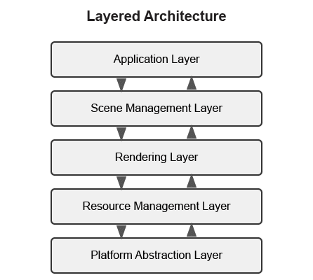
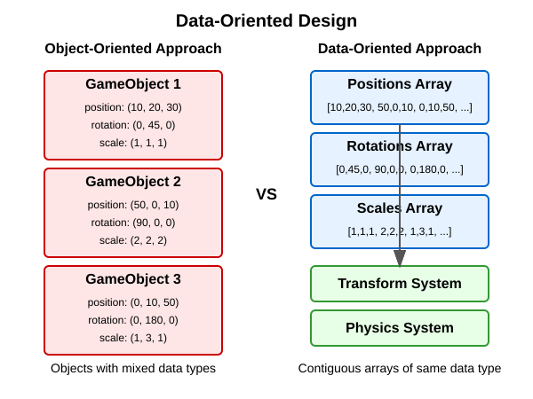
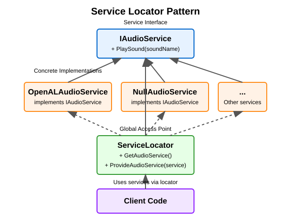
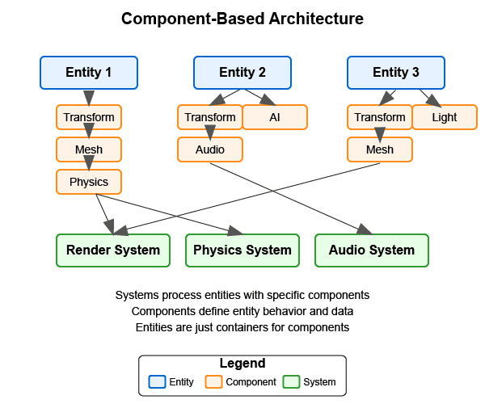

:pp: {plus}{plus}

= 引擎架构：架构模式

== 架构模式

本节中，我们将简要概览现代渲染引擎与游戏引擎中常见的架构模式，重点放在基于组件的架构上，它是我们 Vulkan 渲染引擎的基础。

在深入具体模式之前，有必要先澄清一点：虽然本教程构建的是基于 Vulkan 的渲染引擎，但我们要讨论的许多架构模式在渲染引擎和完整游戏引擎中都普遍使用。渲染引擎主要聚焦于图形渲染能力，而完整的游戏引擎通常还包含物理、音频、AI 和玩法逻辑等额外系统。

=== 常见架构模式概览

下面简要介绍游戏引擎和渲染引擎中最常见的架构模式：

==== link:https://games-1312234642.cos.ap-guangzhou.myqcloud.com/course/GAMES104/GAMES104_Lecture02.pdf[分层架构]

分层架构把系统划分为若干不同的层，每层承担特定职责。典型的层包括平台抽象、资源管理、渲染、场景管理和应用层。

*主要优点：*

* 关注点清晰分离
* 更易于理解和维护
* 可以替换或修改单独的层而不影响其他层

详细信息和实现示例，参见 xref:Building_a_Simple_Engine/Appendix/appendix.adoc#layered-architecture[附录：分层架构]。

==== link:https://www.youtube.com/watch?v=rX0ItVEVjHc[数据导向设计]

数据导向设计（DOD）关注的是为高效处理而组织数据，而不是围绕对象来组织代码。它强调对缓存友好的内存布局和数据的批量处理。

*主要优点：*

* 更好的缓存利用率
* 更高效的内存使用
* 更易于并行化

详细信息和实现示例，参见 xref:Building_a_Simple_Engine/Appendix/appendix.adoc#data-oriented-design[附录：数据导向设计]。

==== link:https://gameprogrammingpatterns.com/service-locator.html[服务定位器模式]

服务定位器模式提供一个全局的服务访问点，同时不让使用方与具体实现耦合。

*主要优点：*

* 将服务使用方与服务提供方解耦
* 便于替换服务
* 便于用模拟服务进行测试

详细信息和实现示例，参见 xref:Building_a_Simple_Engine/Appendix/appendix.adoc#service-locator-pattern[附录：服务定位器模式]。

=== link:https://gameprogrammingpatterns.com/component.html[基于组件的架构]

基于组件的架构在现代游戏引擎中被广泛使用，也是我们 Vulkan 渲染引擎的基础。它提倡组合优于继承，允许更灵活的实体设计。

[NOTE]
====
*图例说明：*

* *方框*：蓝色方框表示实体，橙色方框表示组件，绿色方框表示系统
* *线条类型*：
** 虚线表示所有权/包含关系（实体包含组件）
** 实线表示处理关系（系统处理特定的组件）
* *文字*：所有文字元素都使用深色，以便在浅色和深色模式下都能看清
* *方向流*：箭头表示元素之间关系的方向
====

==== 核心概念

1. *实体（Entity）*——代表游戏世界中对象的基本容器。
2. *组件（Component）*——可以挂到实体上的模块化功能单元。
3. *系统（System）*——处理带有特定组件的实体，以实现游戏逻辑。

==== 基于组件的架构的优点

* 高度模块化且灵活
* 避免深层继承体系
* 支持数据导向设计
* 便于并行处理

==== 实现示例

[source,cpp]
----
// Component base class
class Component {
public:
    virtual ~Component() = default;
    virtual void Update(float deltaTime) {}
};

// Specific component types
class TransformComponent : public Component {
private:
    glm::vec3 position;
    glm::quat rotation;
    glm::vec3 scale;

public:
    // Methods to manipulate transform
};

class MeshComponent : public Component {
private:
    Mesh* mesh;
    Material* material;

public:
    // Methods to render the mesh
};

// Entity class
class Entity {
private:
    std::vector<std::unique_ptr<Component>> components;

public:
    template<typename T, typename... Args>
    T* AddComponent(Args&&... args) {
        static_assert(std::is_base_of<Component, T>::value, "T must derive from Component");
        auto component = std::make_unique<T>(std::forward<Args>(args)...);
        T* componentPtr = component.get();
        components.push_back(std::move(component));
        return componentPtr;
    }

    template<typename T>
    T* GetComponent() {
        for (auto& component : components) {
            if (T* result = dynamic_cast<T*>(component.get())) {
                return result;
            }
        }
        return nullptr;
    }

    void Update(float deltaTime) {
        for (auto& component : components) {
            component->Update(deltaTime);
        }
    }
};
----

=== 为什么我们聚焦于组件系统

对于我们的 Vulkan 渲染引擎，我们选择聚焦于基于组件的架构，原因有几个：

1. *图形特性的灵活性*：组件系统让我们能轻松添加、移除或替换渲染特性（例如不同的着色模型、后处理效果或光照技术），而无需大规模重构。

2. *渲染关注点的分离*：组件自然地把渲染的不同方面（几何、材质、光照、相机）拆成可管理、可复用的单元。

3. *行业标准*：大多数现代渲染引擎和图形框架都采用基于组件的方式，因为它在灵活性、可维护性和性能之间提供了恰当的平衡。

4. *可扩展性*：图形技术快速演进，组件系统让引入新的 Vulkan 特性或渲染技术变得更容易。

5. *与数据导向优化的兼容性*：虽然我们采用基于组件的方式，但在性能关键的渲染路径上，我们仍然可以在组件内部应用数据导向设计原则。

其他架构模式各有其优点，但基于组件的架构为现代、灵活的渲染引擎提供了最好的基础。话虽如此，我们仍会在适当之处融合其他模式的要素——用分层架构组织引擎的整体结构，用数据导向设计服务性能关键的系统，用服务定位器处理横切关注点。

=== 结语

我们简要概览了常见的架构模式，重点介绍了基于组件的架构，本教程后续都会使用它。关于其他架构模式更详细的信息，包括实现示例和对比分析，参见 xref:Building_a_Simple_Engine/Appendix/appendix.adoc[附录：架构模式详解]。

下一节中，我们会更深入地探讨组件系统，以及如何在你的引擎中高效地实现它们。

xref:Building_a_Simple_Engine/Engine_Architecture/01_introduction.adoc[上一篇：引擎架构：简介] | xref:Building_a_Simple_Engine/Engine_Architecture/03_component_systems.adoc[下一篇：引擎架构：组件系统]
