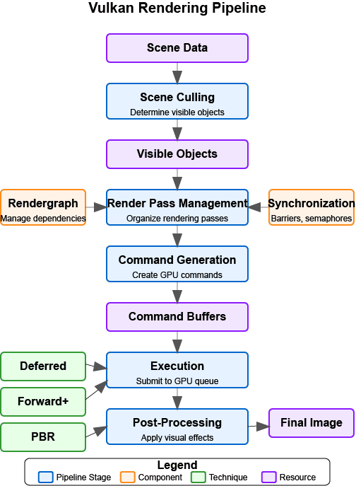

:pp: {plus}{plus}

= 引擎架构：渲染管线

== 渲染管线

一套设计良好的渲染管线，是构建灵活而高效的渲染引擎的关键。本节将探讨如何组织你的渲染管线，以便支持各种渲染技术与效果。

=== 渲染管线概览

下图从高层概括了现代 Vulkan 渲染管线的构成：

[NOTE]
====
*图示说明：*

* *方框*：表示渲染管线的各个阶段
* *箭头*：表示阶段之间的数据流与执行流
* *颜色*：不同颜色代表不同类型的操作（处理、管理、执行）
* *配套组件*：渲染图与同步原语在图中与主管线流相连
====

渲染管线由几个关键阶段组成：

1. *场景剔除* —— 确定哪些对象可见、需要渲染。
2. *渲染通道管理* —— 把渲染组织成用途明确的各个通道。
3. *命令生成* —— 生成交由 GPU 执行的命令。
4. *执行* —— 把命令提交给 GPU 执行。
5. *后处理* —— 对渲染出的图像施加各种效果。

渲染图（rendergraph）之类的配套组件负责管理渲染通道之间的依赖，而同步原语则保证正确的执行顺序。不同的渲染技术（延迟渲染、Forward+、PBR）都可以在这套管线架构中实现。

=== 渲染管线的挑战

设计渲染管线时，你需要解决几个难题：

1. *灵活性* —— 支持不同的渲染技术与效果。
2. *性能* —— 高效利用 GPU，尽量减少状态切换。
3. *可扩展性* —— 便于添加新的渲染特性。
4. *可维护性* —— 让代码保持条理清晰、易于理解。
5. *平台无关性* —— 把平台相关的细节抽象掉。

=== 渲染管线架构

前面我们列出了现代管线的主要阶段。与其再复述一遍，不如直接深入每个阶段，关注它们各自的职责、数据流，以及能让引擎保持灵活与高效的实用实现模式。

=== 场景剔除

渲染之前，需要先确定哪些对象对相机可见。这个过程称为剔除（culling），它能减少需要渲染的对象数量，从而显著提升性能。

[source,cpp]
----
class CullingSystem {
private:
    Camera* camera;
    std::vector<Entity*> visibleEntities;

public:
    explicit CullingSystem(Camera* cam) : camera(cam) {}

    void SetCamera(Camera* cam) {
        camera = cam;
    }

    void CullScene(const std::vector<Entity*>& allEntities) {
        visibleEntities.clear();

        if (!camera) return;

        // Get camera frustum
        Frustum frustum = camera->GetFrustum();

        // Check each entity against the frustum
        for (auto entity : allEntities) {
            if (!entity->IsActive()) continue;

            auto meshComponent = entity->GetComponent<MeshComponent>();
            if (!meshComponent) continue;

            auto transformComponent = entity->GetComponent<TransformComponent>();
            if (!transformComponent) continue;

            // Get bounding box of the mesh
            BoundingBox boundingBox = meshComponent->GetBoundingBox();

            // Transform bounding box by entity transform
            boundingBox.Transform(transformComponent->GetTransformMatrix());

            // Check if bounding box is visible
            if (frustum.Intersects(boundingBox)) {
                visibleEntities.push_back(entity);
            }
        }
    }

    const std::vector<Entity*>& GetVisibleEntities() const {
        return visibleEntities;
    }
};
----

=== 渲染通道管理

现代渲染技术往往需要多个通道，每个通道各司其职。渲染通道管理器可以帮助你组织这些通道以及它们之间的依赖关系。

本教程使用 Vulkan 的动态渲染特性配合 vk::raii，而不是传统的渲染通道。动态渲染让我们用单个命令就能开始和结束渲染操作，不必显式创建 VkRenderPass 和 VkFramebuffer 对象，从而简化了渲染流程。

=== 渲染图与同步

NOTE: 本节介绍的渲染图是一种架构模式，并没有接入随附示例中的 Simple Engine 代码。下面几节应视为一份可供你自行添加到引擎中的设计指南，而不是对 `attachments/simple_engine` 当前运行时行为的描述 —— 这个引擎直接发出自己的渲染通道，不经过任何渲染图抽象。

渲染图是一种更高层的抽象，它把整个渲染过程表示成有向无环图（DAG）：图中的节点是渲染通道，边表示通道之间的依赖。相比传统的渲染通道管理方式，这种做法有几项优势：

==== 什么是渲染图？

渲染图是这样一种数据结构：

1. *描述资源*：跟踪渲染中用到的所有资源（纹理、缓冲区）。
2. *定义操作*：指明将要执行哪些操作（渲染通道）。
3. *管理依赖*：自动推断操作之间的依赖关系。
4. *处理同步*：自动插入必要的同步原语。
5. *优化内存*：可以执行内存别名等优化。

=== 渲染图：数据结构架构与资源表示

首先，我们要建立渲染图系统中用于表示渲染资源与渲染通道的基础数据结构。

[source,cpp]
----
// A comprehensive rendergraph implementation for automated dependency management
class Rendergraph {
private:
    // Resource description and management structure
    // Represents Image resource used during rendering (textures)
    struct Resource {
        std::string name;                     // Human-readable identifier for debugging and referencing
        vk::Format format;                    // Pixel format (RGBA8, Depth24Stencil8, etc.)
        vk::Extent2D extent;                  // Dimensions in pixels for 2D resources
        vk::ImageUsageFlags usage;            // How this resource will be used (color attachment, texture, etc.)
        vk::ImageLayout initialLayout;        // Expected layout when the frame begins
        vk::ImageLayout finalLayout;          // Required layout when the frame ends

        // Actual GPU resources - populated during compilation
        vk::raii::Image image = nullptr;      // The GPU image object
        vk::raii::DeviceMemory memory = nullptr;  // Backing memory allocation
        vk::raii::ImageView view = nullptr;   // Shader-accessible view of the image
    };

    // Render pass representation within the graph structure
    // Each pass represents a distinct rendering operation with defined inputs and outputs
    struct Pass {
        std::string name;                     // Descriptive name for debugging and profiling
        std::vector<std::string> inputs;      // Resources this pass reads from (dependencies)
        std::vector<std::string> outputs;     // Resources this pass writes to (products)
        std::function<void(vk::raii::CommandBuffer&)> executeFunc;  // The actual rendering code
    };

    // Core data storage for the rendergraph system
    std::unordered_map<std::string, Resource> resources;  // All resources referenced in the graph
    std::vector<Pass> passes;                             // All rendering passes in definition order
    std::vector<size_t> executionOrder;                   // Computed optimal execution sequence

    // Automatic synchronization management
    // These objects ensure correct GPU execution order without manual barriers
    std::vector<vk::raii::Semaphore> semaphores;          // GPU synchronization primitives
    std::vector<std::pair<size_t, size_t>> semaphoreSignalWaitPairs;  // (signaling pass, waiting pass)

    vk::raii::Device& device;  // Vulkan device for resource creation

public:
    explicit Rendergraph(vk::raii::Device& dev) : device(dev) {}
----

这套数据结构体现了渲染图的核心思路：把渲染看作对资源的一系列变换，而不是一条条命令式的 GPU 指令。Resource 结构封装了创建和管理 GPU 资源所需的全部信息，而 Pass 结构则用资源依赖而非实现细节来描述渲染操作。

这种做法带来了强大的优化空间，例如自动内存别名（当多个资源的生命周期不重叠时，让它们共用同一块内存）以及最优的资源布局转换。资源描述与实际 GPU 对象相互分离，使渲染图能够在编译阶段对资源管理做出有依据的决策。

=== 渲染图：资源注册与通道定义接口

接下来是公开接口：通过注册资源、定义带依赖关系的渲染通道来构建渲染图。

[source,cpp]
----
    // Resource registration interface for declaring all resources used during rendering
    // This method establishes resource metadata without creating actual GPU resources
    void AddResource(const std::string& name, vk::Format format, vk::Extent2D extent,
                    vk::ImageUsageFlags usage, vk::ImageLayout initialLayout,
                    vk::ImageLayout finalLayout) {
        Resource resource;
        resource.name = name;                    // Store human-readable identifier
        resource.format = format;                // Define pixel format and bit depth
        resource.extent = extent;                // Set resource dimensions
        resource.usage = usage;                  // Specify intended usage patterns
        resource.initialLayout = initialLayout; // Define starting layout state
        resource.finalLayout = finalLayout;     // Define required ending state

        resources[name] = resource;              // Register in the global resource map
    }

    // Pass registration interface for defining rendering operations and their dependencies
    // This method establishes the logical structure of rendering without immediate execution
    void AddPass(const std::string& name,
                const std::vector<std::string>& inputs,
                const std::vector<std::string>& outputs,
                std::function<void(vk::raii::CommandBuffer&)> executeFunc) {
        Pass pass;
        pass.name = name;                        // Assign descriptive identifier
        pass.inputs = inputs;                    // List all resources this pass reads
        pass.outputs = outputs;                  // List all resources this pass writes
        pass.executeFunc = executeFunc;          // Store the actual rendering implementation

        passes.push_back(pass);                  // Add to the ordered pass list
    }
----

这套注册接口让渲染图可以以声明式的方式构建：开发者只说明想要达成的结果，而不必说明如何实现。这种高层做法让渲染图能够先分析整条渲染管线，再决定资源分配与调度。

延迟执行的模型（通道保存的是函数对象，而不是立即录制 GPU 命令）带来了编译期的强大优化。渲染图可以重排通道、合并兼容的操作，并基于完整的依赖图来优化资源使用，而不是对每个通道单独做局部决策。

=== 渲染图：依赖分析与执行排序

接下来实现核心算法逻辑：分析通道之间的依赖，并为渲染管线计算出最优的执行顺序。

[source,cpp]
----
    // Rendergraph compilation - transforms declarative descriptions into executable pipeline
    // This method performs dependency analysis, resource allocation, and execution planning
    void Compile() {
        // Dependency Graph Construction
        // Build bidirectional dependency relationships between passes
        std::vector<std::vector<size_t>> dependencies(passes.size());  // What each pass depends on
        std::vector<std::vector<size_t>> dependents(passes.size());    // What depends on each pass

        // Track which pass produces each resource (write-after-write dependencies)
        std::unordered_map<std::string, size_t> resourceWriters;

        // Resource Production Registration
        // Register every pass's outputs *before* looking at any inputs, in its own pass over
        // `passes`. Producers and consumers can appear in any order in the `passes` vector -
        // a pass added later might produce a resource a pass added earlier consumes - so
        // dependency discovery below must not assume producers come first positionally.
        for (size_t i = 0; i < passes.size(); ++i) {
            for (const auto& output : passes[i].outputs) {
                resourceWriters[output] = i;                    // Record this pass as producer
            }
        }

        // Dependency Discovery Through Resource Usage Analysis
        // Now that every producer is known, analyze each pass's inputs to determine data flow
        // relationships, regardless of where the producer sits in the passes vector.
        for (size_t i = 0; i < passes.size(); ++i) {
            const auto& pass = passes[i];

            // Process input dependencies - this pass must wait for producers
            for (const auto& input : pass.inputs) {
                auto it = resourceWriters.find(input);
                if (it != resourceWriters.end()) {
                    // Found the pass that produces this input - create dependency link
                    dependencies[i].push_back(it->second);      // This pass depends on the producer
                    dependents[it->second].push_back(i);        // Producer has this as dependent
                }
            }
        }

        // Topological Sort for Optimal Execution Order
        // Use depth-first search to compute valid execution sequence while detecting cycles
        std::vector<bool> visited(passes.size(), false);       // Track completed nodes
        std::vector<bool> inStack(passes.size(), false);       // Track current recursion path

        std::function<void(size_t)> visit = [&](size_t node) {
            if (inStack[node]) {
                // Cycle detection - circular dependency found
                throw std::runtime_error("Cycle detected in rendergraph");
            }

            if (visited[node]) {
                return;  // Already processed this node and its dependencies
            }

            inStack[node] = true;   // Mark as currently being processed

            // Recursively process all passes this one depends on first (post-order traversal),
            // so a producer is always pushed onto executionOrder before its consumers.
            for (auto dependency : dependencies[node]) {
                visit(dependency);
            }

            inStack[node] = false;  // Remove from current path
            visited[node] = true;   // Mark as completely processed
            executionOrder.push_back(node);  // Add to execution sequence
        };

        // Process all unvisited nodes to handle disconnected graph components
        for (size_t i = 0; i < passes.size(); ++i) {
            if (!visited[i]) {
                visit(i);
            }
        }
----

依赖分析是渲染图系统的数学核心，它把对渲染操作的抽象描述转换成具体的执行计划。双向依赖跟踪让图遍历算法得以高效运行，并为自动同步提供所需的信息。

拓扑排序算法保证通道按依赖顺序执行，同时检测出不可能成立的循环依赖 —— 那代表渲染管线设计中存在逻辑错误。这种编译期校验能在许多常见的管线缺陷演变成运行时的 GPU 同步问题之前，就把它们抓住。

=== 渲染图：自动同步与资源分配

接下来创建保证执行顺序正确所需的 GPU 同步对象，并为所有已注册的资源分配实际的 Vulkan 资源。

[source,cpp]
----
        // Automatic Synchronization Object Creation
        // Generate semaphores for all dependencies identified during analysis
        for (size_t i = 0; i < passes.size(); ++i) {
            for (auto dep : dependencies[i]) {
                // Create a GPU semaphore for this dependency relationship
                // The dependent pass will wait on this semaphore before executing
                semaphores.emplace_back(device.createSemaphore({}));
                semaphoreSignalWaitPairs.emplace_back(dep, i);    // (producer, consumer) pair
            }
        }

        // Physical Resource Allocation and Creation
        // Transform resource descriptions into actual GPU objects
        for (auto& [name, resource] : resources) {
            // Configure image creation parameters based on resource description
            vk::ImageCreateInfo imageInfo;
            imageInfo.setImageType(vk::ImageType::e2D)                    // 2D texture/render target
                     .setFormat(resource.format)                          // Pixel format from description
                     .setExtent({resource.extent.width, resource.extent.height, 1})  // Dimensions
                     .setMipLevels(1)                                      // Single mip level for simplicity
                     .setArrayLayers(1)                                    // Single layer (not array texture)
                     .setSamples(vk::SampleCountFlagBits::e1)              // No multisampling
                     .setTiling(vk::ImageTiling::eOptimal)                 // GPU-optimal memory layout
                     .setUsage(resource.usage)                             // Usage flags from registration
                     .setSharingMode(vk::SharingMode::eExclusive)          // Single queue family access
                     .setInitialLayout(vk::ImageLayout::eUndefined);       // Initial layout (will be transitioned)

            resource.image = device.createImage(imageInfo);               // Create the GPU image object

            // Allocate backing memory for the image
            vk::MemoryRequirements memRequirements = resource.image.getMemoryRequirements();

            vk::MemoryAllocateInfo allocInfo;
            allocInfo.setAllocationSize(memRequirements.size)             // Required memory size
                     .setMemoryTypeIndex(FindMemoryType(memRequirements.memoryTypeBits,
                                                       vk::MemoryPropertyFlagBits::eDeviceLocal));  // GPU-local memory

            resource.memory = device.allocateMemory(allocInfo);           // Allocate GPU memory
            resource.image.bindMemory(*resource.memory, 0);               // Bind memory to image

            // Create image view for shader access
            vk::ImageViewCreateInfo viewInfo;
            viewInfo.setImage(*resource.image)                            // Reference the created image
                    .setViewType(vk::ImageViewType::e2D)                   // 2D view type
                    .setFormat(resource.format)                            // Match image format
                    .setSubresourceRange({vk::ImageAspectFlagBits::eColor, 0, 1, 0, 1});  // Full image access

            resource.view = device.createImageView(viewInfo);             // Create shader-accessible view
        }
    }

    // Resource access interface for retrieving compiled resources
    Resource* GetResource(const std::string& name) {
        auto it = resources.find(name);
        return (it != resources.end()) ? &it->second : nullptr;
    }
----

=== 渲染图：执行引擎与命令录制

最后实现执行引擎，它负责协调各通道的执行，并处理正确的同步与资源转换。

[source,cpp]
----

    // Rendergraph execution engine - coordinates pass execution with automatic synchronization
    // This method transforms the compiled rendergraph into actual GPU work
    void Execute(vk::raii::CommandBuffer& commandBuffer, vk::Queue queue) {
        // Execution state management for dynamic synchronization
        std::vector<vk::CommandBuffer> cmdBuffers;           // Command buffer storage
        std::vector<vk::Semaphore> waitSemaphores;           // Synchronization dependencies for current pass
        std::vector<vk::PipelineStageFlags> waitStages;      // Pipeline stages to wait on
        std::vector<vk::Semaphore> signalSemaphores;         // Semaphores to signal after current pass

        // Ordered Pass Execution with Automatic Dependency Management
        // Execute each pass in the computed dependency-safe order
        for (auto passIdx : executionOrder) {
            const auto& pass = passes[passIdx];

            // Synchronization Setup - Collect Dependencies for Current Pass
            // Determine what this pass must wait for before executing
            waitSemaphores.clear();
            waitStages.clear();

            for (size_t i = 0; i < semaphoreSignalWaitPairs.size(); ++i) {
                if (semaphoreSignalWaitPairs[i].second == passIdx) {
                    // This pass depends on the completion of another pass
                    waitSemaphores.push_back(*semaphores[i]);                           // Wait for dependency completion
                    waitStages.push_back(vk::PipelineStageFlagBits::eColorAttachmentOutput);  // Wait at output stage
                }
            }

            // Collect semaphores that this pass will signal for dependent passes
            signalSemaphores.clear();
            for (size_t i = 0; i < semaphoreSignalWaitPairs.size(); ++i) {
                if (semaphoreSignalWaitPairs[i].first == passIdx) {
                    // Other passes depend on this pass's completion
                    signalSemaphores.push_back(*semaphores[i]);                         // Signal completion for dependents
                }
            }

            // Command Buffer Preparation and Resource Layout Transitions
            // Set up command recording and transition resources to appropriate layouts
            commandBuffer.begin({});                                                   // Begin command recording

            // Transition input resources to shader-readable layouts
            for (const auto& input : pass.inputs) {
                auto& resource = resources[input];

                vk::ImageMemoryBarrier barrier;
                barrier.setOldLayout(resource.initialLayout)                           // Current resource layout
                       .setNewLayout(vk::ImageLayout::eShaderReadOnlyOptimal)          // Target layout for reading
                       .setSrcQueueFamilyIndex(VK_QUEUE_FAMILY_IGNORED)                // No queue family transfer
                       .setDstQueueFamilyIndex(VK_QUEUE_FAMILY_IGNORED)
                       .setImage(*resource.image)                                      // Target image
                       .setSubresourceRange({vk::ImageAspectFlagBits::eColor, 0, 1, 0, 1})  // Full image range
                       .setSrcAccessMask(vk::AccessFlagBits::eMemoryWrite)             // Previous write access
                       .setDstAccessMask(vk::AccessFlagBits::eShaderRead);             // Required read access

                // Insert pipeline barrier for safe layout transition
                commandBuffer.pipelineBarrier(
                    vk::PipelineStageFlagBits::eAllCommands,                           // Wait for all previous work
                    vk::PipelineStageFlagBits::eFragmentShader,                        // Enable fragment shader access
                    vk::DependencyFlagBits::eByRegion,                                 // Region-local dependency
                    0, nullptr, 0, nullptr, 1, &barrier                               // Image barrier only
                );
            }

            // Transition output resources to render target layouts
            for (const auto& output : pass.outputs) {
                auto& resource = resources[output];

                vk::ImageMemoryBarrier barrier;
                barrier.setOldLayout(resource.initialLayout)                           // Current layout state
                       .setNewLayout(vk::ImageLayout::eColorAttachmentOptimal)         // Optimal for color output
                       .setSrcQueueFamilyIndex(VK_QUEUE_FAMILY_IGNORED)
                       .setDstQueueFamilyIndex(VK_QUEUE_FAMILY_IGNORED)
                       .setImage(*resource.image)
                       .setSubresourceRange({vk::ImageAspectFlagBits::eColor, 0, 1, 0, 1})
                       .setSrcAccessMask(vk::AccessFlagBits::eMemoryRead)              // Previous read access
                       .setDstAccessMask(vk::AccessFlagBits::eColorAttachmentWrite);   // Required write access

                // Insert barrier for safe transition to writable state
                commandBuffer.pipelineBarrier(
                    vk::PipelineStageFlagBits::eAllCommands,
                    vk::PipelineStageFlagBits::eColorAttachmentOutput,                 // Enable color attachment writes
                    vk::DependencyFlagBits::eByRegion,
                    0, nullptr, 0, nullptr, 1, &barrier
                );
            }

            // Pass Execution - Execute the Actual Rendering Logic
            // Call the user-provided rendering function with prepared command buffer
            pass.executeFunc(commandBuffer);                                           // Execute pass-specific rendering

            // Final Layout Transitions - Prepare Resources for Subsequent Use
            // Transition output resources to their final required layouts
            for (const auto& output : pass.outputs) {
                auto& resource = resources[output];

                vk::ImageMemoryBarrier barrier;
                barrier.setOldLayout(vk::ImageLayout::eColorAttachmentOptimal)         // Current writable layout
                       .setNewLayout(resource.finalLayout)                             // Required final layout
                       .setSrcQueueFamilyIndex(VK_QUEUE_FAMILY_IGNORED)
                       .setDstQueueFamilyIndex(VK_QUEUE_FAMILY_IGNORED)
                       .setImage(*resource.image)
                       .setSubresourceRange({vk::ImageAspectFlagBits::eColor, 0, 1, 0, 1})
                       .setSrcAccessMask(vk::AccessFlagBits::eColorAttachmentWrite)    // Previous write operations
                       .setDstAccessMask(vk::AccessFlagBits::eMemoryRead);             // Enable subsequent reads

                // Insert final barrier for layout transition
                commandBuffer.pipelineBarrier(
                    vk::PipelineStageFlagBits::eColorAttachmentOutput,                 // After color writes complete
                    vk::PipelineStageFlagBits::eAllCommands,                           // Before any subsequent work
                    vk::DependencyFlagBits::eByRegion,
                    0, nullptr, 0, nullptr, 1, &barrier
                );
            }

            // Command Submission with Synchronization
            // Submit command buffer with appropriate dependency and signaling semaphores
            commandBuffer.end();                                                       // Finalize command recording

            vk::SubmitInfo submitInfo;
            submitInfo.setWaitSemaphoreCount(static_cast<uint32_t>(waitSemaphores.size()))      // Dependencies to wait for
                      .setPWaitSemaphores(waitSemaphores.data())                                 // Dependency semaphores
                      .setPWaitDstStageMask(waitStages.data())                                   // Pipeline stages to wait at
                      .setCommandBufferCount(1)                                                  // Single command buffer
                      .setPCommandBuffers(&*commandBuffer)                                      // Command buffer to execute
                      .setSignalSemaphoreCount(static_cast<uint32_t>(signalSemaphores.size()))  // Semaphores to signal
                      .setPSignalSemaphores(signalSemaphores.data());                           // Signal semaphores

            queue.submit(1, &submitInfo, nullptr);                                              // Submit to GPU queue
        }
    }
----

执行引擎是渲染图系统的收官之处：前面所有的分析与准备工作，在这一刻转化为协调一致的 GPU 执行。自动同步保证各通道以正确顺序执行，无需手工管理屏障；自动布局转换则处理 Vulkan 为达到最优性能所要求的复杂状态管理。

这套执行模型展示了渲染图抽象的威力：涉及数十个资源与依赖的复杂多通道渲染，被简化为一次 `Execute()` 调用，所有同步与资源管理都根据声明式的通道与资源描述自动完成。

[source,cpp]
----
private:
    uint32_t FindMemoryType(uint32_t typeFilter, vk::MemoryPropertyFlags properties) {
        // Implementation to find suitable memory type
        // ...
        return 0; // Placeholder
    }
};
----

==== Vulkan 同步

Vulkan 中的同步是最复杂的话题之一。Vulkan 提供了多种同步原语，用来保证正确的执行顺序与内存可见性：

1. *信号量*：用于队列操作之间的同步（GPU-GPU 同步）。
2. *栅栏*：用于 CPU 与 GPU 之间的同步。
3. *事件*：用于命令缓冲区内部的细粒度同步。
4. *屏障*：用于同步对资源的访问，并执行布局转换。

在 Vulkan 中，正确的同步至关重要，原因如下：

1. *没有隐式同步*：与 OpenGL 不同，Vulkan 不提供操作之间的隐式同步。
2. *并行执行*：现代 GPU 会并行执行命令，缺少正确的同步就可能产生竞态。
3. *内存可见性*：一次操作所做的修改，在没有正确屏障的情况下可能对另一次操作不可见。

Vulkan 教程中对同步以及上述各原语的正确用法有更详细的讨论。

* xref:03_Drawing_a_triangle/03_Drawing/02_Rendering_and_presentation.adoc[渲染与呈现]
* xref:03_Drawing_a_triangle/03_Drawing/03_Frames_in_flight.adoc[飞行帧]
* xref:11_Compute_Shader.adoc[计算着色器]
* xref:17_Multithreading.adoc[使用 Vulkan 进行多线程编程]

===== 管线屏障

管线屏障是 Vulkan 中最重要的同步原语之一。它保证屏障之前的操作在屏障之后的操作开始前完成，同时还能对图像执行布局转换。下面我们完整拆解这一过程，看看如何实现正确的图像布局转换。

=== 图像布局转换：屏障配置与资源指定

首先，建立屏障的基本结构，并确定需要在布局之间转换的是哪一个图像资源。

[source,cpp]
----
// Comprehensive image layout transition implementation
// This function demonstrates proper synchronization and layout management in Vulkan
void TransitionImageLayout(vk::raii::CommandBuffer& commandBuffer,
                          vk::Image image,
                          vk::Format format,
                          vk::ImageLayout oldLayout,
                          vk::ImageLayout newLayout) {

    // Configure the basic image memory barrier structure
    // This barrier will coordinate memory access and layout transitions
    vk::ImageMemoryBarrier barrier;
    barrier.setOldLayout(oldLayout)                                        // Current image layout state
           .setNewLayout(newLayout)                                        // Target layout after transition
           .setSrcQueueFamilyIndex(VK_QUEUE_FAMILY_IGNORED)                // No queue family ownership transfer
           .setDstQueueFamilyIndex(VK_QUEUE_FAMILY_IGNORED)                // Same queue family throughout
           .setImage(image)                                                // Target image for the transition
           .setSubresourceRange({vk::ImageAspectFlagBits::eColor, 0, 1, 0, 1}); // Full color image range
----

图像内存屏障是 Vulkan 中同时协调内存访问模式与图像布局转换的基础机制。在 OpenGL 里这些操作会自动发生，而 Vulkan 要求显式指定图像布局在何时、以何种方式改变。这里把队列族设为 VK_QUEUE_FAMILY_IGNORED，表示我们不在不同的队列族之间转移所有权，从而简化了同步要求。

子资源范围精确界定了屏障影响图像的哪些部分。这里的做法是把图像的颜色切面整体转换，覆盖所有 mip 层级与数组层，这是基本纹理操作中最常见的情形。

=== 图像布局转换：管线阶段与访问掩码的确定

接下来，分析所要执行的具体布局转换，并确定合适的管线阶段与内存访问模式，以获得最优的同步。

[source,cpp]
----
    // Initialize pipeline stage tracking for synchronization timing
    // These stages define when operations must complete and when new operations can begin
    vk::PipelineStageFlags sourceStage;      // When previous operations must finish
    vk::PipelineStageFlags destinationStage; // When subsequent operations can start

    // Configure synchronization for undefined-to-transfer layout transitions
    // This pattern is common when preparing images for data uploads
    if (oldLayout == vk::ImageLayout::eUndefined &&
        newLayout == vk::ImageLayout::eTransferDstOptimal) {

        // Configure memory access permissions for upload preparation
        barrier.setSrcAccessMask(vk::AccessFlagBits::eNone)                // No previous access to synchronize
               .setDstAccessMask(vk::AccessFlagBits::eTransferWrite);      // Enable transfer write operations

        // Set pipeline stage synchronization points for upload workflow
        sourceStage = vk::PipelineStageFlagBits::eTopOfPipe;               // No previous work to wait for
        destinationStage = vk::PipelineStageFlagBits::eTransfer;           // Transfer operations can proceed

    // Configure synchronization for transfer-to-shader layout transitions
    // This pattern prepares uploaded images for shader sampling
    } else if (oldLayout == vk::ImageLayout::eTransferDstOptimal &&
               newLayout == vk::ImageLayout::eShaderReadOnlyOptimal) {

        // Configure memory access transition from writing to reading
        barrier.setSrcAccessMask(vk::AccessFlagBits::eTransferWrite)       // Previous transfer writes must complete
               .setDstAccessMask(vk::AccessFlagBits::eShaderRead);         // Enable shader read access

        // Set pipeline stage synchronization for shader usage workflow
        sourceStage = vk::PipelineStageFlagBits::eTransfer;                // Transfer operations must complete
        destinationStage = vk::PipelineStageFlagBits::eFragmentShader;     // Fragment shaders can access

    } else {
        // Handle unsupported transition combinations
        // Production code would include additional common transition patterns
        throw std::invalid_argument("Unsupported layout transition!");
    }
----

管线阶段与访问掩码的配置，是 Vulkan 显式同步模型的核心。通过精确指定哪些操作必须在屏障之前完成（源阶段）、哪些操作可以在屏障之后开始（目标阶段），我们能在不引入多余停顿的前提下精确控制 GPU 的执行时机。

访问掩码模式定义了每次转换的内存可见性要求。「无访问」到「传输写入」的转换让图像上传得以高效进行，不必等待并不存在的先前操作；「传输写入」到「着色器读取」的转换则保证已上传的数据在着色器尝试采样纹理之前全部写完并可见。

=== 图像布局转换：屏障执行与 GPU 同步

最后，把配置好的屏障提交到 GPU 命令流，确保布局转换与同步发生在渲染管线中正确的位置。

[source,cpp]
----
    // Execute the pipeline barrier with configured synchronization
    // This commits the layout transition and memory synchronization to the command buffer
    commandBuffer.pipelineBarrier(
        sourceStage,                                                       // Wait for these operations to complete
        destinationStage,                                                  // Before allowing these operations to begin
        vk::DependencyFlagBits::eByRegion,                                 // Enable region-local optimizations
        0, nullptr,                                                        // No memory barriers needed
        0, nullptr,                                                        // No buffer barriers needed
        1, &barrier                                                        // Apply our image memory barrier
    );
}
----

提交管线屏障是整个同步规划的落点：配置好的屏障由此成为 GPU 命令流的一部分。`ByRegion` 依赖标志允许 GPU 在图像的不同区域可以独立处理时进行优化，这对基于瓦片的渲染器以及其他先进 GPU 架构可能有性能收益。

参数结构清楚地区分了不同类型的屏障（内存、缓冲区、图像），使驱动能够为每种资源类型采用最高效的同步策略。在本例中我们只需要图像屏障，所以另外两个数组留空，避免不必要的开销。

==== 信号量与栅栏

信号量与栅栏用于渲染管线不同阶段之间、以及 CPU 与 GPU 操作之间更粗粒度的同步。下面我们完整拆解帧渲染流程，看看如何用这些同步原语正确地协调帧渲染。

=== 帧渲染：CPU-GPU 同步与帧节奏控制

首先要保证 CPU 的帧准备工作与 GPU 执行之间的协调，既不让 CPU 跑得太超前，也要管理好资源争用。

[source,cpp]
----
// Comprehensive frame rendering with proper synchronization
// This function demonstrates the complete cycle of frame rendering coordination
void RenderFrame(vk::raii::Device& device, vk::Queue graphicsQueue, vk::Queue presentQueue) {

    // Synchronize with previous frame completion
    // Prevent CPU from submitting work faster than GPU can process it
    vk::Result result = device.waitForFences(1, &*inFlightFence, VK_TRUE, UINT64_MAX);

    // Reset fence for this frame's completion tracking
    // Prepare the fence to signal when this frame's GPU work completes
    device.resetFences(1, &*inFlightFence);
----

基于栅栏的同步是帧渲染中 CPU 与 GPU 协调的主要机制。等待上一帧的栅栏，可以确保 GPU 已完成上一帧的处理，然后再开始当前帧的工作。这样既避免 CPU 给 GPU 塞入过多工作，也有助于保持稳定的帧节奏。

重置栅栏是为当前帧准备这个同步对象。栅栏是一种二值信号：相关联的 GPU 工作完成时，它从无信号状态变为有信号状态，因此复用之前必须显式重置。超时值 UINT64_MAX 的实际含义是「无限等待」，这对于必须确保完成的帧同步是合适的。

=== 帧渲染：交换链图像获取与资源准备

接着获取下一张可用的交换链图像用于渲染，并与呈现引擎协调，确保图像确实可用。

[source,cpp]
----
    // Acquire next available image from the swapchain
    // This operation coordinates with the presentation engine and display system
    uint32_t imageIndex;
    result = device.acquireNextImageKHR(*swapchain,                        // Target swapchain for acquisition
                                       UINT64_MAX,                         // Wait indefinitely for image availability
                                       *imageAvailableSemaphore,          // Semaphore signaled when image is available
                                       nullptr,                           // No fence needed for this operation
                                       &imageIndex);                      // Receives index of acquired image

    // Record command buffer for this frame's rendering
    // Command buffer recording happens here with acquired image as render target
    // ... (command recording implementation would go here)
----

交换链图像获取是渲染系统与呈现引擎之间的一个关键同步点。如果当前没有可用图像（例如所有交换链图像都在显示或处理中），该操作可能阻塞，因此它对帧节奏至关重要。该操作所发出信号的信号量会在后续用到，以确保在获取到的图像真正可被修改之前不会开始渲染。

无限超时意味着即使在高负载下，或面对可变刷新率显示器时，获取最终也会成功。获取到的图像索引决定了这一帧以哪张交换链图像作为渲染目标，进而影响后续命令录制阶段的描述符集绑定与渲染通道配置。

=== 帧渲染：GPU 工作提交与队列间同步

接下来，把录制好的渲染命令提交给 GPU，并通过恰当的同步来协调图像获取、渲染与呈现。

[source,cpp]
----
    // Configure GPU work submission with comprehensive synchronization
    // This submission coordinates image availability, rendering, and presentation readiness
    vk::SubmitInfo submitInfo;
    vk::PipelineStageFlags waitStages[] = {vk::PipelineStageFlagBits::eColorAttachmentOutput};

    submitInfo.setWaitSemaphoreCount(1)                                    // Wait for one semaphore before execution
              .setPWaitSemaphores(&*imageAvailableSemaphore)               // Don't start until image is available
              .setPWaitDstStageMask(waitStages)                            // Specifically wait before color output
              .setCommandBufferCount(1)                                    // Submit one command buffer
              .setPCommandBuffers(&*commandBuffer)                        // The recorded rendering commands
              .setSignalSemaphoreCount(1)                                  // Signal one semaphore when complete
              .setPSignalSemaphores(&*renderFinishedSemaphore);            // Notify when rendering is finished

    // Submit work to GPU with fence-based completion tracking
    // The fence allows CPU to know when this frame's GPU work has completed
    graphicsQueue.submit(1, &submitInfo, *inFlightFence);
----

这份提交配置展示了 Vulkan 显式同步模型如何协调多个 GPU 操作。等待信号量确保在交换链图像真正可用于修改之前，渲染命令不会执行。等待阶段掩码精确指定图形管线中哪一部分需要等待 —— 这里是颜色附件输出 —— 从而让更早的管线阶段在必要时先行推进。

信号信号量把渲染工作的完成情况告知依赖渲染结果的其他操作，例如呈现。栅栏则向 CPU 提供完成通知，也就是前面看到的帧节奏逻辑所依赖的那一环。这种三方同步（等待信号量、信号信号量、栅栏）为帧渲染管线构成了一套完整的协调系统。

=== 帧渲染：呈现协调与显示集成

最后，与呈现引擎协调，把渲染完成的帧显示出来，确保呈现会等待渲染完成，并处理好从渲染到显示的过渡。

[source,cpp]
----
    // Present the rendered image to the display
    // This operation transfers the completed frame from rendering to display system
    vk::PresentInfoKHR presentInfo;
    presentInfo.setWaitSemaphoreCount(1)                                   // Wait for rendering completion
               .setPWaitSemaphores(&*renderFinishedSemaphore)              // Don't present until rendering finishes
               .setSwapchainCount(1)                                       // Present to one swapchain
               .setPSwapchains(&*swapchain)                                // Target swapchain for presentation
               .setPImageIndices(&imageIndex);                             // Present the image we rendered to

    // Submit presentation request to the presentation engine
    result = presentQueue.presentKHR(&presentInfo);
}
----

呈现阶段通过协调从渲染到显示的移交，完成整个帧渲染循环。等待信号量确保所有渲染操作完成之前不会开始呈现，避免显示出只渲染了一半的帧。这种同步很关键，因为呈现与渲染可能发生在不同的 GPU 队列上，时序特性也不相同。

呈现操作本身是异步的：它把呈现请求排入队列后立即返回，让 CPU 可以开始准备下一帧。呈现引擎负责与显示硬件进行实际协调，包括与刷新率对齐的时序同步，以及管理交换链图像在「渲染中」「显示中」「可复用」状态之间的转换。

==== 渲染图如何帮助处理同步

渲染图通过以下方式简化同步：

1. *自动跟踪依赖*：渲染图知道哪些通道依赖哪些资源，因此可以自动插入必要的同步原语。
2. *最优的屏障位置*：渲染图可以分析整个渲染过程，只在需要的地方放置屏障，减少开销。
3. *布局转换*：渲染图可以根据资源的使用方式自动处理图像布局转换。
4. *资源别名*：渲染图可以让不会同时使用的资源复用内存，从而降低内存占用。

==== 动态渲染及其与渲染图的集成

动态渲染是一项现代 Vulkan 特性，它简化了渲染流程，并且与渲染图配合得特别好。在进入实现示例之前，先弄清楚动态渲染是什么，以及它与我们的渲染管线架构有何关系。

===== 动态渲染的优势

相比传统的渲染通道，动态渲染有几项优势：

1. *更简洁的 API*：无需创建和管理 VkRenderPass、VkFramebuffer 对象，降低了代码复杂度。
2. *更灵活的渲染*：运行时更容易更换渲染目标与附件格式。
3. *更好的兼容性*：对不太适合传统渲染通道模型的现代渲染技术更为友好。
4. *更少的状态管理*：需要跟踪和同步的对象更少。
5. *更易调试*：更简单的渲染代码更容易调试和维护。

使用动态渲染时，我们在 vkCmdBeginRendering 调用中直接指定全部渲染状态（渲染目标、加载/存储操作等），而不是事先在 VkRenderPass 对象里配置好。这让渲染工作流更动态，也简化了延迟渲染之类技术的实现。

===== 渲染图中的动态渲染

与渲染图结合时，动态渲染会变得更强大：渲染图负责资源依赖与同步，动态渲染则简化实际的渲染过程。两者结合，既灵活又高效。

===== 示例：用渲染图与动态渲染实现延迟渲染器

延迟渲染是一种精巧的渲染技术，它把几何处理与光照计算分离开来，从而能高效应对复杂的光照场景。下面我们完整拆解整个搭建过程，看看如何用渲染图与动态渲染实现这项技术。

=== 延迟渲染器搭建：G-Buffer 资源配置

首先要建立 G-Buffer（几何缓冲区）资源，用来存放供延迟光照通道使用的中间几何信息。

[source,cpp]
----
// Comprehensive deferred renderer setup demonstrating rendergraph resource management
// This implementation shows how to efficiently organize multi-pass rendering workflows
void SetupDeferredRenderer(Rendergraph& graph, uint32_t width, uint32_t height) {

    // Configure position buffer for world-space vertex positions
    // High precision format preserves positional accuracy for lighting calculations
    graph.AddResource("GBuffer_Position", vk::Format::eR16G16B16A16Sfloat, {width, height},
                     vk::ImageUsageFlagBits::eColorAttachment | vk::ImageUsageFlagBits::eInputAttachment,
                     vk::ImageLayout::eUndefined, vk::ImageLayout::eShaderReadOnlyOptimal);

    // Configure normal buffer for surface orientation data
    // High precision normals enable accurate lighting and reflection calculations
    graph.AddResource("GBuffer_Normal", vk::Format::eR16G16B16A16Sfloat, {width, height},
                     vk::ImageUsageFlagBits::eColorAttachment | vk::ImageUsageFlagBits::eInputAttachment,
                     vk::ImageLayout::eUndefined, vk::ImageLayout::eShaderReadOnlyOptimal);

    // Configure albedo buffer for surface color information
    // Standard 8-bit precision sufficient for color data with gamma encoding
    graph.AddResource("GBuffer_Albedo", vk::Format::eR8G8B8A8Unorm, {width, height},
                     vk::ImageUsageFlagBits::eColorAttachment | vk::ImageUsageFlagBits::eInputAttachment,
                     vk::ImageLayout::eUndefined, vk::ImageLayout::eShaderReadOnlyOptimal);

    // Configure depth buffer for occlusion and depth testing
    // High precision depth enables accurate depth reconstruction in lighting pass
    graph.AddResource("Depth", vk::Format::eD32Sfloat, {width, height},
                     vk::ImageUsageFlagBits::eDepthStencilAttachment | vk::ImageUsageFlagBits::eInputAttachment,
                     vk::ImageLayout::eUndefined, vk::ImageLayout::eDepthStencilAttachmentOptimal);

    // Configure final color buffer for the completed lighting result
    // Standard color format with transfer capability for presentation or post-processing
    graph.AddResource("FinalColor", vk::Format::eR8G8B8A8Unorm, {width, height},
                     vk::ImageUsageFlagBits::eColorAttachment | vk::ImageUsageFlagBits::eTransferSrc,
                     vk::ImageLayout::eUndefined, vk::ImageLayout::eTransferSrcOptimal);
----

G-Buffer 的资源配置是延迟渲染的基础：每个缓冲区存放特定的几何信息，供光照计算阶段取用。格式的选择体现了精度需求与内存效率之间的权衡：位置和法线采用 16 位浮点，以保证光照计算准确；反照率则用 8 位整数，因为经过 gamma 编码后，颜色数据对精度的要求自然降低。

这些用途标志的组合让每个资源承担两种角色：先在几何通道中作为渲染目标，再在光照通道中作为输入纹理。这种双重用途正是延迟渲染工作流的特征 —— 同一份数据以不同的访问模式流经多个管线阶段。

=== 延迟渲染器搭建：几何通道配置与多渲染目标

接下来配置几何通道，它负责把场景中 3D 模型的几何信息填充到 G-Buffer 中。

[source,cpp]
----
    // Configure geometry pass for G-Buffer population
    // This pass renders all geometry and stores intermediate data for lighting calculations
    graph.AddPass("GeometryPass",
                 {},                                                        // No input dependencies - first pass in pipeline
                 {"GBuffer_Position", "GBuffer_Normal", "GBuffer_Albedo", "Depth"},  // Outputs all G-Buffer components
                 [&](vk::raii::CommandBuffer& cmd) {

                     // Configure multiple render target attachments for G-Buffer output
                     // Each attachment corresponds to a different geometric property
                     std::array<vk::RenderingAttachmentInfoKHR, 3> colorAttachments;

                     // Configure position attachment - world space vertex positions
                     colorAttachments[0].setImageView(/* GBuffer_Position view */)    // Target position buffer
                                       .setImageLayout(vk::ImageLayout::eColorAttachmentOptimal)  // Optimal for writes
                                       .setLoadOp(vk::AttachmentLoadOp::eClear)       // Clear to known state
                                       .setStoreOp(vk::AttachmentStoreOp::eStore);    // Preserve for lighting pass

                     // Configure normal attachment - surface normals in world space
                     colorAttachments[1].setImageView(/* GBuffer_Normal view */)      // Target normal buffer
                                       .setImageLayout(vk::ImageLayout::eColorAttachmentOptimal)
                                       .setLoadOp(vk::AttachmentLoadOp::eClear)       // Clear to default normal
                                       .setStoreOp(vk::AttachmentStoreOp::eStore);    // Preserve for lighting

                     // Configure albedo attachment - surface color and material properties
                     colorAttachments[2].setImageView(/* GBuffer_Albedo view */)      // Target albedo buffer
                                       .setImageLayout(vk::ImageLayout::eColorAttachmentOptimal)
                                       .setLoadOp(vk::AttachmentLoadOp::eClear)       // Clear to default color
                                       .setStoreOp(vk::AttachmentStoreOp::eStore);    // Preserve for lighting

                     // Configure depth attachment for occlusion culling
                     vk::RenderingAttachmentInfoKHR depthAttachment;
                     depthAttachment.setImageView(/* Depth view */)                   // Target depth buffer
                                   .setImageLayout(vk::ImageLayout::eDepthStencilAttachmentOptimal)  // Optimal for depth ops
                                   .setLoadOp(vk::AttachmentLoadOp::eClear)           // Clear to far plane
                                   .setStoreOp(vk::AttachmentStoreOp::eStore)         // Preserve for lighting pass
                                   .setClearValue({1.0f, 0});                        // Clear to maximum depth

                     // Assemble complete rendering configuration
                     vk::RenderingInfoKHR renderingInfo;
                     renderingInfo.setRenderArea({{0, 0}, {width, height}})          // Full screen rendering
                                  .setLayerCount(1)                                   // Single layer rendering
                                  .setColorAttachmentCount(colorAttachments.size())  // Number of G-Buffer targets
                                  .setPColorAttachments(colorAttachments.data())     // G-Buffer attachment array
                                  .setPDepthAttachment(&depthAttachment);            // Depth testing configuration

                     // Execute geometry rendering with dynamic rendering
                     cmd.beginRendering(renderingInfo);                              // Begin G-Buffer population

                     // Bind geometry pipeline and render all scene objects
                     // Each draw call populates position, normal, and albedo for visible fragments
                     // ... (geometry rendering implementation would go here)

                     cmd.endRendering();                                             // Complete G-Buffer population
                 });
----

几何通道的配置体现了延迟渲染分工明确的优势：几何复杂度与光照复杂度彼此独立处理。多渲染目标设置让一次渲染通道就能同时向所有 G-Buffer 分量输出，相比拆成多次独立通道，能显著提高 GPU 效率。

动态渲染省去了预先配置渲染通道对象的需要，从而能根据运行时需求灵活调整 G-Buffer 的格式或附件数量。这种灵活性对自适应画质设置、或针对不同材质类型选用可选 G-Buffer 分量之类的技术尤其有价值。

=== 延迟渲染器搭建：光照通道配置与屏幕空间处理

现在该建立光照通道了：它从 G-Buffer 读取数据，在屏幕空间中完成全部光照计算，输出最终渲染图像。

[source,cpp]
----
    // Configure lighting pass for screen-space illumination calculations
    // This pass reads G-Buffer data and computes final lighting for each pixel
    graph.AddPass("LightingPass",
                 {"GBuffer_Position", "GBuffer_Normal", "GBuffer_Albedo", "Depth"},  // Read all G-Buffer components
                 {"FinalColor"},                                            // Output final lit result
                 [&](vk::raii::CommandBuffer& cmd) {

                     // Configure single color output for final lighting result
                     vk::RenderingAttachmentInfoKHR colorAttachment;
                     colorAttachment.setImageView(/* FinalColor view */)             // Target final color buffer
                                   .setImageLayout(vk::ImageLayout::eColorAttachmentOptimal)  // Optimal for color writes
                                   .setLoadOp(vk::AttachmentLoadOp::eClear)          // Clear to background color
                                   .setStoreOp(vk::AttachmentStoreOp::eStore)        // Preserve final result
                                   .setClearValue({0.0f, 0.0f, 0.0f, 1.0f});        // Clear to black background

                     // Configure lighting pass rendering without depth testing
                     // Depth testing unnecessary since we're processing each pixel exactly once
                     vk::RenderingInfoKHR renderingInfo;
                     renderingInfo.setRenderArea({{0, 0}, {width, height}})          // Full screen processing
                                  .setLayerCount(1)                                   // Single layer output
                                  .setColorAttachmentCount(1)                        // Single color output
                                  .setPColorAttachments(&colorAttachment);           // Final color attachment

                     // Execute screen-space lighting calculations
                     cmd.beginRendering(renderingInfo);                              // Begin lighting pass

                     // Bind lighting pipeline and draw full-screen quad
                     // Fragment shader reads G-Buffer textures and computes lighting for each pixel
                     // All scene lights are processed in a single screen-space pass
                     // ... (lighting calculation implementation would go here)

                     cmd.endRendering();                                             // Complete lighting calculations
                 });

    // Compile the complete rendergraph for execution
    // This analyzes dependencies and generates optimal execution plan
    graph.Compile();
}
----

光照通道体现了延迟渲染的核心优势：把光照复杂度与几何复杂度解耦。由于光照在屏幕空间中处理，其开销与屏幕分辨率成正比，而不是与场景复杂度成正比，因此面对大量光源或复杂光照模型的场景也能高效处理。

单一渲染目标的配置反映了光照通道的统一性：所有光照贡献都累加到最终颜色缓冲区中。这种做法使基于物理的渲染、全局光照算法等高级光照技术成为可能 —— 在几何复杂的场景里，这些技术若用前向渲染，代价往往高得无法承受。

==== 渲染图与同步的最佳实践

1. *尽量减少同步*：利用渲染图把同步点的数量降到最低。
2. *批量处理相似操作*：把相似操作分组，减少状态切换。
3. *选用恰当的访问标志*：明确说明需要同步的是哪类访问。
4. *避免冗余屏障*：让渲染图消除多余的屏障。
5. *考虑内存别名*：利用渲染图的内存别名能力降低内存占用。
6. *分析与优化*：用 GPU 性能分析工具找出同步瓶颈。
7. *处理平台差异*：不同 GPU 对同步的要求可能不同。

[source,cpp]
----
// Forward declarations
class RenderPass;
class RenderTarget;

// Render pass manager
class RenderPassManager {
private:
    std::unordered_map<std::string, std::unique_ptr<RenderPass>> renderPasses;
    std::vector<RenderPass*> sortedPasses;
    bool dirty = true;

public:
    template<typename T, typename... Args>
    T* AddRenderPass(const std::string& name, Args&&... args) {
        static_assert(std::is_base_of<RenderPass, T>::value, "T must derive from RenderPass");

        auto it = renderPasses.find(name);
        if (it != renderPasses.end()) {
            return dynamic_cast<T*>(it->second.get());
        }

        auto pass = std::make_unique<T>(std::forward<Args>(args)...);
        T* passPtr = pass.get();
        renderPasses[name] = std::move(pass);
        dirty = true;

        return passPtr;
    }

    RenderPass* GetRenderPass(const std::string& name) {
        auto it = renderPasses.find(name);
        if (it != renderPasses.end()) {
            return it->second.get();
        }
        return nullptr;
    }

    void RemoveRenderPass(const std::string& name) {
        auto it = renderPasses.find(name);
        if (it != renderPasses.end()) {
            renderPasses.erase(it);
            dirty = true;
        }
    }

    void Execute(vk::raii::CommandBuffer& commandBuffer) {
        if (dirty) {
            SortPasses();
            dirty = false;
        }

        for (auto pass : sortedPasses) {
            pass->Execute(commandBuffer);
        }
    }

private:
    void SortPasses() {
        // Topologically sort render passes based on dependencies
        sortedPasses.clear();

        // Create a copy of render passes for sorting
        std::unordered_map<std::string, RenderPass*> passMap;
        for (const auto& [name, pass] : renderPasses) {
            passMap[name] = pass.get();
        }

        // Perform topological sort
        std::unordered_set<std::string> visited;
        std::unordered_set<std::string> visiting;

        for (const auto& [name, pass] : passMap) {
            if (visited.find(name) == visited.end()) {
                TopologicalSort(name, passMap, visited, visiting);
            }
        }
    }

    void TopologicalSort(const std::string& name,
                         const std::unordered_map<std::string, RenderPass*>& passMap,
                         std::unordered_set<std::string>& visited,
                         std::unordered_set<std::string>& visiting) {
        visiting.insert(name);

        auto pass = passMap.at(name);
        for (const auto& dep : pass->GetDependencies()) {
            if (visited.find(dep) == visited.end()) {
                if (visiting.find(dep) != visiting.end()) {
                    // Circular dependency detected
                    throw std::runtime_error("Circular dependency detected in render passes");
                }
                TopologicalSort(dep, passMap, visited, visiting);
            }
        }

        visiting.erase(name);
        visited.insert(name);
        sortedPasses.push_back(pass);
    }
};

// Base render pass class
class RenderPass {
private:
    std::string name;
    std::vector<std::string> dependencies;
    RenderTarget* target = nullptr;
    bool enabled = true;

public:
    explicit RenderPass(const std::string& passName) : name(passName) {}
    virtual ~RenderPass() = default;

    const std::string& GetName() const { return name; }

    void AddDependency(const std::string& dependency) {
        dependencies.push_back(dependency);
    }

    const std::vector<std::string>& GetDependencies() const {
        return dependencies;
    }

    void SetRenderTarget(RenderTarget* renderTarget) {
        target = renderTarget;
    }

    RenderTarget* GetRenderTarget() const {
        return target;
    }

    void SetEnabled(bool isEnabled) {
        enabled = isEnabled;
    }

    bool IsEnabled() const {
        return enabled;
    }

    virtual void Execute(vk::raii::CommandBuffer& commandBuffer) {
        if (!enabled) return;

        BeginPass(commandBuffer);
        Render(commandBuffer);
        EndPass(commandBuffer);
    }

protected:
    // With dynamic rendering, BeginPass typically calls vkCmdBeginRendering
    // instead of vkCmdBeginRenderPass
    virtual void BeginPass(vk::raii::CommandBuffer& commandBuffer) = 0;
    virtual void Render(vk::raii::CommandBuffer& commandBuffer) = 0;
    // With dynamic rendering, EndPass typically calls vkCmdEndRendering
    // instead of vkCmdEndRenderPass
    virtual void EndPass(vk::raii::CommandBuffer& commandBuffer) = 0;
};

// Render target class
class RenderTarget {
private:
    vk::raii::Image colorImage = nullptr;
    vk::raii::DeviceMemory colorMemory = nullptr;
    vk::raii::ImageView colorImageView = nullptr;

    vk::raii::Image depthImage = nullptr;
    vk::raii::DeviceMemory depthMemory = nullptr;
    vk::raii::ImageView depthImageView = nullptr;

    uint32_t width;
    uint32_t height;

public:
    RenderTarget(uint32_t w, uint32_t h) : width(w), height(h) {
        // Create color and depth images
        CreateColorResources();
        CreateDepthResources();

        // Note: With dynamic rendering, we don't need to create VkRenderPass
        // or VkFramebuffer objects. Instead, we just create the images and
        // image views that will be used directly with vkCmdBeginRendering.
    }

    // No need for explicit destructor with RAII objects

    vk::ImageView GetColorImageView() const { return *colorImageView; }
    vk::ImageView GetDepthImageView() const { return *depthImageView; }

    uint32_t GetWidth() const { return width; }
    uint32_t GetHeight() const { return height; }

private:
    void CreateColorResources() {
        // Implementation to create color image, memory, and view
        // With dynamic rendering, we just need to create the image and image view
        // that will be used with vkCmdBeginRendering
        // ...
    }

    void CreateDepthResources() {
        // Implementation to create depth image, memory, and view
        // With dynamic rendering, we just need to create the image and image view
        // that will be used with vkCmdBeginRendering
        // ...
    }

    vk::raii::Device& GetDevice() {
        // Get device from somewhere (e.g., singleton or parameter)
        // ...
        static vk::raii::Device device = nullptr; // Placeholder
        return device;
    }
};
----

=== 实现具体的渲染通道

现在来实现几个具体的渲染通道：

[source,cpp]
----
// Geometry pass for deferred rendering
class GeometryPass : public RenderPass {
private:
    CullingSystem* cullingSystem;

    // G-buffer textures
    RenderTarget* gBuffer;

public:
    GeometryPass(const std::string& name, CullingSystem* culling)
        : RenderPass(name), cullingSystem(culling) {
        // Create G-buffer render target
        gBuffer = new RenderTarget(1920, 1080); // Example resolution
        SetRenderTarget(gBuffer);
    }

    ~GeometryPass() override {
        delete gBuffer;
    }

protected:
    void BeginPass(vk::raii::CommandBuffer& commandBuffer) override {
        // Begin rendering with dynamic rendering
        vk::RenderingInfoKHR renderingInfo;

        // Set up color attachment
        vk::RenderingAttachmentInfoKHR colorAttachment;
        colorAttachment.setImageView(gBuffer->GetColorImageView())
                       .setImageLayout(vk::ImageLayout::eColorAttachmentOptimal)
                       .setLoadOp(vk::AttachmentLoadOp::eClear)
                       .setStoreOp(vk::AttachmentStoreOp::eStore)
                       .setClearValue(vk::ClearColorValue(std::array<float, 4>{0.0f, 0.0f, 0.0f, 1.0f}));

        // Set up depth attachment
        vk::RenderingAttachmentInfoKHR depthAttachment;
        depthAttachment.setImageView(gBuffer->GetDepthImageView())
                       .setImageLayout(vk::ImageLayout::eDepthStencilAttachmentOptimal)
                       .setLoadOp(vk::AttachmentLoadOp::eClear)
                       .setStoreOp(vk::AttachmentStoreOp::eStore)
                       .setClearValue(vk::ClearDepthStencilValue(1.0f, 0));

        // Configure rendering info
        renderingInfo.setRenderArea(vk::Rect2D({0, 0}, {gBuffer->GetWidth(), gBuffer->GetHeight()}))
                     .setLayerCount(1)
                     .setColorAttachmentCount(1)
                     .setPColorAttachments(&colorAttachment)
                     .setPDepthAttachment(&depthAttachment);

        // Begin dynamic rendering
        commandBuffer.beginRendering(renderingInfo);
    }

    void Render(vk::raii::CommandBuffer& commandBuffer) override {
        // Get visible entities
        const auto& visibleEntities = cullingSystem->GetVisibleEntities();

        // Render each entity to G-buffer
        for (auto entity : visibleEntities) {
            auto meshComponent = entity->GetComponent<MeshComponent>();
            auto transformComponent = entity->GetComponent<TransformComponent>();

            if (meshComponent && transformComponent) {
                // Bind pipeline for G-buffer rendering
                // ...

                // Set model matrix
                // ...

                // Draw mesh
                // ...
            }
        }
    }

    void EndPass(vk::raii::CommandBuffer& commandBuffer) override {
        // End dynamic rendering
        commandBuffer.endRendering();
    }
};

// Lighting pass for deferred rendering
class LightingPass : public RenderPass {
private:
    GeometryPass* geometryPass;
    std::vector<Light*> lights;

public:
    LightingPass(const std::string& name, GeometryPass* gPass)
        : RenderPass(name), geometryPass(gPass) {
        // Add dependency on geometry pass
        AddDependency(gPass->GetName());
    }

    void AddLight(Light* light) {
        lights.push_back(light);
    }

    void RemoveLight(Light* light) {
        auto it = std::find(lights.begin(), lights.end(), light);
        if (it != lights.end()) {
            lights.erase(it);
        }
    }

protected:
    void BeginPass(vk::raii::CommandBuffer& commandBuffer) override {
        // Begin rendering with dynamic rendering
        vk::RenderingInfoKHR renderingInfo;

        // Set up color attachment for the lighting pass
        vk::RenderingAttachmentInfoKHR colorAttachment;
        colorAttachment.setImageView(GetRenderTarget()->GetColorImageView())
                       .setImageLayout(vk::ImageLayout::eColorAttachmentOptimal)
                       .setLoadOp(vk::AttachmentLoadOp::eClear)
                       .setStoreOp(vk::AttachmentStoreOp::eStore)
                       .setClearValue(vk::ClearColorValue(std::array<float, 4>{0.0f, 0.0f, 0.0f, 1.0f}));

        // Configure rendering info
        renderingInfo.setRenderArea(vk::Rect2D({0, 0}, {GetRenderTarget()->GetWidth(), GetRenderTarget()->GetHeight()}))
                     .setLayerCount(1)
                     .setColorAttachmentCount(1)
                     .setPColorAttachments(&colorAttachment);

        // Begin dynamic rendering
        commandBuffer.beginRendering(renderingInfo);
    }

    void Render(vk::raii::CommandBuffer& commandBuffer) override {
        // Bind G-buffer textures from the geometry pass
        auto gBuffer = geometryPass->GetRenderTarget();

        // Set up descriptor sets for G-buffer textures
        // With dynamic rendering, we access the G-buffer textures directly as shader resources
        // rather than as subpass inputs

        // Render full-screen quad with lighting shader
        // ...

        // For each light
        for (auto light : lights) {
            // Set light properties
            // ...

            // Draw light volume
            // ...
        }
    }

    void EndPass(vk::raii::CommandBuffer& commandBuffer) override {
        // End dynamic rendering
        commandBuffer.endRendering();
    }
};

// Post-process effect base class
class PostProcessEffect {
public:
    virtual ~PostProcessEffect() = default;
    virtual void Apply(vk::raii::CommandBuffer& commandBuffer) = 0;
};

// Post-processing pass
class PostProcessPass : public RenderPass {
private:
    LightingPass* lightingPass;
    std::vector<PostProcessEffect*> effects;

public:
    PostProcessPass(const std::string& name, LightingPass* lPass)
        : RenderPass(name), lightingPass(lPass) {
        // Add dependency on lighting pass
        AddDependency(lPass->GetName());
    }

    void AddEffect(PostProcessEffect* effect) {
        effects.push_back(effect);
    }

    void RemoveEffect(PostProcessEffect* effect) {
        auto it = std::find(effects.begin(), effects.end(), effect);
        if (it != effects.end()) {
            effects.erase(it);
        }
    }

protected:
    void BeginPass(vk::raii::CommandBuffer& commandBuffer) override {
        // Begin rendering with dynamic rendering
        vk::RenderingInfoKHR renderingInfo;

        // Set up color attachment for the post-processing pass
        vk::RenderingAttachmentInfoKHR colorAttachment;
        colorAttachment.setImageView(GetRenderTarget()->GetColorImageView())
                       .setImageLayout(vk::ImageLayout::eColorAttachmentOptimal)
                       .setLoadOp(vk::AttachmentLoadOp::eClear)
                       .setStoreOp(vk::AttachmentStoreOp::eStore)
                       .setClearValue(vk::ClearColorValue(std::array<float, 4>{0.0f, 0.0f, 0.0f, 1.0f}));

        // Configure rendering info
        renderingInfo.setRenderArea(vk::Rect2D({0, 0}, {GetRenderTarget()->GetWidth(), GetRenderTarget()->GetHeight()}))
                     .setLayerCount(1)
                     .setColorAttachmentCount(1)
                     .setPColorAttachments(&colorAttachment);

        // Begin dynamic rendering
        commandBuffer.beginRendering(renderingInfo);
    }

    void Render(vk::raii::CommandBuffer& commandBuffer) override {
        // With dynamic rendering, each effect can set up its own rendering state
        // and access input textures directly as shader resources

        // Apply each post-process effect
        for (auto effect : effects) {
            effect->Apply(commandBuffer);
        }
    }

    void EndPass(vk::raii::CommandBuffer& commandBuffer) override {
        // End dynamic rendering
        commandBuffer.endRendering();
    }
};
----

=== 命令生成与执行

渲染通道搭好之后，我们需要生成并执行命令：

[source,cpp]
----
class Renderer {
private:
    vk::raii::Device device = nullptr;
    vk::Queue graphicsQueue;
    vk::raii::CommandPool commandPool = nullptr;

    RenderPassManager renderPassManager;
    CullingSystem cullingSystem;

    // Current frame resources
    vk::raii::CommandBuffer commandBuffer = nullptr;
    vk::raii::Fence fence = nullptr;
    vk::raii::Semaphore imageAvailableSemaphore = nullptr;
    vk::raii::Semaphore renderFinishedSemaphore = nullptr;

public:
    Renderer(vk::raii::Device& dev, vk::Queue queue) : device(dev), graphicsQueue(queue) {
        // Create command pool
        // ...

        // Create synchronization objects
        // ...

        // Set up render passes
        SetupRenderPasses();
    }

    // No need for explicit destructor with RAII objects

    void SetCamera(Camera* camera) {
        cullingSystem.SetCamera(camera);
    }

    void Render(const std::vector<Entity*>& entities) {
        // Wait for previous frame to finish
        fence.wait(UINT64_MAX);
        fence.reset();

        // Reset command buffer
        commandBuffer.reset();

        // Perform culling
        cullingSystem.CullScene(entities);

        // Record commands
        vk::CommandBufferBeginInfo beginInfo;
        commandBuffer.begin(beginInfo);

        // Execute render passes
        renderPassManager.Execute(commandBuffer);

        commandBuffer.end();

        // Submit command buffer
        vk::SubmitInfo submitInfo;

        // With vk::raii, we need to dereference the command buffer
        vk::CommandBuffer rawCommandBuffer = *commandBuffer;
        submitInfo.setCommandBufferCount(1);
        submitInfo.setPCommandBuffers(&rawCommandBuffer);

        // Set up wait and signal semaphores
        vk::PipelineStageFlags waitStages[] = { vk::PipelineStageFlagBits::eColorAttachmentOutput };

        // With vk::raii, we need to dereference the semaphores
        vk::Semaphore rawImageAvailableSemaphore = *imageAvailableSemaphore;
        vk::Semaphore rawRenderFinishedSemaphore = *renderFinishedSemaphore;

        submitInfo.setWaitSemaphoreCount(1);
        submitInfo.setPWaitSemaphores(&rawImageAvailableSemaphore);
        submitInfo.setPWaitDstStageMask(waitStages);
        submitInfo.setSignalSemaphoreCount(1);
        submitInfo.setPSignalSemaphores(&rawRenderFinishedSemaphore);

        // With vk::raii, we need to dereference the fence
        vk::Fence rawFence = *fence;
        graphicsQueue.submit(1, &submitInfo, rawFence);
    }

private:
    void SetupRenderPasses() {
        // Create geometry pass
        auto geometryPass = renderPassManager.AddRenderPass<GeometryPass>("GeometryPass", &cullingSystem);

        // Create lighting pass
        auto lightingPass = renderPassManager.AddRenderPass<LightingPass>("LightingPass", geometryPass);

        // Create post-process pass
        auto postProcessPass = renderPassManager.AddRenderPass<PostProcessPass>("PostProcessPass", lightingPass);

        // Add post-process effects
        // ...
    }
};
----

=== 高级渲染技术

关于延迟渲染、Forward+ 渲染以及基于物理的渲染（PBR）等高级渲染技术的详细信息，请参阅附录中的 xref:Building_a_Simple_Engine/Appendix/appendix.adoc#advanced-rendering-techniques[高级渲染技术] 一节。该节还列出了可供进一步阅读的宝贵资料。

=== 结语

设计良好的渲染管线，是构建灵活而高效的渲染引擎的关键。通过实现本节介绍的各项技术，你可以得到一个这样的系统：

1. 能高效剔除不可见的对象
2. 把渲染组织成依赖关系清晰的各个通道
3. 支持延迟渲染、PBR 等高级渲染技术
4. 能方便地扩展新的效果与特性

下一节我们将探讨事件系统，它为引擎各部分之间提供了一种灵活的通信方式。

xref:Building_a_Simple_Engine/Engine_Architecture/04_resource_management.adoc[上一篇：引擎架构：资源管理] | xref:Building_a_Simple_Engine/Engine_Architecture/06_event_systems.adoc[下一篇：引擎架构：事件系统]
