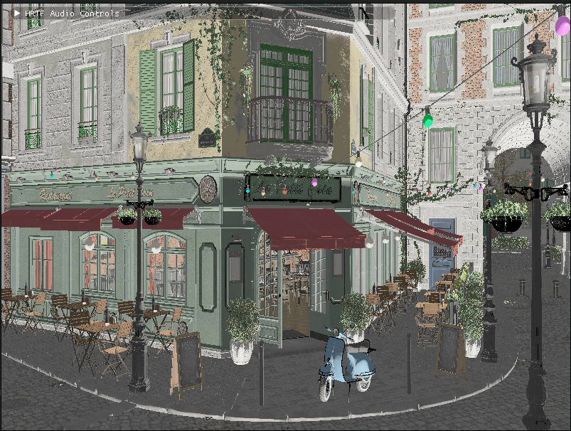

= 光照与材质入门

本章将探讨 3D 渲染中光照与材质的基础知识，重点放在基于物理的渲染（Physically Based Rendering，PBR）上。光照是营造真实、悦目的 3D 场景的关键环节。缺少恰当的光照，即使是最精细的模型也会显得扁平、毫无生气。

[NOTE]
====
*关于 PBR 参考资料*：在本教程中，你可能会在读到本章之前就遇到 PBR（基于物理的渲染）的引用。PBR 是一种现代渲染方法，它依据物理原理模拟光与表面的相互作用。后续各节会详细讲解 PBR，所以即使你还不熟悉这些概念也不必担心。
====

本章是理解光如何以物理上准确的方式与不同材质相互作用的基础。你在这里学到的概念会应用于后续章节，包括 Loading_Models 一章，那里我们会用这些知识渲染带 PBR 材质的 glTF 模型。

在本引擎的实现过程中，我们会使用 vk::raii 动态渲染与 {cpp}20 模块。vk::raii 命名空间为 Vulkan 对象提供了 RAII（资源获取即初始化）封装，有助于资源管理，也让代码更清爽。动态渲染免去了显式渲染通道和帧缓冲区，从而简化渲染流程。与传统的头文件相比，{cpp}20 模块改善了代码组织、编译时间与封装性。

== 为什么光照很重要

计算机图形学中的光照有几个重要作用：

1. *视觉真实感*：恰当的光照会产生阴影、高光与渐变，使 3D 物体看起来更真实。
2. *空间理解*：光照帮助观看者理解场景中各物体之间的空间关系。
3. *情绪与氛围*：不同的光照布置能显著改变场景的情绪与氛围。
4. *焦点与注意力*：光照可以用来把注意力引向场景中的重要元素。

== 基于物理的渲染（PBR）

=== PBR 简介

基于物理的渲染（PBR）是过去十年中实时图形领域最重要的进步之一。传统渲染方法使用临时拼凑的着色模型，而 PBR 则依据物理原理模拟真实世界中光与表面的相互作用。

=== 实时渲染的演进

要体会 PBR 的价值，先了解实时渲染是如何演进的会有帮助：

1. *固定功能管线（1990 年代）*：早期的 3D 硬件使用 Gouraud 或 Phong 等着色模型，材质属性很有限。

2. *可编程着色器（2000 年代）*：随着着色器编程的出现，开发者可以实现自定义光照模型，但它们在各种光照条件下往往表现不一致。

3. *基于物理的渲染（2010 年代）*：通过把渲染建立在物理原理之上，PBR 能给出更真实、且在不同环境中保持一致的结果。

PBR 的主要优势包括：

* *真实感*：材质在任何光照条件下看起来都正确
* *一致性*：美术师创作的材质能在所有环境中正常工作
* *直观性*：材质参数具有物理含义，因此更容易理解
* *高效性*：现代 PBR 实现针对实时性能做了优化

=== PBR 的核心原理

PBR 建立在若干关键原理之上，这些原理使它有别于更早的渲染方法：

==== 能量守恒

在现实世界中，表面反射的光不可能多于它接收的光。这一能量守恒原理是 PBR 的基础：

* 漫反射与镜面反射之和不得超过 1.0
* 表面金属度越高，漫反射越少
* 表面越粗糙，镜面高光越大，但强度越低

==== 微表面理论

PBR 使用微表面理论来建模表面粗糙度。该理论假设表面由大量朝向各异、完美反射的微小表面组成：

* 光滑表面的微表面朝向基本一致，形成锐利的反射
* 粗糙表面的微表面朝向随机，会把光散射开，形成模糊的反射
* 这些微表面的分布由粗糙度参数控制

==== 菲涅尔效应

菲涅尔效应描述反射率如何随观察角度变化：

* 所有表面在掠射角（观察方向几乎与表面平行的角度）下都会变得更反光
* 这一效应在光滑表面上更明显
* 正入射时的基础反射率（F0，即光垂直射到表面时）由材质的折射率决定
* 对金属而言，F0 是带颜色的（取决于该金属的性质）
* 对非金属（电介质）而言，F0 通常约为 0.04（4%）

==== 金属度-粗糙度工作流

glTF 和许多现代引擎中的 PBR 实现使用金属度-粗糙度工作流，它用以下主要参数定义材质：

* *基础颜色*：表面的反照率或漫反射颜色
* *金属度*：表面有多「像金属」（0.0 = 非金属，1.0 = 金属）
* *粗糙度*：表面有多光滑或多粗糙（0.0 = 镜面般光滑，1.0 = 粗糙）

这一工作流对美术师来说很直观，对实时渲染来说也很高效。

=== PBR 中的 BRDF

双向反射分布函数（Bidirectional Reflectance Distribution Function，BRDF）是 PBR 的核心。它描述光如何从表面反射出去，并考虑以下因素：

* 入射光方向
* 出射的观察方向
* 表面法线
* 材质属性

在 PBR 中，BRDF 通常拆成两部分：

* *漫反射 BRDF*：处理穿透表面、在内部散射后再射出的光
* *镜面反射 BRDF*：处理直接从表面反射的光

==== 漫反射 BRDF

最简单的漫反射 BRDF 是朗伯模型：

[source]
----
f_diffuse = albedo / π
----

其中：

* albedo 是表面的基础颜色
* π 是归一化因子

也可以使用 Disney 漫反射或 Oren-Nayar 等更高级的模型来提升真实感，尤其是对粗糙表面而言。

==== 镜面反射 BRDF

对于镜面反射分量，PBR 通常使用微表面 BRDF：

[source]
----
f_specular = D * F * G / (4 * (n·ωo) * (n·ωi))
----

其中：

* D 是法线分布函数（Normal Distribution Function，NDF）
* F 是菲涅尔项
* G 是几何项
* n 是表面法线
* ωo 是出射（观察）方向
* ωi 是入射（光照）方向

常见的实现选择包括：

* *D*：GGX（Trowbridge-Reitz）分布
* *F*：Schlick 近似
* *G*：Smith 阴影-遮蔽函数

== 计算机图形学中的材质

材质定义表面如何与光相互作用。不同材质以不同方式反射、吸收和透射光。理解材质是做出真实渲染的关键。

=== 材质属性

在计算机图形学中，材质由多种属性定义：

* *基础颜色/反照率*：漫反射光照下表面的颜色
* *金属度*：表面的金属程度（影响镜面反射与漫反射吸收）
* *粗糙度/光滑度*：表面有多粗糙或多光滑（影响镜面高光的大小与锐利程度）
* *法线贴图*：在不增加几何复杂度的前提下补充表面细节
* *环境光遮蔽*：近似估计表面某点能接收多少环境光
* *自发光*：让表面的一部分发光
* *不透明度/透明度*：控制材质的透明程度
* *折射*：控制光穿过材质时的偏折方式

=== 常见材质类型

不同类型的材质具有不同特征：

* *金属*：镜面反射强，镜面反射带颜色，没有漫反射
* *电介质（非金属）*：镜面反射较弱，镜面反射为白色，漫反射强
* *半透明材质*：允许光穿过并在内部散射（例如皮肤、蜡、大理石）
* *透明材质*：允许光穿过且散射极少（例如玻璃、水）
* *各向异性材质*：按方向以不同方式反射光（例如拉丝金属、毛发）

=== 用推送常量传递材质属性

在我们的实现中，会用推送常量高效地把材质属性传给着色器。

推送常量是一种向着色器发送少量数据的方式，无需创建和管理描述符集。它们非常适合材质属性这类频繁变化的数据。

== 你将学到什么

读完本章，你将理解：

1. 基于物理的渲染如何工作
2. 如何在 Slang 着色器中实现 PBR
3. 如何用推送常量传递材质属性
4. 如何把 PBR 光照与 Vulkan 集成

让我们从更深入地探讨基于物理的渲染的原理开始吧。

xref:Building_a_Simple_Engine/Camera_Transformations/06_conclusion.adoc[上一页：相机与变换：结语] | xref:Building_a_Simple_Engine/Lighting_Materials/02_lighting_models.adoc[下一页：光照模型]
