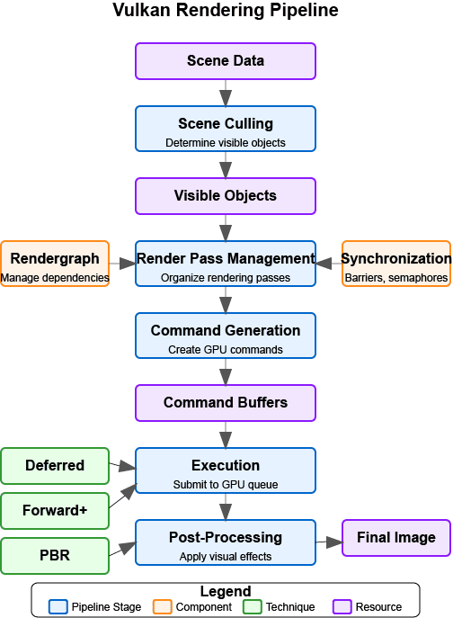

= 与 Vulkan 集成

在本节中，我们会把 PBR 实现与 Vulkan 渲染管线的其余部分集成起来。我们会更新渲染器类，让它支持可与 glTF 模型及其 PBR 材质配合使用的高级光照技术。这里开发的技术将在 Loading_Models 一章中加载并渲染 glTF 模型时使用。

为了让流程保持具体、避免重复此前的理论，先看一份简短的路线图：

1) 为渲染器添加 PBR 管线对象和一个材质推送常量块
2) 在主管线之外创建 PBR 管线（布局、着色器、混合、格式）
3) 录制绘制：绑定 PBR 管线、绑定几何体，并逐个网格推送材质常量
4) 用 RAII 完成清理（无需专门的销毁步骤）

[NOTE]
====
这里不再重复 PBR 理论或推送常量的基础知识。PBR 概念可参见 xref:Building_a_Simple_Engine/Lighting_Materials/03_push_constants.adoc[推送常量] 和 xref:Building_a_Simple_Engine/Lighting_Materials/01_introduction.adoc[光照与材质入门]（以及 xref:Building_a_Simple_Engine/Loading_Models/05_pbr_rendering.adoc[加载模型：为 glTF 模型实现 PBR]）。
====

PBR 通道在图形管线中的位置如下图所示：

== 更新渲染器类

首先，更新渲染器类，加入 PBR 实现所需的新成员：

[source,cpp]
----
class Renderer {
public:
    // ... existing members ...

    // PBR pipeline
    vk::raii::PipelineLayout pbrPipelineLayout;
    vk::raii::Pipeline pbrPipeline;

    // Push constant block for PBR material properties
    struct PushConstantBlock {
        glm::vec4 baseColorFactor;
        float metallicFactor;
        float roughnessFactor;
        int baseColorTextureSet;
        int physicalDescriptorTextureSet;
        int normalTextureSet;
        int occlusionTextureSet;
        int emissiveTextureSet;
        float alphaMask;
        float alphaMaskCutoff;
    };

    // ... existing methods ...

    // New methods
    bool createPBRPipeline();
    void pushMaterialProperties(vk::CommandBuffer commandBuffer, const Model* model, uint32_t materialIndex);
};
----

我们添加了 PBR 管线的成员，以及一个用于 PBR 材质属性的结构体；还添加了创建 PBR 管线和向着色器推送材质属性的方法。

== 更新初始化

接下来，需要更新初始化流程以创建 PBR 管线：

[source,cpp]
----
bool Renderer::Initialize(const std::string& appName, bool enableValidationLayers) {
    // ... existing initialization code ...

    // Create graphics pipeline
    if (!createGraphicsPipeline()) {
        return false;
    }

    // Create PBR pipeline
    if (!createPBRPipeline()) {
        std::cerr << "Failed to create PBR pipeline" << std::endl;
        return false;
    }

    // ... rest of initialization code ...

    initialized = true;
    return true;
}
----

== 更新清理

我们还需要更新清理流程以销毁 PBR 管线：

[source,cpp]
----
void Renderer::Cleanup() {
    // ... existing cleanup code ...

    // With vk::raii, pipeline and pipeline layout objects are automatically destroyed
    // when they go out of scope, so we don't need explicit destruction calls

    // ... rest of cleanup code ...
}
----

== 更新渲染过程

最后，需要更新渲染过程，让它使用 PBR 管线并推送材质属性：

[source,cpp]
----
void Renderer::recordCommandBuffer(vk::CommandBuffer commandBuffer, uint32_t imageIndex) {
    // ... existing command buffer recording code ...

    // Bind the PBR pipeline
    commandBuffer.bindPipeline(vk::PipelineBindPoint::eGraphics, *pbrPipeline);

    // For each model in the scene
    for (const auto& model : models) {
        // Bind vertex and index buffers
        vk::Buffer vertexBuffers[] = {model->vertexBuffer};
        vk::DeviceSize offsets[] = {0};
        commandBuffer.bindVertexBuffers(0, 1, vertexBuffers, offsets);
        commandBuffer.bindIndexBuffer(model->indexBuffer, 0, vk::IndexType::eUint32);

        // For each mesh in the model
        for (const auto& mesh : model->meshes) {
            // Push material properties
            pushMaterialProperties(commandBuffer, model, mesh.materialIndex);

            // Bind descriptor sets
            commandBuffer.bindDescriptorSets(
                vk::PipelineBindPoint::eGraphics,
                *pbrPipelineLayout,
                0,
                1,
                &descriptorSets[imageIndex],
                0,
                nullptr
            );

            // Draw
            commandBuffer.drawIndexed(mesh.indexCount, 1, mesh.firstIndex, 0, 0);
        }
    }

    // ... rest of command buffer recording code ...
}
----

== PBR 着色器参考

本章沿用上一节中定义的同一个 PBR 着色器，以避免内容重复和两份代码逐渐偏离。完整的 pbr.slang 源码与详细说明请参见 xref:Building_a_Simple_Engine/Lighting_Materials/04_lighting_implementation.adoc[PBR 光照实现]。这里我们只聚焦 Vulkan 集成：管线布局、描述符绑定、推送常量以及绘制提交。

== 编译着色器

创建着色器文件后，需要用 slangc 编译它。这一步通常作为构建过程的一部分完成，不过也可以手动执行：

[source,bash]
----
slangc shaders/pbr.slang -target spirv -profile spirv_1_4 -o shaders/pbr.spv
----

== 用 glTF 模型测试实现

为了测试我们的实现，可以使用 glTF 模型：它们已经定义了与我们的实现兼容的 PBR 材质。在 Loading_Models 一章中我们会学习如何加载这些模型，不过现在先假设我们已经有办法加载它们。

下面是一个用 glTF 模型搭建测试场景的示例：

[source,cpp]
----
void Renderer::renderTestScene() {
    // Set up camera
    glm::vec3 cameraPos = glm::vec3(0.0f, 0.0f, 3.0f);
    glm::vec3 cameraTarget = glm::vec3(0.0f, 0.0f, 0.0f);
    glm::vec3 cameraUp = glm::vec3(0.0f, 1.0f, 0.0f);

    // Set up lights
    // Light 1: White light from above
    glm::vec4 lightPos1 = glm::vec4(0.0f, 5.0f, 5.0f, 1.0f);
    glm::vec4 lightColor1 = glm::vec4(300.0f, 300.0f, 300.0f, 1.0f);

    // Light 2: Blue light from the left
    glm::vec4 lightPos2 = glm::vec4(-5.0f, 0.0f, 0.0f, 1.0f);
    glm::vec4 lightColor2 = glm::vec4(0.0f, 0.0f, 300.0f, 1.0f);

    // Load glTF models
    Model* damagedHelmet = modelLoader.loadModel("models/DamagedHelmet/DamagedHelmet.gltf");
    Model* flightHelmet = modelLoader.loadModel("models/FlightHelmet/FlightHelmet.gltf");

    // The models already have PBR materials defined in the glTF file
    // We can render them directly with our PBR pipeline

    // Render the models with different transformations
    renderModel(damagedHelmet, glm::vec3(-1.0f, 0.0f, 0.0f), glm::vec3(0.5f));
    renderModel(flightHelmet, glm::vec3(1.0f, 0.0f, 0.0f), glm::vec3(0.5f));

    // We can also experiment with modifying the material properties
    // For example, to make the damaged helmet more metallic:
    if (damagedHelmet->materials.size() > 0) {
        // Store the original value to restore later
        float originalMetallic = damagedHelmet->materials[0].metallicFactor;

        // Modify the material
        damagedHelmet->materials[0].metallicFactor = 1.0f;

        // Render with modified material
        renderModel(damagedHelmet, glm::vec3(-2.0f, 0.0f, 0.0f), glm::vec3(0.5f));

        // Restore original value
        damagedHelmet->materials[0].metallicFactor = originalMetallic;
    }
}
----

== 结语

在本节中，我们把 PBR 实现与 Vulkan 渲染管线的其余部分集成了起来。我们更新了渲染器类，让它支持可与 glTF 模型及其 PBR 材质配合使用的高级光照技术。我们基于此前学到的概念创建了 PBR 着色器，并演示了如何用 glTF 模型测试实现。

这种做法为渲染物理准确的材质打下了坚实基础，我们将在 Loading_Models 一章中加载并渲染 glTF 模型时应用它。它还让我们能够根据需要灵活地修改和扩展材质属性，以满足具体的渲染需求。

下一节，我们会探讨如何用 Vulkan Ray Query 添加高质量阴影。

xref:Building_a_Simple_Engine/Lighting_Materials/04_lighting_implementation.adoc[上一篇：PBR 光照实现] | xref:Building_a_Simple_Engine/Lighting_Materials/07_shadows.adoc[下一篇：阴影：光线查询集成]
