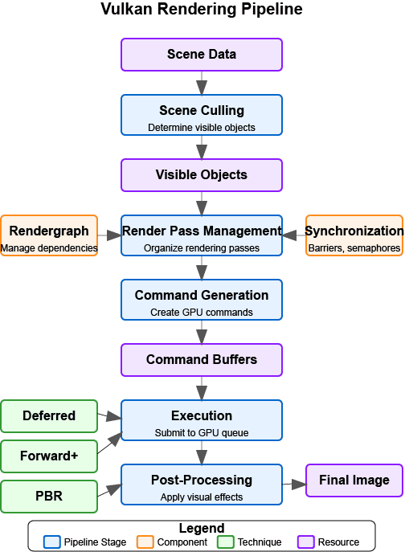

:pp: {plus}{plus}
= 依赖关系剖析：简介

== 概览

Vulkan 的每一个操作，从简单的颜色清除到复杂的光线追踪反射通道，都靠我们定义的依赖关系来运转。本章深入探讨数据究竟如何在 Vulkan 管线中流转，以及为什么同步远不只是「设置一个位掩码」这么简单。

要真正掌握同步，我们首先需要拆解 GPU 处理你的命令时发生了什么。我们常说 GPU 是一台「大规模并行处理器」，但这对数据完整性意味着什么？我们先从解构**执行依赖**（GPU 工作的「何时」）与**内存依赖**（数据的「何处」与「可见性」）之间的根本区别开始。

=== 本章你将学到什么

本章的目标是把你从「让它能跑」带到「知道它为什么能跑」。我们将探索：

*   **硬件视角**：理解为什么仅靠执行屏障不足以在现代多缓存 GPU 上防止数据损坏。
*   **执行依赖与内存依赖**：学会区分「让某个阶段停下」和「确保它的数据真的能被下一个阶段读到」。
*   **Synchronization 2 的优势**：为什么新的 `vk::DependencyInfo` 和 `vk::CmdPipelineBarrier2` 不只是语法清理——它们是我们向驱动表达意图方式的根本转变。
*   **用管线阶段做外科手术般的精确控制**：掌握 `vk::PipelineStageFlagBits2` 和 `vk::AccessFlagBits2`，精确指向特定硬件单元，通过避免不必要的管线气泡来保持 GPU 占用率。

到本章结束时，你会清楚地理解任意两段 GPU 工作之间必须发生的「握手」。这个基础对后续所有内容都至关重要，从简单的图像布局转换到复杂的异步计算架构。

== 导航

上一节：xref:Synchronization/introduction.adoc[Synchronization 2：精通 GPU 与 CPU 的握手] | 下一节：xref:Synchronization/Anatomy_of_a_Dependency/02_execution_vs_memory.adoc[执行依赖与内存依赖]
