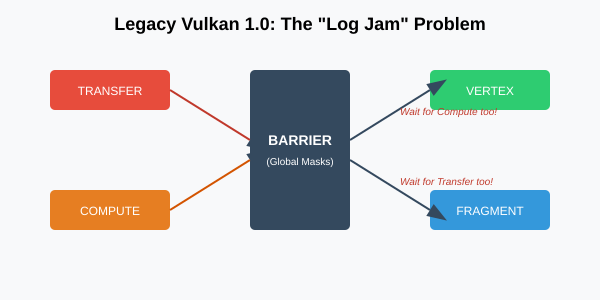
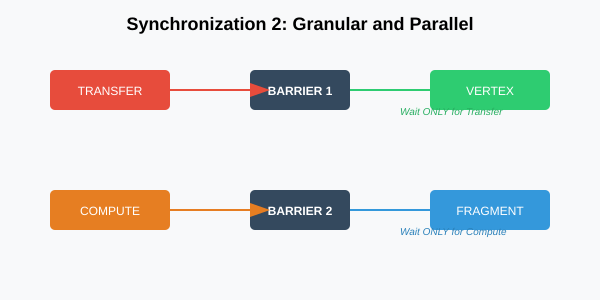

:pp: {plus}{plus}
= Synchronization 2 的优势

== 简介

在 Vulkan 1.0 的早期，定义依赖是个零碎且常常令人沮丧的过程。你得同时摆弄 `VkMemoryBarrier`、`VkBufferMemoryBarrier` 和 `VkImageMemoryBarrier` 等多个结构。这些结构不仅数量多，功能上也是割裂的，这意味着你的同步逻辑会散落在代码的好几个地方。

**Synchronization 2**（VK_KHR_synchronization2）如今已是 Vulkan 1.3 的核心内容，它从根本上改变了这一点。它把这些互不相干的屏障统一成一个连贯的结构：`vk::DependencyInfo`。

== 破碎的过去：旧 API 为何难用

要体会 Synchronization 2 的优势，得先看看我们抛弃了什么。在旧版 Vulkan 1.0 API 中，一次管线屏障是一个函数调用，接收三个独立的屏障数组：全局、缓冲区和图像。

[,cpp]
----
// Legacy Vulkan 1.0 (Still works, but we don't like it)
vkCmdPipelineBarrier(
    commandBuffer,
    srcStageMask,  // Global stage mask for ALL barriers
    dstStageMask,  // Global stage mask for ALL barriers
    dependencyFlags,
    memoryBarrierCount, pMemoryBarriers,
    bufferMemoryBarrierCount, pBufferMemoryBarriers,
    imageMemoryBarrierCount, pImageMemoryBarriers
);
----

注意问题所在了吗？`srcStageMask` 和 `dstStageMask` 是作为*函数*的参数传入的，而不是各个屏障结构的一部分。这意味着如果你在同一次调用里有两个不同的图像转换——比如一个从 `Transfer` 到 `Fragment Shader`，另一个从 `Compute` 到 `Vertex Shader`——你就得把所有这些阶段合并成一个宽泛的掩码。

这导致了「过度同步」。在函数层面合并阶段，你实际上是在告诉 GPU：在*所有*目标阶段能够开始之前，先等*所有*源阶段完成。你制造了一个本不必存在的瓶颈。

== 「意图链」：用 vk::DependencyInfo 统一

Synchronization 2 把阶段掩码移入屏障结构本身，从而解决了这个问题。在我们的引擎中，我们使用 `vk::DependencyInfo`，它充当所有同步需求的容器。

当我们统一同步时，并不只是在整理语法。我们把依赖的整个「意图」归拢到一处。借助 `vk::DependencyInfo`，每个 `vk::ImageMemoryBarrier2` 或 `vk::BufferMemoryBarrier2` 都带有自己的 `srcStageMask` 和 `dstStageMask`。

[,cpp]
----
// Synchronization 2 (The Modern Way)
vk::ImageMemoryBarrier2 imageBarrier{
    .srcStageMask = vk::PipelineStageFlagBits2::eColorAttachmentOutput,
    .srcAccessMask = vk::AccessFlagBits2::eColorAttachmentWrite,
    .dstStageMask = vk::PipelineStageFlagBits2::eFragmentShader,
    .dstAccessMask = vk::AccessFlagBits2::eShaderRead,
    // ... layout transitions, image handles ...
};

vk::DependencyInfo dependencyInfo{
    .imageMemoryBarrierCount = 1,
    .pImageMemoryBarriers = &imageBarrier
};

commandBuffer.pipelineBarrier2(dependencyInfo);
----

这对人类可读性是个巨大的胜利。当你看到那个 `imageBarrier` 块时，你看到的是一次完整的「握手」。你清楚知道哪段工作正在结束（`src`），哪段工作正在等待（`dst`）。无需在函数参数或全局变量里翻找依赖的另一半。

== 64 位掩码带来的精细控制

换用的另一个技术原因很简单：算术。最初的 Vulkan 1.0 标志是 32 位位掩码。随着 Vulkan 演进，我们加入了光线追踪、网格着色、视频编码等等。我们的位数真的快不够用了。

借助 `vk::PipelineStageFlagBits2`，我们转向 64 位掩码。这给了我们足够的余量，以外科手术般的精度指向特定硬件单元。

=== 「None」的力量
在旧版 Vulkan 中，如果你不需要内存依赖（只需要执行依赖），往往得传 `0` 或使用 `BOTTOM_OF_PIPE` 这类令人困惑的标志。在 Sync 2 中，我们有明确的 `vk::PipelineStageFlagBits2::eNone` 和 `vk::AccessFlagBits2::eNone`。

如果你做的布局转换不需要内存刷新（非常罕见，但有可能），或者你只是想明确表示某个屏障对某个阶段没有影响，`eNone` 就是你最好的朋友。它让代码自带文档。

== 把 Synchronization 2 当作心智模型

请把 Synchronization 2 看作不是一套新 API，而是一种与 GPU 对话的更好方式。在旧体系里，你是在对硬件大声喊出笼统的命令：「所有人停下，等渲染做完！」

在 Synchronization 2 里，你是在进行更细致的对话：「嘿，Color Attachment Output，你写完这张特定的图像之后，告诉片元着色器可以安全开始读了。」

正是这种「人对人」级别的清晰度，让我们围绕这些结构构建了整个引擎。它减轻了你作为开发者的认知负担，同时把驱动所需的确切信息交给它，让 GPU 的「管线」始终填满工作。

== 在引擎中把它们串起来

在真实世界的引擎里，同步不只是单次转换，而是编排通道之间整个数据流。Synchronization 2「胜出」的绝佳例子就在我们的 `Renderer` 类中，具体说是在反射通道这样的复杂操作里。

渲染反射时，我们常常需要同时转换多个资源——比如一个颜色缓冲区和一个深度缓冲区。在旧 API 中，它们会被迫陷入「堵塞」，两者都得等所有阶段的并集。借助 Synchronization 2，我们可以批量处理，同时保留各自独特的需求。

[,cpp]
----
void Renderer::renderReflectionPass(vk::raii::CommandBuffer& cmd) {
    // Transition reflection color to COLOR_ATTACHMENT_OPTIMAL
    vk::ImageMemoryBarrier2 toColor{
        .srcStageMask  = vk::PipelineStageFlagBits2::eColorAttachmentOutput,
        .srcAccessMask = vk::AccessFlagBits2::eColorAttachmentWrite,
        .dstStageMask  = vk::PipelineStageFlagBits2::eColorAttachmentOutput,
        .dstAccessMask = vk::AccessFlagBits2::eColorAttachmentWrite,
        .oldLayout     = vk::ImageLayout::eShaderReadOnlyOptimal,
        .newLayout     = vk::ImageLayout::eColorAttachmentOptimal,
        .image         = *reflectionColor,
        .subresourceRange = { vk::ImageAspectFlagBits::eColor, 0, 1, 0, 1 }
    };

    // Transition reflection depth to DEPTH_ATTACHMENT_OPTIMAL
    vk::ImageMemoryBarrier2 toDepth{
        .srcStageMask  = vk::PipelineStageFlagBits2::eEarlyFragmentTests,
        .srcAccessMask = vk::AccessFlagBits2::eDepthStencilAttachmentWrite,
        .dstStageMask  = vk::PipelineStageFlagBits2::eEarlyFragmentTests,
        .dstAccessMask = vk::AccessFlagBits2::eDepthStencilAttachmentWrite,
        .oldLayout     = vk::ImageLayout::eUndefined,
        .newLayout     = vk::ImageLayout::eDepthAttachmentOptimal,
        .image         = *reflectionDepth,
        .subresourceRange = { vk::ImageAspectFlagBits::eDepth, 0, 1, 0, 1 }
    };

    // The Win: Batching unique intents into a single call
    std::array barriers{ toColor, toDepth };
    vk::DependencyInfo dependencyInfo{
        .imageMemoryBarrierCount = static_cast<uint32_t>(barriers.size()),
        .pImageMemoryBarriers    = barriers.data()
    };

    // One call, but the driver knows 'toColor' only cares about
    // ColorAttachmentOutput, while 'toDepth' only cares about EarlyFragmentTests.
    cmd.pipelineBarrier2(dependencyInfo);

    // Now we can safely begin our reflection rendering
    // ...
}
----

要看清这里的「胜出」之处，我们来看看同一个 `renderReflectionPass` 操作在旧版里的做法。你被迫在函数层面合并阶段掩码：

[,cpp]
----
// Legacy Vulkan 1.0 equivalent - The "Log Jam"
vk::ImageMemoryBarrier legacyToColor{
    .srcAccessMask = vk::AccessFlagBits::eColorAttachmentWrite,
    .dstAccessMask = vk::AccessFlagBits::eColorAttachmentWrite,
    .oldLayout     = vk::ImageLayout::eShaderReadOnlyOptimal,
    .newLayout     = vk::ImageLayout::eColorAttachmentOptimal,
    .image         = *reflectionColor,
    .subresourceRange = { vk::ImageAspectFlagBits::eColor, 0, 1, 0, 1 }
};

vk::ImageMemoryBarrier legacyToDepth{
    .srcAccessMask = vk::AccessFlagBits::eDepthStencilAttachmentWrite,
    .dstAccessMask = vk::AccessFlagBits::eDepthStencilAttachmentWrite,
    .oldLayout     = vk::ImageLayout::eUndefined,
    .newLayout     = vk::ImageLayout::eDepthAttachmentOptimal,
    .image         = *reflectionDepth,
    .subresourceRange = { vk::ImageAspectFlagBits::eDepth, 0, 1, 0, 1 }
};

std::array legacyBarriers{ legacyToColor, legacyToDepth };

// NOTICE: The stage masks are passed to the function, not the barriers!
cmd.pipelineBarrier(
    vk::PipelineStageFlagBits::eColorAttachmentOutput | vk::PipelineStageFlagBits::eEarlyFragmentTests, // srcStageMask (Union)
    vk::PipelineStageFlagBits::eColorAttachmentOutput | vk::PipelineStageFlagBits::eEarlyFragmentTests, // dstStageMask (Union)
    {}, // dependencyFlags
    nullptr, nullptr, legacyBarriers
);
----

在这个旧版里，你被迫传入单个 `srcStageMask`，它是 `eColorAttachmentOutput` 与 `eEarlyFragmentTests` 的并集。这意味着 GPU 必须先等所有先前工作的颜色写入*和*深度测试都完成，才能*开始*转换任意一张图像。

借助 Synchronization 2，如果深度测试提前完成，驱动可以立刻开始 `toDepth` 转换，即使颜色硬件仍在忙。这防止了 GPU 的「堵塞」形成，让硬件的不同部分按各自的节奏工作。

这段代码通常位于你的帧录制逻辑中，往往在 `renderReflectionPass` 这样的专用通道函数里，就在调用 `beginRendering` 之前。把同步逻辑放在资源被使用的位置，并把相关的转换归入单个 `vk::DependencyInfo`，你就创造了一条「意图链」——既便于你阅读，也让硬件执行得更优。

== 实现：让 Simple Engine 现代化

虽然 `Simple Engine` 的渲染器大体上已经现代化，改用我们讨论过的 `pipelineBarrier2` 调用，但代码库里仍有一些正在重构的「旧版孤岛」。一个典型例子是 `PhysicsSystem`（`physics_system.cpp`），它仍使用旧式 `pipelineBarrier` 来同步自己的计算派发。

如果你查看 `PhysicsSystem::SimulatePhysicsOnGPU`，会看到这样的转换：

[,cpp]
----
// Legacy synchronization in PhysicsSystem
vulkanResources.commandBuffer.pipelineBarrier(
    vk::PipelineStageFlagBits::eComputeShader,
    vk::PipelineStageFlagBits::eComputeShader,
    {},
    vk::MemoryBarrier(vk::AccessFlagBits::eShaderWrite, vk::AccessFlagBits::eShaderRead),
    nullptr, nullptr
);
----

在 `Simple Engine` 即将推出的「Synchronization 升级」分支中，我们会把它们替换为更简洁的 `vk::DependencyInfo` 和 `vk::BufferMemoryBarrier2`。这将让我们摆脱全局内存屏障，改为针对具体的物理缓冲区，从而减轻在具有复杂缓存层级的架构上的性能损失。

下一节，我们会深入探讨如何挑选正确的阶段和标志，从硬件里榨出最后一滴性能。

== 导航

上一节：xref:Synchronization/Anatomy_of_a_Dependency/02_execution_vs_memory.adoc[执行依赖与内存依赖] | 下一节：xref:Synchronization/Anatomy_of_a_Dependency/04_refined_pipeline_stages.adoc[精细的管线阶段：精确即性能]
