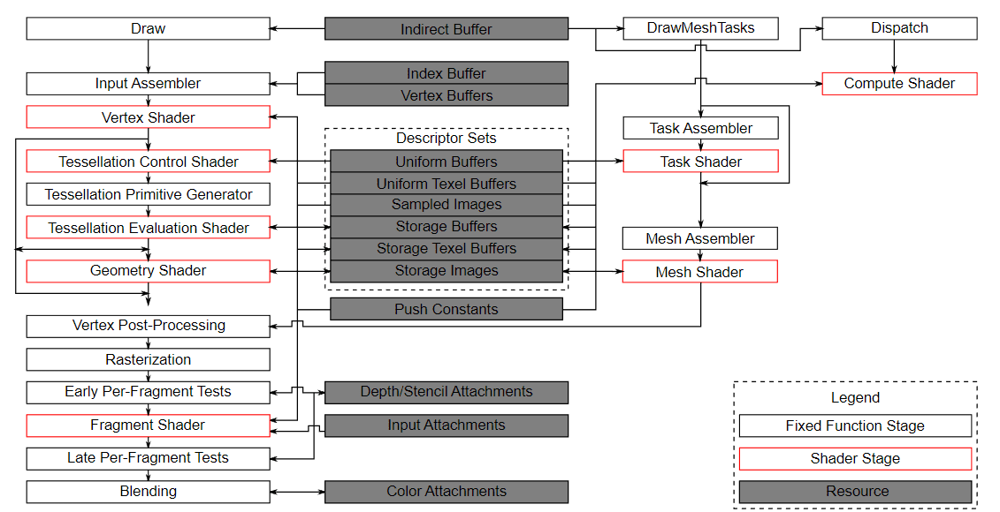

:pp: {plus}{plus}
= 精细的管线阶段：精确即性能

== 简介

前面的章节里，我们看到了 Synchronization 2 如何统一 API。但真正的性能收益来自你如何使用它。掌握 `vk::PipelineStageFlagBits2` 和 `vk::AccessFlagBits2` 的关键在于精确。在旧版 Vulkan 中，许多开发者掉进了用 `eAllCommands`（更糟的是 `eTopOfPipe` 和 `eBottomOfPipe`）当万能方案的陷阱。这种做法的确「能用」——它能防止数据损坏——但这相当于为了一个人过马路而让全城所有汽车停下。

=== 管线气泡

当你使用过于宽泛的阶段掩码时，就会产生所谓的**管线气泡**。现代 GPU 的设计目标是让尽可能多的专用硬件单元——光栅化器、计算核心、固定功能 blit 引擎——保持忙碌。如果你让 GPU 在 `eAllCommands` 处等待，实质上就是在排空整条管线。GPU 必须等到之前每一个操作都彻底完成，才能开始下一个操作哪怕最小的部分。

借助 Synchronization 2，我们可以精确得多。如果你只关心确保计算着色器写完存储缓冲区后片元着色器才去读，就可以专门指定 `eComputeShader` 和 `eFragmentShader`。这让 GPU 的其他部分——比如几何引擎或光栅化器——能继续处理独立的任务。

=== 选择合适的阶段

挑选正确的阶段掩码需要扎实理解数据从哪来、到哪去。以下是我们引擎中常用的几个模式：

*   **渲染到纹理**：如果你要转换一个颜色附件，以便在后续通道中采样，源阶段应当是 `eColorAttachmentOutput`。
*   **计算后处理**：当计算着色器完成一个将被片元着色器使用的通道时，用 `eComputeShader` 作为源、`eFragmentShader` 作为目标。
*   **传输到图形**：当你用传输队列上传完一个缓冲区或图像后，源阶段是 `eTransfer`。

=== 访问标志的力量

阶段标志告诉 GPU *何时*等待，而**访问标志**告诉它*为什么*。它们控制我们在「执行依赖与内存依赖」一节中讨论的缓存刷新与无效化。

把阶段与正确的访问标志配对至关重要。例如，如果你在计算着色器中读取存储缓冲区，你需要 `eShaderRead` 或 `eShaderStorageRead`；如果写入，则需要 `eShaderWrite` 或 `eShaderStorageWrite`。在这里保持具体，能让硬件只执行必要的缓存操作，从而显著降低屏障本身的开销。

=== 小结

随着我们进入本系列更复杂的部分——比如异步计算和资产流式加载——请保持这种「精确优先」的思维方式。你在屏障中设置的每一位都是给硬件的提示。提示越准确，帧率就越平稳。

== Simple Engine：瞄准正确的硬件单元

在 `Simple Engine` 中，我们在 `Renderer::Render` 循环里应用这种精确优先的做法。例如，当把深度缓冲区从「仅深度」通道（比如阴影贴图生成或深度预通道）转到「深度测试」通道（比如主不透明通道）时，我们使用：

[,cpp]
----
// Depth transition in Renderer::Render
vk::ImageMemoryBarrier2 depthToRead2{
  .srcStageMask = vk::PipelineStageFlagBits2::eLateFragmentTests,
  .srcAccessMask = vk::AccessFlagBits2::eDepthStencilAttachmentWrite,
  .dstStageMask = vk::PipelineStageFlagBits2::eEarlyFragmentTests,
  .dstAccessMask = vk::AccessFlagBits2::eDepthStencilAttachmentRead,
  .oldLayout = vk::ImageLayout::eDepthAttachmentOptimal,
  .newLayout = vk::ImageLayout::eDepthAttachmentOptimal,
  // ...
  .image = *depthImage,
};
----

通过指定 `eLateFragmentTests` 和 `eEarlyFragmentTests`，我们告诉 GPU：它只需等待固定功能深度单元写完，就可以开始为下一个通道读取。下一个通道的顶点着色器实际上可以开始运行，甚至开始处理几何，而上一通道的深度写入仍在收尾。正是这种重叠防止了「管线气泡」，让我们的帧率即使在复杂场景中也能保持高位。

接下来，我们会把这些基础概念应用到 Vulkan 中最常见的同步任务上：图像布局转换。

== 导航

上一节：xref:Synchronization/Anatomy_of_a_Dependency/03_sync2_advantage.adoc[Synchronization 2 的优势] | 下一节：xref:Synchronization/Pipeline_Barriers_Transitions/01_introduction.adoc[管线屏障与布局转换：核心循环]
