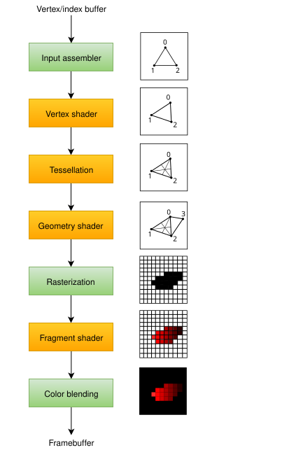

:pp: {plus}{plus}
= 气泡问题：发现并修复停顿

== 识别气泡

GPU 时间线上的“气泡”（bubble）是指某些单元因等待依赖满足而空闲的一段时间。仅靠读代码很难发现它们。你可能*以为*自己已经启用了重叠，但如果阶段掩码设得太宽，GPU 仍然可能在停顿。

要找到这些气泡，我们使用硬件性能分析器，比如 **NVIDIA Nsight Graphics**、**AMD Radeon GPU Profiler**，甚至 **LunarG 同步验证**层。在性能分析器里，气泡表现为时间线上的一段空隙：Graphics 行或 Compute 行为空，而另一行正忙。

== 气泡的常见成因

1.  **过于保守的阶段掩码**：如果每个屏障都用 `vk::PipelineStageFlagBits2::eAllCommands`，GPU 就会冲刷一切，等全部空闲之后才开始下一个任务。这是气泡最常见的成因。始终尽量使用最具体的阶段掩码。
2.  **串行提交**：即使你有两个队列，如果 CPU 代码先等待一个队列完成再向另一个队列提交，你就在 CPU 侧造出了气泡。在合适的地方使用**信号前等待**模式和多个提交线程。
3.  **依赖链**：一串小依赖有时比一个稍宽的屏障代价更高。如果你有五个计算通道互相等待，每个都会引入一次小停顿。有时把它们合并成一次计算提交会更好。

== 消除停顿

找到气泡之后，修复办法通常是细化你的 `vk::DependencyInfo`。

-   **细化阶段掩码**：看看能否把 `srcStageMask` 挪到管线中更晚的位置，或把 `dstStageMask` 挪到更早的位置。例如，你的计算工作能否在 `eVertexShader` 完成后就开始，而不必等到 `eFragmentShader`？
-   **巧用内存屏障**：有时一个全局内存屏障比多个图像屏障更好，因为它能让更多工作更早开始。
-   **提高并发度**：如果性能分析器显示计算单元利用率不足，你能否把更多工作（比如遮挡剔除）从图形挪到计算？

通过系统地发现并消除这些气泡，你就能从“能用就行”的渲染器迈向真正专业级的渲染器。下一章我们会看到，同样的原则如何应用到现代游戏中最常见的后台任务之一：资产流式加载。

== 导航

上一节：xref:Synchronization/Async_Compute_Overlap/03_async_post_processing.adoc[异步后处理：并行化帧的结束与开始] | 下一节：xref:Synchronization/Transfer_Queues_Streaming/01_introduction.adoc[传输队列与资产流式加载同步：非阻塞上传]
