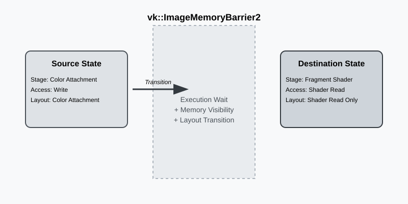

:pp: {plus}{plus}
= 图像屏障：实现 vk::ImageMemoryBarrier2

== 核心机制

在现代 Vulkan 的世界里，图像内存屏障是管理资源如何在管线中流动的终极工具。同步理论讲的是「执行」与「可见性」，而图像屏障还引入了第三个同样关键的组成部分：**布局转换**。缓冲区只是一条线性的内存条带，图像却拥有一个决定其 texel 如何组织的布局。

如果我们想以颜色附件的形式写入图像，GPU 硬件期望它处于 `VK_IMAGE_LAYOUT_COLOR_ATTACHMENT_OPTIMAL`。如果之后我们想在同一张图像上于着色器中采样，就必须把它转换到 `VK_IMAGE_LAYOUT_SHADER_READ_ONLY_OPTIMAL`。这不只是驱动侧的「标志位」——在某些硬件上，这种转换可能触发数据的物理重排或缓存刷新。

当我们说「物理重排」时，指的是不同硬件单元如何看待同一批比特。例如，光栅化器可能使用一种专用的分块压缩格式（比如增量颜色压缩，Delta Color Compression）来节省带宽。而采样同一张图像的计算着色器可能并不理解这种压缩。布局转换确保数据被「解压」或移入下一个阶段能够使用的格式。

== 拆解图像屏障

录制管线屏障时，我们实际上是在定义一个 GPU 必须通过的「闸门」。下面看看我们如何用引擎里那套 RAII 风格的 Vulkan-Hpp 封装来构造它：

[,cpp]
----
auto imageBarrier = vk::ImageMemoryBarrier2{
    .srcStageMask = vk::PipelineStageFlagBits2::eColorAttachmentOutput,
    .srcAccessMask = vk::AccessFlagBits2::eColorAttachmentWrite,
    .dstStageMask = vk::PipelineStageFlagBits2::eFragmentShader,
    .dstAccessMask = vk::AccessFlagBits2::eShaderRead,
    .oldLayout = vk::ImageLayout::eColorAttachmentOptimal,
    .newLayout = vk::ImageLayout::eShaderReadOnlyOptimal,
    .image = renderTarget.image(),
    .subresourceRange = {
        .aspectMask = vk::ImageAspectFlagBits::eColor,
        .baseMipLevel = 0,
        .levelCount = 1,
        .baseArrayLayer = 0,
        .layerCount = 1
    }
};

auto dependencyInfo = vk::DependencyInfo{
    .imageMemoryBarrierCount = 1,
    .pImageMemoryBarriers = &imageBarrier
};

commandBuffer.pipelineBarrier2(dependencyInfo);
----

在这个例子中，我们转换一个颜色附件，使它能被后续的片元着色器采样。`srcStageMask` 告诉 GPU「等之前命令的颜色附件输出阶段完成」，而 `srcAccessMask` 指明我们具体等待的是该阶段的内存*写入*完成。在闸门的另一侧，`dstStageMask` 和 `dstAccessMask` 确保片元着色器阶段会等到布局转换与缓存刷新完成之后，才开始它的读取操作。

== 布局丢弃的威力

Vulkan 中最常见的性能优化之一，是把 `vk::ImageLayout::eUndefined` 用作 `oldLayout`。当我们把旧布局设为 undefined 时，我们是在告诉驱动：「我不关心这张图像之前有什么内容。」

这非常强大。如果驱动知道之前的内容是垃圾数据，它就可以跳过布局转换期间保存数据的昂贵工作。例如，如果你正要清空一张图像并把它当作全新的颜色附件使用，那么从 `eUndefined` 转换到 `eColorAttachmentOptimal` 要比从 `eShaderReadOnlyOptimal` 转换（后者可能需要对上一帧的数据做「解析」或「解压」）快得多。

== 子资源范围与层面掩码

Vulkan 并不只允许我们同步整张图像；它通过 `subresourceRange` 让我们能像做手术一样精确控制其中的特定部分。这对复杂的效果至关重要：

* **mipmap 生成**：我们可以把 mip 层级 0 转换到 `eTransferSrcOptimal`、把层级 1 转换到 `eTransferDstOptimal` 来执行一次 blit，然后再把它们转换回来。
* **层面掩码**：对于深度模板格式，我们可能只想转换 `eDepth` 层面而保持 `eStencil` 不变（或者反过来）。
* **分层渲染**：在 VR 或立方体贴图渲染中，我们可以独立地转换各个数组层，让 GPU 的不同部分同时处理不同的视图。

== 动态渲染中的同步

现代 Vulkan 的一大转变是走向**动态渲染**（自 Vulkan 1.3 起成为核心，或通过扩展提供）。在旧的「渲染通道」体系中，转换常常隐藏在子通道依赖或渲染通道定义本身里。这往往令人困惑，并导致过度同步。

使用动态渲染后，转换的责任完全落在我们身上。我们通常在 `beginRendering` 与 `endRendering` 调用*之间*执行转换。这可能感觉工作量更大，但它带来了清晰得多的结构：我们确切知道转换发生在哪里，因为它是我们显式录制的。这也让与引擎架构的集成容易得多——在那些架构中，渲染通道比旧体系更灵活、更少刚性约束。

== 在引擎中整合

在真实引擎里，你很少只发出一个屏障。你会把它们批处理。下面展示了我们的 `Renderer` 可能如何处理一段常见的「后处理」序列：在最终的 UI 通道之前，同时转换场景颜色和深度缓冲区（用于景深）：

[,cpp]
----
std::array<vk::ImageMemoryBarrier2, 2> barriers;

// Transition Scene Color from Attachment to Shader Read
barriers[0] = vk::ImageMemoryBarrier2{
    .srcStageMask = vk::PipelineStageFlagBits2::eColorAttachmentOutput,
    .srcAccessMask = vk::AccessFlagBits2::eColorAttachmentWrite,
    .dstStageMask = vk::PipelineStageFlagBits2::eFragmentShader,
    .dstAccessMask = vk::AccessFlagBits2::eShaderRead,
    .oldLayout = vk::ImageLayout::eColorAttachmentOptimal,
    .newLayout = vk::ImageLayout::eShaderReadOnlyOptimal,
    .image = sceneColor.image()
};

// Transition Depth from Attachment to Shader Read (Depth Aspect only!)
barriers[1] = vk::ImageMemoryBarrier2{
    .srcStageMask = vk::PipelineStageFlagBits2::eLateFragmentTests,
    .srcAccessMask = vk::AccessFlagBits2::eDepthStencilAttachmentWrite,
    .dstStageMask = vk::PipelineStageFlagBits2::eFragmentShader,
    .dstAccessMask = vk::AccessFlagBits2::eShaderRead,
    .oldLayout = vk::ImageLayout::eDepthStencilAttachmentOptimal,
    .newLayout = vk::ImageLayout::eDepthReadOnlyOptimal,
    .image = depthBuffer.image(),
    .subresourceRange = {
        .aspectMask = vk::ImageAspectFlagBits::eDepth,
        .baseMipLevel = 0,
        .levelCount = 1,
        .baseArrayLayer = 0,
        .layerCount = 1
    }
};

commandBuffer.pipelineBarrier2(vk::DependencyInfo{
    .imageMemoryBarrierCount = static_cast<uint32_t>(barriers.size()),
    .pImageMemoryBarriers = barriers.data()
});
----

通过把这些屏障批处理进单个 `DependencyInfo`，驱动可以优化状态变化和缓存刷新，确保 GPU 花更多时间绘制、更少时间等待屏障。

== Simple Engine：统一屏障

在 `Simple Engine` 中，我们合并图像转换以减少驱动开销。如果你查看 `renderer_rendering.cpp` 里的 `Renderer::Render`，就会看到我们如何处理从**不透明通道**到**后处理通道**的转换。我们不只转换颜色缓冲区；我们常常在单个 `vk::DependencyInfo` 中同时转换深度缓冲区和任何辅助缓冲区（比如用于 Forward+ 光照的 G-Buffer）。

我们在 `Simple Engine` 中使用的一个具体技巧是**布局跟踪**系统。由于我们的 `Renderer` 可以在不同的渲染路径之间切换（比如光栅化与光线查询），我们会记录主要图像（如 `opaqueSceneColorImageLayouts`）的当前布局。开始一个通道时，我们检查当前布局，只在确实需要转换时才发出屏障。如果图像已经处于正确的布局，我们就完全跳过屏障，省下宝贵的 GPU 周期。

== 导航

上一页：xref:Synchronization/Pipeline_Barriers_Transitions/01_introduction.adoc[管线屏障与布局转换：核心循环] | 下一页：xref:Synchronization/Pipeline_Barriers_Transitions/03_queue_family_ownership.adoc[队列族所有权：握手]
