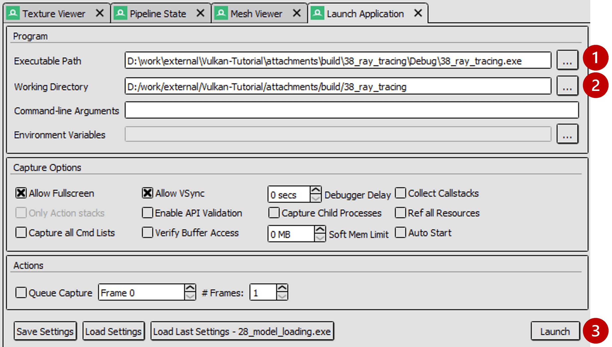
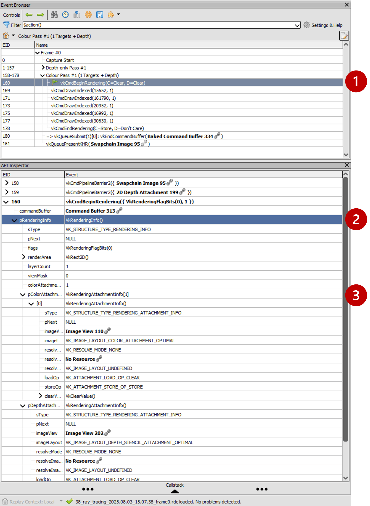
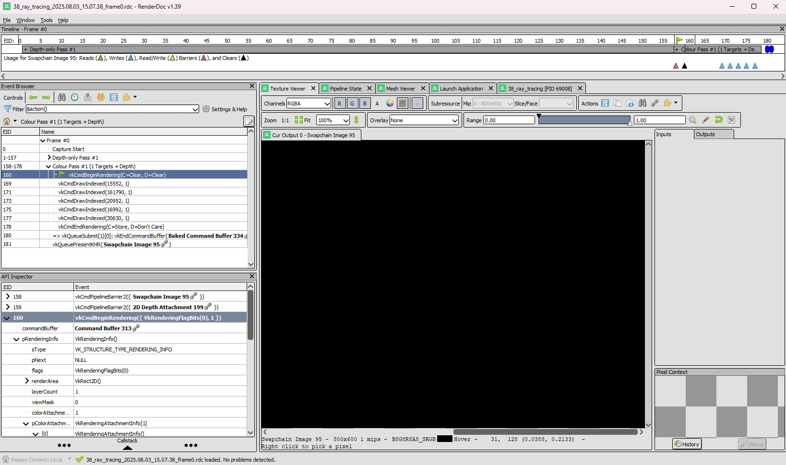

= 动态渲染

*目标*：确保基础项目使用*动态渲染*，并了解如何用 RenderDoc 验证这一点。

在动态渲染中，我们不再创建 `vk::raii::RenderPass` 或 `vk::raii::Framebuffer`；而是用 `commandBuffer.beginRendering()` 开始渲染，并即时指定附件。这让代码更灵活（无需预先声明子通道），也是如今在 Vulkan 中渲染的“现代”做法。

== 任务 1：检查动态渲染的设置

在提供的代码库中，找到图形管线的初始化部分：

[,c{pp}]
----
/* TASK01: Check the setup for dynamic rendering
 *
 * This new struct replaces what previously was the render pass in the pipeline creation.
 * Note how this structure is now linked in .pNext below, and .renderPass is not used.
 */
vk::PipelineRenderingCreateInfo pipelineRenderingCreateInfo{
    .colorAttachmentCount = 1,
    .pColorAttachmentFormats = &swapChainImageFormat,
    .depthAttachmentFormat = depthFormat
};

vk::GraphicsPipelineCreateInfo pipelineInfo{
    .pNext = &pipelineRenderingCreateInfo,
    .stageCount = 2,
    .pStages = shaderStages,
    .pVertexInputState = &vertexInputInfo,
    .pInputAssemblyState = &inputAssembly,
    .pViewportState = &viewportState,
    .pRasterizationState = &rasterizer,
    .pMultisampleState = &multisampling,
    .pDepthStencilState = &depthStencil,
    .pColorBlendState = &colorBlending,
    .pDynamicState = &dynamicState,
    .layout = pipelineLayout,
    .renderPass = nullptr
};

graphicsPipeline = vk::raii::Pipeline(device, nullptr, pipelineInfo);
----

再往后是命令缓冲区的录制，我们在那里开始渲染：

[,c{pp}]
----
/* TASK01: Check the setup for dynamic rendering
 *
 * With dynamic rendering, we specify the image view and load/store operations directly
 * in the vk::RenderingAttachmentInfo structure.
 * This approach eliminates the need for explicit render pass and framebuffer objects,
 * simplifying the code and providing flexibility to change attachments at runtime.
 */

vk::RenderingAttachmentInfo colorAttachmentInfo = {
    .imageView = swapChainImageViews[imageIndex],
    .imageLayout = vk::ImageLayout::eColorAttachmentOptimal,
    .loadOp = vk::AttachmentLoadOp::eClear,
    .storeOp = vk::AttachmentStoreOp::eStore,
    .clearValue = clearColor
};

vk::RenderingAttachmentInfo depthAttachmentInfo = {
    .imageView = depthImageView,
    .imageLayout = vk::ImageLayout::eDepthStencilAttachmentOptimal,
    .loadOp = vk::AttachmentLoadOp::eClear,
    .storeOp = vk::AttachmentStoreOp::eDontCare,
    .clearValue = clearDepth
};

// The vk::RenderingInfo structure combines these attachments with other rendering parameters.
vk::RenderingInfo renderingInfo = {
    .renderArea = { .offset = { 0, 0 }, .extent = swapChainExtent },
    .layerCount = 1,
    .colorAttachmentCount = 1,
    .pColorAttachments = &colorAttachmentInfo,
    .pDepthAttachment = &depthAttachmentInfo
};

// Note: .beginRendering replaces the previous .beginRenderPass call.
commandBuffers[frameIndex].beginRendering(renderingInfo);
----

更多背景可参阅前面的教程 xref:../../03_Drawing_a_triangle/02_Graphics_pipeline_basics/03_Dynamic_rendering.adoc[章节]。

=== 用 RenderDoc 检查动态渲染

用 RenderDoc 启动程序并抓取一帧：

. 指定可执行文件路径：`Vulkan-Tutorial\attachments\build\38_ray_tracing\Debug\38_ray_tracing.exe`。
. 指定工作目录：`Vulkan-Tutorial\attachments\build\38_ray_tracing`。
. 启动程序。

在 Event Browser 中，你应该能看到这些调用，它们确认动态渲染已经正确设置：

. `vkCmdBeginRenderingKHR` 与 `vkCmdEndRenderingKHR`。
. `VkRenderingInfoKHR` 取代了旧的渲染通道/帧缓冲区概念。
. 通过 `VkRenderingAttachmentInfo` 设置的颜色（和深度）附件。

在 RenderDoc 的 Texture Viewer 中，你可以在任意时刻检查颜色与深度附件：

NOTE: 动态渲染降低了 CPU 开销，并且配合 `VK_KHR_dynamic_rendering_local_read` 扩展，你可以在没有完整渲染通道的情况下实现类似子通道的瓦片本地读取。这对基于瓦片的 GPU 上的延迟着色等技术非常有用：从上一通道的附件读取可以在瓦片内完成，不产生额外的内存带宽。虽然我们这里不会实现延迟渲染器，但请留意它在移动端的这一优势。

完成这一步后，你应该已经确信动态渲染设置无误。现在可以转向光线追踪特性了。

== 导航
- 上一篇：xref:./00_Overview.adoc[概览]
- 下一篇：xref:./02_Acceleration_structures.adoc[加速结构（BLAS/TLAS）]
