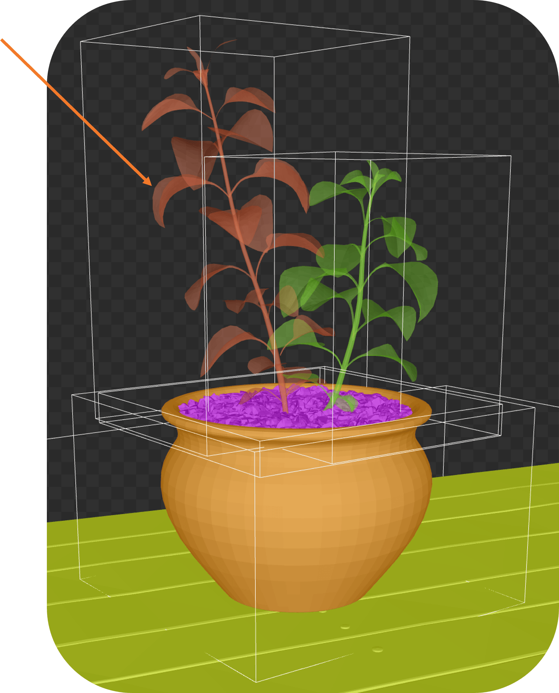
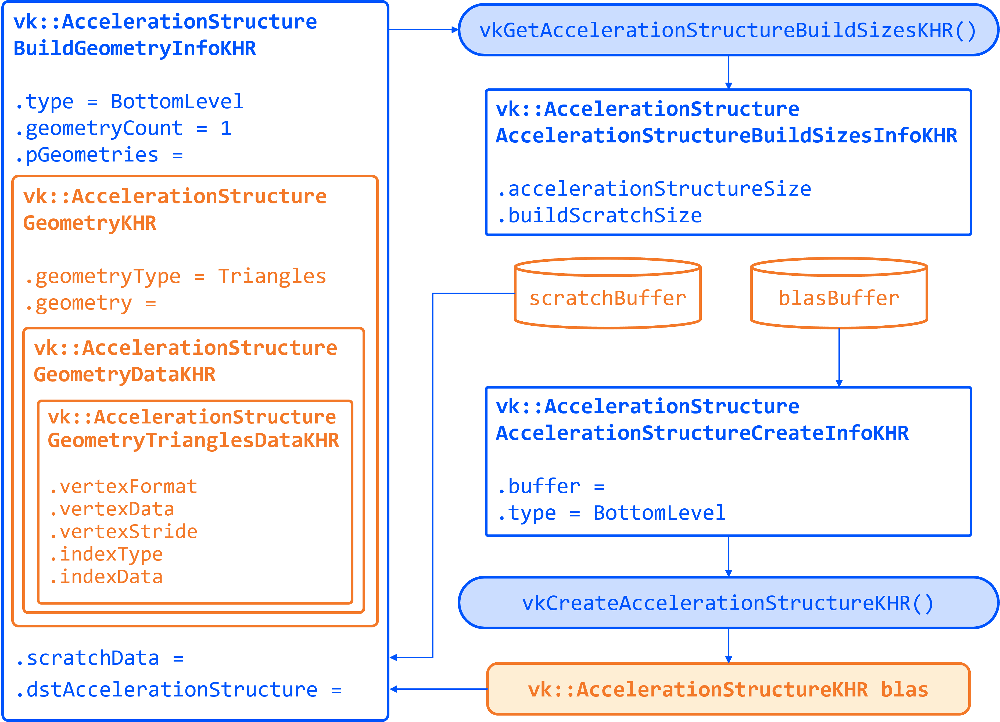
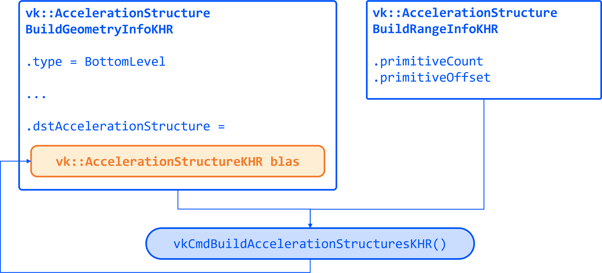
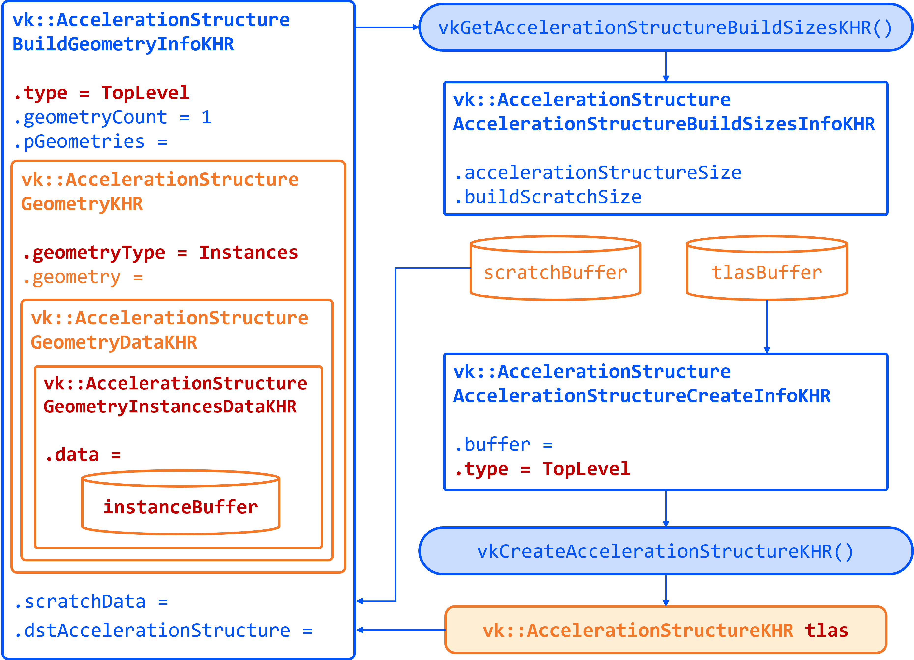

= 加速结构（BLAS/TLAS）

*目标*：为模型的几何体创建*底层加速结构*（BLAS），并创建一个*顶层加速结构*（TLAS）来实例化这些 BLAS。把 TLAS 绑定到着色器，这样我们就能使用光线查询。

在场景中投射光线时，我们需要一个经过优化的结构，能快速判断光线击中了哪个三角形。GPU 使用的加速结构把几何体分组到包围盒中，从而可以跳过场景中的大片区域。光线遍历沿树向下进行，高效地缩小到被相交的那个三角形。
具体实现取决于 GPU，对使用者是不透明的。

我们的场景是一个从 OBJ 文件加载的简单 3D 模型（桌上的一株植物）。提供的代码已经把模型的顶点、索引、法线和纹理加载到缓冲区中。
它把模型拆分成子网格，每个子网格有自己的材质。

BLAS 保存一个网格或物体的几何体（三角形）。
TLAS 保存 BLAS 的实例（带变换），组成完整场景。
我们会为每个不同的网格/材质创建一个 BLAS，再创建一个引用它们的 TLAS。
光线查询将使用 TLAS。
在 Vulkan 中，构建加速结构（AS）需要几个步骤：描述几何体、查询构建所需大小、分配缓冲区、创建 AS 句柄，然后发出构建命令。

== 任务 2：为每个子网格创建 BLAS

转到 `createAccelerationStructures` 的定义。这里我们先为模型中的每个子网格创建 BLAS。代码里已经有一个遍历 `submeshes` 的循环，其中包含着几何体数据。

首先，我们需要描述 BLAS 的几何体。`vk::AccelerationStructureGeometryKHR` 结构体就是用来做这件事的：

[,c{pp}]
----
// Prepare the geometry data
auto trianglesData = vk::AccelerationStructureGeometryTrianglesDataKHR{
    .vertexFormat = vk::Format::eR32G32B32Sfloat,
    .vertexData = vertexAddr,
    .vertexStride = sizeof(Vertex),
    .maxVertex = submesh.maxVertex,
    .indexType = vk::IndexType::eUint32,
    .indexData = indexAddr + submesh.indexOffset * sizeof(uint32_t)
};

vk::AccelerationStructureGeometryDataKHR geometryData(trianglesData);

vk::AccelerationStructureGeometryKHR blasGeometry{
    .geometryType = vk::GeometryTypeKHR::eTriangles,
    .geometry = geometryData,
    .flags = vk::GeometryFlagBitsKHR::eOpaque
};
----

然后把它记录进构建信息结构体：

[,c{pp}]
----
vk::AccelerationStructureBuildGeometryInfoKHR blasBuildGeometryInfo{
    .type = vk::AccelerationStructureTypeKHR::eBottomLevel,
    .mode = vk::BuildAccelerationStructureModeKHR::eBuild,
    .geometryCount = 1,
    .pGeometries = &blasGeometry,
};
----

接下来，我们需要查询 BLAS 的内存需求：

[,c{pp}]
----
// TASK02: Query the memory sizes that will be needed for this BLAS
vk::AccelerationStructureBuildSizesInfoKHR blasBuildSizes =
    device.getAccelerationStructureBuildSizesKHR(
        vk::AccelerationStructureBuildTypeKHR::eDevice,
        blasBuildGeometryInfo,
        { primitiveCount }
);
----

这个辅助函数使用 `device.getAccelerationStructureBuildSizesKHR()`，返回 BLAS 所需的内存大小。我们需要分配：

. 一个用于 BLAS 本身的缓冲区。
. 另一个用于构建过程中临时空间（scratch space）的缓冲区。

然后我们创建这些缓冲区，并把它们存进持久化的数组，因为后面还会用到。

我们还需要创建 BLAS 句柄本身，这通过 `vk::AccelerationStructureCreateInfoKHR` 和调用 `device.createAccelerationStructureKHR()` 的设备函数辅助来完成。句柄被存进一个 vector 供后续使用（记住每个子网格都需要一个）：

[,c{pp}]
----
// TASK02: Create and store the BLAS handle
vk::AccelerationStructureCreateInfoKHR blasCreateInfo{
    .buffer = blasBuffers[i],
    .offset = 0,
    .size = blasBuildSizes.accelerationStructureSize,
    .type = vk::AccelerationStructureTypeKHR::eBottomLevel,
};

blasHandles.emplace_back(device.createAccelerationStructureKHR(blasCreateInfo));

// Save the BLAS handle in the build info structure
blasBuildGeometryInfo.dstAccelerationStructure = blasHandles[i];
----

下图汇总了到目前为止我们创建的所有结构体与缓冲区：

为了把这一切串起来，我们需要提交一个命令缓冲区，在 GPU 上构建 BLAS。这通过命令缓冲区的 `buildAccelerationStructuresKHR()` 方法完成，它接受构建信息和 range。range 让你可以在一次操作中构建多个几何体，但这里每个 BLAS 只有一个几何体，所以保持简单：

[,c{pp}]
----
// TASK02: Prepare the build range for the BLAS
vk::AccelerationStructureBuildRangeInfoKHR blasRangeInfo{
    .primitiveCount = primitiveCount,
    .primitiveOffset = 0,
    .firstVertex = firstVertex,
    .transformOffset = 0
};
----

最后，准备并提交一个命令缓冲区，它会为底层加速结构保存一个有效的句柄：

[,c{pp}]
----
// TASK02: Build the BLAS
auto cmd = beginSingleTimeCommands();
cmd->buildAccelerationStructuresKHR({ blasBuildGeometryInfo }, { &blasRangeInfo });
endSingleTimeCommands(*cmd);
----

现在你为场景中的每个模型都有了 BLAS。接下来我们需要把它们全部组合到一个 TLAS 中，之后由片元着色器使用。

== 任务 3：创建带有 BLAS 实例的 TLAS

现在有了 BLAS，我们需要创建一个引用它们的 TLAS。TLAS 保存 BLAS 的实例，让我们能通过变换（位置、旋转、缩放）把它们放置到场景中。

我们可以在创建 BLAS 的同一个子网格循环里创建实例。对每个子网格，创建一个引用对应 BLAS 句柄的实例。`vk::AccelerationStructureInstanceKHR` 结构体就是为此而设：

[,c{pp}]
----
// TASK03: Create a BLAS instance for the TLAS
vk::AccelerationStructureDeviceAddressInfoKHR addrInfo{
    .accelerationStructure = *blasHandles[i]
};
vk::DeviceAddress blasDeviceAddr = device.getAccelerationStructureAddressKHR(addrInfo);

vk::AccelerationStructureInstanceKHR instance{
    .transform = tm,
    .mask = 0xFF,
    .accelerationStructureReference = blasDeviceAddr
};

instances.push_back(instance);
----

注意我们需要用 `device.getAccelerationStructureAddressKHR()` 获取 BLAS 的设备地址。我们暂时把变换矩阵设为单位矩阵，稍后在实验里再回头处理这一点。

现在所有实例都存进了 vector，我们需要为 TLAS 准备实例数据。这涉及创建一个保存实例数据的缓冲区。

采用与 BLAS 非常相似的做法，我们需要为 TLAS 构建准备数据、查询缓冲区大小、分配缓冲区、创建 TLAS 句柄，并发出构建命令。下图突出显示了 TLAS 需要的主要改动：

为 TLAS 准备几何体数据时，我们用 `vk::GeometryTypeKHR::eInstances` 表示我们正在从 BLAS 实例构建 TLAS：

[,c{pp}]
----
// TASK03: Prepare the geometry (instance) data
auto instancesData = vk::AccelerationStructureGeometryInstancesDataKHR{
    .arrayOfPointers = vk::False,
    .data = instanceAddr
};

vk::AccelerationStructureGeometryDataKHR geometryData(instancesData);

vk::AccelerationStructureGeometryKHR tlasGeometry{
    .geometryType = vk::GeometryTypeKHR::eInstances,
    .geometry = geometryData
};
----

然后把它记录进构建信息结构体：

[,c{pp}]
----
vk::AccelerationStructureBuildGeometryInfoKHR tlasBuildGeometryInfo{
    .type = vk::AccelerationStructureTypeKHR::eTopLevel,
    .mode = vk::BuildAccelerationStructureModeKHR::eBuild,
    .geometryCount = 1,
    .pGeometries = &tlasGeometry
};
----

接下来，我们需要查询 TLAS 的内存需求：

[,c{pp}]
----
// TASK03: Query the memory sizes that will be needed for this TLAS
vk::AccelerationStructureBuildSizesInfoKHR tlasBuildSizes =
    device.getAccelerationStructureBuildSizesKHR(
        vk::AccelerationStructureBuildTypeKHR::eDevice,
        tlasBuildGeometryInfo,
        { primitiveCount }
);
----

然后同样创建必要的缓冲区。

创建 TLAS 句柄和之前一样，用 `device.createAccelerationStructureKHR()`：

[,c{pp}]
----
// TASK03: Create and store the TLAS handle
vk::AccelerationStructureCreateInfoKHR tlasCreateInfo{
    .buffer = tlasBuffer,
    .offset = 0,
    .size = tlasBuildSizes.accelerationStructureSize,
    .type = vk::AccelerationStructureTypeKHR::eTopLevel,
};

tlas = device.createAccelerationStructureKHR(tlasCreateInfo);

// Save the TLAS handle in the build info structure
tlasBuildGeometryInfo.dstAccelerationStructure = tlas;
----

再一次，我们需要为 TLAS 准备构建 range。这与 BLAS 类似，只是现在使用实例数量。然后就可以提交命令缓冲区来构建 TLAS：

[,c{pp}]
----
 // TASK03: Prepare the build range for the TLAS
 vk::AccelerationStructureBuildRangeInfoKHR tlasRangeInfo{
     .primitiveCount = primitiveCount,
     .primitiveOffset = 0,
     .firstVertex = 0,
     .transformOffset = 0
 };

// TASK03: Build the TLAS
auto cmd = beginSingleTimeCommands();
cmd->buildAccelerationStructuresKHR({ tlasBuildGeometryInfo }, { &tlasRangeInfo });
endSingleTimeCommands(*cmd);
----

完成！你现在创建了一个 TLAS，它引用了模型中所有子网格的 BLAS。TLAS 已准备好在片元着色器的光线查询中使用。

== 任务 4：把加速结构绑定到着色器

要让加速结构在着色器中可用，我们需要为 TLAS 添加一个描述符集绑定。这在 `createDescriptorSetLayout()` 函数中完成（暂时可以忽略编号更高的绑定）：

[,c{pp}]
----
// TASK04: The acceleration structure uses binding 1
std::array global_bindings = {
    vk::DescriptorSetLayoutBinding( 0, vk::DescriptorType::eUniformBuffer, 1, vk::ShaderStageFlagBits::eVertex | vk::ShaderStageFlagBits::eFragment, nullptr),
    vk::DescriptorSetLayoutBinding( 1, vk::DescriptorType::eAccelerationStructureKHR, 1, vk::ShaderStageFlagBits::eFragment, nullptr),
    vk::DescriptorSetLayoutBinding( 2, vk::DescriptorType::eStorageBuffer, 1, vk::ShaderStageFlagBits::eFragment, nullptr),
    vk::DescriptorSetLayoutBinding( 3, vk::DescriptorType::eStorageBuffer, 1, vk::ShaderStageFlagBits::eFragment, nullptr),
    vk::DescriptorSetLayoutBinding( 4, vk::DescriptorType::eStorageBuffer, 1, vk::ShaderStageFlagBits::eFragment, nullptr)
};
----

接下来，我们需要更新描述符集来绑定 TLAS。这在 `updateDescriptorSets()` 函数中完成：

[,c{pp}]
----
vk::WriteDescriptorSetAccelerationStructureKHR asInfo{
    .accelerationStructureCount = 1,
    .pAccelerationStructures = {&*tlas}
};

vk::WriteDescriptorSet asWrite{
    .pNext = &asInfo,
    .dstSet = globalDescriptorSets[i],
    .dstBinding = 1,
    .dstArrayElement = 0,
    .descriptorCount = 1,
    .descriptorType = vk::DescriptorType::eAccelerationStructureKHR
};
----

然后再调用 `device.updateDescriptorSets()`，把 TLAS 加入列表：

[,c{pp}]
----
std::array<vk::WriteDescriptorSet, 4> descriptorWrites{bufferWrite, asWrite, indexBufferWrite, uvBufferWrite};

device.updateDescriptorSets(descriptorWrites, {});
----

最后，在着色器中添加对应的属性：

[,slang]
----
// TASK04: Acceleration structure binding
[[vk::binding(1,0)]]
RaytracingAccelerationStructure accelerationStructure;
----

用以下设置重新构建并运行：

[,c{pp}]
----
#define LAB_TASK_LEVEL 4
----

你不会看到任何视觉差异，但请放心，你的加速结构现在已设置完毕，随时可以在片元着色器中使用。

== 导航
- 上一篇：xref:./01_Dynamic_rendering.adoc[动态渲染]
- 下一篇：xref:./03_Ray_query_shadows.adoc[光线查询阴影（不透明几何体）]
