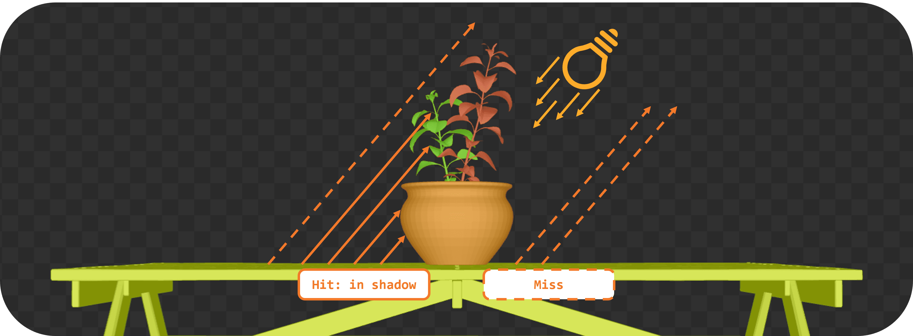
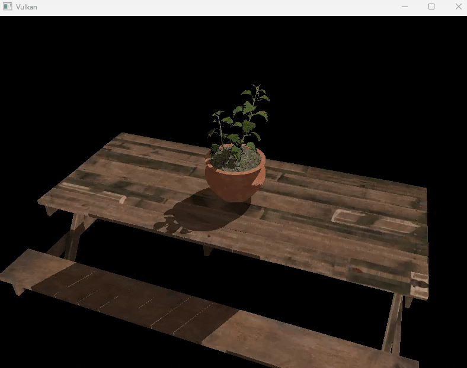

= 光线查询阴影（不透明几何体）

*目标*：在片元着色器里用光线查询加入一个简单的阴影测试。我们会从每个片元点朝光源投射一条光线，如果击中某物就把该片元变暗（硬阴影）。

恭喜：你已经为场景准备好了有效的 TLAS/BLAS！现在就用它来投射一些光线吧。

== 任务 5：实现光线查询阴影

在片元着色器中，我们将用光线查询从片元位置朝光源投射一条阴影光线。如果光线在到达光源之前击中任何几何体，我们就把该片元的颜色变暗：

[,slang]
----
// TASK05: Implement ray query shadows
bool in_shadow(float3 P)
{
    bool hit = false;

    return hit;
}

[shader("fragment")]
float4 fragMain(VSOutput vertIn) : SV_TARGET {
   float4 baseColor = textures[pc.materialIndex].Sample(textureSampler, vertIn.fragTexCoord);

   float3 P = vertIn.worldPos;

   bool inShadow = in_shadow(P);

   // Darken if in shadow
   if (inShadow) {
       baseColor.rgb *= 0.2;
   }

   return baseColor;
}
----

为此，你将实现一个执行光线查询的辅助函数 `in_shadow()`。先定义光线描述，并用片元位置和光照方向初始化它：

[,slang]
----
bool in_shadow(float3 P)
{
    // Build the shadow ray from the world position toward the light
    RayDesc shadowRayDesc;
    shadowRayDesc.Origin = P;
    shadowRayDesc.Direction = normalize(lightDir);
    shadowRayDesc.TMin = EPSILON;
    shadowRayDesc.TMax = 1e4;
----

`TMin` 和 `TMax` 定义光线从其原点出发所能行进的最小与最大距离。`EPSILON` 是一个很小的值，用来避免自相交；`1e4` 是一个很大的值，确保我们能击中远处的物体。

接下来，我们初始化一个 `RayQuery` 对象，用它来执行光线遍历。注意我们为了让遍历更快而选择的标志：

- `RAY_FLAG_SKIP_PROCEDURAL_PRIMITIVES`，因为这是一个只含三角形的简单场景。
- `RAY_FLAG_ACCEPT_FIRST_HIT_AND_END_SEARCH`，一旦找到第一个不透明交点就结束遍历；对阴影测试来说这足够了，因为我们只需要知道是否有东西挡住了光源。

[,slang]
----
    // Initialize a ray query for shadows
    RayQuery<RAY_FLAG_SKIP_PROCEDURAL_PRIMITIVES |
             RAY_FLAG_ACCEPT_FIRST_HIT_AND_END_SEARCH> sq;
    let rayFlags = RAY_FLAG_SKIP_PROCEDURAL_PRIMITIVES |
             RAY_FLAG_ACCEPT_FIRST_HIT_AND_END_SEARCH;
----

然后我们启动光线追踪操作，它把光线描述、`RayQuery` 对象和加速结构结合起来：

[,slang]
----
    sq.TraceRayInline(accelerationStructure, rayFlags, 0xFF, shadowRayDesc);

    sq.Proceed();
----

`Proceed()` 把 `RayQuery` 对象的状态推进到光线上的下一个交点“候选”。每次调用 `Proceed()` 都会检查是否还有交点需要处理。如果有，它更新查询的内部状态，让你可以访问当前候选交点的信息。这样你就能实现处理交点的自定义逻辑，例如跳过透明表面（本实验后面会再讨论），或在第一个不透明交点处停下。它通常放在循环里调用，以遍历所有潜在交点，但对阴影来说我们只需要第一个交点：

[,slang]
----
    // If the shadow ray intersects an opaque triangle, we consider the pixel in shadow
    bool hit = (sq.CommittedStatus() == COMMITTED_TRIANGLE_HIT);

    return hit;
}
----

就是这样！你已经用光线查询实现了一个基本的阴影测试。如果光线在到达光源之前击中任何几何体，`in_shadow()` 函数就返回 `true`，表示该片元处于阴影之中。

用以下设置重新构建并运行：

[,c{pp}]
----
#define LAB_TASK_LEVEL 5
----

你会注意到有些不对劲：

物体在旋转，但阴影是静止的。这是因为我们还没有更新 TLAS 来反映物体的动画。只要物体移动或播放动画，就需要重建 TLAS，所以接下来我们就来实现这一点。

== 导航
- 上一篇：xref:./02_Acceleration_structures.adoc[加速结构（BLAS/TLAS）]
- 下一篇：xref:./04_TLAS_animation.adoc[TLAS 动画]
