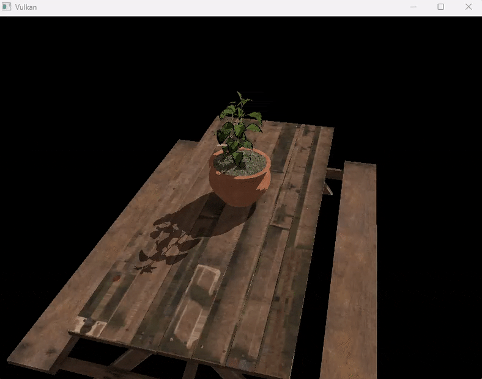

= TLAS 动画

*目标*：通过在每一帧用更新后的实例变换重建 TLAS，确保物体播放动画时阴影也会更新。

为了反映物体的动画，只要物体移动或发生变化，我们就需要更新 TLAS。
这涉及更新实例变换并重建 TLAS。
我们会把这件事放在 `updateTopLevelAS()` 函数里完成，该函数每帧都会用当前的模型矩阵被调用。

== 任务 6：为动画更新 TLAS

首先，我们需要用当前的模型矩阵更新实例变换。做法是遍历 `instances` vector，为每个实例设置变换，然后更新实例缓冲区。

[,c{pp}]
----
vk::TransformMatrixKHR tm{};
auto &M = model;
tm.matrix = std::array<std::array<float,4>,3>{{
        std::array<float,4>{M[0][0], M[1][0], M[2][0], M[3][0]},
        std::array<float,4>{M[0][1], M[1][1], M[2][1], M[3][1]},
        std::array<float,4>{M[0][2], M[1][2], M[2][2], M[3][2]}
}};

// TASK06: update the instances to use the new transform matrix.
for (auto & instance : instances) {
        instance.setTransform(tm);
}
----

接下来，我们需要为 TLAS 构建准备几何体数据。这与创建 TLAS 时类似，但现在我们使用更新后的实例缓冲区。我们还需要把构建的 `mode` 改成 `eUpdate`，并定义源 TLAS 与目标 TLAS。这告诉实现要就地更新已有的 TLAS，而不是创建一个新的。当只发生较小的变化（比如变换）时，这样做更高效：

[,c{pp}]
----
        // Prepare the geometry (instance) data
        auto instancesData = vk::AccelerationStructureGeometryInstancesDataKHR{
            .arrayOfPointers = vk::False,
            .data = instanceAddr
        };

        vk::AccelerationStructureGeometryDataKHR geometryData(instancesData);

        vk::AccelerationStructureGeometryKHR tlasGeometry{
            .geometryType = vk::GeometryTypeKHR::eInstances,
            .geometry = geometryData
        };

        // TASK06: Note the new parameters to re-build the TLAS in-place
        vk::AccelerationStructureBuildGeometryInfoKHR tlasBuildGeometryInfo{
            .type = vk::AccelerationStructureTypeKHR::eTopLevel,
            .flags = vk::BuildAccelerationStructureFlagBitsKHR::eAllowUpdate,
            .mode = vk::BuildAccelerationStructureModeKHR::eUpdate,
            .srcAccelerationStructure = tlas,
            .dstAccelerationStructure = tlas,
            .geometryCount = 1,
            .pGeometries = &tlasGeometry
        };

        vk::BufferDeviceAddressInfo scratchAddressInfo{ .buffer = *tlasScratchBuffer };
        vk::DeviceAddress scratchAddr = device.getBufferAddressKHR(scratchAddressInfo);
        tlasBuildGeometryInfo.scratchData.deviceAddress = scratchAddr;
----

我们可以继续复用同一个临时（scratch）缓冲区。注意还需要一条实现提示：用 `eAllowUpdate` 标志说明我们打算更新这个 TLAS。我们还需要回到 `createAccelerationStructures()` 函数，在首次创建 TLAS 时加上这个标志：

[,c{pp}]
----
        vk::AccelerationStructureBuildGeometryInfoKHR tlasBuildGeometryInfo{
            .type = vk::AccelerationStructureTypeKHR::eTopLevel,
            .flags = vk::BuildAccelerationStructureFlagBitsKHR::eAllowUpdate, // <---- TASK06
            .mode = vk::BuildAccelerationStructureModeKHR::eBuild,
            .geometryCount = 1,
            .pGeometries = &tlasGeometry
        };
----

接下来，我们需要为 TLAS 准备构建 range。这与创建 TLAS 时类似：

[,c{pp}]
----
        // Prepare the build range for the TLAS
        vk::AccelerationStructureBuildRangeInfoKHR tlasRangeInfo{
            .primitiveCount = primitiveCount,
            .primitiveOffset = 0,
            .firstVertex = 0,
            .transformOffset = 0
        };
----

最后，我们可以发出重建 TLAS 的命令。不过这里有一处主要改动与同步有关。由于我们每帧都调用 `updateTopLevelAS()`，我们需要一个构建前的内存屏障，确保之前对加速结构的写入或传输、以及上一帧的着色器读取，都在构建开始前完成：

[,c{pp}]
----
        // Re-build the TLAS
        auto cmd = beginSingleTimeCommands();

        // Pre-build barrier
        vk::MemoryBarrier preBarrier {
            .srcAccessMask = vk::AccessFlagBits::eAccelerationStructureWriteKHR | vk::AccessFlagBits::eTransferWrite | vk::AccessFlagBits::eShaderRead,
            .dstAccessMask = vk::AccessFlagBits::eAccelerationStructureReadKHR | vk::AccessFlagBits::eAccelerationStructureWriteKHR
        };

        cmd->pipelineBarrier(
            vk::PipelineStageFlagBits::eAccelerationStructureBuildKHR | vk::PipelineStageFlagBits::eTransfer | vk::PipelineStageFlagBits::eFragmentShader, // srcStageMask
            vk::PipelineStageFlagBits::eAccelerationStructureBuildKHR, // dstStageMask
            {}, // dependencyFlags
            preBarrier, // memoryBarriers
            {}, // bufferMemoryBarriers
            {} // imageMemoryBarriers
        );

        cmd->buildAccelerationStructuresKHR({ tlasBuildGeometryInfo }, { &tlasRangeInfo });
----

同样，我们需要一个构建后的屏障，确保构建期间对加速结构的所有写入对后续的读取或着色器访问都是可见的：

[,c{pp}]
----
        // Post-build barrier
        vk::MemoryBarrier postBarrier {
            .srcAccessMask = vk::AccessFlagBits::eAccelerationStructureWriteKHR,
            .dstAccessMask = vk::AccessFlagBits::eAccelerationStructureReadKHR | vk::AccessFlagBits::eShaderRead
        };

        cmd->pipelineBarrier(
            vk::PipelineStageFlagBits::eAccelerationStructureBuildKHR, // srcStageMask
            vk::PipelineStageFlagBits::eAccelerationStructureBuildKHR | vk::PipelineStageFlagBits::eFragmentShader, // dstStageMask
            {}, // dependencyFlags
            postBarrier, // memoryBarriers
            {}, // bufferMemoryBarriers
            {} // imageMemoryBarriers
        );

        endSingleTimeCommands(*cmd);
----

这些屏障对正确的同步至关重要，它们防止竞态条件，并确保加速结构处于光线追踪着色器可用的有效状态。

确认该函数在 `drawFrame()` 中、模型矩阵更新之后被调用：

[,c{pp}]
----
        updateUniformBuffer(frameIndex);
        // TASK06: Update the TLAS with the current model matrix
        updateTopLevelAS(ubo.model);
----

用以下设置重新构建并运行：

[,c{pp}]
----
#define LAB_TASK_LEVEL 6
----

现在阴影应该能正确更新了，因为加速结构与几何体的动画保持同步：

供参考，此时完整的着色器应该如下所示：

.点击展开着色器
[%collapsible]
====
[,slang]
----
struct VSInput {
    float3 inPosition;
    float3 inColor;
    float2 inTexCoord;
    float3 inNormal;
};

struct UniformBuffer {
    float4x4 model;
    float4x4 view;
    float4x4 proj;
    float3   cameraPos;
};
[[vk::binding(0,0)]]
ConstantBuffer<UniformBuffer> ubo;

// TASK05: Acceleration structure binding
[[vk::binding(1,0)]]
RaytracingAccelerationStructure accelerationStructure;

[[vk::binding(2,0)]]
StructuredBuffer<uint> indexBuffer;

[[vk::binding(3,0)]]
StructuredBuffer<float2> uvBuffer;

struct InstanceLUT {
    uint materialID;
    uint indexBufferOffset;
};
[[vk::binding(4,0)]]
StructuredBuffer<InstanceLUT> instanceLUTBuffer;

struct VSOutput
{
    float4 pos : SV_Position;
    float3 fragColor;
    float2 fragTexCoord;
    float3 fragNormal;
    float3 worldPos;
};

[shader("vertex")]
VSOutput vertMain(VSInput input) {
    VSOutput output;
    output.pos = mul(ubo.proj, mul(ubo.view, mul(ubo.model, float4(input.inPosition, 1.0))));
    output.fragColor = input.inColor;
    output.fragTexCoord = input.inTexCoord;
    output.fragNormal = input.inNormal;
    output.worldPos = mul(ubo.model, float4(input.inPosition, 1.0)).xyz;
    return output;
}

[[vk::binding(0,1)]]
SamplerState textureSampler;

[[vk::binding(1,1)]]
Texture2D<float4> textures[];

struct PushConstant {
    uint materialIndex;
};
[push_constant]
PushConstant pc;

static const float3 lightDir = float3(-6.0, 0.0, 6.0);

// Small epsilon to avoid self-intersection
static const float EPSILON = 0.01;

// TASK05: Implement ray query shadows
bool in_shadow(float3 P)
{
    // Build the shadow ray from the world position toward the light
    RayDesc shadowRayDesc;
    shadowRayDesc.Origin = P;
    shadowRayDesc.Direction = normalize(lightDir);
    shadowRayDesc.TMin = EPSILON;
    shadowRayDesc.TMax = 1e4;

    // Initialize a ray query for shadows
    RayQuery<RAY_FLAG_SKIP_PROCEDURAL_PRIMITIVES |
             RAY_FLAG_ACCEPT_FIRST_HIT_AND_END_SEARCH> sq;
    let rayFlags = RAY_FLAG_SKIP_PROCEDURAL_PRIMITIVES |
             RAY_FLAG_ACCEPT_FIRST_HIT_AND_END_SEARCH;

    sq.TraceRayInline(accelerationStructure, rayFlags, 0xFF, shadowRayDesc);

    sq.Proceed();

    // If the shadow ray intersects an opaque triangle, we consider the pixel in shadow
    bool hit = (sq.CommittedStatus() == COMMITTED_TRIANGLE_HIT);

    return hit;
}

[shader("fragment")]
float4 fragMain(VSOutput vertIn) : SV_TARGET {
   float4 baseColor = textures[pc.materialIndex].Sample(textureSampler, vertIn.fragTexCoord);

   float3 P = vertIn.worldPos;

   bool inShadow = in_shadow(P);

   // Darken if in shadow
   if (inShadow) {
       baseColor.rgb *= 0.2;
   }

   return baseColor;
}
----
====

NOTE: 光线查询与光线追踪管线：注意我们是直接在片元着色器中加入光线追踪效果（阴影）的。我们不需要单独的光线生成着色器，也不需要任何新的管线。这正是光线查询（也叫内联光线追踪）的威力所在：我们把光线遍历集成进现有的渲染管线。这样着色器逻辑保持统一，也避免了额外的 GPU 着色器启动。在许多移动 GPU 上，这种做法不仅更方便，而且是必需的：如前所述，当前移动设备大多只支持光线查询，而不支持完整的光线管线，并且它们能在片元着色器中高效地执行光线查询。这也是我们在本实验中聚焦光线查询的关键原因。

== 导航
- 上一篇：xref:./03_Ray_query_shadows.adoc[光线查询阴影（不透明几何体）]
- 下一篇：xref:./05_Shadow_transparency.adoc[在阴影中实现透明度]
