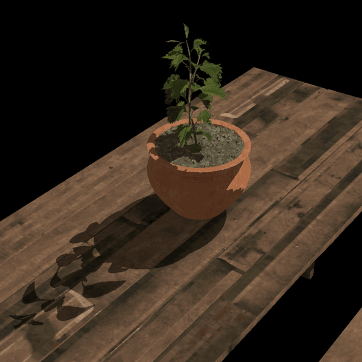
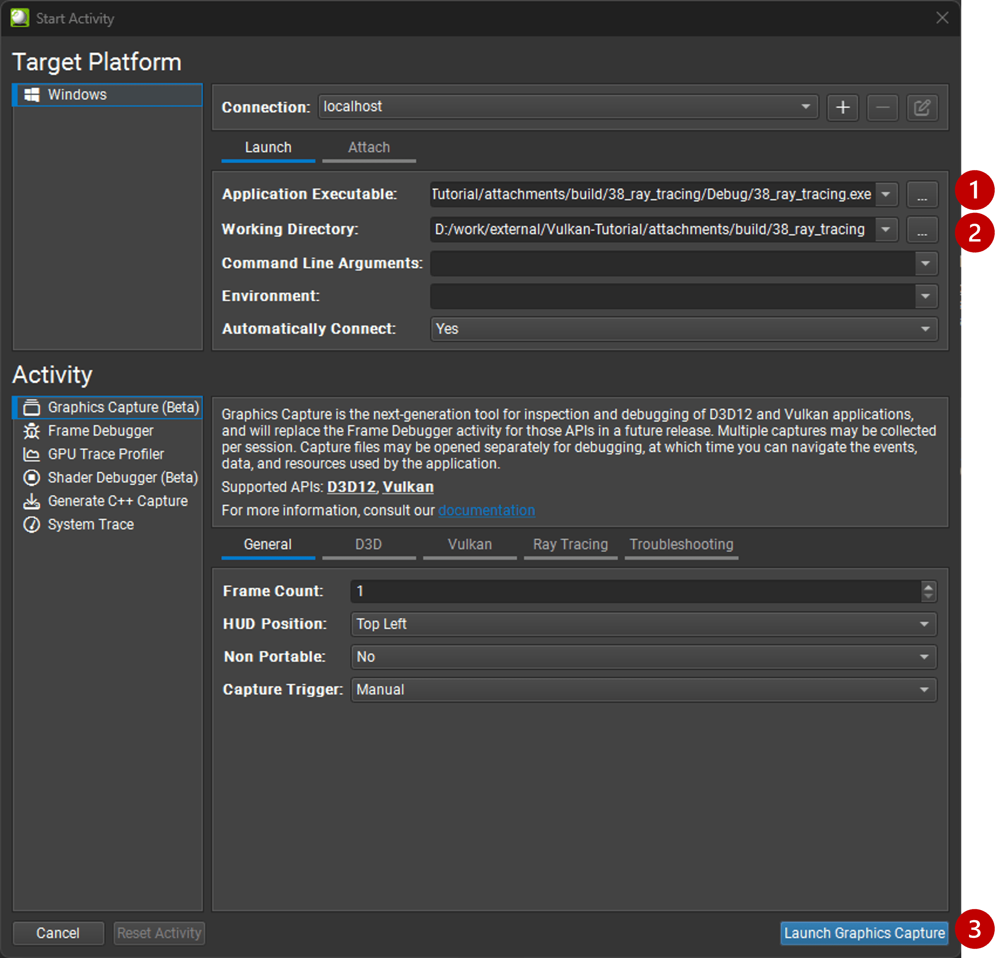
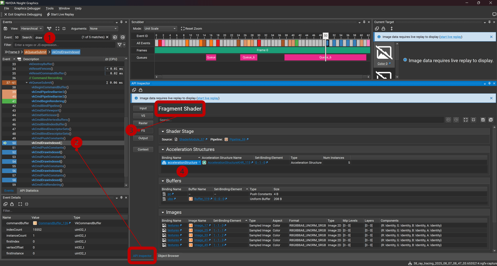
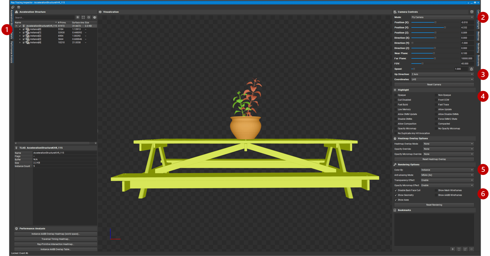
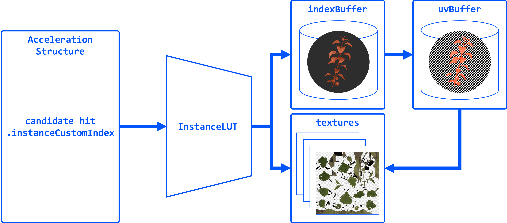
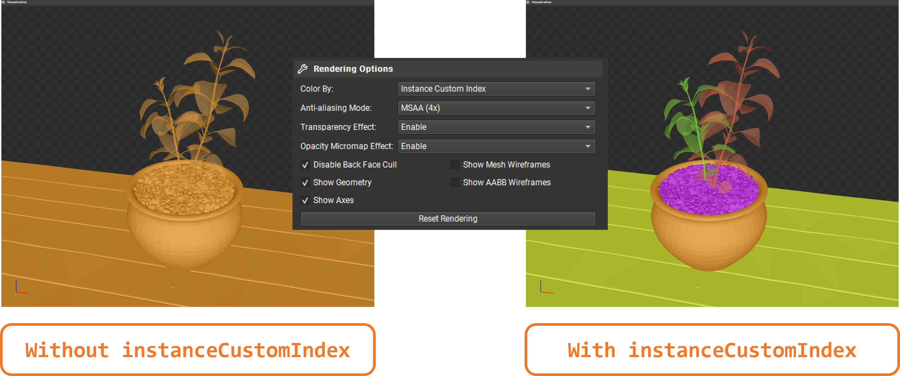
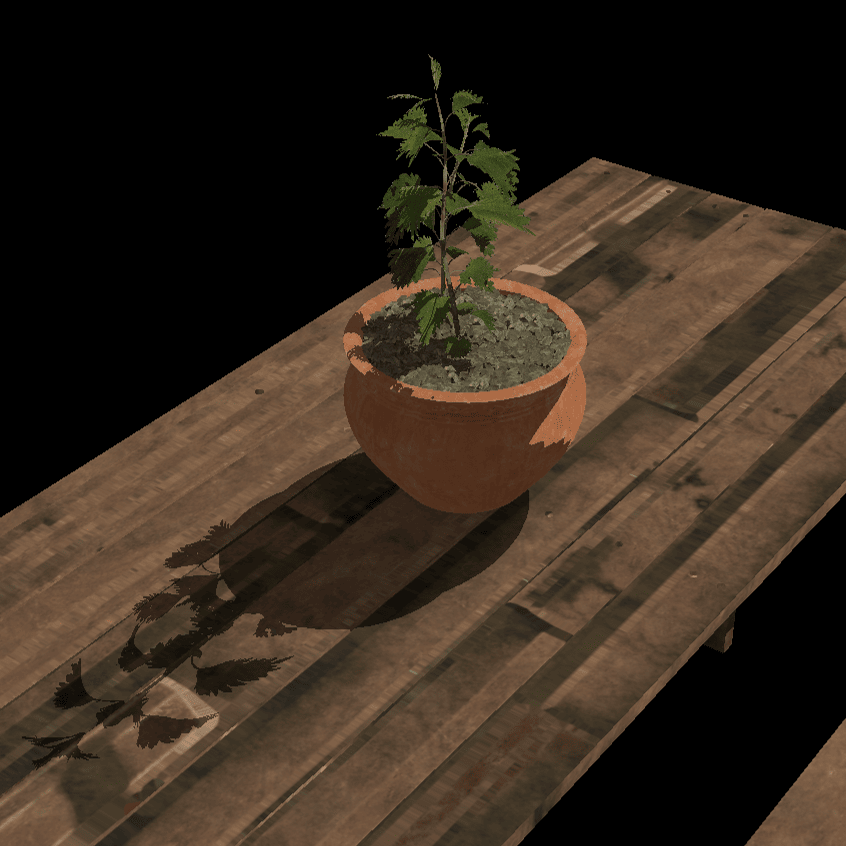

= 在阴影中实现透明度

*目标*：为场景中的透明物体提供支持。我们将实现一个简单的 alpha 测试，丢弃 alpha 值低的片元，并在对应的光线追踪阴影中复现同样的逻辑。

到目前为止，我们把所有几何体都当作不透明的。但请注意，叶子的纹理用 alpha 通道来定义透明度，而目前这一点没有被考虑，所以叶子边缘周围会出现一些偏暗的像素：

== 任务 7：alpha 裁剪透明度

要实现 alpha 裁剪透明度，我们将在片元着色器中丢弃 alpha 值低的片元。这是一种常见的技术，用来处理透明纹理，而无需复杂的混合或排序：

[,slang]
----
   float4 baseColor = textures[pc.materialIndex].Sample(textureSampler, vertIn.fragTexCoord);

   // Alpha test
   if (baseColor.a < 0.5) discard;
----

注意阴影目前还没有变化。我们首先要做的是，在 `createAccelerationStructures()` 中，只在 BLAS 没有 alpha 透明度时才使用 `eOpaque` 标志：

[,c{pp}]
----
vk::AccelerationStructureGeometryKHR blasGeometry{
    .geometryType = vk::GeometryTypeKHR::eTriangles,
    .geometry = geometryData
};

blasGeometry.flags = (submesh.alphaCut) ? vk::GeometryFlagsKHR(0) : vk::GeometryFlagBitsKHR::eOpaque;
----

用以下设置重新构建并运行：

[,c{pp}]
----
#define LAB_TASK_LEVEL 7
----

你会发现叶子的阴影现在完全消失了！这是因为在所有交点候选中，只有不透明几何体的三角形会被自动提交。我们需要实现一种在光线查询阴影中处理透明度的方式，有条件地提交候选交点。

在动手之前，我们先来看看目前已经构建的加速结构，了解它们是如何组织的，以及每个三角形上能拿到哪些信息。

== 任务 8：用 NVIDIA Nsight Graphics 查看加速结构

RenderDoc 目前还不支持查看 Vulkan 加速结构，但我们可以用 *Nsight Graphics* 来验证 BLAS/TLAS 是否构建正确。这有助于在我们在着色器里依赖它们之前发现错误（例如几何体数量、偏移量写错）。

使用 Nsight 的步骤：

. 指定可执行文件路径：`C:\Users\nvidia\S2025_LABS\gensubcur_105\Vulkan-Tutorial\attachments\build\38_ray_tracing\Debug\38_ray_tracing.exe`。
. 指定工作目录：`C:\Users\nvidia\S2025_LABS\gensubcur_105\Vulkan-Tutorial\attachments\build\38_ray_tracing`。
. 启动程序。

然后抓取一帧，点击 “Start Graphics Debugger”：

image::../images/38_TASK04_nsight_capture.png[]

与 RenderDoc 类似，你可以查看事件并找到加速结构的构建命令，接下来会被带到加速结构可视化工具：

. 使用 Event browser 中的搜索功能过滤并找到 `draw` 调用。
. 选择任意一个绘制调用，这会打开 API Inspector。
. 选择 `FS`，找到绑定到片元着色器的资源。
. 点击加速结构绑定（这就是我们的 TLAS），这会打开 “Ray Tracing Inspector”。

在新窗口中，你可以看到 TLAS 及其实例：

. 你可以展开每个实例，查看它引用的 BLAS，并检查几何体数据。
. 你可能会觉得用 ‘Orbit Camera’ 浏览场景更顺手。
. 你可能需要把 “Up Direction” 设为 “Z Axis”，以匹配模型使用的坐标系。
. 用 ‘Opaque’ 过滤几何体（如你所料，叶子模型会变灰）。
. 试试 “Color by” 之类的不同可视化选项。
. 试试 “Show Mesh Wireframes” 和 “Show AABB Wireframes”。

== 任务 9：无绑定资源与实例查找表

到目前为止，我们不需要知道光线与哪个三角形相交，只关心它是否击中了某物。但为了实现透明度，我们需要知道用于着色被击中三角形上那个点的纹理的 alpha 值。这样我们才能判断是否击中了一个透明像素，从而需要继续遍历，以防在通往光源的路上还击中了它后面的某个不透明三角形。

在引入所需的光线查询逻辑之前，我们先看看渲染器是如何在着色器中绑定所需的一切的，并实现一个简单的查找表，把加速结构实例映射到它们的几何体与纹理数据。

注意渲染器并没有为每个子网格绑定单独的材质纹理。它绑定一个纹理数组，并用材质索引为每个子网格查找纹理。我们使用推送常量传递材质索引：

[,c{pp}]
----
        for (auto& sub : submeshes) {
            // TASK09: Bindless resources
            PushConstant pushConstant = {
                .materialIndex = sub.materialID < 0 ? 0u : static_cast<uint32_t>(sub.materialID),
            };
            commandBuffers[frameIndex].pushConstants<PushConstant>(pipelineLayout, vk::ShaderStageFlagBits::eFragment, 0, pushConstant);

            commandBuffers[frameIndex].drawIndexed(sub.indexCount, 1, sub.indexOffset, 0, 0);
        }
----

然后，在着色器中我们用材质索引来采样纹理数组。它们共享同一个采样器：

[,slang]
----
[[vk::binding(0,1)]]
SamplerState textureSampler;

[[vk::binding(1,1)]]
Texture2D<float4> textures[];

struct PushConstant {
    uint materialIndex;
};
[push_constant]
PushConstant pc;

[shader("fragment")]
float4 fragMain(VSOutput vertIn) : SV_TARGET {
   float4 baseColor = textures[pc.materialIndex].Sample(textureSampler, vertIn.fragTexCoord);
----

这是一种常见的技术，叫做“无绑定资源”（bindless resources），它让我们可以减少所需的描述符集与绑定数量，也更容易管理包含许多对象的场景中的材质。它需要描述符索引扩展，该扩展自 Vulkan 1.2 起成为核心。

我们不能在光线遍历中使用推送常量，因为光线可能击中场景中的任何几何体，而不只是我们当前着色的那一个。不过，我们可以给每个加速结构实例打上自定义索引，之后再配合查找表（LUT）用这个索引找到被击中实例的几何体与纹理。

在 `createAccelerationStructures()` 中遍历模型子网格时，我们需要给 `AccelerationStructureInstanceKHR` 结构体添加一个新字段，为每个子网格保存一个唯一索引：

[,c{pp}]
----
vk::AccelerationStructureInstanceKHR instance{
    .transform = identity,
    .mask = 0xFF,
    .accelerationStructureReference = blasDeviceAddr
};

instances.push_back(instance);

instances[i].instanceCustomIndex = static_cast<uint32_t>(i);
----

如果现在运行程序并用 Nsight Graphics 抓取，你就能按 “Instance Custom Index” 着色，看到每个实例分配到的索引，而之前它们全都一样：

然后，填充一个由 LUT 条目组成的 vector。使用相同的子网格索引，我们需要为每个子网格保存材质 ID 和索引缓冲区偏移：

[,c{pp}]
----
// TASK09: store the instance look-up table entry
instanceLUTs.push_back({ static_cast<uint32_t>(submesh.materialID), submesh.indexOffset });
----

其余与创建 LUT 缓冲区相关的代码可以在 `createDescriptorSets()` 和 `createInstanceLUTBuffer()` 中找到。注意着色器中已经定义了对应的绑定：

[,slang]
----
// TASK09: Instance look-up table
struct InstanceLUT {
    uint materialID;
    uint indexBufferOffset;
};
[[vk::binding(4,0)]]
StructuredBuffer<InstanceLUT> instanceLUTBuffer;
----

现在我们来看看如何在光线查询中使用这些资源来处理透明交点。

== 任务 10：带 alpha 测试的光线查询

还记得 `Proceed()` 会把 `RayQuery` 对象的状态推进到光线上的下一个交点候选吗？我们就在这里实现 alpha 测试逻辑。我们会检查用于着色被击中三角形的纹理的 alpha 值，如果它低于某个阈值，就继续遍历去寻找下一个不透明三角形。一旦找到，我们就“提交”它，遍历随之结束。

首先，把原来的调用改成一个循环，并从候选命中中取出必要的属性。我们随后把这些传给一个辅助函数 `intersection_uv`，它负责取得被击中点在三角形内的纹理坐标：

[,slang]
----
    while (sq.Proceed())
    {
        uint instanceID = sq.CandidateRayInstanceCustomIndex();
        uint primIndex = sq.CandidatePrimitiveIndex();

        float2 uv = intersection_uv(instanceID, primIndex, sq.CandidateTriangleBarycentrics());
    }
----

这个辅助函数的定义如下：

[,slang]
----
float2 intersection_uv(uint instanceID, uint primIndex, float2 barycentrics) {
    uint indexOffset = instanceLUTBuffer[NonUniformResourceIndex(instanceID)].indexBufferOffset;

    uint i0 = indexBuffer[indexOffset + (primIndex * 3 + 0)];
    uint i1 = indexBuffer[indexOffset + (primIndex * 3 + 1)];
    uint i2 = indexBuffer[indexOffset + (primIndex * 3 + 2)];

    float2 uv0 = uvBuffer[i0];
    float2 uv1 = uvBuffer[i1];
    float2 uv2 = uvBuffer[i2];

    float w0 = 1.0 - barycentrics.x - barycentrics.y;
    float w1 = barycentrics.x;
    float w2 = barycentrics.y;

    return w0 * uv0 + w1 * uv1 + w2 * uv2;
}
----

. `instanceID` 让我们能从实例 LUT 中取出 `indexBufferOffset` 和 `materialID`。
. `indexBufferOffset` 用于找到该实例的索引缓冲区。注意索引缓冲区包含场景中所有模型的索引，所以我们需要缩小到被击中的模型（例如叶子）。
. `primIndex` 是三角形在该实例那段索引缓冲区中的索引。
. `NonUniformResourceIndex()` 表示资源索引在单次绘制或派发调用中的不同着色器调用之间可能不同，从而防止编译器做出不想要的优化。

一旦把命中缩小到模型中的某个具体三角形，我们就可以在 `uvBuffer` 中取得它的纹理坐标，其中包含场景中所有顶点的 UV 坐标。

最后，它根据交点的重心坐标，对被击中三角形的纹理坐标做插值。

然后我们就可以用这些 UV 坐标采样纹理并取得 alpha 值：

[,slang]
----
        uint materialID = instanceLUTBuffer[NonUniformResourceIndex(instanceID)].materialID;
        float4 intersection_color = textures[NonUniformResourceIndex(materialID)].SampleLevel(textureSampler, uv, 0);
----

再根据 alpha 值，我们可以决定是继续追踪还是提交这次命中：

[,slang]
----
        if (intersection_color.a < 0.5) {
            // If the triangle is transparent, we continue to trace
            // to find the next opaque triangle.
        } else {
            // If we hit an opaque triangle, we stop tracing.
            sq.CommitNonOpaqueTriangleHit();
        }
----

完整的 `Proceed()` 循环应该像这样：

[,slang]
----
    while (sq.Proceed())
    {
        uint instanceID = sq.CandidateRayInstanceCustomIndex();
        uint primIndex = sq.CandidatePrimitiveIndex();

        float2 uv = intersection_uv(instanceID, primIndex, sq.CandidateTriangleBarycentrics());

        uint materialID = instanceLUTBuffer[NonUniformResourceIndex(instanceID)].materialID;
        float4 intersection_color = textures[NonUniformResourceIndex(materialID)].SampleLevel(textureSampler, uv, 0);

        if (intersection_color.a < 0.5) {
            // If the triangle is transparent, we continue to trace
            // to find the next opaque triangle.
        } else {
            // If we hit an opaque triangle, we stop tracing.
            sq.CommitNonOpaqueTriangleHit();
        }
    }
----

注意不透明命中是自动提交的，根本不会进入这个循环。

用以下设置重新构建并运行：

[,c{pp}]
----
#define LAB_TASK_LEVEL 10
----

到此为止，你已经用光线查询实现了带透明度的稳健阴影！这是一项重要的特性，用传统的阴影贴图处理精细的 alpha 细节很难做到：

在支持阴影透明度的各项设置都已就位之后，实现反射这样的其它效果就非常直接了！

== 导航
- 上一篇：xref:./04_TLAS_animation.adoc[TLAS 动画]
- 下一篇：xref:./06_Reflections.adoc[光线查询反射]
