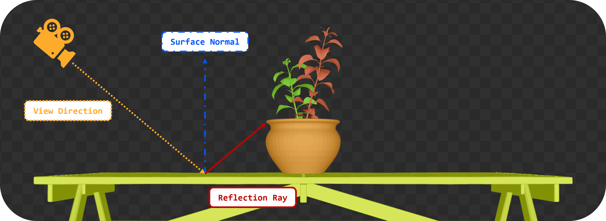
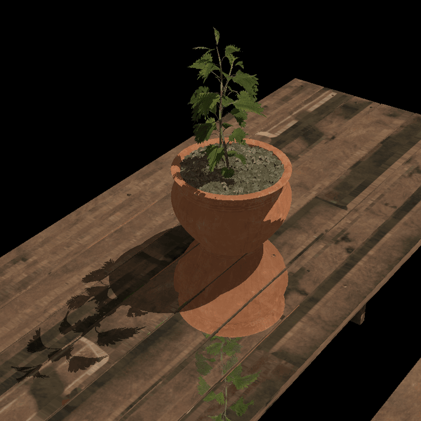

= 光线查询反射

*目标*：我们将从片元沿镜面反射方向投射光线，看看它命中什么，以此模拟反射材质（如镜子或光滑表面）。

反射的实现方式与阴影光线类似，但我们从着色点沿镜面方向投射光线，并采样命中表面的颜色。

== 任务 11：实现光线查询反射

首先，我们用推送常量把反射材质标志传给片元着色器。这样我们就能判断当前材质是否具有反射性。

假设这是一个雨天，桌面覆满了水，因此它会反射周围环境。

我们需要在渲染器中更新 `PushConstant` 结构，加入 `reflective` 标志：

[,c{pp}]
----
struct PushConstant {
    uint32_t materialIndex;
    uint32_t reflective;
};
----

在着色器中同样如此：

[,slang]
----
struct PushConstant {
    uint materialIndex;
    uint reflective;
};
[push_constant]
PushConstant pc;
----

并在发出绘制调用之前更新赋给它的值：

[,c{pp}]
----
PushConstant pushConstant = {
    .materialIndex = sub.materialID < 0 ? 0u : static_cast<uint32_t>(sub.materialID),
    .reflective = sub.reflective
};
commandBuffers[frameIndex].pushConstants<PushConstant>(pipelineLayout, vk::ShaderStageFlagBits::eFragment, 0, pushConstant);

commandBuffers[frameIndex].drawIndexed(sub.indexCount, 1, sub.indexOffset, 0, 0);
----

接着，我们在应用阴影效果之前，在片元着色器中取出它，调用一个辅助函数，根据反射光线查询就地修改片元颜色：

[,slang]
----
   float3 P = vertIn.worldPos;
   float3 N = vertIn.fragNormal;

   if (pc.reflective > 0) {
       apply_reflection(P, N, baseColor);
   }

   bool inShadow = in_shadow(P);
----

`apply_reflection()` 函数的实现将与 `in_shadow()` 函数类似。`Proceed()` 循环不再可有可无，因为我们不仅要检查是否存在交点，还需要最近命中三角形的完整颜色来应用反射效果。

注意它需要法线方向（`N`）。这是因为反射是表面法线与视线方向 `V` 的函数。反射方向 `R` 可以借助内置的 `reflect()` 函数轻松算出：

[,slang]
----
void apply_reflection(float3 P, float3 N, inout float4 baseColor) {
    // Build the reflections ray
    float3 V = normalize(ubo.cameraPos - P);
    float3 R = reflect(-V, N);
----

然后我们定义光线描述，做法与阴影时类似：

[,slang]
----
    RayDesc reflectionRayDesc;
    reflectionRayDesc.Origin = P;
    reflectionRayDesc.Direction = R;
    reflectionRayDesc.TMin = EPSILON;
    reflectionRayDesc.TMax = 1e4;
----

并初始化 `RayQuery` 对象。不过在这种情况下，我们不能使用 `RAY_FLAG_ACCEPT_FIRST_HIT_AND_END_SEARCH` 标志，因为我们需要取回最近三角形的完整颜色，而不是任意一个三角形：

[,slang]
----
    // Initialize a ray query for reflections
    RayQuery<RAY_FLAG_SKIP_PROCEDURAL_PRIMITIVES> rq;
    let rayFlags = RAY_FLAG_SKIP_PROCEDURAL_PRIMITIVES;
----

现在可以发射反射光线了：

[,slang]
----
    rq.TraceRayInline(accelerationStructure, rayFlags, 0xFF, reflectionRayDesc);
----

`Proceed()` 循环完全一样：

[,slang]
----
    while (rq.Proceed())
    {
        uint instanceID = rq.CandidateRayInstanceCustomIndex();
        uint primIndex = rq.CandidatePrimitiveIndex();

        float2 uv = intersection_uv(instanceID, primIndex, rq.CandidateTriangleBarycentrics());

        uint materialID = instanceLUTBuffer[NonUniformResourceIndex(instanceID)].materialID;
        float4 intersection_color = textures[NonUniformResourceIndex(materialID)].SampleLevel(textureSampler, uv, 0);

        if (intersection_color.a < 0.5) {
            // If the triangle is transparent, we continue to trace
            // to find the next opaque triangle.
        } else {
            // If we hit an opaque triangle, we stop tracing.
            rq.CommitNonOpaqueTriangleHit();
        }
    }

    bool hit = (rq.CommittedStatus() == COMMITTED_TRIANGLE_HIT);
----

我们唯一需要额外添加的逻辑，是取回命中三角形的颜色，并将其应用到片元的基础颜色上。注意这里的逻辑与循环中几乎相同，只是这次使用的是函数的 `Committed` 版本，而不是 `Candidate` 版本：

[,slang]
----
    if (hit)
    {
        uint instanceID = rq.CommittedRayInstanceCustomIndex();
        uint primIndex = rq.CommittedPrimitiveIndex();

        float2 uv = intersection_uv(instanceID, primIndex, rq.CommittedTriangleBarycentrics());

        uint materialID = instanceLUTBuffer[NonUniformResourceIndex(instanceID)].materialID;
        float4 intersectionColor = textures[NonUniformResourceIndex(materialID)].SampleLevel(textureSampler, uv, 0);

        baseColor.rgb = lerp(baseColor.rgb, intersectionColor.rgb, 0.7);
    }
----

TIP: 作为练习，你可以扩展这个函数：当光线没有命中场景中任何几何体、且没有已提交的三角形命中时，改为采样天空盒。

使用以下方式重新构建并运行：

[,c{pp}]
----
#define LAB_TASK_LEVEL 11
----

完成这些之后，你现在应该能在桌面上看到闪亮的反射：

== 导航
- 上一篇：xref:./05_Shadow_transparency.adoc[在阴影中实现透明度]
- 下一篇：xref:./07_Conclusion.adoc[结语]
