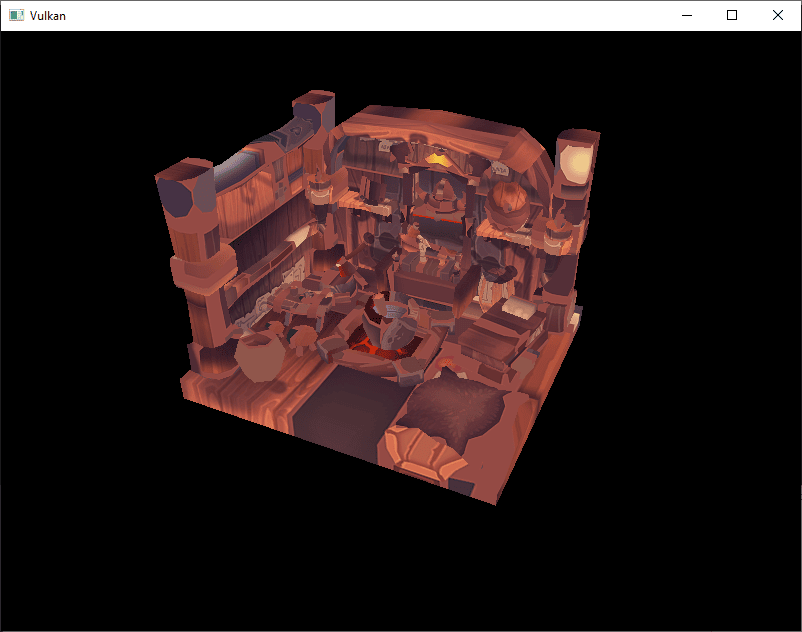
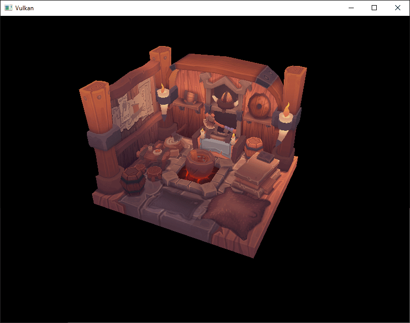

= 加载模型
:toc:
:toclevels: 3
:toc-title: 目录

== 介绍

你的程序现在可以渲染带纹理的 3D 网格了，但是当前数组中的几何体 `vertices` 和 `indices` 不太有用。在本章中，我们将扩展程序，使其能够从实际的模型文件中加载顶点和索引，从而让显卡真正发挥作用。

许多图形API教程都会在类似这样的章节中指导读者编写自己的OBJ加载器。但问题在于，任何稍微有点意思的3D应用程序很快就会需要一些OBJ文件格式不支持的功能，例如骨骼动画。本章我们将从OBJ模型加载网格数据，但重点在于如何将网格数据集成到程序本身，而不是从文件中加载数据的细节。

== 库

我们将使用 https://github.com/syoyo/tinyobjloader[tinyobjloader]库从 OBJ 文件中加载顶点和面。它速度很快，而且易于集成，因为它像 stb_image 一样是一个单文件库。这在 xref:开发环境.adoc[开发环境] 章节中已经提到过，并且应该作为本教程这一部分的依赖项之一。

== 更新片段着色器

回到 xref:纹理映射/组合图像采样器.adoc[组合图像采样器章节]，我们将采样纹理颜色乘以插值后的逐顶点颜色，以证明两者正在被组合在一起：

[source,slang]
----
return float4(vertIn.fragColor * texture.Sample(vertIn.fragTexCoord).rgb, 1.0);
----

我们即将加载的模型的光照直接烘焙到纹理中，没有设置任何有意义的顶点颜色，因此乘法运算只会将模型染成不需要的颜色。请将 `fragMain` 片段着色器改为直接采样纹理，不涉及任何顶点颜色：

[source,slang]
----
return texture.Sample(vertIn.fragTexCoord);
----

如果您跳过此步骤，则在本章结束时，模型渲染的颜色将明显错误。

== 样品网格

本章暂不启用光照，因此使用一个纹理中已烘焙光照的示例模型会很有帮助。查找此类模型的一个简单方法是在 https://sketchfab.com/[Sketchfab]上搜索 3D 扫描模型。该网站上的许多模型都以 OBJ 格式提供，并采用宽松的许可协议。

在本教程中，我决定使用 https://sketchfab.com/nigelgoh[nigelgoh] 的 https://sketchfab.com/3d-models/viking-room-a49f1b8e4f5c4ecf9e1fe7d81915ad38[维京房间]模型（ https://web.archive.org/web/20200428202538/https://sketchfab.com/3d-models/viking-room-a49f1b8e4f5c4ecf9e1fe7d81915ad38[CC BY 4.0]）。我调整了模型的大小和方向，使其可以直接替换当前的几何体：

- https://docs.vulkan.org/tutorial/latest/_attachments/assets/viking_room.obj[viking_room.obj]
- https://docs.vulkan.org/tutorial/latest/_attachments/assets/viking_room.png[viking_room.png]

您可以随意使用自己的模型，但请确保它仅包含一种材质，并且尺寸约为 1.5 x 1.5 x 1.5 个单位。如果尺寸大于此，则需要更改视图矩阵。将模型文件放在与 `models` 和 `shaders` 相邻的新目录 `textures` 中，并将纹理图像放在 `textures` 目录中。

在程序中添加两个新的配置变量，分别用于定义模型路径和纹理路径：

[source,c++]
----
constexpr uint32_t WIDTH                = 800;
constexpr uint32_t HEIGHT               = 600;
const std::string  MODEL_PATH           = "models/viking_room.obj";
const std::string  TEXTURE_PATH         = "textures/viking_room.png";
----

并更新 `createTextureImage` 以使用此路径变量：

[source,c++]
----
stbi_uc* pixels = stbi_load(TEXTURE_PATH.c_str(), &texWidth, &texHeight, &texChannels, STBI_rgb_alpha);
----

== 加载顶点和索引

现在我们要从模型文件中加载顶点和索引，所以你应该移除全局变量 `vertices` 和 `indices` 数组。将它们替换为作为类成员的非 const 容器：

[source,c++]
----
std::vector<Vertex>    vertices;
std::vector<uint32_t>  indices;
vk::raii::Buffer       vertexBuffer       = nullptr;
vk::raii::DeviceMemory vertexBufferMemory = nullptr;
vk::raii::Buffer       indexBuffer        = nullptr;
vk::raii::DeviceMemory indexBufferMemory  = nullptr;
----

你应该将索引的类型从 `uint16_t` 更改为 `uint32_t`，因为顶点数将远大于 65535。这种略显复杂的构造 `vk::IndexTypeValue<decltype(indices)::value_type>::value` 会自动获取索引的类型。

[source,c++]
----
commandBuffer.bindIndexBuffer(*indexBuffer, 0, vk::IndexTypeValue<decltype(indices)::value_type>::value);
----

tinyobjloader 库的引入方式与 STB 库相同。引入 `tiny_obj_loader.h` 文件，并确保 `TINYOBJLOADER_IMPLEMENTATION` 在同一个源文件中定义它，以便包含函数体并避免链接器错误：

[source,c++]
----
#define TINYOBJLOADER_IMPLEMENTATION
#include <tiny_obj_loader.h>
----

现在我们将编写一个 `loadModel` 函数，使用该库将网格中的顶点数据填充到 `vertices` 和 `indices` 容器中。该函数应该在创建顶点缓冲区和索引缓冲区之前调用：

[source,c++]
----
void initVulkan()
{
    ...
    loadModel();
    createVertexBuffer();
    createIndexBuffer();
    ...
}

...

void loadModel()
{
}
----

通过调用以下函数将模型加载到库的数据结构 `tinyobj::LoadObj` 中：

[source,c++]
----
void loadModel()
{
		tinyobj::attrib_t                attrib;
		std::vector<tinyobj::shape_t>    shapes;
		std::vector<tinyobj::material_t> materials;
		std::string                      warn, err;

		if (!tinyobj::LoadObj(&attrib, &shapes, &materials, &warn, &err, MODEL_PATH.c_str()))
		{
			throw std::runtime_error(warn + err);
		}
}
----

OBJ 文件包含位置、法线、纹理坐标和面。面由任意数量的顶点组成，每个顶点通过索引指向一个位置、法线和/或纹理坐标。这使得不仅可以重用整个顶点，还可以重用单个属性。

容器 `attrib` 在其向量中存储所有位置、法线和纹理坐标 `attrib.texcoords`。容器包含所有独立的对象及其面。每个面由一个顶点数组 组成，每个顶点包含位置、法线和纹理坐标属性的索引 `attrib.normals` 。OBJ 模型还可以为每个面 `attrib.vertices` 定义材质和纹理，但我们将忽略这些 `shapes`。

该字符串包含加载文件时出现的 `err` 错误和警告 `warn`，例如缺少材质定义。只有当函数返回空值时，加载才真正失败。如上所述，OBJ 文件中的面实际上可以包含任意数量的顶点，而我们的应用程序只能渲染三角形。幸运的是，该函数有一个可选参数 `LoadObj` 可以自动对这些面进行三角剖分，并且默认情况下已启用。

我们将把文件中的所有面部合并成一个模型，所以只需遍历所有形状即可：

[source,c++]
----
for (const auto& shape : shapes)
{
}
----

三角剖分功能已经确保每个面有三个顶点，因此我们现在可以直接遍历顶点并将它们直接放入我们的 `vertices` 向量中：

[source,c++]
----
for (const auto& shape : shapes)
{
    for (const auto& index : shape.mesh.indices)
    {
        Vertex vertex{};

        vertices.push_back(vertex);
        indices.push_back(indices.size());
    }
}
----

为简单起见，我们暂时假设每个顶点都是唯一的，因此使用简单的自增索引。`index` 变量的类型为 `tinyobj::index_t` ，包含 `vertex_index` 、`normal_index` 和 `texcoord_index` 成员。我们需要使用这些索引在数组 `attrib` 中查找实际的顶点属性：

[source,c++]
----
vertex.pos = {
    attrib.vertices[3 * index.vertex_index + 0],
    attrib.vertices[3 * index.vertex_index + 1],
    attrib.vertices[3 * index.vertex_index + 2]
};

vertex.texCoord = {
    attrib.texcoords[2 * index.texcoord_index + 0],
    attrib.texcoords[2 * index.texcoord_index + 1]
};

vertex.color = {1.0f, 1.0f, 1.0f};
----

遗憾的是，该 `attrib.vertices` 数组是一个值数组，而不是类似 `float` 数组的形式，因此您需要将索引乘以 `3`。同样，每个 `glm::vec3` 条目都有两个纹理坐标分量。偏移量 `0`、`1` 和 `2` 用于访问 X、Y 和 Z 分量，或者在纹理坐标的情况下访问 U 和 V 分量。

现在运行你的程序，你应该会看到类似以下内容：

很好，几何形状看起来没问题，但是纹理出了什么问题？OBJ 格式假定的坐标系中，垂直坐标的某个值0表示图像底部，但我们上传到 Vulkan 的图像方向却是从上到下，也就是说，某个0值表示图像顶部。解决方法是翻转纹理坐标的垂直分量：

[source,c++]
----
vertex.texCoord = {
    attrib.texcoords[2 * index.texcoord_index + 0],
    1.0f - attrib.texcoords[2 * index.texcoord_index + 1]
};
----

再次运行程序后，您应该会看到正确的结果：

所有的努力终于开始有了回报，这样的演示视频就是最好的证明！

NOTE: 当模型旋转时，您可能会注意到背面（墙壁的背面）看起来有点奇怪。这是正常的，因为该模型的设计初衷并非从该侧观看。

== 顶点去重

遗憾的是，我们目前还没有充分利用索引缓冲区。`vertices` 向量中包含大量重复的顶点数据，因为许多顶点包含在多个三角形中。我们应该只保留唯一的顶点，并在需要时使用索引缓冲区来重用它们。一种直接的实现方法是使用一个 `map` 索引 `unordered_map` 来跟踪唯一的顶点及其对应的索引：

[source,c++]
----
#include <unordered_map>

...

std::unordered_map<Vertex, uint32_t> uniqueVertices{};

for (const auto& shape : shapes)
{
    for (const auto& index : shape.mesh.indices)
    {
        Vertex vertex{};

        ...

				auto [it, inserted] = uniqueVertices.insert({vertex, static_cast<uint32_t>(vertices.size())});
				if (inserted)
				{
            vertices.push_back(vertex);
				}

				indices.push_back(it->second);
    }
}
----

每次从 OBJ 文件读取顶点时，我们都会插入一个顶点 `{ vertex, index }` 对，其中索引是 `vertices` 数组的当前大小。只有当顶点确实存在时， `inserted` 索引值才会被设置。否则，`vertex` 映射中该顶点的索引不会改变。如果顶点存在 `inserted`，我们会将其存储在映射中 `vertices`。无论如何，该顶点在 `vertices` 映射中的索引都会被添加到 `indices` 映射中。

程序现在无法编译，因为使用像我们自定义的 `Vertex` 结构体这样的类型作为哈希表的键需要我们实现两个函数：相等性测试和哈希计算。相等性测试很容易实现，只需重载结构体 `Vertex` 的 `==` 中的运算符即可：

[source,c++]
----
bool operator==(const Vertex& other) const
{
    return pos == other.pos && color == other.color && texCoord == other.texCoord;
}
----

`Vertex` 哈希函数的实现是通过指定一个模板特化来实现的 `std::hash<T>`。哈希函数是一个复杂的主题，但 https://en.cppreference.com/w/cpp/utility/hash[cppreference.com 推荐]以下方法，即组合结构体的字段来创建一个质量不错的哈希函数：

[source,c++]
----
namespace std
{
    template<> struct hash<Vertex>
    {
        size_t operator()(Vertex const& vertex) const
        {
            return ((hash<glm::vec3>()(vertex.pos) ^ (hash<glm::vec3>()(vertex.color) << 1)) >> 1) ^ (hash<glm::vec2>()(vertex.texCoord) << 1);
        }
    };
}
----

这段代码应该放在 `Vertex` 结构体之外。GLM 类型的哈希函数需要使用以下头文件引入：

[source,c++]
----
#define GLM_ENABLE_EXPERIMENTAL
#include <glm/gtx/hash.hpp>
----

哈希函数定义在 `gtx` 文件夹中，这意味着它目前仍是 GLM 的一个实验性扩展。因此，您需要进行相应的定义 `GLM_ENABLE_EXPERIMENTAL` 才能使用它。这意味着 API 可能会随着未来 GLM 版本的更新而发生变化，但实际上，该 API 非常稳定。

现在你应该能够成功编译并运行你的程序了。如果你检查一下文件的大小 `vertices`，你会发现它已经从 11,484 缩小到了 3,566！这意味着每个顶点平均在约 3 个三角形中被重复使用。这无疑节省了大量的 GPU 内存。

xref:生成Mipmap.adoc[下一章]，我们将学习一种改进纹理渲染的技术。

