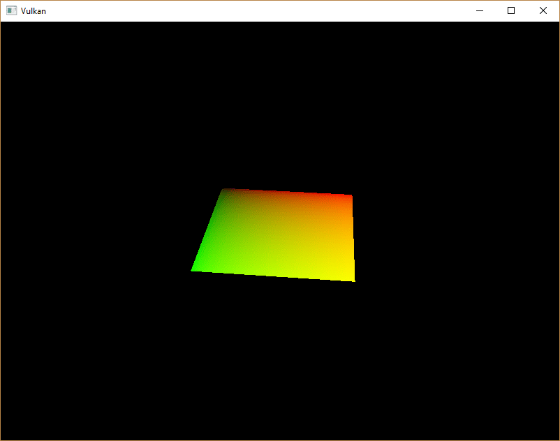
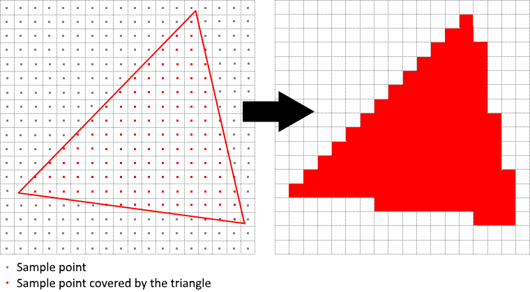
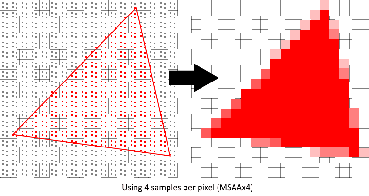
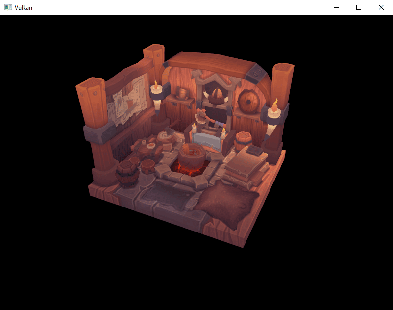
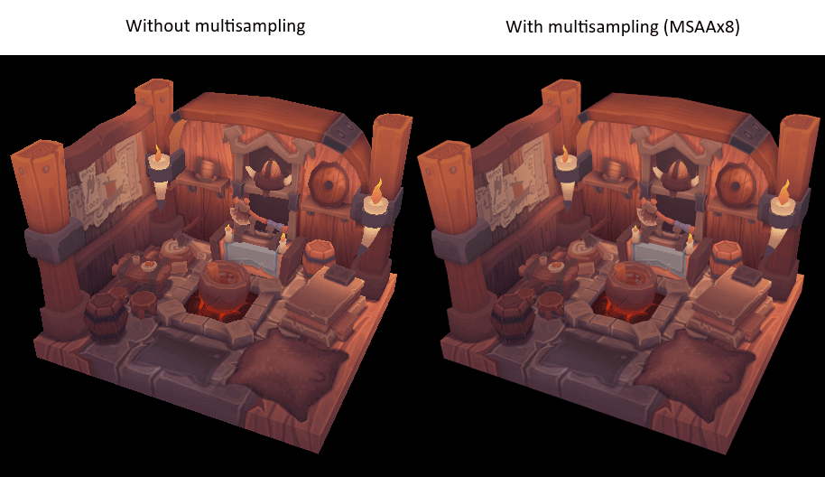
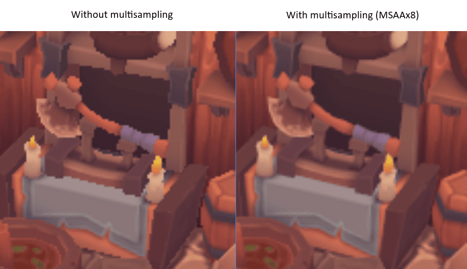
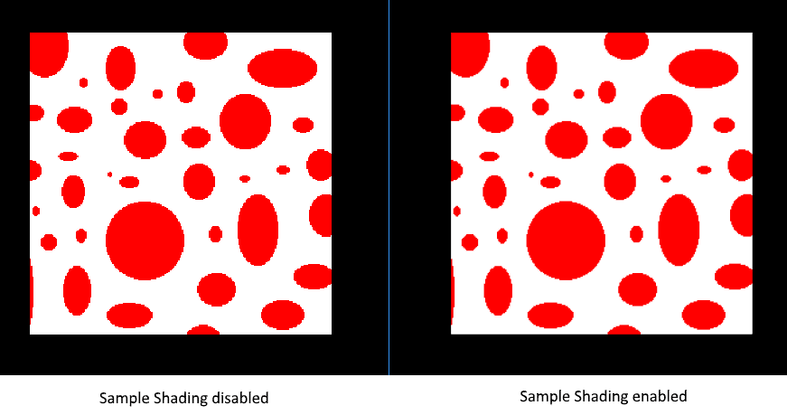

= 多重采样
:toc:
:toclevels: 3
:toc-title: 目录

== 介绍

我们的程序现在可以加载多级纹理细节，从而修复渲染远处物体时出现的瑕疵。图像现在平滑了很多；但是，仔细观察，你会发现绘制的几何图形边缘存在锯齿状的图案。在我们早期的一个程序中，渲染四边形时，这种现象尤为明显：

这种不良效果称为“锯齿”，是由于可用于渲染的像素数量有限造成的。由于目前还没有分辨率无限大的显示器，因此锯齿现象总是会在一定程度上存在。有很多方法可以解决这个问题，本章我们将重点介绍其中一种比较常用的方法： https://en.wikipedia.org/wiki/Multisample_anti-aliasing[多重采样抗锯齿]（MSAA）。

在普通渲染中，像素颜色是根据单个采样点确定的，该采样点通常是屏幕上目标像素的中心。如果绘制的线条的一部分穿过某个像素但没有覆盖采样点，则该像素将留空，从而导致锯齿状的“阶梯”效果。

MSAA（多级抗锯齿）的原理是使用每个像素的多个采样点（因此得名）来确定其最终颜色。正如人们所预期的，采样点越多，结果越好，但计算量也更大。

在我们的实现方案中，我们将着重使用尽可能多的可用样本数。但根据您的具体应用，这可能并非总是最佳方案。如果最终结果能够满足您的质量要求，那么为了获得更高的性能，使用较少的样本数或许更为合适。

== 获取可用样本数量

首先，我们需要确定硬件可以使用多少个采样点。大多数现代 GPU 至少支持八个采样点，但并非所有地方都支持相同的采样点数。我们将通过添加一个新的类成员来跟踪这个值：

[source,c++]
----
...
vk::SampleCountFlagBits msaaSamples = vk::SampleCountFlagBits::e1;
...
----

默认情况下，每个像素只使用一个样本，相当于不进行多重采样，在这种情况下，最终图像将保持不变。可以从 `vk::PhysicalDeviceProperties` 所选物理设备中提取的最大样本数。我们还使用了深度缓冲区，因此必须同时考虑颜色和深度的样本数。两者均支持的最大样本数即为我们能够支持的最大样本数。请添加一个函数来获取此信息：

[source,c++]
----
vk::SampleCountFlagBits getMaxUsableSampleCount()
{
  vk::PhysicalDeviceProperties physicalDeviceProperties = physicalDevice->getProperties();

  vk::SampleCountFlags counts = physicalDeviceProperties.limits.framebufferColorSampleCounts & physicalDeviceProperties.limits.framebufferDepthSampleCounts;
  if (counts & vk::SampleCountFlagBits::e64) { return vk::SampleCountFlagBits::e64; }
  if (counts & vk::SampleCountFlagBits::e32) { return vk::SampleCountFlagBits::e32; }
  if (counts & vk::SampleCountFlagBits::e16) { return vk::SampleCountFlagBits::e16; }
  if (counts & vk::SampleCountFlagBits::e8) { return vk::SampleCountFlagBits::e8; }
  if (counts & vk::SampleCountFlagBits::e4) { return vk::SampleCountFlagBits::e4; }
  if (counts & vk::SampleCountFlagBits::e2) { return vk::SampleCountFlagBits::e2; }

  return vk::SampleCountFlagBits::e1;
}
----

现在我们将使用此函数在物理设备选择过程中设置 `msaaSamples` 变量。为此，我们对该 `pickPhysicalDevice` 函数稍作扩展：

[source,c++]
----
void pickPhysicalDevice()
{
  ...
  physicalDevice = *devIter;
  msaaSamples    = getMaxUsableSampleCount();
  ...
}
----

== 设置渲染目标

在 MSAA 中，每个像素都会被采样到一个离屏缓冲区，然后再渲染到屏幕上。这个新的缓冲区与我们之前渲染的常规图像略有不同——它必须能够存储每个像素的多个采样值。创建多重采样缓冲区后，必须将其解析为默认帧缓冲区（每个像素仅存储一个采样值）。这就是为什么我们需要创建一个额外的渲染目标并修改当前的绘制流程。我们只需要一个渲染目标，因为一次只能进行一个绘制操作，就像深度缓冲区一样。添加以下类成员：

[source,c++]
----
...
vk::raii::Image        colorImage       = nullptr;
vk::raii::DeviceMemory colorImageMemory = nullptr;
vk::raii::ImageView    colorImageView   = nullptr;
...
----

这张新图像需要存储每个像素所需的采样数，因此我们需要 `vk::ImageCreateInfo` 在图像创建过程中传递这个数值。修改 `createImage` 函数，添加一个 `numSamples` 参数：

[source,c++]
----
std::pair<vk::raii::Image, vk::raii::DeviceMemory>
    createImage(uint32_t                width,
                uint32_t                height,
                uint32_t                mipLevels,
                vk::SampleCountFlagBits numSamples,
                vk::Format              format,
                vk::ImageTiling         tiling,
                vk::ImageUsageFlags     usage,
                vk::MemoryPropertyFlags properties)
{
  vk::ImageCreateInfo imageInfo{.imageType     = vk::ImageType::e2D,
                                .format        = format,
                                .extent        = {width, height, 1},
                                .mipLevels     = mipLevels,
                                .arrayLayers   = 1,
                                .samples       = numSamples,
                                .tiling        = tiling,
                                .usage         = usage,
                                .sharingMode   = vk::SharingMode::eExclusive,
                                .initialLayout = vk::ImageLayout::eUndefined};
    ...
----

目前，请使用以下代码更新所有对此函数的调用 `vk::SampleCountFlagBits::e1` ——随着实现的进行，我们将用正确的值替换这些代码：

[source,c++]
----
std::tie(depthImage, depthImageMemory) = createImage(swapChainExtent.width,
                                                     swapChainExtent.height,
                                                     1,
                                                     vk::SampleCountFlagBits::e1,
                                                     depthFormat,
                                                     vk::ImageTiling::eOptimal,
                                                     vk::ImageUsageFlagBits::eDepthStencilAttachment,
                                                     vk::MemoryPropertyFlagBits::eDeviceLocal);
...
std::tie(textureImage, textureImageMemory) =
    createImage(texWidth,
                texHeight,
                mipLevels,
                vk::SampleCountFlagBits::e1,
                vk::Format::eR8G8B8A8Srgb,
                vk::ImageTiling::eOptimal,
                vk::ImageUsageFlagBits::eTransferSrc | vk::ImageUsageFlagBits::eTransferDst | vk::ImageUsageFlagBits::eSampled,
                vk::MemoryPropertyFlagBits::eDeviceLocal);
----

现在我们将创建一个多重采样颜色缓冲区。添加一个 `createColorResources` 函数，并注意 `msaaSamples` 这里我们将其作为函数参数传递给 `createImage`。我们也只使用一个 mip 级别，因为 Vulkan 规范强制要求每个像素采样数超过一个的图像只能使用一个 mip 级别。此外，由于此颜色缓冲区不会用作纹理，因此不需要 mipmap。

[source,c++]
----
void createColorResources()
{
  vk::Format colorFormat = swapChainSurfaceFormat.format;

  std::tie(colorImage, colorImageMemory) = createImage(swapChainExtent.width,
                                                       swapChainExtent.height,
                                                       1,
                                                       msaaSamples,
                                                       colorFormat,
                                                       vk::ImageTiling::eOptimal,
                                                       vk::ImageUsageFlagBits::eTransientAttachment | vk::ImageUsageFlagBits::eColorAttachment,
                                                       vk::MemoryPropertyFlagBits::eDeviceLocal);
  colorImageView                         = createImageView(colorImage, colorFormat, vk::ImageAspectFlagBits::eColor, 1);
}
----

为了保持一致性，请在调用函数之前立即调用 `createDepthResources`：

[source,c++]
----
void initVulkan()
{
  ...
  createColorResources();
  createDepthResources();
  ...
}
----

现在我们已经有了多重采样颜色缓冲区，接下来需要处理深度信息。修改 `createDepthResources` 并更新深度缓冲区使用的采样数：

[source,c++]
----
void createDepthResources()
{
  ...
  std::tie(depthImage, depthImageMemory) = createImage(swapChainExtent.width,
                                                       swapChainExtent.height,
                                                       1,
                                                       msaaSamples,
                                                       depthFormat,
                                                       vk::ImageTiling::eOptimal,
                                                       vk::ImageUsageFlagBits::eDepthStencilAttachment,
                                                       vk::MemoryPropertyFlagBits::eDeviceLocal);
  ...
}
----

并进行更新，`recreateSwapChain` 以便在窗口大小调整时能够以正确的分辨率重新创建新的彩色图像：

[source,c++]
----
void recreateSwapChain()
{
  ...
  createImageViews();
  createColorResources();
  createDepthResources();
  ...
}
----

我们已经完成了 MSAA 的初始设置，现在我们需要开始在图形管线中使用这种新资源，看看效果如何！

== 使用新附件

首先，通过修改以下代码 `createGraphicsPipeline` 告诉图形管线使用多个样本：

[source,c++]
----
void createGraphicsPipeline()
{
  ...
  vk::PipelineMultisampleStateCreateInfo multisampling{.rasterizationSamples = msaaSamples};
  ...
}
----

然后我们需要扩展 `recordCommandBuffer`。除了将 `swapChainImages[imageIndex]` 和 `depthImage` 分别从 `vk::ImageLayout::eUndefined` 过渡到 `vk::ImageLayout::eColorAttachmentOptimal` 和 `vk::ImageLayout::eDepthAttachmentOptimal` 之外，我们还需要将新的多重采样 `colorImage` 从 `vk::ImageLayout::eUndefined` 过渡到 `vk::ImageLayout::eColorAttachmentOptimal`：

[source,c++]
----
void recordCommandBuffer(uint32_t imageIndex)
{
  ...
  // Transition the multisampled color image to vk::ImageLayout::eColorAttachmentOptimal
  transition_image_layout(
      *colorImage,
      vk::ImageLayout::eUndefined,
      vk::ImageLayout::eColorAttachmentOptimal,
      vk::AccessFlagBits2::eColorAttachmentWrite,
      vk::AccessFlagBits2::eColorAttachmentWrite,
      vk::PipelineStageFlagBits2::eColorAttachmentOutput,
      vk::PipelineStageFlagBits2::eColorAttachmentOutput,
      vk::ImageAspectFlagBits::eColor);
  ...
}
----

接下来，在调用 `vk::CommandBuffer::beginRendering` 时，`vk::RenderingInfo` 中的颜色附件不再使用 `swapChainImageViews[imageIndex]`，而是使用 `colorImageView`，并将 `swapChainImageViews[imageIndex]` 用作解析图像视图（resolve image view），解析模式使用 `vk::ResolveModeFlagBits::eAverage`：

[source,c++]
----
void recordCommandBuffer(uint32_t imageIndex)
{
  ...
  // Color attachment (multisampled) with resolve attachment
  vk::RenderingAttachmentInfo colorAttachment = {
      .imageView          = colorImageView,
      .imageLayout        = vk::ImageLayout::eColorAttachmentOptimal,
      .resolveMode        = vk::ResolveModeFlagBits::eAverage,
      .resolveImageView   = swapChainImageViews[imageIndex],
      .resolveImageLayout = vk::ImageLayout::eColorAttachmentOptimal,
      .loadOp             = vk::AttachmentLoadOp::eClear,
      .storeOp            = vk::AttachmentStoreOp::eStore,
      .clearValue         = clearColor};
  ...
}
----

现在运行你的程序，你应该会看到以下内容：

就像使用 mipmapping 一样，这种差异可能不会立即显现。仔细观察后，你会发现边缘不再那么锯齿状，整个图像看起来比原图更加平滑。

近距离观察边缘时，这种差异更加明显：

== 质量改进

我们目前的 MSAA 实现存在一些局限性，可能会影响更复杂场景下的输出图像质量。例如，我们目前尚未解决着色器锯齿可能导致的问题，也就是说，MSAA 只能平滑几何体的边缘，而无法平滑内部填充。这可能导致这样的情况：屏幕上渲染的多边形很平滑，但如果纹理包含高对比度的颜色，则应用的纹理仍然会出现锯齿。解决此问题的一种方法是启用 https://docs.vulkan.org/spec/latest/chapters/vertexpostproc.html#primsrast-sampleshading[采样着色]，这将进一步提高图像质量，但会增加性能开销：

[source,c++]
----
void createLogicalDevice()
{
  ...
  vk::StructureChain<vk::PhysicalDeviceFeatures2, vk::PhysicalDeviceVulkan13Features, vk::PhysicalDeviceExtendedDynamicStateFeaturesEXT> featureChain = {
      {.features = {.sampleRateShading = vk::True, .samplerAnisotropy = vk::True}},        // vk::PhysicalDeviceFeatures2
  ...
}

void createGraphicsPipeline()
{
  ...
  vk::PipelineMultisampleStateCreateInfo multisampling{
      .rasterizationSamples = msaaSamples,
      .sampleShadingEnable  = vk::True,        // enable sample shading in the pipeline
      .minSampleShading     = 0.2f             // min fraction for sample shading; closer to one is smoother
  };
  ...
}
----

在这个例子中，我们将禁用采样阴影功能，但在某些情况下，质量提升可能会很明显：

== 下一步

走到今天这一步需要付出很多努力，但现在你终于为 Vulkan 程序打下了良好的基础。但这并非本系列教程的终点——你现在掌握的 Vulkan 基本原理足以让你开始探索更多功能，例如：

- 在 xref:渲染多个对象.adoc[渲染多个对象]一节中，我们简要介绍了推送常量和实例化渲染。
- xref:多线程.adoc[多线程命令缓冲区生成]
- xref:计算着色器.adoc[计算着色器]
- 动态 uniform 变量、独立的图像和采样器描述符、流水线缓存以及多子通道——这些内容本系列文章未涵盖，但在 Khronos 维护的 https://github.com/KhronosGroup/Vulkan-Samples[Vulkan-Samples]代码库中有演示。

当前的程序可以通过多种方式进行扩展，例如添加 Blinn-Phong 光照、后期处理效果和阴影贴图。您应该可以从其他 API 的教程中学习这些效果的工作原理，因为尽管 Vulkan 的描述非常明确，但许多概念仍然适用。
