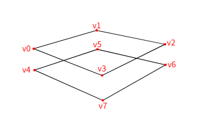
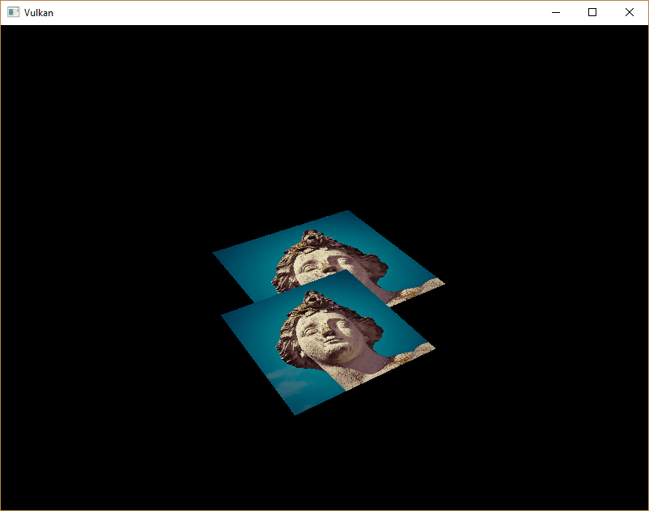
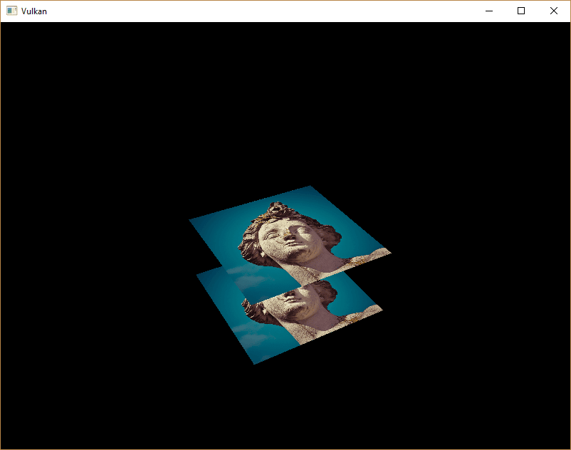

= 深度缓冲
:toc:
:toclevels: 3
:toc-title: 目录

== 介绍

我们目前处理的几何体虽然投影到了三维空间，但仍然是完全平面的。本章中，我们将为位置添加 Z 坐标，以便为三维网格做好准备。我们将使用这个第三个坐标在当前正方形上放置一个正方形，从而观察当几何体未按深度排序时会出现的问题。

== 三维几何

将结构体 `Vertex` 更改为使用 3D 向量表示位置，并更新 `format` 相应的 `vk::VertexInputAttributeDescription`：

[source,c++]
----
struct Vertex {
    glm::vec3 pos;
    glm::vec3 color;
    glm::vec2 texCoord;

    ...

    static std::array<vk::VertexInputAttributeDescription, 3> getAttributeDescriptions() {
        return {
            vk::VertexInputAttributeDescription(0, 0, vk::Format::eR32G32B32Sfloat, offsetof(Vertex, pos)),
            vk::VertexInputAttributeDescription(1, 0, vk::Format::eR32G32B32Sfloat, offsetof(Vertex, color)),
            vk::VertexInputAttributeDescription(2, 0, vk::Format::eR32G32Sfloat, offsetof(Vertex, texCoord))
        };

        ...
    }
};
----

接下来，更新顶点着色器，使其能够接受并转换 3D 坐标作为输入，方法是将 `inPosition` 类型从 `float2` 更改为 `float3`：

[source,slang]
----
struct VSInput {
    float3 inPosition;
    ...
};

...

[shader("vertex")]
VSOutput vertMain(VSInput input) {
    VSOutput output;
    output.pos = mul(ubo.proj, mul(ubo.view, mul(ubo.model, float4(input.inPosition, 1.0))));
    output.fragColor = input.inColor;
    output.fragTexCoord = input.inTexCoord;
    return output;
}
----

之后记得重新编译着色器！

最后，更新 `vertices` 容器以包含 Z 坐标：

[source,c++]
----
const std::vector<Vertex> vertices = {
    {{-0.5f, -0.5f, 0.0f}, {1.0f, 0.0f, 0.0f}, {0.0f, 0.0f}},
    {{0.5f, -0.5f, 0.0f}, {0.0f, 1.0f, 0.0f}, {1.0f, 0.0f}},
    {{0.5f, 0.5f, 0.0f}, {0.0f, 0.0f, 1.0f}, {1.0f, 1.0f}},
    {{-0.5f, 0.5f, 0.0f}, {1.0f, 1.0f, 1.0f}, {0.0f, 1.0f}}
};
----

现在运行应用程序，应该会看到与之前完全相同的结果。现在是时候添加一些额外的几何体，让场景更有趣，并演示我们将在本章中解决的问题。复制顶点，定义一个位于当前正方形正下方的正方形的位置，如下所示：

使用 Z 坐标 `-0.5f` 并添加额外正方形的相应索引：

[source,c++]
----
const std::vector<Vertex> vertices = {
    {{-0.5f, -0.5f, 0.0f}, {1.0f, 0.0f, 0.0f}, {0.0f, 0.0f}},
    {{0.5f, -0.5f, 0.0f}, {0.0f, 1.0f, 0.0f}, {1.0f, 0.0f}},
    {{0.5f, 0.5f, 0.0f}, {0.0f, 0.0f, 1.0f}, {1.0f, 1.0f}},
    {{-0.5f, 0.5f, 0.0f}, {1.0f, 1.0f, 1.0f}, {0.0f, 1.0f}},

    {{-0.5f, -0.5f, -0.5f}, {1.0f, 0.0f, 0.0f}, {0.0f, 0.0f}},
    {{0.5f, -0.5f, -0.5f}, {0.0f, 1.0f, 0.0f}, {1.0f, 0.0f}},
    {{0.5f, 0.5f, -0.5f}, {0.0f, 0.0f, 1.0f}, {1.0f, 1.0f}},
    {{-0.5f, 0.5f, -0.5f}, {1.0f, 1.0f, 1.0f}, {0.0f, 1.0f}}
};

const std::vector<uint16_t> indices = {
    0, 1, 2, 2, 3, 0,
    4, 5, 6, 6, 7, 4
};
----

现在运行你的程序，你会看到类似埃舍尔插画的画面：

问题在于，由于下方正方形在索引数组中的位置靠后，其碎片会被绘制到上方正方形的碎片之上。有两种方法可以解决这个问题：

- 将所有抽牌调用按深度从后到前排序
- 使用深度缓冲区进行深度测试。

第一种方法通常用于绘制透明对象，因为顺序无关的透明度是一个难以解决的难题。然而，按深度对片段进行排序的问题通常使用深度缓冲区来解决。深度缓冲区是一个额外的附件，它存储每个位置的深度，就像颜色附件存储每个位置的颜色一样。每次光栅化器生成一个片段时，深度测试都会检查新片段是否比前一个片段更近。如果不是，则丢弃新片段。通过深度测试的片段会将自身的深度写入深度缓冲区。可以像操作颜色输出一样，从片段着色器中操作此值。

[source,c++]
----
#define GLM_FORCE_DEPTH_ZERO_TO_ONE
#include <glm/glm.hpp>
#include <glm/gtc/matrix_transform.hpp>
----

GLM 生成的透视投影矩阵默认使用 OpenGL 的深度范围 `-1.0` 到 `1.0`。我们需要通过配置 `GLM_FORCE_DEPTH_ZERO_TO_ONE` 使其使用 Vulkan 的深度 `0.0` 到 `1.0` 范围。

== 深度图像和视图

深度附件和颜色附件一样，都是基于图像的。区别在于，交换链不会自动为我们创建深度图像。我们只需要一张深度图像，因为一次只能运行一个绘制操作。深度图像同样需要图像、内存和图像视图这三者资源。

[source,c++]
----
vk::raii::Image        depthImage       = nullptr;
vk::raii::DeviceMemory depthImageMemory = nullptr;
vk::raii::ImageView    depthImageView   = nullptr;
----

创建一个新函数 `createDepthResources` 来设置这些资源：

[source,c++]
----
void initVulkan()
{
    ...
    createCommandPool();
    createDepthResources();
    createTextureImage();
    ...
}

...

void createDepthResources()
{
}
----

创建深度图像相当简单。它应该与彩色附件具有相同的分辨率（由交换链范围决定），图像使用方式应适合深度附件，并采用最佳的平铺方式和设备本地内存。唯一的问题是：深度图像的正确格式是什么？该格式必须包含深度分量，`vk::Format` 中的 `D??`。

与纹理图像不同，我们并不一定需要特定的格式，因为我们不会直接从程序访问纹素。它只需要具有合理的精度，在实际应用中至少需要 24 位。有几种格式符合此要求：

- `vk::Format::eD32Sfloat`：32 位浮点数表示深度

- `vk::Format::eD32SfloatS8Uint`：深度采用 32 位有符号浮点数，模板分量采用 8 位浮点数。

- `vk::Format::eD24UnormS8Uint`：深度采用 24 位浮点数，模板分量采用 8 位浮点数。

模板组件用于 https://en.wikipedia.org/wiki/Stencil_buffer[模板测试]，这是一种可以与深度测试结合使用的附加测试。我们将在后续章节中详细介绍。

我们可以直接采用这种 `vk::Format::eD32Sfloat` 格式，因为它的支持非常普遍（参见硬件数据库），但尽可能为我们的应用程序增加一些额外的灵活性总是好的。我们将编写一个函数 `findSupportedFormat`，该函数接受一个候选格式列表，并按从最理想到最不理想的顺序排列，然后检查哪个格式是第一个被支持的：

[source,c++]
----
vk::Format findSupportedFormat(const std::vector<vk::Format>& candidates, vk::ImageTiling tiling, vk::FormatFeatureFlags features)
{
}
----

格式支持情况取决于平铺模式和使用方式，因此我们也必须将这些作为参数包含在内。可以使用以下 `physicalDevice.getFormatProperties` 函数查询格式支持情况：

[source,c++]
----
for (const auto format : candidates) {
    vk::FormatProperties props = physicalDevice.getFormatProperties(format);
}
----

该 `vk::FormatProperties` 结构体包含三个字段：

- linearTilingFeatures ：线性平铺支持的用例。
- optimalTilingFeatures：支持最佳平铺效果的使用场景。
- bufferFeatures：缓冲区支持的用例。

这里只有前两个相关，而我们要检查哪一个取决于 `tiling` 函数的参数：

[source,c++]
----
if (((tiling == vk::ImageTiling::eLinear) && ((props.linearTilingFeatures & features) == features)) ||
    ((tiling == vk::ImageTiling::eOptimal) && ((props.optimalTilingFeatures & features) == features)))
{
    return format;
}
----

如果所有候选格式都不支持所需的用法，那么我们可以返回一个特殊值，或者直接抛出异常：

[source,c++]
----
vk::Format findSupportedFormat(const std::vector<vk::Format>& candidates, vk::ImageTiling tiling, vk::FormatFeatureFlags features) {
    for (const auto format : candidates) {
        vk::FormatProperties props = physicalDevice.getFormatProperties(format);

        if (((tiling == vk::ImageTiling::eLinear) && ((props.linearTilingFeatures & features) == features)) ||
            ((tiling == vk::ImageTiling::eOptimal) && ((props.optimalTilingFeatures & features) == features)))
        {
          return format;
        }
    }

    throw std::runtime_error("failed to find supported format!");
}
----

现在我们将使用这个函数创建一个 `findDepthFormat` 辅助函数，用于选择支持用作深度附件的深度组件格式：

[source,c++]
----
vk::Format findDepthFormat()
{
    return findSupportedFormat({vk::Format::eD32Sfloat, vk::Format::eD32SfloatS8Uint, vk::Format::eD24UnormS8Uint},
                               vk::ImageTiling::eOptimal,
                               vk::FormatFeatureFlagBits::eDepthStencilAttachment);
}
----

在这种情况下，请务必使用 `vk::FormatFeatureFlagBits` 而不是 `vk::ImageUsageFlagBits`。所有这些候选格式都包含深度组件，但后两种格式还包含模板组件。我们暂时不会用到模板组件，但在对这些格式的图像进行布局过渡时，确实需要考虑它。`vulkan_format_traits.hpp` 头文件提供了一些简单的辅助函数，例如 `vk::hasDepthComponent` 或 `vk::hasStencilComponentvulkan`。

`createDepthResources` 调用该函数从以下位置查找深度格式：

[source,c++]
----
vk::Format depthFormat = findDepthFormat();
----

我们现在拥有调用我们的辅助函数 `createImage` 和 `createImageView` 所需的所有信息：

[source,c++]
----
std::tie(depthImage, depthImageMemory) = createImage(swapChainExtent.width, swapChainExtent.height, depthFormat, vk::ImageTiling::eOptimal, vk::ImageUsageFlagBits::eDepthStencilAttachment, vk::MemoryPropertyFlagBits::eDeviceLocal);
depthImageView                         = createImageView(depthImage, depthFormat, vk::ImageAspectFlagBits::eDepth);
----

但是，`createImageView` 函数目前假定子资源始终是 `vk::ImageAspectFlagBits::eColor`，因此我们需要将该字段转换为参数：

[source,c++]
----
vk::raii::ImageView createImageView(vk::raii::Image& image, vk::Format format, vk::ImageAspectFlags aspectFlags)
{
    ...
		vk::ImageViewCreateInfo viewInfo{
        ...
		    .subresourceRange = {.aspectMask = aspectFlags, ...}};
    ...
}
----

更新所有对此函数的调用，使其使用正确的方面：

[source,c++]
----
swapChainImageViews.emplace_back(createImageView(image, swapChainSurfaceFormat.format, vk::ImageAspectFlagBits::eColor));
...
depthImageView = createImageView(depthImage, depthFormat, vk::ImageAspectFlagBits::eDepth);
...
textureImageView = createImageView(*textureImage, vk::Format::eR8G8B8A8Srgb, vk::ImageAspectFlagBits::eColor);
----

深度图像的创建就完成了。我们不需要映射它或将另一张图像复制到它上面，因为我们会在命令缓冲区开始时像清除颜色附件一样清除它。

== 命令缓冲区

=== 清除值

由于现在有多个附件需要清除 `vk::AttachmentLoadOp::eClear` 颜色和深度信息，因此我们还需要指定多个清除值。请转到 `recordCommandBuffer` 并创建一个名为 `vk::ClearValue` 的附加变量 `clearDepth`：

[source,c++]
----
vk::ClearValue clearColor = vk::ClearColorValue(0.0f, 0.0f, 0.0f, 1.0f);
vk::ClearValue clearDepth = vk::ClearDepthStencilValue(1.0f, 0);
----

Vulkan 中深度缓冲区的深度范围为 `0.0` 到 `1.0`，其中 `1.0` 位于远视平面，`0.0` 位于近视平面。深度缓冲区中每个点的初始值应该是最远的可能深度，即 `1.0`。

=== 动态渲染

现在我们已经设置好了深度图像，接下来需要使用它 `recordCommandBuffer`。这将是动态渲染的一部分，类似于设置彩色输出图像。

首先为深度图像指定一个新的渲染附件：

[source,c++]
----
vk::RenderingAttachmentInfo depthAttachmentInfo = {
    .imageView   = depthImageView,
    .imageLayout = vk::ImageLayout::eDepthAttachmentOptimal,
    .loadOp      = vk::AttachmentLoadOp::eClear,
    .storeOp     = vk::AttachmentStoreOp::eDontCare,
    .clearValue  = clearDepth};
----

并将其添加到动态渲染信息结构中：

[source,c++]
----
vk::RenderingInfo renderingInfo = {
    ...
    .pDepthAttachment     = &depthAttachmentInfo};
----

=== 显式过渡深度图像

与颜色附件一样，深度附件也需要按照预期的布局进行设置。为此，我们需要添加一个额外的屏障，以确保深度图像在渲染期间可以用作深度附件。深度图像首先在早期片段测试管线阶段被访问，并且由于我们有一个会清除深度图像的加载操作，因此我们应该为写入操作指定访问掩码。

由于我们现在要处理另一种图像类型（深度），首先要 `transition_image_layout` 为图像方面添加一个新参数：

[source,c++]
----
void transition_image_layout(
    ...
    vk::ImageAspectFlags    image_aspect_flags)
{
    vk::ImageMemoryBarrier2 barrier = {
        ...
        .subresourceRange    = {
            .aspectMask     = image_aspect_flags,
            .baseMipLevel   = 0,
            .levelCount     = 1,
            .baseArrayLayer = 0,
            .layerCount     = 1}};
}
----

现在在命令缓冲区的开头添加新的图像布局过渡效果 `recordCommandBuffer`：

[source,c++]
----
commandBuffers[currentFrame].begin({});
// Before starting rendering, transition the swapchain image to vk::ImageLayout::eColorAttachmentOptimal
transition_image_layout(
    ...
    vk::ImageAspectFlagBits::eColor);

// Transition depth image to depth attachment optimal layout
transition_image_layout(
    *depthImage,
    vk::ImageLayout::eUndefined,
    vk::ImageLayout::eDepthAttachmentOptimal,
    vk::AccessFlagBits2::eDepthStencilAttachmentWrite,
    vk::AccessFlagBits2::eDepthStencilAttachmentWrite,
    vk::PipelineStageFlagBits2::eEarlyFragmentTests | vk::PipelineStageFlagBits2::eLateFragmentTests,
    vk::PipelineStageFlagBits2::eEarlyFragmentTests | vk::PipelineStageFlagBits2::eLateFragmentTests,
    vk::ImageAspectFlagBits::eDepth);
----

与彩色图像不同，这里我们不需要多个屏障。由于帧完成后我们不再关心深度附件的内容，因此我们可以随时进行转换 `vk::ImageLayout::eUndefined`。这种布局的特别之处在于，您可以始终将其用作源，而无需关心之前发生的事情。

另外，请确保调整所有其他对该 `transition_image_layout` 函数的调用，以传递正确的图像宽高比：

[source,c++]
----
// Before starting rendering, transition the swapchain image to COLOR_ATTACHMENT_OPTIMAL
transition_image_layout(
    ...
    // Also need to specify this for color images
    vk::ImageAspectFlagBits::eColor);
----

== 深度和模板状态

深度附件现已可以使用，但仍需在图形管线中启用深度测试。它通过以下 `vk::PipelineDepthStencilStateCreateInfo` 结构体进行配置：

[source,c++]
----
vk::PipelineDepthStencilStateCreateInfo depthStencil{
    .depthTestEnable       = vk::True,
    .depthWriteEnable      = vk::True,
    .depthCompareOp        = vk::CompareOp::eLess,
    .depthBoundsTestEnable = vk::False,
    .stencilTestEnable     = vk::False};
----

`depthTestEnable` 字段指定是否应将新片段的深度与深度缓冲区进行比较，以确定是否应丢弃这些片段。`depthWriteEnable` 字段还指定是否应将通过深度测试的片段的新深度写入深度缓冲区。

`depthCompareOp` 字段指定用于保留或丢弃片段的比较条件。我们遵循深度越浅越接近的惯例，因此新片段的深度应该更小。

`depthBoundsTestEnable`、`minDepthBounds` 和 `maxDepthBounds` 字段用于可选的深度边界测试。简而言之，它允许您仅保留落在指定深度范围内的片段。我们不会使用此功能。

如果动态渲染设置包含深度模板附件，则必须始终指定深度模板状态：

更新 `pipelineCreateInfoChain` 结构链，使其引用我们刚刚填充的深度模板状态，并添加对我们正在使用的深度格式的引用：

[source,c++]
----
vk::StructureChain<vk::GraphicsPipelineCreateInfo, vk::PipelineRenderingCreateInfo> pipelineCreateInfoChain = {
    {.stageCount          = 2,
     ...
     .pDepthStencilState  = &depthStencil,
     ...},
    {.colorAttachmentCount = 1, .pColorAttachmentFormats = &swapChainSurfaceFormat.format, .depthAttachmentFormat = depthFormat}};
----

现在运行程序后，你应该会看到几何体的碎片已经正确排序：

== 处理窗口大小调整

当窗口大小调整以匹配新的颜色附件分辨率时，深度缓冲区的分辨率也应随之改变。在这种情况下，需要扩展 `recreateSwapChain` 函数以重新创建深度资源：

[source,c++]
----
void recreateSwapChain()
{
    int width = 0, height = 0;
		while (width == 0 || height == 0)
		{
        glfwGetFramebufferSize(window, &width, &height);
        glfwWaitEvents();
		}

    device.waitIdle(device);

    cleanupSwapChain();
    createSwapChain();
    createImageViews();
    createDepthResources();
}
----

恭喜！您的应用程序现在终于可以渲染任意 3D 几何体并使其看起来正确了。我们将在 xref:加载模型.adoc[下一章]中通过绘制一个带纹理的模型来测试一下！