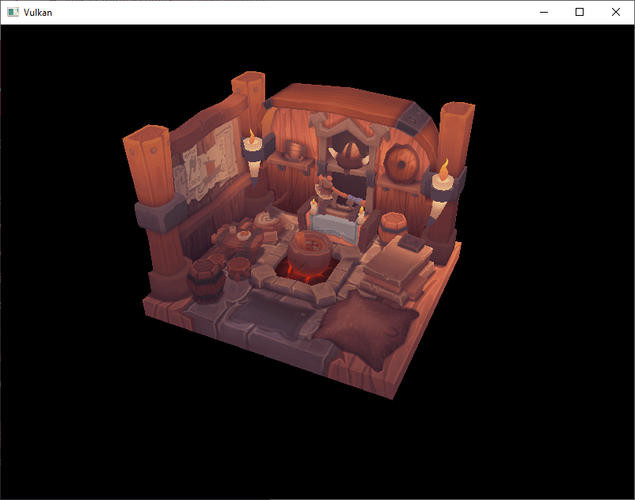
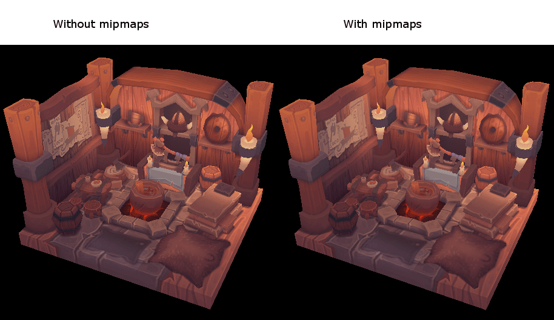
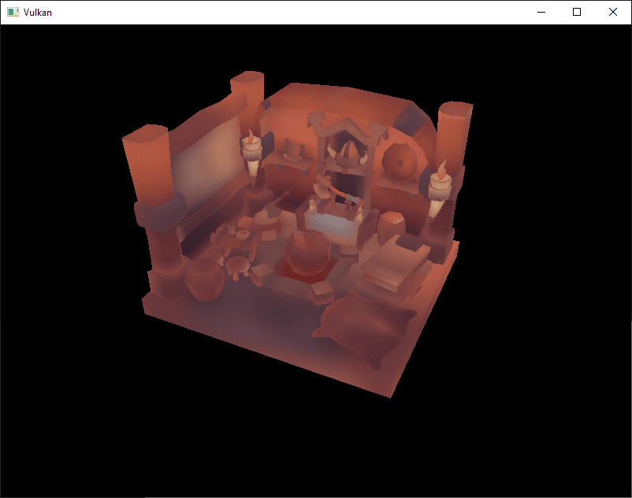

= 生成Mipmap
:toc:
:toclevels: 3
:toc-title: 目录

== 介绍

我们的程序现在可以加载和渲染 3D 模型了。本章我们将添加一项新功能：生成 mipmap。mipmap 广泛应用于游戏和渲染软件中，而 Vulkan 使我们能够完全控制 mipmap 的创建方式。

Mipmap 是预先计算好的图像缩小版本。每个新图像的宽度和高度都是前一个图像的一半。Mipmap 用作细节层次( LOD)的一种形式。距离摄像机较远的物体将从较小的 mipmap 中采样其纹理。使用较小的图像可以提高渲染速度并避免诸如 https://en.wikipedia.org/wiki/Moir%C3%A9_pattern[摩尔纹]之类的瑕疵。Mipmap 的示例如下：

== 图像创建

在 Vulkan 中，每个 mip 图像都存储在不同的mip 级别的 `vk::Image`。Mip 级别 0 是原始图像，级别 0 之后的 mip 级别通常被称为 mip 链。

mip 层级数在 `vk::Image` 创建时指定。到目前为止，我们一直将此值设置为 1。我们需要根据图像尺寸计算 mip 层级数。首先，添加一个类成员来存储此数字：

[source,c++]
----
...
uint32_t               mipLevels          = 0;
vk::raii::Image        textureImage       = nullptr;
...
----

`createTextureImage` 加载纹理后即可找到 `mipLevels` 值：

[source,c++]
----
int            texWidth, texHeight, texChannels;
stbi_uc       *pixels    = stbi_load(TEXTURE_PATH.c_str(), &texWidth, &texHeight, &texChannels, STBI_rgb_alpha);
...
mipLevels = static_cast<uint32_t>(std::floor(std::log2(std::max(texWidth, texHeight)))) + 1;
----

此函数计算 mip 链中的层数。它首先 `max` 选择最大维度，然后 `log2` 计算该维度能被 2 整除多少次。该函数 `floor` 还会处理最大维度不是 2 的幂的情况，最终使原始图像具有 mip 层。

要使用此值，我们需要修改 `createImage` 、`createImageView` 和 `transitionImageLayout` 函数，以便指定 mip 级别的数量。`mipLevels` 向这些函数添加一个参数：

[source,c++]
----
std::pair<vk::raii::Image, vk::raii::DeviceMemory>
    createImage(uint32_t                width,
                uint32_t                height,
                uint32_t                mipLevels,
                vk::Format              format,
                vk::ImageTiling         tiling,
                vk::ImageUsageFlags     usage,
                vk::MemoryPropertyFlags properties)
{
    vk::ImageCreateInfo imageInfo{.imageType     = vk::ImageType::e2D,
                                  .format        = format,
                                  .extent        = {width, height, 1},
                                  .mipLevels     = mipLevels,
    ...
}
----

[source,c++]
----
vk::raii::ImageView createImageView(vk::Image const &image, vk::Format format, vk::ImageAspectFlags aspectFlags, uint32_t mipLevels) const
{
		vk::ImageViewCreateInfo viewInfo{
		    .image            = image,
		    .viewType         = vk::ImageViewType::e2D,
		    .format           = format,
		    .subresourceRange = {.aspectMask = aspectFlags, .levelCount = mipLevels, .layerCount = 1}};
    ...
}
----

[source,c++]
----
void transitionImageLayout(
    vk::raii::CommandBuffer &commandBuffer, vk::raii::Image const &image, vk::ImageLayout oldLayout, vk::ImageLayout newLayout, uint32_t mipLevels)
{
		vk::ImageMemoryBarrier barrier{.oldLayout           = oldLayout,
		                               .newLayout           = newLayout,
		                               .srcQueueFamilyIndex = vk::QueueFamilyIgnored,
		                               .dstQueueFamilyIndex = vk::QueueFamilyIgnored,
		                               .image               = image,
		                               .subresourceRange    = {.aspectMask = vk::ImageAspectFlagBits::eColor, .levelCount = mipLevels, .layerCount = 1}};
    ...
----

更新所有对这些函数的调用，使其使用正确的值：

[source,c++]
----
std::tie(depthImage, depthImageMemory) = createImage(swapChainExtent.width,
                                                     swapChainExtent.height,
                                                     1,
                                                     depthFormat,
                                                     vk::ImageTiling::eOptimal,
                                                     vk::ImageUsageFlagBits::eDepthStencilAttachment,
                                                     vk::MemoryPropertyFlagBits::eDeviceLocal);
...
std::tie(textureImage, textureImageMemory) =
    createImage(texWidth,
                texHeight,
                mipLevels,
                vk::Format::eR8G8B8A8Srgb,
                vk::ImageTiling::eOptimal,
                vk::ImageUsageFlagBits::eTransferSrc | vk::ImageUsageFlagBits::eTransferDst | vk::ImageUsageFlagBits::eSampled,
                vk::MemoryPropertyFlagBits::eDeviceLocal);
----

[source,c++]
----
swapChainImageViews.emplace_back(createImageView(image, swapChainSurfaceFormat.format, vk::ImageAspectFlagBits::eColor, 1));
...
depthImageView = createImageView(depthImage, depthFormat, vk::ImageAspectFlagBits::eDepth, 1);
...
textureImageView = createImageView(*textureImage, vk::Format::eR8G8B8A8Srgb, vk::ImageAspectFlagBits::eColor, mipLevels);
----

在上一章中，`createTextureImage` 我们调用了三次 `endSingleTimeCommands`：一次是在布局转换期间，一次是在缓冲区到图像的复制期间，还有一次是在最终过渡到着色器读取布局期间。生成 mipmap 会为每个 mip 级别增加一次 blit 操作和两次额外的布局转换，为每次转换都打开一个新的命令缓冲区会造成资源浪费。因此，我们改为在 `createTextureImage` 开始时调用 `beginSingleTimeCommands` 一次，将转换、复制以及所有操作都记录到同一个命令缓冲区 `generateMipmaps` 中，并在 `endSingleTimeCommands` 最后只调用一次。 `beginSingleTimeCommands` 和 `endSingleTimeCommands` 本身并没有改变——我们只是减少了它们的调用频率：

[source,c++]
----
vk::raii::CommandBuffer commandBuffer = beginSingleTimeCommands();
transitionImageLayout(commandBuffer, textureImage, vk::ImageLayout::eUndefined, vk::ImageLayout::eTransferDstOptimal, mipLevels);
----

== 生成 Mipmap

我们的纹理图像现在有多个 mip 级别，但暂存缓冲区只能用于填充 mip 级别 0。其他级别仍未定义。为了填充这些级别，我们需要从现有的单个级别生成数据。我们将使用 `vk::raii::CommandBuffer::blitImage` 命令。该命令执行复制、缩放和过滤操作。我们将多次调用此命令，将数据复制到纹理图像的每个级别。

`vk::raii::CommandBuffer::blitImage` 由于纹理图像被视为传输操作，因此我们必须告知 Vulkan 我们打算将纹理图像同时用作传输的源和目标。请在 `createTextureImage` 纹理图像的使用标志 `vk::ImageUsageFlagBits::eTransferSrc` 中添加以下内容：

[source,c++]
----
...
std::tie(textureImage, textureImageMemory) =
    createImage(texWidth,
                texHeight,
                mipLevels,
                vk::Format::eR8G8B8A8Srgb,
                vk::ImageTiling::eOptimal,
                vk::ImageUsageFlagBits::eTransferSrc | vk::ImageUsageFlagBits::eTransferDst | vk::ImageUsageFlagBits::eSampled,
                vk::MemoryPropertyFlagBits::eDeviceLocal);
...
----

与其他图像操作一样，`vk::raii::CommandBuffer::blitImage` 操作取决于所操作图像的布局。我们可以将整个图像转换为平铺式布局 `vk::ImageLayout::eGeneral`，但这很可能会很慢。为了获得最佳性能，源图像应位于平铺式布局中 `vk::ImageLayout::eTransferSrcOptimal`，目标图像应位于平铺式布局中 `vk::ImageLayout::eTransferDstOptimal`。Vulkan 允许我们独立地转换图像的每个 mip 级别。每次 blit 操作一次只会处理两个 mip 级别，因此我们可以在两次 blit 命令之间将每个级别转换为最佳布局。

`transitionImageLayout` 只对整个图像执行布局过渡，所以我们需要编写一些额外的管道屏障命令。移除现有的过渡 `vk::ImageLayout::eShaderReadOnlyOptimal` 到 `createTextureImage`：

[source,c++]
----
...
std::tie(textureImage, textureImageMemory) =
    createImage(texWidth,
                texHeight,
                mipLevels,
                vk::Format::eR8G8B8A8Srgb,
                vk::ImageTiling::eOptimal,
                vk::ImageUsageFlagBits::eTransferSrc | vk::ImageUsageFlagBits::eTransferDst | vk::ImageUsageFlagBits::eSampled,
                vk::MemoryPropertyFlagBits::eDeviceLocal);
...
----

这将使纹理图像的每个层级都保留在。每个层级在 blit 命令读取完成后 `vk::ImageLayout::eTransferDstOptimal` 都会过渡到 `vk::ImageLayout::eShaderReadOnlyOptimal`。

现在我们要编写生成 mipmap 的函数：

[source,c++]
----
void generateMipmaps(vk::raii::CommandBuffer &commandBuffer,
                     vk::raii::Image         &image,
                     int32_t                  texWidth,
                     int32_t                  texHeight,
                     uint32_t                 mipLevels)
{
		vk::ImageMemoryBarrier barrier = {.srcAccessMask       = vk::AccessFlagBits::eTransferWrite,
		                                  .dstAccessMask       = vk::AccessFlagBits::eTransferRead,
		                                  .oldLayout           = vk::ImageLayout::eTransferDstOptimal,
		                                  .newLayout           = vk::ImageLayout::eTransferSrcOptimal,
		                                  .srcQueueFamilyIndex = vk::QueueFamilyIgnored,
		                                  .dstQueueFamilyIndex = vk::QueueFamilyIgnored,
		                                  .image               = image,
										  .subresourceRange    = {.aspectMask = vk::ImageAspectFlagBits::eColor, .levelCount = 1, .layerCount = 1}};
}
----

我们将进行多次转换，因此会重复使用此设置 `vk::ImageMemoryBarrier`。上面设置的字段 `subresourceRange.miplevel`  对于所有障碍物都将保持不变。而 `oldLayout` 、`newLayout` 、 `srcAccessMask` 和 `dstAccessMask` 将在每次转换时发生变化。

[source,c++]
----
int32_t mipWidth  = texWidth;
int32_t mipHeight = texHeight;

for (uint32_t i = 1; i < mipLevels; i++)
{
}
----

此循环将记录每条 `vk::raii::CommandBuffer::blitImage` 命令。请注意，循环变量的初始值为 1，而不是 0。

[source,c++]
----
barrier.subresourceRange.baseMipLevel = i - 1;
barrier.oldLayout                     = vk::ImageLayout::eTransferDstOptimal;
barrier.newLayout                     = vk::ImageLayout::eTransferSrcOptimal;
barrier.srcAccessMask                 = vk::AccessFlagBits::eTransferWrite;
barrier.dstAccessMask                 = vk::AccessFlagBits::eTransferRead;

commandBuffer.pipelineBarrier(vk::PipelineStageFlagBits::eTransfer, vk::PipelineStageFlagBits::eTransfer, {}, {}, {}, barrier);
----

首先，我们将级别转换 `i - 1` 到 `vk::ImageLayout::eTransferSrcOptimal`。此转换将等待级别 `i - 1` 被填充，填充物可能来自之前的 blit 命令，也可能来自 `vk::raii::CommandBuffer::copyBufferToImage`。当前的 blit 命令将等待此转换完成。

[source,c++]
----
vk::ImageBlit blit = {.srcSubresource = {.aspectMask = vk::ImageAspectFlagBits::eColor, .mipLevel = i - 1, .layerCount = 1},
                      .srcOffsets     = std::array<vk::Offset3D, 2>({{}, {mipWidth, mipHeight, 1}}),
                      .dstSubresource = {.aspectMask = vk::ImageAspectFlagBits::eColor, .mipLevel = i, .layerCount = 1},
                      .dstOffsets     = std::array<vk::Offset3D, 2>({{}, {1 < mipWidth ? mipWidth / 2 : 1, 1 < mipHeight ? mipHeight / 2 : 1, 1}})};
----

接下来，我们指定用于数据位图传输操作的区域。源 mip 级别为 `i - 1`，目标 mip 级别为 `i` 。数组的两个元素 `srcOffsets` 和 `dstOffsets` 决定了数据将从哪个 3D 区域传输出来。决定了数据将传输到哪个区域。`dstOffsets[1]` 的 X 和 Y 维度除以 2，因为每个 mip 级别的大小是前一个级别的一半。`srcOffsets[1]` 和 `dstOffsets[1]` 的 Z 维度必须为 1，因为 2D 图像的深度为 1。

[source,c++]
----
commandBuffer.blitImage(image, vk::ImageLayout::eTransferSrcOptimal, image, vk::ImageLayout::eTransferDstOptimal, blit, vk::Filter::eLinear);
----

现在，我们记录 blit 命令。注意，`image` 同时用于 `srcImage` 和 `dstImage` 参数。这是因为我们是在同一图像的不同层级之间进行 blit。源 mip 层级刚刚转换到 `vk::ImageLayout::eTransferSrcOptimal`，而目标层级仍处于 `createTextureImage` 中的 `vk::ImageLayout::eTransferDstOptimal` 状态。

注意，如果你使用的是专用传输队列（如 xref:顶点缓冲区/索引缓冲区.adoc[顶点缓冲区]一章所建议）：`vk::raii::CommandBuffer::blitImage` 必须提交到具有图形能力的队列。

最后一个参数允许我们指定 blit 中使用的 `vk::Filter`。这里可用的过滤选项与创建 `vk::raii::Sampler` 时相同。我们使用 `vk::Filter::eLinear` 来启用插值。

[source,c++]
----
barrier.oldLayout     = vk::ImageLayout::eTransferSrcOptimal;
barrier.newLayout     = vk::ImageLayout::eShaderReadOnlyOptimal;
barrier.srcAccessMask = vk::AccessFlagBits::eTransferRead;
barrier.dstAccessMask = vk::AccessFlagBits::eShaderRead;

commandBuffer.pipelineBarrier(vk::PipelineStageFlagBits::eTransfer, vk::PipelineStageFlagBits::eFragmentShader, {}, {}, {}, barrier);
----

此屏障会将 mip 级别 `i - 1` 转换为 `vk::ImageLayout::eShaderReadOnlyOptimal`。此转换会等待当前 blit 命令完成。所有采样操作都将等待此转换完成。

[source,c++]
----
    ...
    if (1 < mipWidth)
    {
      mipWidth /= 2;
    }
    if (1 < mipHeight)
    {
      mipHeight /= 2;
    }
}
----

在循环结束时，我们将当前的 mip 维度除以 2。在除法之前，我们会检查每个维度，以确保其值永远不会变为 0。这可以处理图像不是正方形的情况，因为在这种情况下，mip 的某个维度会比其他维度先达到 1。当这种情况发生时，该维度在所有剩余层级中都应保持为 1。

[source,c++]
----
		barrier.subresourceRange.baseMipLevel = mipLevels - 1;
		barrier.oldLayout                     = vk::ImageLayout::eTransferDstOptimal;
		barrier.newLayout                     = vk::ImageLayout::eShaderReadOnlyOptimal;
		barrier.srcAccessMask                 = vk::AccessFlagBits::eTransferWrite;
		barrier.dstAccessMask                 = vk::AccessFlagBits::eShaderRead;

		commandBuffer.pipelineBarrier(vk::PipelineStageFlagBits::eTransfer, vk::PipelineStageFlagBits::eFragmentShader, {}, {}, {}, barrier);
}
----

最后，我们插入另一个流水线屏障。该屏障将最后一个 mip 层级从 `vk::ImageLayout::eTransferDstOptimal` 转换为 `vk::ImageLayout::eShaderReadOnlyOptimal`。循环没有处理这种情况，因为最后一个 mip 层级永远不会被 blit 到。

`generateMipmaps` 最后，添加对 `createTextureImage` 的调用，并结束我们在本章开头打开的一次性命令缓冲区，因为现在所有操作都已记录到其中：

[source,c++]
----
transitionImageLayout(commandBuffer, textureImage, vk::ImageLayout::eUndefined, vk::ImageLayout::eTransferDstOptimal, mipLevels);
copyBufferToImage(commandBuffer, stagingBuffer, textureImage, static_cast<uint32_t>(texWidth), static_cast<uint32_t>(texHeight));
//transitioned to vk::ImageLayout::eShaderReadOnlyOptimal while generating mipmaps
generateMipmaps(commandBuffer, textureImage, texWidth, texHeight, mipLevels);
endSingleTimeCommands(std::move(commandBuffer));
----

我们的纹理图像的 mipmap 已填充完毕。

== 线性滤波支持

使用内置函数 `vk::raii::CommandBuffer::blitImage` 生成所有 mip 级别非常方便，但遗憾的是，它并不能保证在所有平台上都受支持。它需要我们用于支持线性滤波的纹理图像格式，这可以通过函数进行检查。我们将为此在函数 `generateMipmaps` 中添加一个检查 `vk::raii::PhysicalDevice::getFormatProperties`。

首先，添加一个参数来指定图像格式：

[source,c++]
----
void createTextureImage()
{
    ...
    generateMipmaps(commandBuffer, textureImage, vk::Format::eR8G8B8A8Srgb, texWidth, texHeight, mipLevels);
}

void generateMipmaps(vk::raii::CommandBuffer &commandBuffer,
                     vk::raii::Image         &image,
                     vk::Format               imageFormat,
                     int32_t                  texWidth,
                     int32_t                  texHeight,
                     uint32_t                 mipLevels)
{
    ...
}
----

在 `generateMipmaps` 函数中，使用以下方式 `vk::raii::PhysicalDevice::getFormatProperties` 请求纹理图像格式的属性：

[source,c++]
----
void generateMipmaps(vk::raii::CommandBuffer &commandBuffer,
                     vk::raii::Image         &image,
                     vk::Format               imageFormat,
                     int32_t                  texWidth,
                     int32_t                  texHeight,
                     uint32_t                 mipLevels)
{
    // Check if image format supports linear blit-ing
    vk::FormatProperties formatProperties = physicalDevice->getFormatProperties(imageFormat);
    ...
----

`vk::FormatProperties` 结构体有三个字段，分别名为 `linearTilingFeatures`、`optimalTilingFeatures` 、`bufferFeatures`，每个字段都描述了格式在不同使用方式下的用法。我们创建了一个使用最佳平铺格式的纹理图像，因此需要检查 `optimalTilingFeatures` 。可以使用以下代码 `vk::FormatFeatureFlagBits::eSampledImageFilterLinear` 检查是否支持线性滤波功能：

[source,c++]
----
if (!(formatProperties.optimalTilingFeatures & vk::FormatFeatureFlagBits::eSampledImageFilterLinear))
{
  throw std::runtime_error("texture image format does not support linear blitting!");
}
----

在这种情况下有两种选择。您可以实现一个函数，搜索常见的纹理图像格式，找到支持线性位图传输的格式；或者，您可以使用类似 https://github.com/nothings/stb/blob/master/stb_image_resize.h[stb_image_resize]的库，在软件中实现 mipmap 的生成。然后，您可以像加载原始图像一样，将每个 mip 级别加载到图像中。

需要注意的是，在实际应用中，运行时生成 mipmap 层级的情况并不常见。通常情况下，它们会预先生成并与基础层级一起存储在纹理文件中，以提高加载速度。至于如何在软件中实现调整大小以及如何从文件中加载多个层级，则留给读者作为练习。

== 采样器

虽然它 `vk::raii::Image` 保存着 mipmap 数据，但 `vk::raii::Sampler` 控制着渲染时如何读取这些数据。Vulkan 允许我们指定 `minLod`、`maxLod`、`mipLodBias` 和 `mipmapMode`（“Lod”表示“细节级别”）。当对纹理进行采样时，采样器会根据以下伪代码选择一个 mip 级别：

[source,c++]
----
lod = getLodLevelFromScreenSize(); //smaller when the object is close, may be negative
lod = clamp(lod + mipLodBias, minLod, maxLod);

level = clamp(floor(lod), 0, texture.mipLevels - 1);  //clamped to the number of mip levels in the texture

if (mipmapMode == vk::SamplerMipmapMode::eNearest)
{
    color = sample(level);
}
else
{
    color = blend(sample(level), sample(level + 1));
}
----

如果 `samplerInfo.mipmapMode` 为 `vk::SamplerMipmapMode::eNearest`，`lod` 则选择要从中采样的 mip 级别。如果 mipmap 模式为 `vk::SamplerMipmapMode::eLinear`，`lod` 则用于选择要采样的两个 mip 级别。对这两个级别进行采样，并将结果线性混合。

采样操作还受到以下因素的影响 `lod`：

[source,c++]
----
if (lod <= 0)
{
    color = readTexture(uv, magFilter);
}
else
{
    color = readTexture(uv, minFilter);
}
----

如果物体靠近摄像机，则使用 `magFilter` 作为滤波器。如果物体远离摄像机，则使用 `minFilter`。通常情况下，`lod` 为非负值，且仅在靠近摄像机时为 0。这允许我们强制 Vulkan 使用比 `mipLodBias` 通常使用的更低的 `lod` 和 `level`。

要查看本章的结果，我们需要为 `textureSampler` 选择值。我们已经设置了 `minFilter` 和 `magFilter` 为 `vk::Filter::eLinear`。我们只需要为 `minLod`、`maxLod`、`mipLodBias` 和 `mipmapMode` 选择值。

[source,c++]
----
void createTextureSampler()
{
    vk::PhysicalDeviceProperties properties = physicalDevice.getProperties();
		vk::SamplerCreateInfo        samplerInfo{
		    .magFilter        = vk::Filter::eLinear,
		    .minFilter        = vk::Filter::eLinear,
		    .mipmapMode       = vk::SamplerMipmapMode::eLinear,
		    .addressModeU     = vk::SamplerAddressMode::eRepeat,
		    .addressModeV     = vk::SamplerAddressMode::eRepeat,
		    .addressModeW     = vk::SamplerAddressMode::eRepeat,
		    .mipLodBias       = 0.0f,
		    .anisotropyEnable = vk::True,
		    .maxAnisotropy    = properties.limits.maxSamplerAnisotropy,
		    .compareEnable    = vk::False,
		    .compareOp        = vk::CompareOp::eAlways,
		    .minLod           = 0.0f,
		    .maxLod           = vk::LodClampNone};
    ...
}
----

在上面的代码中，我们设置了采样器，对缩小和放大都采用了线性滤波，并在 mip 层级之间进行了线性插值。我们还将 mip 层级偏差设置为 0.0f。

`minLod` 和 `maxLod` 用于通过限制最小和最大 LOD 值来有效地设置要使用的 mip 等级范围。通过将 `minLod` 设置为 `0.0f` ，`maxLod` 设置为 `vk::LodClampNone` ，我们可以确保使用完整的 mip 等级范围。

现在运行你的程序，你应该会看到以下内容：

由于场景非常简单，所以差别并不显著。但仔细观察的话，还是能发现一些细微差别。

最明显的区别在于纸张上的文字。使用 mipmap 后，文字变得平滑。不使用 mipmap 时，文字边缘生硬，并且由于莫尔条纹的存在而出现缝隙。

您可以尝试调整采样器设置，看看它们如何影响 mipmap。例如，通过更改设置 `minLod`，您可以强制采样器不使用最低的 mip 级别：

[source,c++]
----
samplerInfo.minLod = static_cast<float>(mipLevels / 2);
----

这些设置将生成以下图像：

当物体距离相机较远时，就会使用更高的 mip 级别。

xref:多重采样.adoc[下一章]将带我们了解多重采样如何生成更平滑的图像。