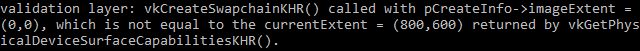

= 交换链
:toc:
:toclevels: 3
:toc-title: 目录

Vulkan 没有“默认帧缓冲区”的概念，因此需要一个基础设施来管理渲染到屏幕上的图像缓冲区。这个基础设施被称为**交换链**，必须在 Vulkan 中显式创建。交换链本质上是一个等待呈现到屏幕上的图像队列。我们的应用程序会获取要绘制的图像，然后将其返回到队列中。队列的具体工作方式以及从队列中呈现图像的条件取决于交换链的设置方式。然而，交换链的总体目的是使图像的呈现与屏幕的刷新率同步。

== 检查交换链支持情况
并非所有显卡都能直接将图像输出到屏幕，原因有很多，例如，有些显卡是为服务器设计的，没有显示输出接口。其次，由于图像显示与窗口系统及其关联的界面紧密相关，因此它并非 Vulkan 核心功能的一部分。您需要在查询设备是否支持``VK_KHR_swapchain``功能后启用设备扩展。

为此，我们先要扩展``createLogicalDevice``函数，
使其可以检查此扩展是否受支持。我们之前在``vk::raii::PhysicalDevice``已经了解到如何检查查询扩展支持了，因此执行此操作应该非常简单。请注意，Vulkan头文件提供了一个方便的宏``vk::KHRSwapchainExtensionName``，其定义为``VK_KHR_swapchin``。使用该宏的优势在于编译器可以捕获拼写错误。

首先声明所需的设备扩展列表，类似于要启用的验证层列表。
[source,c++]
----
std::vector<const char*> requiredDeviceExtension = {
    vk::KHRSwapchainExtensionName
};
----
需要注意的是，正如我们在上一章中所述，演示队列的可用性意味着必须支持交换链扩展。我们在 创建逻辑设备时已经传递了``requiredDeviceExtension``参数 ，因此该扩展已启用，此处无需编写其他设备创建代码``vk::DeviceCreateInfo``。

== 查询交换链支持的详细信息
仅仅检查交换链是否可用是不够的，因为它可能与我们的窗口表面不兼容。创建交换链涉及的设置比创建实例和设备要多得多，因此我们需要查询更多详细信息才能继续。

我们基本上需要检查三种属性：

* 基本表面功能（交换链中图像的最小/最大数量，图像的最小/最大宽度和高度）
* 表面格式（像素格式、色彩空间）
* 可用的演示模式

本节介绍如何查询包含这些信息的结构体。这些结构体的含义以及它们具体包含哪些数据将在下一节中讨论。

我们先从基本功能入手。这些属性查询起来很简单，并且会返回到一个单独的 ``vk::SurfaceCapabilitiesKHR``结构体中。
[source,c++]
----
auto surfaceCapabilities = physicalDevice.getSurfaceCapabilitiesKHR(*surface);
----
此函数在确定支持的功能时会考虑指定的``vk::SurfaceKHR``窗口表面。所有支持查询函数都将其作为第一个参数，因为它是交换链的核心组件。

下一步是查询支持的表面格式。
[source,c++]
----
std::vector<vk::SurfaceFormatKHR> availableFormats = physicalDevice.getSurfaceFormatsKHR( *surface );
----
最后，查询支持的显示模式的方式与上面方式完全相同``vk::raii::PhysicalDevice::getSurfacePresentModesKHR``：
[source,c++]
----
std::vector<vk::PresentModeKHR> availablePresentModes = physicalDevice.getSurfacePresentModesKHR( *surface );
----
所有细节现已公布。对于本教程而言，只要窗口表面至少支持一种图像格式和一种显示模式，交换链支持就足够了。重要的是，我们只有在确认扩展可用之后才能尝试查询交换链支持。

== 为交换链选择正确的设置
交换链中可能仍然存在许多不同最优性的模式。接下来，我们将编写几个函数来找到最佳交换链的正确设置。需要确定的设置类型有三种：

* 表面格式（颜色深度）
* 演示模式（将图像“切换”到屏幕的条件）
* 交换范围（交换链中图像的分辨率）

对于每一种设置，我们心中都有一个理想值，如果该值可用，我们将采用该值；否则，我们将制定一些逻辑来找到次优值。

=== 表面格式
该设置的函数最初是这样的。稍后我们会将 结构体``formats``的成员``SwapChainSupportDetails``作为参数传递。
[source,c++]
----
vk::SurfaceFormatKHR chooseSwapSurfaceFormat(std::vector<vk::SurfaceFormatKHR> const& availableFormats) {
    assert(!availableFormats.empty());
    return availableFormats[0];
}
----
每个``vk::SurfaceFormatKHR``条目包括一个``format``和``colorSpace``成员。``format``成员指定颜色通道和类型。例如，``vk::Format::eB8G8R8A8Srgb``表示我们按顺序存储B、G、R和alpha通道，每个通道使用一个8位无符号整数，因此每个像素总共使用32位。``colorSpace``成员使用``vk::ColorSpaceKHR::eSrgbNonlinear``标志指示是否支持sRGB彩色空间。

如果条件允许，我们将使用 sRGB 色彩空间，因为它能带来 http://stackoverflow.com/questions/12524623/[更准确的色彩感知]。它也是图像（例如我们稍后会用到的纹理）的标准色彩空间。因此，我们也应该使用 sRGB 颜色格式，其中最常见的格式之一是``vk::Format::eB8G8R8A8Srgb``。

我们来看看列表，看看所需的组合是否可用：
[source,c++]
----
const auto formatIt = std::ranges::find_if(availableFormats,
     {
        return format.format == vk::Format::eB8G8R8A8Srgb
        && format.colorSpace ==
         vk::ColorSpaceKHR::eSrgbNonlinear;
    });
----
如果失败，我们可以开始根据格式的“好坏”对可用格式进行排名，但在大多数情况下，直接采用第一个指定的格式就可以了。
[source,c++]
----
vk::SufaceFormatKHR chooseSwapSurfaceFormat(const std::vector<vk::SufaceFormatKHR>& availableFormats) {
    const auto formatIt = std::ranges::find_if(availableFormats,
     {
        return format.format == vk::Format::eB8G8R8A8Srgb
        && format.colorSpace ==
         vk::ColorSpaceKHR::eSrgbNonlinear;
    });
    return formatIt != availableFormats.end() ? *formatIt :availableFormats[0];
}
----

=== 显示模式
可以说，显示模式是交换链中最重要的设置，因为它代表了在屏幕上显示图像的实际条件。Vulkan 中有四种可用的显示模式：

* `vk::PresentModeKHR::eImmediate`：您通过应用程序提交的图像会立即传输到屏幕上，这可能会导致画面撕裂。
* ``vk::PresentModeKHR::eFifo``：交换链是一个队列，显示器刷新时从队列前端取出图像，程序则将渲染好的图像插入队列后端。如果队列已满，程序就必须等待。这与现代游戏中常见的垂直同步机制最为相似。显示器刷新的瞬间被称为“垂直空白”。
* ``vk::PresentModeKHR::eFifoRelaxed``：此模式与前一种模式的区别仅在于应用程序延迟且在上一个垂直空白时队列为空。此时，图像不会等待下一个垂直空白，而是在最终到达时立即传输。这可能会导致画面出现可见的撕裂。
* ``vk::PresentModeKHR::eMailbox``：这是第二种模式的另一种变体。当队列满时，应用程序不会阻塞，而是直接用新生成的图像替换已排队的图像。这种模式可以在尽可能快的时间内渲染帧，同时避免画面撕裂，从而比标准垂直同步模式减少延迟问题。这通常被称为“三重缓冲”，但三个缓冲的存在并不一定意味着帧率就完全解锁了。

只有一种``vk::PresentModeKHR::eFifo``模式能保证可用，所以我们需要再次编写一个函数来查找最佳可用模式：
[source,c++]
----
vk::PresentModeKHR chooseSwapPresentMode(std::vector<vk::PresentModeKHR> const& availablePresentModes) {
    return vk::PresentModeKHR::eFifo;
}
----
我认为如果能耗不是问题，``vk::PresentModeKHR::eMailbox``是一个非常不错的折衷方案。它允许我们在避免画面撕裂的同时，通过渲染尽可能最新的图像（直到画面出现垂直空白区域），保持较低的延迟。在能耗更为重要的移动设备上，您可能需要使用 ``vk::PresentModeKHR::eFifo``或其他方法。现在，让我们查看列表，看看是否``vk::PresentModeKHR::eMailbox``可用：
[source,c++]
----
vk::PresentModeKHR chooseSwapPresentMode(std::vector<vk::PresentModeKHR> const& availablePresentModes) {
    assert(std::ranges::any_of(availablePresentModes,  {
        return presentMode == vk::PresentModeKHR::eFifo;
    }));
    return std::ranges::any_of(availablePresentModes,
         {
            return vk::PresentModeKHR::eMailbox == value;
        }) ? vk::PresentModeKHR::eMailbox :
    vk::PresentModeKHR::eFifo;
}
----
=== 交换范围
这样就只剩下一个主要属性了，我们将为它添加最后一个函数：
[source,c++]
----
vk::Extent2D chooseSwapExtent(vk::SufaceCapabilitiesKHR const& capabilities) {

}
----
交换范围是指交换链图像的分辨率，它几乎总是与我们绘制到的窗口的像素分辨率完全相同（稍后会详细介绍）。可能的分辨率范围在vk::SurfaceCapabilitiesKHR结构体中定义。Vulkan 要求我们通过在成员中设置宽度和高度来匹配窗口的分辨率 currentExtent。但是，某些窗口管理器允许我们在此处使用不同的值，这可以通过将宽度和高度设置currentExtent为一个特殊值来表示：即最大值``maxImageExtent``。在这种情况下，我们将选择在和 范围uint32_t内最匹配窗口的分辨率。但我们必须以正确的单位指定分辨率。

GLFW 在测量尺寸时使用两种单位：像素和 https://www.glfw.org/docs/latest/intro_guide.html#coordinate_systems[屏幕坐标]。例如，{WIDTH, HEIGHT}我们之前创建窗口时指定的分辨率是以屏幕坐标衡量的。但 Vulkan 使用像素，因此交换链的范围也必须以像素为单位指定。遗憾的是，如果您使用的是高 DPI 显示器（例如 Apple 的 Retina 显示屏），屏幕坐标并不对应于像素。相反，由于像素密度更高，窗口的像素分辨率会大于屏幕坐标分辨率。因此，如果 Vulkan 没有自动调整交换范围，我们就不能直接使用原始的交换范围{WIDTH, HEIGHT}。相反，我们必须先 glfwGetFramebufferSize查询窗口的像素分辨率，然后再将其与最小和最大图像范围进行匹配。
[source,c++]
----
#include <cstdint>
#include <limits>
#include <algorithm>
...
vk::Extent2D chooseSwapExtent(vk::SurfaceCapabilitiesKHR const& capabilities) {
    if (capabilities.currentExtent.width != std::numeric_limits<uint32_t>::max()) {
        return capabilities.currentExtent;
    }
    int width, height;
    glfwGetFramebuggerSize(window, &width, &height);

    return {
        std::clamp<uint32_t>(width, capabilities.minImageExtent.width, capabilities.maxImageExtent.width),
        std::clamp<uint32_t>(height, capabilities.minImageExtent.height, capabilities.maxImageExtent.height)
    };
}
----
clamp这里使用函数来限制``width``和``height``的值，使其介于实现所支持的允许的最小值和最大值之间。

== 创建交换链
现在有了这些辅助函数来帮助我们做出运行时必须做出的选择，我们终于拥有了创建可用交换链所需的所有信息。

创建一个``createSwapChain``函数，该函数以这些调用的结果为初始状态，并确保在``initVulkan``逻辑设备创建之后调用它。
[source,c++]
----
void initVulkan() {
    createInstance();
    setupDebugMessenger();
    createSurface();
    pickPhysicalDevice();
    createLogicalDevice();
    createSwapChain();
}

void createSwapChain() {
    vk::SurfaceCapabilitiesKHR surfaceCapabilities = physicalDevice.getSurfaceCapabilitiesKHR(&surface);
    swapChainExtent = chooseSwapExtent(surfaceCapabilities);
    uint32_t chooseSwapMinImageCount(surfaceCapabilities);

    std::vector<vk::SurfaceFormatKHR> availableFormats = physicalDevice.getSurfaceFormatsKHR(*surface);
    swapChainSurfaceFormat = chooseSwapSurfaceFormat(availableFormats);
}
----
除了这些属性之外，我们还需要决定交换链中需要多少张图像。实现中规定了正常运行所需的最小图像数量：
[source,c++]
----
uint32_t minImageCount = surfaceCapabilities.minImageCount;
----
然而，仅仅坚持这个最小值意味着我们有时可能需要等待驱动程序完成内部操作才能获取另一张图像进行渲染。实际上，通常会请求比严格最小值多几张图像，以便留出一些余地——下面的辅助函数至少请求三张图像，同时确保不超过实现支持的最大图像数，其中 ``0``是一个特殊值，表示没有最大值：
[source,c++]
----
uint32_t chooseSwapMinImageCount(vk::SurfaceCapabilitiesKHR const& surfaceCapabilities) {
    auto minImageCount = std::max(3u, surfaceCapabilities.minImageCount);
    if ((0 < surfaceCapabilities.maxImageCount) && (surfaceCapabilities.maxImageCount < minImageCount)) {
        minImageCount = surfaceCapabilities.maxImageCount;
    }
    return minImageCount;
}
----
与 Vulkan 对象的惯例一样，创建交换链对象需要填充一个大型结构。公平地说，交换链是一个相当复杂的对象，因此它是 Vulkan 中较大的 createInfo 结构之一：
[source,c++]
----
vk::SwapChainCreateInfo swapChainCreateInfo{
    .surface = *surface,
    .minImageCount = minImageCount,
    .imageFormat = swapChainSurfaceFormat.format,
    .imageColorSpace = swapChainSurfaceFormat.colorSpace,
    .imageExtent = swapChainExtent,
    .imageArrayLayers = 1,
    .imageUsage = vk::ImageUsageFlagBits::eColorAttachment,
    .imageSharingMode = vk::SharingMode::eExclusive,
    .preTransform = surfaceCapabilities.currentTransform,
    .compositeAlpha = vk::CompositeAlphaFlagBitsKHR::eOpaqur,
    .presentMode = chooseSwapPresentMode(availablePresentModes),
    .clipped = true
};
----
[source,c++]
----
    .imageArrayLayers = 1,
----
该``imageArrayLayers``参数指定每张图像由多少层组成。除非您正在开发立体 3D 应用程序，否则此参数始终为1。
[source,c++]
----
    .imageUsage = vk::ImageUsageFlagBits::eColorAttachment,
----
``imageUsage``指定了我们将如何使用交换链中的图像。在本教程中，我们将直接渲染到这些图像，这意味着它们将用作颜色附件。您也可以先将图像渲染到单独的图像中，以便执行诸如后期处理之类的操作。在这种情况下，您可以使用类似这样的值 `vk::ImageUsageFlagBits::eTransferDst`，并使用内存操作将渲染后的图像传输到交换链图像。
[source,c++]
----
    .imageSharingMode = vk::SharingMode::eExclusive,
----
该``imageSharingMode``规范规定了如何处理可能跨多个队列族使用的交换链镜像。处理从多个队列访问的镜像有两种方法：

* vk::SharingMode::eExclusive一个镜像一次只能属于一个队列族，必须显式转移所有权才能在另一个队列族中使用它。此选项可提供最佳性能。
* vk::SharingMode::eConcurrent图像可以在多个队列族中使用，而无需显式的所有权转移。

如果队列族不同，则可以使用并发模式来避免编写所有权章节，因为这些章节涉及一些概念，最好稍后再解释。并发模式要求您预先使用``queueFamilyIndexCount``和 ``pQueueFamilyIndices``参数指定哪些队列族之间共享所有权。并发模式要求您至少指定两个不同的队列族。如果图形队列族和显示队列族相同（大多数硬件都是如此），则应坚持使用独占模式。
[source,c++]
----
    .preTransform = surfaceCapabilities.currentTransform,
----
我们可以指定在交换链中对图像应用特定的变换（如果支持``supportedTransforms``的``capabilities``），例如顺时针旋转 90 度或水平翻转。要指定不需要任何变换，只需指定当前的变换即可。
[source,c++]
----
    .compositeAlpha = vk::CompositeAlphaFlagBitsKHR::eOpaqur,
----
该``compositeAlpha``字段指定是否应将 alpha 通道用于与窗口系统中的其他窗口混合。您几乎总是希望忽略 alpha 通道，因此，该字段为``vk::CompositeAlphaFlagBitsKHR::eOpaque``。
[source,c++]
----
    .presentMode = chooseSwapPresentMode(availablePresentModes),
    .clipped = true
----
该``presentMode``成员本身就说明了一切。如果该``clipped``成员设置为 ``vk::True``，则表示我们不关心被遮挡的像素颜色，例如，由于另一个窗口挡住了它们的视线。除非您确实需要能够读取这些像素并获得可预测的结果，否则启用裁剪将获得最佳性能。
[source,c++]
----
swapChainCreateInfo.oldSwapchain = nullptr;
----
这样就剩下最后一个字段``oldSwapChain``了。使用 Vulkan 时，应用程序运行时（例如，由于窗口大小调整），交换链可能会失效或未优化。在这种情况下，实际上需要从头开始重新创建交换链，因此必须在此字段中指定对旧交换链的引用。这是一个复杂的主题，我们将在 xref:../重建交换链.adoc[以后的章节]中详细学习。现在，我们假设只会创建一个交换链，因此可以将此成员保留其默认值nullptr。

现在添加类成员来存储vk::SwapchainKHR对象及其图像：
[source,c++]
----
vk::raii::SwapchainKHR swapChain;
std::vector<vk::Image> swapChainImages;
----
现在创建交换链就像调用以下构造函数``vk::raii::SwapchainKHR``一样简单：
[source,c++]
----
swapChain = vk::raii::SwapchainKHR(device, swapChainCreateInfo);
swapChainImages = swapChain.getImages();
----
参数包括逻辑设备和交换链创建信息。

现在运行应用程序，确保交换链创建成功！如果此时``vkCreateSwapchainKHR``出现访问冲突错误 或看到类似的消息``Failed to find 'vkGetInstanceProcAddress' in layer SteamOverlayVulkanLayer.dll``，请参阅关于 Steam 覆盖层的 xref:../../常见问题.adoc[常见问题解答]。
尝试删除``swapChainCreateInfo.imageExtent = extent;``启用了验证层的代码行。你会发现其中一个验证层会立即检测到错误，并打印出一条有用的消息：

== 检索交换链图像
交换链已经创建完成，接下来只需获取``vk::Image``其中包含的对象的句柄即可。我们将在后续章节的渲染操作中引用这些句柄。
[source,c++]
----
std::vector<vk::Image> swapChainImages = swapChain->getImages();
----
最后一点，请将我们为交换链图像选择的格式和范围存储在成员变量中。我们将在后续章节中用到它们。
[source,c++]
----
vk::raii::SwapchainKHR swapChain = nullptr;
std::vector<vk::Image> swapChainImages;
vk::SurfaceFormatKHR swapChainSurfaceFormat;
vk::Extent2D swapChainExtent;
----
现在我们有了一组可以绘制并显示在窗口中的图像。xref:图像视图.adoc[下一章]将开始介绍如何将这些图像设置为渲染目标，然后我们将开始研究实际的图形管线和绘制命令！

