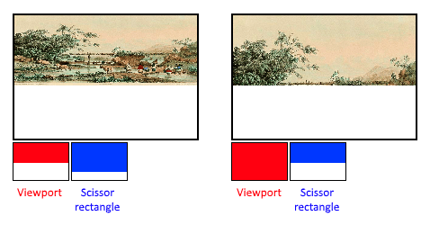

= 固定功能
:toc:
:toclevels: 3
:toc-title: 目录

旧版图形 API 为图形管线的大多数阶段提供了默认状态。而在 Vulkan 中，大多数管线状态必须显式指定，因为它们会被嵌入到一个不可变的管线状态对象中。本章将介绍配置这些固定功能操作所需的所有结构。

== 动态状态
虽然大部分管线状态需要预先写入管线，但实际上有一部分状态可以在不重新创建管线的情况下进行更改。例如视口大小、线宽和混合常量。如果要使用动态状态并保留这些属性，则需要填写类似这样的结构 `vk::PipelineDynamicStateCreateInfo` ：
[source,c++]
----
std::vector<vk::DynamicState> dynamicStates = {
    vk::DynamicState::eViewport,
    vk::DynamicState::eScissor
};

vk::PipelineDynamicStateCreateInfo dynamicState{
    .dynamicStateCount = static_cast<uint32_t>(dynamicStates.size()),
    .pDynamicStates = dynamicStates.data()
};
----
这将导致这些值的配置被忽略，您需要在绘制时指定数据。这使得设置更加灵活，并且广泛应用于视口和裁剪状态等功能，因为如果将这些功能集成到管线状态中，设置会更加复杂。

== 顶点输入
该结构体 `vk::PipelineVertexInputStateCreateInfo` 描述了将传递给顶点着色器的顶点数据的格式。它大致通过两种方式进行描述：

* 绑定：数据之间的间距以及数据是按顶点还是按实例（参见link:https://en.wikipedia.org/wiki/Geometry_instancing[实例化]）
* 属性描述：传递给顶点着色器的属性类型、加载它们的绑定以及偏移量。

由于我们将顶点数据直接硬编码到顶点着色器中，因此我们将填充此结构以指定目前没有顶点数据需要加载。我们将在顶点缓冲区章节中再讨论这个问题。
[source,c++]
----
vk::PipelineVertexInputStateCreateInfo vertexInputInfo;
----
`pVertexBindingDescriptions` 和 `pVertexAttributeDescriptions` 成员指向一个结构体数组，该数组描述了加载顶点数据的上述细节。将此结构体添加到 `createGraphicsPipeline` 函数中，紧跟在 `shaderStages` 数组之后。

== 输入组件
该 `vk::PipelineInputAssemblyStateCreateInfo` 结构体描述了两件事：从顶点绘制哪种几何体，以及是否启用图元重启。前者在 `topology` 成员中指定，其值可以如下所示：

* `vk::PrimitiveTopology::ePointList`：顶点的点
* `vk::PrimitiveTopology::eLineList`：从任意两个顶点出发的直线，不重复使用
* `vk::PrimitiveTopology::eLineStrip` 每行的终点顶点都用作下一行的起点顶点。
* `vk::PrimitiveTopology::eTriangleList`：从任意三个顶点构成三角形，且不重复使用
* `vk::PrimitiveTopology::eTriangleStrip` 每个三角形的第二个和第三个顶点都用作下一个三角形的前两个顶点。

通常情况下，顶点会按索引顺序从顶点缓冲区加载，但使用元素缓冲区时，您可以自行指定要使用的索引。这允许您执行诸如重用顶点之类的优化。如果您将成员设置 `primitiveRestartEnable` 为 `vk::True` ，则可以通过使用特殊索引 `0xFFFF` 或 `0xFFFFFFFF`来在拓扑模式 `Strip` 下拆分线和三角形。

在本教程中，我们将始终绘制三角形，因此我们将使用以下数据来构建结构：
[source,c++]
----
vk::PipelineInputAssemblyStateCreateInfo inputAssembly{
    .topology = vk::PrimitiveTopology::eTriangleList
};
----
== 视口与裁剪矩阵
视口本质上描述了帧缓冲区中用于渲染输出的区域。这几乎总是(0, 0)指向帧(width, height)缓冲区，本教程也不例外。
[source,c++]
----
vk::ViewPort viewport{
    0.0f,
    0.0f,
    static_cast<float>(swapChainExtent.width),
    static_cast<float>(swapChainExtent.height),
    0.0f,
    1.0f
};
----
请记住，交换链及其图像的大小可能与窗口的 `WIDTH` 和 `HEIGHT` 不同。交换链图像稍后将用作帧缓冲区，因此我们应该保持其大小不变。

`minDepth` 和 `maxDepth` 值指定帧缓冲区使用的深度值范围。这些值必须在指定 `[0.0f, 1.0f]` 范围内，但 `minDepth` 可以大于 `maxDepth` 。如果没有特殊操作，则应使用标准值 `0.0f` 和 `1.0f` 。

视口定义了图像到帧缓冲区的转换，而裁剪矩形则定义了像素实际存储的区域。光栅化器会丢弃裁剪矩形之外的所有像素。它们的作用更像是过滤器，而不是转换。下图展示了二者的区别。请注意，左侧的裁剪矩形只是众多可能结果之一，只要它大于视口即可。

因此，如果我们想绘制到整个帧缓冲区，我们会指定一个完全覆盖它的裁剪矩形：
[source,c++]
----
vk::Rect2D scissor{
    vk::Offset2D{0, 0},
    swapChainExtent
}
----
视口和裁剪矩形既可以作为管线中的静态部分指定，也可以作为命令缓冲区中的动态状态集设置。虽然前者与其他状态更为一致，但通常情况下，将视口和裁剪状态设置为动态状态会更加方便，因为它提供了更大的灵活性。这种做法非常普遍，所有实现都能处理这种动态状态而不会造成性能损失。

选择动态视口和剪裁矩形时，需要为管线启用相应的动态状态：
[source,c++]
----
std::vector<vk::DynamicState> dynamicStates = {
    vk::DynamicState::eViewport,
    vk::DynamicState::eScissor
};

vk::PipelineDynamicStateCreateInfo dynamicState{
    .dynamicStateCount = static_cast<uint32_t>(dynamicStates.size()),
    .pDynamicStates = dynamicStates.data()
};
----
然后您只需在创建管道时指定它们的数量即可：
[source,c++]
----
vk::PipelineViewportStateCreateInfo viewportState{
    .viewportCount = 1,
    .scissorCount = 1
};
----
实际的视口和裁剪矩形将在绘制时设置。

借助动态状态，甚至可以在单个命令缓冲区内指定不同的视口和裁剪矩形。

如果没有动态状态，视口和裁剪矩形需要在管道中使用结构体 `vk::PipelineViewportStateCreateInfo` 进行设置。这使得该管道的视口和裁剪矩形是不可变的。任何对这些值的更改都需要使用新值创建一个新的管道。
[source,c++]
----
vk::PipelineViewportStateCreateInfo viewportState{
    .viewportCount = 1,
    .pViewports = &viewport,
    .scissorCount = 1,
    .pScissors = &scissor
};
----
无论如何设置，某些显卡都支持使用多个视口和裁剪矩形，因此结构体成员引用的是一个数组。使用多个视口和裁剪矩形需要启用 GPU 的相应功能（参见逻辑设备创建）。

== 光栅化器
光栅化器从顶点着色器获取由顶点构成的几何体，并将其转换为片段，以便由片段着色器进行着色。它还执行link:https://en.wikipedia.org/wiki/Z-buffering[深度测试]、link:https://en.wikipedia.org/wiki/Back-face_culling[面剔除]和剪刀测试，并且可以配置为输出填充整个多边形或仅填充边缘（线框渲染）的片段。所有这些都通过结构体 `vk::PipelineRasterizationStateCreateInfo` 进行配置。
[source,c++]
----
vk::PipelineRasterizationStateCreateInfo rasterizer{
    .depthClampEnable = vk::False,
    .rasterizerDiscardEnable = vk::False,
    .polygonMode = vk::PolygonMode::eFill,
    .cullMode = vk::CullModeFlagBits::eBack,
    .frontFace = vk::FrontFace::eClockwise,
    .depthBiasEnable = vk::False,
    lineWidth = 1.0f
};
----
如果depthClampEnable设置为 `vk::True`，则超出近平面和远平面的片段将被限制在这两个平面内，而不是被丢弃。这在某些特殊情况下（例如阴影贴图）非常有用。使用此功能需要启用 GPU 特性。

如果 `rasterizerDiscardEnable` 设置为 `vk::True`，则几何体永远不会经过光栅化器阶段。这实际上禁用了对帧缓冲区的任何输出。

`polygonMode` 参数决定几何体的碎片生成方式。以下几种模式可用：

* `vk::PolygonMode::eFill` 用碎片填充多边形区域
* `vk::PolygonMode::eLine` 多边形的边被绘制成线条
* `vk::PolygonMode::ePoint` 多边形顶点被绘制成点

使用填充模式以外的任何模式都需要启用 GPU 功能。

`cullMode` 变量决定使用哪种类型的面剔除。您可以禁用剔除、剔除正面、剔除背面或两者都剔除。

`frontFace` 变量指定面的顶点顺序，即面的朝向，可以是顺时针方向或逆时针方向。

光栅化器可以通过添加常量值或根据片段的斜率进行偏移来改变深度值。这有时用于阴影映射，但我们不会使用它。只需将其设置 `depthBiasEnable` 为 `vk::False`.

`lineWidth` 成员的描述很简单，它根据片段数量来描述线条的粗细。支持的最大线宽取决于硬件，任何超过1.0f的线条都需要启用 `wideLines` GPU 功能。

== 多重采样
该结构体配置多重采样，这是实现link:https://en.wikipedia.org/wiki/Multisample_anti-aliasing[抗锯齿]的vk::PipelineMultisampleStateCreateInfo一种方法。它的工作原理是将多个光栅化到同一像素的多边形的片段着色器结果进行合并。这主要发生在边缘，而边缘也是最容易出现锯齿伪影的地方。由于如果只有一个多边形映射到一个像素，则无需多次运行片段着色器，因此它比简单地渲染到更高分辨率然后再缩小要便宜得多。启用此功能需要启用 GPU 的相应功能。
[source,c++]
----
vk::PipelineMultiesampleStateCreateInfo multisampling{
    .rasterizationSamples = vk::SampleCountFlagBits::e1,
    .sampleShadingEnable = vk::False
};
----
我们将在后面的章节中重新讨论多重采样，现在我们先将其禁用。

== 深度和模板测试
如果您使用深度缓冲区或模板缓冲区，则还需要使用 `vk::PipelineDepthStencilStateCreateInfo` 配置深度测试和模板测试。我们目前还没有这样的配置，所以我们可以简单地传递一个 `nullptr` 对象，而不是指向此类结构的指针。我们将在深度缓冲章节中再讨论这个问题。

== 颜色混合
片段着色器返回颜色后，需要将其与帧缓冲区中已有的颜色进行混合。这种转换称为颜色混合，有两种方法可以实现：

* 将旧值和新值混合，得到最终颜色。
* 使用按位运算合并旧值和新值

用于配置颜色混合的结构体有两种类型。第一种结构体 `vk::PipelineColorBlendAttachmentState` 包含每个附加帧缓冲区的配置，第二种结构体 `vk::PipelineColorBlendStateCreateInfo` 包含全局颜色混合设置。在我们的例子中，我们只有一个帧缓冲区：
[source,c++]
----
vk::PipelineColorBlendAttachmentState colorBlendAttachment{
    .blendEnable = vk::False,
    .colorWriteMask = vk::ColorComponentFlagBits::eR
    | vk::ColorComponentFlasgBits::eG
    | vk::ColorComponentFlasgBits::eB
    | vk::ColorComponentFlasgBits::eA
};
----
这个帧缓冲区结构体允许您配置第一种颜色混合方式。以下伪代码可以最好地演示将要执行的操作：
[source,c++]
----
if (blendEnable) {
    finalColor.rgb = (srcColorBlendFactor * newColor.rgb) <colorBlendOp> (dstColorBlendFactor * oldColor.rgb);
    finalColor.a = (srcAlphaBlendFactor * newColor.a) <alphaBlendOp> (dstAlphaBlendFactor * oldColor.a);
} else {
    finalColor = newColor;
}

finalColor = finalColor & colorWriteMask;
----
如果blendEnable设置为 `vk::False`，则片段着色器中的新颜色将原封不动地传递。否则，将执行两次混合操作以计算新颜色。将结果颜色与 `colorWriteMask` 进行逻辑与运算，以确定实际传递哪些通道

颜色混合最常用的方法是实现 alpha 混合，即根据不透明度将新颜色与旧颜色混合。其 `finalColor` 计算方法如下：
[source,c++]
----
finalColor.rgb = newAlpha * newColor + (1 - newAlpha) * oldColor;
finalColor.a = newAlpha.a;
----
这可以通过以下参数实现：
[source,c++]
----
vk::PipelineColorBlendAttachmentState colorBlendAttachment{
    .blendEnable = vk::True,
    .srcColorBlendFactor = vk::BlendFactor::eSrcAlpha,
    .dstColorBlendFactor = vk::BlendFactor::eOneMinusSrcAlpha,
    .colorBlendOp = vk::BlendOp::eAdd,
    .srcAlphaBlendFactor = vk::BlendOp::eOne,
    dstAlphaBlendFactor = vk::BlendFactor::eZero,
    .alphaBlendOp = vk::BlendOp::eAdd,
    .colorWriteMask = vk::ColorComponentFlagBits::eR
    | vk::ColorComponentFlagBits::eG
    | vk::ColorComponentFlagBits::eB
    | vk::ColorComponentFlagBits::eA
};
----
您可以在规范的枚举 `vk::BlendFactor` 中找到所有可能的 `vk::BlendOp`。

第二个结构引用所有帧缓冲区的结构数组，并允许您设置混合常量，您可以在上述计算中将其用作混合因子。
[source,c++]
----
vk::PipelineColorBlendStateCreateInfo colorBlending{
    .logicOpEnable = vk::False,
    .logicOp = vk::LogicOp::eCopy,
    .attachmentCount = 1,
    .pAttachments = &colorBlendAttachment
};
----
如果您想使用第二种混合方法（按位组合），则应将其 `logicOpEnable` 设置为 `vk::True`。然后可以在 `logicOp` 字段中指定按位运算。请注意，这将自动禁用第一种方法，就像您为每个附加的帧缓冲区 `blendEnable` 都设置了一样 `vk::False`！在此模式下，还将使用 `colorWriteMask` 来确定帧缓冲区中哪些通道会实际受到影响。也可以像我们这里一样禁用这两种模式，在这种情况下，片段颜色将原封不动地写入帧缓冲区。

== 管道布局
你可以在着色器中使用全局变量 `uniform`，它们类似于动态状态变量，可以在绘制时更改，从而改变着色器的行为而无需重新创建它们。全局变量通常用于将变换矩阵传递给顶点着色器，或在片段着色器中创建纹理采样器。

这些统一值需要在创建管道对象时指定 `vk::PipelineLayout`。虽然我们直到后面的章节才会用到它们，但我们仍然需要创建一个空的管道布局。

创建一个类成员来保存这个对象，因为我们稍后会在其他函数中引用它：
[source,c++]
----
vk::raii::PipelineLayout pipelineLayout = nullptr;
----
然后在 `createGraphicsPipeline` 函数中创建对象：
[source,c++]
----
vk::PipelineLayoutCreateInfo pipelineLayoutInfo{
    .setLayoutCount = 0,
    .pushConstantRangeCount = 0
};

pipelineLayout = vk::raii::PipelineLayout(device, pipelineLayoutInfo);
----
该结构还规定了推送常量，这是将动态值传递给着色器的另一种方式，我们可能会在以后的章节中详细介绍。

== 结论
以上就是所有固定功能状态的设置！从头开始搭建所有这些确实需要大量工作，但好处是我们现在几乎完全了解图形管线中发生的一切！这降低了遇到意外情况的概率，因为某些组件的默认状态可能与预期不符。

xref:动态渲染.adoc[下一步]，我们将设置动态渲染，告诉图形管线将使用哪些附件以及如何使用附件。

