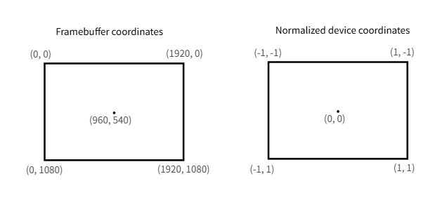
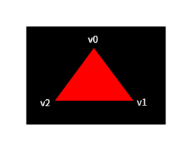
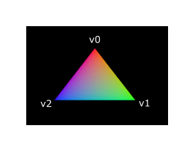

= 着色器模块
:toc:
:toclevels: 3
:toc-title: 目录

与别的的 API 不同，Vulkan 中的着色器代码必须以字节码格式指定，而不是像 https://en.wikipedia.org/wiki/OpenGL_Shading_Language[GLSL]、 https://shader-slang.org/slang/user-guide/[Slang]和 https://en.wikipedia.org/wiki/High-Level_Shading_Language[HLSL]那样使用人类可读的语法。这种字节码格式称为 https://www.khronos.org/spir[SPIR-V]，专为 Vulkan（Khronos 的一个 API）而设计。它可用于编写图形着色器和计算着色器，但本教程将重点介绍 Vulkan 图形管线中使用的着色器。

使用字节码格式的优势在于，GPU 厂商编写的用于将着色器代码转换为本地代码的编译器复杂度显著降低。过去的经验表明，在使用 GLSL 等人类可读语法时，一些 GPU 厂商对标准的解释相当灵活。如果您使用这些厂商的 GPU 编写复杂的着色器，则可能会面临其他厂商的驱动程序因语法错误而拒绝您的代码，更糟糕的是，由于编译器错误，您的着色器运行方式可能与预期不符。而使用像 SPIR-V 这样简洁明了的字节码格式，则有望避免这种情况的发生。

然而，这并不意味着我们需要手动编写字节码。Khronos 发布了他们自己的独立于厂商的编译器，可以将 Slang 编译成 SPIR-V。该编译器旨在验证您的着色器代码是否完全符合标准，并生成一个可以随程序一起发布的 SPIR-V 二进制文件。您也可以将此编译器作为库包含进来，以便在运行时生成 SPIR-V，但本教程中我们暂不涉及此操作，直到我们在后续章节中讲解反射时才会用到。虽然我们可以直接通过 `--compiler` 使用此编译器``slangc``，但我们将``slangc``在 CMake 构建过程中使用它。

Slang 是一种采用 C 风格语法的着色语言。用它编写的程序有一个主入口点，每个对象都会被调用。与 HLSL 类似，Slang 使用参数和返回值进行输入输出，并使用注解来描述这些变量之间的关系。该语言包含许多辅助图形编程的功能，例如内置的向量和矩阵图元。它还包含用于诸如叉积、矩阵-向量乘积、AI 自动微分以及围绕向量的反射等运算的函数。向量类型``float``通过一个数字来表示元素的数量。例如，一个 3D 位置可以存储在一个向量中``float3``。

我们可以通过``.x``这样来访问单个成员，也可以同时从多个分量创建一个新向量。例如，`float3(1.0, 2.0, 3.0).xy` 将生成一个``float2``向量。向量的构造函数还可以接受向量对象和标量值的组合。例如，``float3``可以使用构造函数创建 一个向量``float3(float2(1.0, 2.0), 3.0)``。

正如上一章所述，我们需要编写顶点着色器和片段着色器才能在屏幕上显示三角形。接下来的两节将介绍 Slang 代码，之后我会演示如何生成 SPIR-V 二进制文件并将其加载到程序中。

== 顶点着色器
顶点着色器处理每个传入的顶点。它以顶点的属性作为输入，例如世界坐标、颜色、法线坐标和纹理坐标。输出结果是裁剪坐标系中的最终位置以及需要传递给片段着色器的属性，例如颜色坐标和纹理坐标。然后，光栅化器会将这些值插值到各个片段上，以生成平滑的渐变。

裁剪坐标是顶点着色器生成的一个四维向量，随后通过将整个向量除以其最后一个分量， 将其转换为归一化设备坐标。这些归一化设备坐标是 https://en.wikipedia.org/wiki/Homogeneous_coordinates[齐次坐标] ，它将帧缓冲区映射到一个 [-1, 1] × [-1, 1] 的坐标系，如下所示：

如果您之前接触过计算机图形学，应该已经熟悉这些概念了。如果您之前使用过 OpenGL，就会注意到 Y 坐标的符号现在反转了。Z 坐标现在使用与 Direct3D 相同的范围，即 0 到 1。

对于我们的第一个三角形，我们不进行任何变换，而是直接指定三个顶点的位置作为归一化设备坐标，以创建以下形状：

我们可以直接输出归一化设备坐标，方法是从顶点着色器中将最后一个分量设置为``1``，然后将其作为裁剪坐标输出。这样，将裁剪坐标转换为归一化设备坐标的除法运算就不会产生任何影响。

通常情况下，这些坐标会存储在顶点缓冲区中，但在 Vulkan 中创建顶点缓冲区并填充数据并非易事。因此，我决定先推迟这一步骤，等到我们终于看到屏幕上出现三角形之后再进行。在此期间，我们将采用一种略显非常规的方法：直接将坐标包含在顶点着色器中。代码如下：
[source,slang]
----
static float2 positions[3] = float2,
        float2(0.5, 0.5),
        float2(-0.5, 0.5)
);

struct VertexOutput {
    float4 sv_position : SV_Position;
};

[shader("vertex")]
VertexOutput vertMain(uint vid : SV_VertexID) {
    VertexOutput output;
    output.sv_position = float4(positions[vid], 0.0, 1.0);
    return output;
}
----
该``vertMain``函数会针对每个顶点调用。参数中的内置``SV_VertexID`` 注解变量包含当前顶点的索引。这通常是顶点缓冲区的索引，但在我们的例子中，它将是一个硬编码顶点数据数组的索引。每个顶点的位置从着色器中的常量数组访问，并与虚拟坐标 ``z``和``w``分量结合，生成裁剪坐标系中的位置。内置注解``SV_Position``标记了 VertexOutput 结构体中的输出。如果您熟悉其他着色语言（例如 GLSL 或 HLSL），值得注意的是，这里没有绑定指令。这是 Slang 的一个特性。Slang 的设计理念是根据声明顺序自动推断绑定。位置结构体是一个静态变量，用于告知编译器我们的着色器不需要任何绑定。细心的读者会注意到，我们将主函数命名为 vertMain 而不是 main，这是因为 Slang 和 SPIR-V 都支持在一个文件中存在多个入口点。当处理包含多个顶点/片段着色器组合的渲染管线时，这一点尤为重要。例如，即使是简单的演示，光线追踪也可能需要四个或更多着色器，每个着色器都很小，但都需要单独的文件，这可能会变得很繁琐。Slang 的另一个主要特性是能够创建着色器库或模块；读者可以自行探索更多关于这种功能丰富的着色语言的内容。

在本教程中，我们将演示最佳实践，即把所有着色器都放在一个文件中。如果您了解 GLSL，附件文件夹中提供了着色器的 GLSL 版本，它们是直接转换而来的。

== 片段着色器
由顶点着色器确定的位置构成的三角形会用片段填充屏幕上的区域。对这些片段调用片段着色器，为帧缓冲区（或多个帧缓冲区）生成颜色和深度。一个简单的片段着色器，将整个三角形输出为红色，如下所示：
[source,slang]
----
[shader("fragment")]
float4 fragMain() : SV_Target {
    return float4(1.0, 0.0, 0.0, 1.0);
}
----
入口``fragMain``点函数会针对每个片段调用，就像顶点着色器``vertMain``函数会针对每个顶点调用一样。Slang 中的颜色是四分量向量，其 R、G、B 和 alpha 通道的值都在 [0, 1] 范围内。``SV_Target``返回值上的注解将其标记为写入帧缓冲区的颜色。实际上，这里它是可选的：即使着色器写入多个帧缓冲区，Slang 也会根据返回值自动推断渲染目标，因此 ``SV_Target``只有当您想要显式地将特定输出绑定到特定帧缓冲区索引时才需要它。在这些示例中，我们保留它是为了清晰地展示写入位置。红色直接返回``float4(1.0, 0.0, 0.0, 1.0)``。

== 每个顶点的颜色
把整个三角形涂成红色没什么意思，像下面这样的效果岂不是更好看？

为了实现这一点，我们需要对两个着色器都做一些修改。首先，我们需要为三个顶点分别指定不同的颜色。顶点着色器现在应该包含一个颜色数组，就像它处理位置着色器一样：
[source,slang]
----
static float3 colors[3] = float3,
        float3(0.0, 1.0, 0.0),
        flaot3(0.0, 0.0, 1.0)
);
----
现在我们只需要将这些顶点颜色传递给片段着色器，以便它可以将插值后的值输出到帧缓冲区。在顶点着色器中添加一个颜色输出，并在``vertMain``函数中写入该输出：
[source,slang]
----
struct VertexOutput {
    float3 color;
    float4 sv_position : SV_Position;
};

[shader("vertex")]
VertexOutput vertMain(uint vid : SV_VertexID) {
    VertexOutput output;
    output.sv_position = float4(positions[vid], 0.0, 1.0);
    output.color = colors[vid];
    return output;
}
----
接下来，我们需要在片段着色器中添加一个匹配参数：
[source,slang]
----
[shader("fragment")]
float4 fragMain(VertexOutput inVert) : SV_Target {
    float3 color = inVert.color;
    return float4(color, 1.0);
}
----
输入变量不必使用相同的名称，但如果它们位于同一个文件中，避免重复会更方便。无论如何，它们都会通过指令指定的索引链接在一起。该``fragMain``函数已修改为输出颜色及其透明度值。如上图所示，三个顶点之间的片段的透明度值``fragColor``将自动插值，从而产生平滑的渐变效果。

== 编译着色器
在项目根目录下创建一个名为 `shaders` 的目录，并将着色器存储在一个名为 `slang` 的文件中。
[source,slang]
----
static float2 positions[3] = float2,
    float2(0.5, 0.5),
    float2(-0.5, 0.5)
);

static float3 colors[3] = float3,
    float3(0.0, 1.0, 0.0),
    float3(0.0, 0.0, 1.0)
);

struct VertexOutput {
    float3 color;
    float4 sv_position : SV_Position;
};

[shader("vertex")]
VertexOutput vertMain(uint vid : SV_VertexID) {
    VertexOutput output;
    output.sv_position = float4(positions[vid], 0.0, 1.0);
    output.color = colors[vid];
    return output;
}

[shader("fragment")]
float4 fragMain(VertexOutput inVert) : SV_Target {
    float3 color = inVert.color;
    return float4(color, 1.0);
}
----
现在我们将使用该 ``slangc``程序将这些编译成 SPIR-V 字节码。

=== Window
创建一个``compile.bat``文件，内容如下：
[source, bash]
----
C:/VulkanSDK/x.x.x.x/bin/slangc.exe shader.slang -target spirv -profile spirv_1_4 -emit-spirv-directly -fvk-use-entrypoint-name -entry vertMain -entry fragMain -o slang.spv
----
将路径替换``slangc.exe``为您安装 Vulkan SDK 的路径。双击该文件即可运行。

=== Linux
创建一个``compile.sh``文件，内容如下：
[source,bash]
----
/home/user/VulkanSDK/x.x.x.x/x86_64/bin/slangc shader.slang -target spirv -profile spirv_1_4 -emit-spirv-directly -fvk-use-entrypoint-name -entry vertMain -entry fragMain -o slang.spv
----
将路径替换``slangc``为您安装 Vulkan SDK 的路径。使用以下命令使脚本可执行``chmod +x compile.sh``并运行它。

=== 特定平台说明结束
这两条命令告诉编译器读取 Slang 源文件，并使用``-o``(output) 标志直接输出 SPIR-V 1.4 字节码文件。

注意：SlangC 原生支持 SPIR-V 1.3 及以上版本，无需通过生成 GLSL 代码即可达到 SPIR-V 的兼容性。虽然本教程中的所有内容都可以在 SPIR-V 1.0 上运行，但这需要我们将 Slang 着色器拆分成多个文件，这就引出了一个问题：这样做有什么意义呢？使用 SPIR-V 1.4 意味着您将使用功能更强大的标准版本，而不是功能更有限的旧版本。

如果你的着色器代码包含语法错误，编译器会如你所料地告诉你行号和错误所在。例如，尝试省略一个分号，然后再次运行编译器脚本。你也可以尝试不带任何参数运行编译器，看看它支持哪些类型的编译选项。例如，它还可以将字节码输出为人类可读的格式，这样你就可以清楚地看到着色器正在执行的操作以及在此阶段应用的任何优化。

在命令行编译着色器是最直接的方法之一，但最佳方法（也是我们在本教程中使用的方法）是创建一个 CMake 函数：
[source,cmake]
----
function (add_slang_shader_target TARGET)
  cmake_parse_arguments ("SHADER" "" "" "SOURCES" ${ARGN})
  set (SHADERS_DIR ${CMAKE_CURRENT_LIST_DIR}/shaders)
  set (ENTRY_POINTS -entry vertMain -entry fragMain)
  add_custom_command (
          OUTPUT ${SHADERS_DIR}
          COMMAND ${CMAKE_COMMAND} -E make_directory ${SHADERS_DIR}
  )
  add_custom_command (
          OUTPUT  ${SHADERS_DIR}/slang.spv
          COMMAND ${SLANGC_EXECUTABLE} ${SHADER_SOURCES} -target spirv -profile spirv_1_4 -emit-spirv-directly -fvk-use-entrypoint-name ${ENTRY_POINTS} -o slang.spv
          WORKING_DIRECTORY ${SHADERS_DIR}
          DEPENDS ${SHADERS_DIR} ${SHADER_SOURCES}
          COMMENT "Compiling Slang Shaders"
          VERBATIM
  )
  add_custom_target (${TARGET} DEPENDS ${SHADERS_DIR}/slang.spv)
endfunction()
----
然后，您可以像这样将 Slang 构建步骤添加到您的目标中：
[source,cmake]
----
add_slang_shader_target( foo SOURCES ${SHADER_SLANG_SOURCES})
add_dependencies(bar foo)
----

== 加载着色器
现在我们已经有了生成 SPIR-V 着色器的方法，接下来需要将它们加载到程序中，以便最终接入图形管线。首先，我们将编写一个简单的辅助函数，用于从文件中加载二进制数据。
[source,c++]
----
#include <fstream>
...
static std::vector<char> readFile(const std::string& filename) {
    std::ifstream file(filename, std::ios::ate | std::ios::binary);

    if (!file.is_open()) {
        throw std::runtime_error("未能成功打开文件");
    }
}
----
该``readFile``函数将从指定文件中读取所有字节，并将它们存储在一个由 ``std::vector`` 管理的字节数组中返回。我们首先使用两个标志打开文件：

* ``ate``从文件末尾开始阅读
* ``binary``将文件作为二进制文件读取（避免文本转换）

从文件末尾开始读取的优点在于，我们可以使用读取位置来确定文件大小并分配缓冲区：
[source,c++]
----
std::vector<char> buffer(file.tellg());
----
之后，我们可以回到文件开头，一次性读取所有字节：
[source,c++]
----
file.seekg(0, std::ios::beg);
file.read(buffer.data(), static_cast<std::streamsize>(buffer.size()));
----
最后，关闭文件并返回字节：
[source,c++]
----
file.close();

return buffer;
----
现在我们将调用此函数来``createGraphicsPipeline``加载两个着色器的字节码：
[source,c++]
----
void createGraphicsPipeline() {
    auto shaderCode = readFile("shaders/slang.spv");
}
----
确保着色器已正确加载，方法是打印缓冲区大小并检查其是否与实际文件大小（以字节为单位）相符。请注意，由于代码是二进制代码，因此无需以空字符结尾，我们稍后会明确指定其大小。

== 创建着色器模块
在将代码传递给管道之前，我们需要将其封装在一个 ``vk::raii::ShaderModule``对象中。让我们创建一个辅助函数``createShaderModule``来完成这项工作。
[source,c++]
----
[[nodiscard]] vk::raii::ShaderModule createShaderModule(const std::vector<char>& code) const {

}
----
该函数将以字节码为参数的缓冲区为输入，并 ``vk::raii::ShaderModule``从中创建一个对象。

