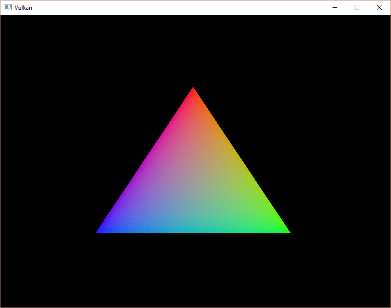
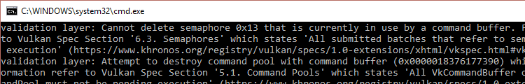

= 渲染与呈现
:toc:
:toclevels: 3
:toc-title: 目录

本章将把所有内容整合起来。我们将编写一个 `drawFrame` 函数，该函数将在主循环 `mainLoop` 中被调用，用于在屏幕上显示三角形。让我们首先创建该函数并从以下位置调用它：
[source,c++]
----
void mainLoop() {
    while (!glfwWindowShouldClose(window)) {
        glfwPoolEvents();
        drawFrame();
    }
}
...
void drawFrame() {

}
----
== 基础架构
从总体上看，Vulkan 渲染帧包含一系列常见的步骤：

* 等待上一帧结束
* 从交换链中获取图像
* 记录一个命令缓冲区，该缓冲区会将场景绘制到该图像上。
* 提交已记录的命令缓冲区
* 展示交换链图像

虽然我们将在后面的章节中扩展绘图功能，但就目前而言，这是我们渲染循环的核心。

== 同步
Vulkan 的核心设计理念之一是显式地同步 GPU 上的执行。操作顺序由我们定义，我们使用各种同步原语来告诉驱动程序我们希望操作按什么顺序执行。这意味着许多在 GPU 上执行工作的 Vulkan API 调用是异步的，函数会在操作完成之前返回。

本章中，有一些事件需要我们明确排序，因为它们发生在 GPU 上，例如：

* 从交换链中获取图像
* 执行在已采集图像上绘制图形的命令
* 将该图像呈现在屏幕上进行展示，然后将其返回到交换链。

这些事件均由单个函数调用触发，但都是异步执行的。函数调用会在操作实际完成之前返回，且执行顺序也未定义。这很不利，因为每个操作都依赖于前一个操作的完成。因此，我们需要探索可以使用哪些基本操作来实现所需的执行顺序。

=== 信号灯
二元信号量用于给队列操作添加顺序。队列操作指的是我们提交到队列中的工作，这些工作既可以来自命令缓冲区，也可以来自函数内部（稍后会详细介绍）。队列的例子包括图形队列和显示队列。信号量既可以用于对同一队列内的工作进行排序，也可以用于对不同队列之间的工作进行排序。

Vulkan 中有两种信号量：二进制信号量和时间线信号量。由于本教程仅使用二进制信号量，因此我们不会讨论时间线信号量。下文中提及的“信号量”一词均特指二进制信号量。

二元信号量要么是未发出信号的，要么是已发出信号的。它初始状态为未发出信号的。我们使用二元信号量来控制队列操作顺序的方法是：在一个队列操作中将同一个信号量作为“信号”信号量，而在另一个队列操作中将其作为“等待”信号量。例如，假设我们有一个信号量 S 和队列操作 A 和 B，我们希望按顺序执行它们。我们告诉 Vulkan，操作 A 在执行完成后会向信号量 S 发出信号，而操作 B 在开始执行之前会等待信号量 S。当操作 A 执行完毕时，信号量 S 将被发出信号，而操作 B 只有在信号量 S 被发出信号后才会开始执行。操作 B 开始执行后，信号量 S 会自动重置为未发出信号的状态，以便再次使用。

刚才描述的内容的伪代码：
----
vk::raii::CommandBuffer A, B = ... // 记录命令缓冲区
vk::raii::Semaphore S = ... // 创建一个信号量

// 将 A 入队，完成后发出信号 S - 立即开始执行
queue.submit(work: A, signal: S, wait: None)

// 将 B 入队，等待 S 开始
queue.submit(work: B, signal: None, wait: S)
----
请注意，在这段代码中，两次调用都 `queue.submit()` 立即返回——等待仅发生在 GPU 上。CPU 会继续运行，不会阻塞。要让 CPU 等待，我们需要不同的同步原语，我们接下来会介绍它。

=== 栅栏
栅栏的作用类似，它用于同步执行，但它是用来对 CPU（也就是主机）上的执行进行排序的。具体来说，如果主机需要知道 GPU 何时完成了某项任务，我们就需要使用栅栏。

与信号量类似，栅栏也分为已发出信号和未发出信号两种状态。每当我们提交任务执行时，都可以将一个栅栏附加到该任务上。当任务完成后，栅栏会被发出信号。然后，我们可以让主机等待栅栏发出信号，从而确保在主机继续执行其他任务之前，任务已经完成。

一个具体的例子是截屏。假设我们已经在GPU上完成了必要的处理。现在需要将图像从GPU传输到主机，然后将内存中的图像保存到文件中。我们有一个命令缓冲区A来执行传输操作，还有一个隔离区F。我们提交命令缓冲区A和隔离区F，然后立即告诉主机等待隔离区F的信号。这会导致主机阻塞，直到命令缓冲区A执行完毕。因此，我们可以安全地让主机将文件保存到磁盘，因为内存传输已经完成。

以下是对上述内容的伪代码：
----
vk::raii::CommandBuffer A = ... // 记录传输命令缓冲区
vk::raii::Fence F = ... // 创建围栏

// 将 A 入队，立即开始工作，完成后发出信号 F
queue.submit(work: A, fence: F)

device.waitForFences(F) // 阻塞执行，直到 A 执行完毕

save_screenshot_to_disk() // 传输完成之前无法运行
----
与信号量示例不同，此示例会阻塞主机执行。这意味着主机除了等待执行完成之外，不会执行任何其他操作。在这种情况下，我们必须确保传输完成才能将屏幕截图保存到磁盘。

一般来说，除非必要，否则最好不要阻塞主机。我们希望为 GPU 和主机提供有用的工作。等待栅栏发出信号并非有用的工作。因此，我们更倾向于使用信号量或其他尚未介绍的同步原语来同步我们的工作。

必须手动重置栅栏才能使其恢复到未发出信号的状态。这是因为栅栏用于控制主机的执行，因此主机可以决定何时重置栅栏。这与信号量形成对比，信号量用于在不涉及主机的情况下对 GPU 上的工作进行排序。

总而言之，信号量用于指定 GPU 上操作的执行顺序，而栅栏用于保持 CPU 和 GPU 彼此同步。

=== 如何选择？
我们有两种同步原语可以使用，并且恰好有两个地方可以应用同步：交换链操作和等待上一帧完成。我们希望使用信号量来进行交换链操作，因为它们在 GPU 上进行，因此我们尽可能避免让主机等待。对于等待上一帧完成的操作，我们希望使用栅栏，原因恰恰相反，因为我们需要主机等待。这是为了避免同时绘制多帧。由于我们每帧都会重新记录命令缓冲区，因此在当前帧执行完毕之前，我们无法将下一帧的工作记录到命令缓冲区。我们不希望在 GPU 使用命令缓冲区时覆盖其当前内容。

== 创建同步对象
我们需要一个信号量来表示已从交换链获取图像并准备好渲染。另一个信号量用于表示渲染已完成，可以进行展示，还需要一个栅栏来确保一次只渲染一帧。

创建三个类成员来存储这些信号量对象和栅栏对象：
[source,c++]
----
vk::raii::Semaphore presentCompleteSemaphore = nullptr;
vk::raii::Semaphore renderFinishedSemaphore = nullptr;
vk::raii::Fence drawFence = nullptr;
----
为了创建信号量，我们将添加本教程这一部分的最后一个函数 `createSyncObjects`：
[source,c++]
----
void initVulkan() {
    createInstance();
    setupDebugMessenger();
    createSurface();
    pickPhysicalDevice();
    createLogicalDevice();
    createSwapChain();
    createImageViews();
    createGraphicsPipeline();
    createCommandPool();
    createCommandBuffer();
    createSyncObjects();
}
...
void createSyncObjects() {

}
----
创建信号量需要填写参数 `vk::SemaphoreCreateInfo`，但在当前版本的 API 中，实际上没有任何与本教程相关的字段：

未来版本的 Vulkan API 或扩展可能会像对其他结构一样，为 `vk::SemaphoreCreateInfo` 结构体flags及其pNext成员添加功能。

接下来是主要的绘图功能！

== 等待上一帧
在帧开始时，我们需要等待上一帧结束后再进行操作，以便命令缓冲区和信号量可供使用。为此，我们调用 `vk::raii::Device::waitForFences`：
[source,c++]
----
void drawFrame() {
    auto fenceResult = device.waitForFences(*drawFence, vk::True, UINT64_MAX);
    if (fenceResult != vk::Result::eSuccess) {
        throw std::runtime_error("未等到栅栏!");
    }
    device.resetFences(*drawFence);
}
----
该 `vk::raii::Device::waitForFences` 函数接收一个栅栏数组，并在主机上等待数组中任意或全部栅栏发出信号后返回。`vk::True` 这里传递的参数表示要等待所有栅栏，但如果只等待一个栅栏，则无所谓。该函数还有一个超时参数，我们将其设置为 64 位无符号整数的最大值 `UINT64_MAX`，这样就相当于禁用了超时。

我们需要确保如果前一帧已经发生，围栏会被重置，这样我们就知道稍后要等待。

接下来，让我们在前一帧结束后，从交换链中获取一帧图像：
[source,c++]
----
void drawFrame() {
    ...
    auto [result, imageIndex] = swapChain.acquireNextImage(UINT64_MAX, *presentCompleteSemaphore, nullptr);
}
----
第一个参数指定图像可用的超时时间（以纳秒为单位）。使用 64 位无符号整数的最大值意味着我们实际上禁用了超时功能。

接下来的两个参数指定了同步对象，当显示引擎完成对图像的使用时，需要向这些对象发出信号。此时我们就可以开始向图像上绘制内容了。可以指定信号量、栅栏或两者都指定。这里我们将使用我们自己的信号量 `presentCompleteSemaphore` 来实现此目的。

该函数返回一对值：一个是通常的 `vk::Result` ，另一个是已可用的交换链图像的索引。该索引指向我们   `swapChainImages` 数组中的 `vk::Image`。我们将使用该索引来选择对应的交换链图像视图。然后，我们将记录渲染到该视图中的命令。

== 记录命令缓冲区
现在我们已经有了指定要使用的交换链镜像的 imageIndex，可以记录命令缓冲区了。接下来，调用函数 `recordCommandBuffer` 来记录我们需要的命令。
[source,c++]
----
recordCommandBuffer(imageIndex);
----
现在命令缓冲区已完全记录，我们可以提交了。

== 提交命令缓冲区
队列提交和同步是通过 `vk::SubmitInfo` 结构体中的参数进行配置的。
[source,c++]
----
vk::PipelineStageFlags waitDestinationStageMask(vk::PipelineStageFlagBits::eColorAttachmentOutput);
const vk::SubmitInfo submitInfo{
    .waitSemaphoreCount = 1,
    .pWaitSemaphores = &*presentCompleteSemaphore,
    .pWaitDstStageMask = &waitDestinationStageMask,
    .commandBufferCount = 1,
    .pCommandBuffers = &*commandBuffer,
    .signalSemaphoreCount = 1,
    .pSignalSemaphores = &*rederFinishedSemaphore
};
----
前三个参数指定在执行开始前要等待哪些信号量，以及要在管线的哪个或哪些阶段等待。我们希望在图像可用时再写入颜色，因此我们指定了图形管线中写入颜色附件的阶段。这意味着理论上，即使图像尚未可用，实现也可以开始执行顶点着色器等操作。数组中的每个条目 `waitStages` 对应于具有相同索引的信号量 `pWaitSemaphores`。

下一个参数指定要实际提交执行的命令缓冲区。我们只需提交我们拥有的单个命令缓冲区即可。

该 `pSignalSemaphores` 参数指定命令缓冲区执行完毕后要向哪些信号量发出信号。在本例中，我们为此目的使用 `renderFinishedSemaphore`。
[source,c++]
----
queue.submit(submitInfo, *drawFence);
----
现在我们可以使用 `vk::raii::Queue::submit` 将命令缓冲区提交到图形队列。该函数接受一个 `vk::SubmitInfo` 结构体数组作为参数，以便在工作负载较大时提高效率。最后一个参数指向一个可选的栅栏，当命令缓冲区执行完毕时，该栅栏会发出信号。这使我们能够知道何时可以安全地重用命令缓冲区，因此我们需要给它一个 `*drawFence` 参数，以便在下一帧中等待其完成。

== 图像
绘制帧的最后一步是将结果提交回交换链，最终使其显示在屏幕上。显示方式通过函数 `drawFrame` 末尾的结构体 `vk::PresentInfoKHR` 进行配置。
[source,c++]
----
const vk::PresentInfoKHR presentInfoKHR{
    .waitSemaphoreCount = 1,
    .pWaitSemaphores = &*renderFinishedSemaphore,
    .swapchainCount = 1,
    .pSwapchains = &*swapChain,
    .pImageIndices = &imageIndex
};
----
前两个参数指定在进行表示之前要等待哪些信号量，就像这样 `vk::SubmitInfo`。由于我们希望等待命令缓冲区执行完毕，从而绘制出我们的三角形，因此我们选取将被发出信号的信号量并等待它们，因此我们使用 `renderFinishedSemaphore`。

接下来的两个参数指定要将图像呈现到的交换链，以及每个交换链中图像的索引。该索引几乎总是唯一的。
[source,c++]
----
presentInfoKHR.pResults = nullptr;
----
还有一个可选参数 `pResults`。它允许您指定一个 `vk::Result` 值数组，用于检查每个交换链的呈现是否成功。如果您只使用单个交换链，则不需要此参数，因为您可以使用 `presentKHR` 函数的返回值。
[source,c++]
----
result = queue.presentKHR(presentInfoKHR);
----
该 `vk::raii::Queue::presentKHR` 函数会向交换链提交显示图像的请求。我们将在下一章添加这两个函数的错误处理 `vk::raii::SwapchainKHR::acquireNextImage`，`vk::raii::Queue::presentKHR` 因为它们的失败并不一定意味着程序应该终止，这与我们目前看到的函数不同。

如果你到目前为止的操作都正确无误，那么运行程序后，你应该会看到类似以下内容：

NOTE: 这个彩色三角形可能和你在图形教程中常见的三角形略有不同。这是因为本教程中的着色器先在线性色彩空间中进行插值，然后再转换为 sRGB 色彩空间。

太好了！不过，你会发现启用验证层后，程序会在关闭时立即崩溃。终端输出的信息 `debugCallback` 会告诉你原因：

请记住，所有操作 `drawFrame` 都是异步的。这意味着当我们退出循环时 `mainLoop`，绘制和显示操作可能仍在进行中。此时清理资源是不可取的。

为了解决这个问题，我们应该等待逻辑设备完成操作后再退出 `mainLoop` 并销毁窗口：
[source,c++]
----
void mainLoop() {
    while (!glfwWindowShouldClose(window)) {
        glfwPollEvents();
        drawFrame();
    }

    device.waitIdle();
}
----
您还可以使用 `vk::raii::Queue::waitIdle` 函数等待特定命令队列中的操作完成。这些函数可以作为一种非常基本的同步方式。您会发现，现在关闭窗口时程序可以正常退出。

== 结论
编写了 500 多行代码后，我们终于看到屏幕上出现了一些内容！启动一个 Vulkan 程序确实需要花费大量精力，但关键在于 Vulkan 通过其显式特性赋予了你极大的控制权。我建议你现在花些时间重新阅读代码，并构建一个关于程序中所有 Vulkan 对象用途及其相互关系的思维模型。接下来，我们将以此为基础，扩展程序的功能。

此外，在后续章节中，我们将讨论时间线信号量和内存屏障，并进一步深化我们对 Vulkan 同步机制的理解。同步是充分发挥 Vulkan 强大功能的关键领域之一，因此也相当复杂。虽然初次理解起来可能有些困难，但这却是后续学习的基础。随着工具箱中工具的增多，处理更精细的操作也会变得更加容易。

xref:多帧并行处理.adoc[下一章]将扩展渲染循环，以支持多帧并行处理。
