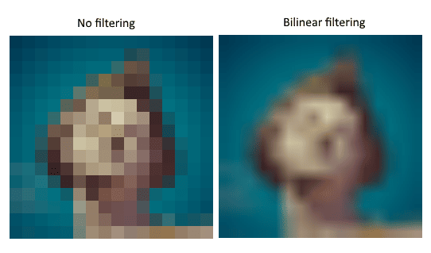
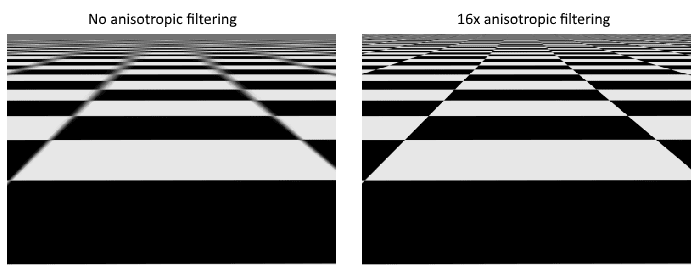
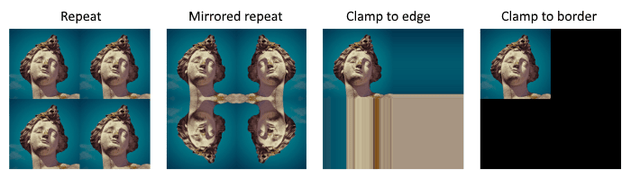
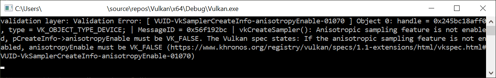

= 图像视图和采样器
:toc:
:toclevels: 3
:toc-title: 目录

本章我们将创建图形管线采样图像所需的另外两个资源。第一个资源我们在处理交换链图像时已经见过，而第二个资源是新的——它与着色器如何从图像中读取纹素有关。

== 纹理图像视图

我们之前在交换链图像和帧缓冲区中已经看到，图像是通过图像视图而不是直接访问的。我们也需要为纹理图像创建一个这样的图像视图。

添加一个 `vk::raii::ImageView` 类成员来保存纹理图像，并创建一个新函数 `createTextureImageView` 来创建它：

[source,c++]
----
vk::raii::ImageView textureImageView = nullptr;

...

void initVulkan()
{
    ...
    createTextureImage();
    createTextureImageView();
    createVertexBuffer();
    ...
}

...

void createTextureImageView()
{
}
----

此函数的代码可以直接基于原代码 `createImageViews`。您只需做 `format` 和 `image` 两处修改：

[source,c++]
----
vk::ImageViewCreateInfo viewInfo{
    .image            = image,
    .viewType         = vk::ImageViewType::e2D,
    .format           = format,
    .subresourceRange = {.aspectMask = vk::ImageAspectFlagBits::eColor, .baseMipLevel = 0, .levelCount = 1, .baseArrayLayer = 0, .layerCount = 1}};
----

我已经省略了显式 `viewInfo.components` 初始化，因为它默认已经初始化 `vk::ComponentSwizzle::eIdentity`。调用构造函数 `vk::raii::ImageView` 完成图像视图的创建：

[source,c++]
----
textureImageView = vk::raii::ImageView(device, viewInfo);
----

由于很多逻辑都与原函数重复 `createImageViews`，您可能希望将其抽象成一个新的 `createImageView` 函数

[source,c++]
----
vk::raii::ImageView createImageView(vk::Image const &image, vk::Format format)
{
  vk::ImageViewCreateInfo viewInfo{
      .image            = image,
      .viewType         = vk::ImageViewType::e2D,
      .format           = format,
      .subresourceRange = {.aspectMask = vk::ImageAspectFlagBits::eColor, .baseMipLevel = 0, .levelCount = 1, .baseArrayLayer = 0, .layerCount = 1}};
  return vk::raii::ImageView(device, viewInfo);
}
----

该 `createTextureImageView` 函数现在可以简化为：

[source,c++]
----
void createTextureImageView()
{
  textureImageView = createImageView(*textureImage, vk::Format::eR8G8B8A8Srgb);
}
----

可以 `createImageViews` 简化为：

[source,c++]
----
void createImageViews()
{
  assert(swapChainImageViews.empty());

  swapChainImageViews.reserve(swapChainImages.size());
  for ( auto &image: swapChainImages )
  {
    swapChainImageViews.emplace_back(createImageView(image, swapChainSurfaceFormat.format));
  }
}
----

== 采样器

着色器可以直接从图像中读取纹素，但这在将图像用作纹理时并不常见。纹理通常通过采样器访问，采样器会应用过滤和变换来计算最终获取的颜色。

这些滤波器有助于处理过采样等问题。考虑一个映射到几何体的纹理，其片段数量多于纹素数量。如果只是简单地取每个片段中纹理坐标最近的纹素，那么就会得到类似第一张图的结果：

如果通过线性插值将最接近的 4 个纹素合并，就能得到像右侧那样更平滑的结果。当然，你的应用程序可能对美术风格有特殊要求，更适合左侧的风格（例如 Minecraft），但在传统的图形应用程序中，右侧的风格更为常见。采样器对象在从纹理读取颜色时会自动应用这种过滤效果。

欠采样则恰恰相反，它会导致纹素数量多于片段数量。当以锐角采样高频图案（例如棋盘格纹理）时，就会出现瑕疵：

如图左所示，远处纹理变得模糊不清。解决这个问题的方法是 https://en.wikipedia.org/wiki/Anisotropic_filtering[各向异性滤波]，采样器也可以自动应用这种滤波方法。

除了这些滤波器之外，采样器还可以处理变换。它决定了当你尝试通过寻址模式读取图像外部的纹素时会发生什么。下图展示了一些可能性：

现在我们将创建一个函数 `createTextureSampler` 来设置这样一个采样器对象。稍后我们将使用该采样器在着色器中读取纹理中的颜色。

[source,c++]
----
void initVulkan()
{
    ...
    createTextureImage();
    createTextureImageView();
    createTextureSampler();
    ...
}

...

void createTextureSampler()
{
}
----

采样器通过结构体 `vk::SamplerCreateInfo` 进行配置，该结构体指定了采样器应该应用的所有过滤器和转换。

[source,c++]
----
vk::SamplerCreateInfo samplerInfo{.magFilter = vk::Filter::eLinear, .minFilter = vk::Filter::eLinear};
----

`magFilter` 和 `minFilter` 字段指定如何对放大或缩小的纹素进行插值。放大涉及上文所述的过采样问题，而缩小涉及欠采样问题。选项为 `vk::Filter::eNearest` 和 `vk::Filter::eLinear` ，分别对应于上图中所示的模式。

[source,c++]
----
vk::SamplerCreateInfo samplerInfo{.magFilter    = vk::Filter::eLinear,
                                  .minFilter    = vk::Filter::eLinear,
                                  .mipmapMode   = vk::SamplerMipmapMode::eLinear,
                                  .addressModeU = vk::SamplerAddressMode::eRepeat,
                                  .addressModeV = vk::SamplerAddressMode::eRepeat,
                                  .addressModeW = vk::SamplerAddressMode::eRepeat};
----

可以使用字段 `addressMode` 为每个轴指定寻址模式。可用值如下所示。上图展示了其中大部分值。请注意，轴的名称是 U、V 和 W，而不是 X、Y 和 Z。这是纹理空间坐标的约定。

- `vk::SamplerAddressMode::eRepeat`：超出图像尺寸时，重复纹理。
- `vk::SamplerAddressMode::eMirroredRepeat`：类似于重复，但当超出尺寸范围时，反转坐标以镜像图像。
- `vk::SamplerAddressMode::eClampToEdge`：取超出图像尺寸范围的坐标附近边缘的颜色。
- `vk::SamplerAddressMode::eMirrorClampToEdge`：类似于夹紧边缘，但使用的是与最近边缘相对的边缘。
- `vk::SamplerAddressMode::eClampToBorder`：当采样超出图像尺寸时，返回纯色。

这里使用哪种寻址模式其实并不重要，因为本教程中我们不会对图像外部进行采样。不过，重复模式可能是最常用的模式，因为它可用于平铺地板和墙壁等纹理。

[source,c++]
----
vk::PhysicalDeviceProperties properties = physicalDevice.getProperties();
vk::SamplerCreateInfo        samplerInfo{.magFilter        = vk::Filter::eLinear,
                                         .minFilter        = vk::Filter::eLinear,
                                         .mipmapMode       = vk::SamplerMipmapMode::eLinear,
                                         .addressModeU     = vk::SamplerAddressMode::eRepeat,
                                         .addressModeV     = vk::SamplerAddressMode::eRepeat,
                                         .addressModeW     = vk::SamplerAddressMode::eRepeat,
                                         .anisotropyEnable = vk::True,
                                         .maxAnisotropy    = properties.limits.maxSamplerAnisotropy};
----

`anisotropyEnable` 字段指定是否使用各向异性滤波。除非性能是主要考虑因素，否则没有理由不使用此功能。`maxAnisotropy` 字段限制了可用于计算最终颜色的纹素样本数量。值越低，性能越好，但结果质量越差。要确定可以使用的值，我们需要按如下方式检索物理设备的属性：

[source,c++]
----
vk::PhysicalDeviceProperties properties = physicalDevice.getProperties();
----

查看 `vk::PhysicalDeviceProperties` 结构的文档，你会发现它包含一个 `vk::PhysicalDeviceLimits` 名为 `limits` 的成员。该结构体又包含一个名为 `maxSamplerAnisotropy` 的成员，这是我们可以为 `maxAnisotropy` 指定的最大值。如果我们想要追求最高质量，可以直接使用该值。你可以在程序开始时查询这些属性，并将它们传递给需要它们的函数，也可以在 `createTextureSampler` 函数内部进行查询。

[source,c++]
----
vk::PhysicalDeviceProperties properties = physicalDevice.getProperties();
vk::SamplerCreateInfo        samplerInfo{.magFilter        = vk::Filter::eLinear,
                                         .minFilter        = vk::Filter::eLinear,
                                         .mipmapMode       = vk::SamplerMipmapMode::eLinear,
                                         .addressModeU     = vk::SamplerAddressMode::eRepeat,
                                         .addressModeV     = vk::SamplerAddressMode::eRepeat,
                                         .addressModeW     = vk::SamplerAddressMode::eRepeat,
                                         .anisotropyEnable = vk::True,
                                         .maxAnisotropy    = properties.limits.maxSamplerAnisotropy,
                                         .compareEnable    = vk::False,
                                         .compareOp        = vk::CompareOp::eAlways};
----

[source,c++]
----
samplerInfo.borderColor = vk::BorderColor::eIntOpaqueBlack;
----

`borderColor` 字段指定在使用边界定位模式进行图像采样时返回的颜色。可以返回黑色、白色或透明色，格式可以是浮点数或整数。不能指定任意颜色。

[source,c++]
----
samplerInfo.unnormalizedCoordinates = vk::False;
----

`unnormalizedCoordinates` 字段指定用于寻址图像中纹素的坐标系。如果该字段为 `vk::True` ，则可以直接使用 `[0, texWidth)` 和 `[0, texHeight)` 范围内的坐标。如果该字段为 `vk::False` ，则使用 `[0, 1)` 范围内的所有坐标寻址纹素。实际应用中几乎总是使用归一化坐标，因为这样就可以使用完全相同的坐标来处理不同分辨率的纹理。

[source,c++]
----
samplerInfo.compareEnable = vk::False;
samplerInfo.compareOp = vk::CompareOp::eAlways;
----

如果启用了比较功能，则首先会将纹素与某个值进行比较，并将比较结果用于过滤操作。这主要用于阴影贴图的 https://developer.nvidia.com/gpugems/GPUGems/gpugems_ch11.html[百分比接近度过滤]。我们将在后续章节中详细介绍。

[source,c++]
----
samplerInfo.mipmapMode = vk::SamplerMipmapMode::eLinear;
samplerInfo.mipLodBias = 0.0f;
samplerInfo.minLod = 0.0f;
samplerInfo.maxLod = 0.0f;
----

所有这些字段都适用于 mipmapping。我们将在 xref:../生成Mipmap.adoc[后面的章节] 中详细介绍 mipmapping ，但简而言之，它是另一种可以应用的过滤器类型。

采样器的功能现已完全定义。添加一个类成员来保存采样器对象的句柄，并使用以下代码 `vkCreateSampler` 创建采样器：

[source,c++]
----
vk::raii::ImageView    textureImageView   = nullptr;
vk::raii::Sampler      textureSampler     = nullptr;

...

void createTextureSampler()
{
    ...

    textureSampler = vk::raii::Sampler(device, samplerInfo);
}
----

请注意，采样器本身并不引用 `vk::Image` 任何对象。采样器是一个独立的对象，它提供了一个从纹理中提取颜色的接口。它可以应用于任何图像，无论是 1D、2D 还是 3D 图像。这与许多旧版 API 不同，旧版 API 将纹理图像和过滤功能合并到一个状态中。

== 各向异性器件特性

如果你现在运行程序，你会看到类似这样的验证层消息：

这是因为各向异性滤波实际上是一个可选的设备功能。我们需要更新请求该功能的函数 `createLogicalDevice`：

[source,c++]
----
vk::StructureChain<vk::PhysicalDeviceFeatures2, vk::PhysicalDeviceVulkan13Features, vk::PhysicalDeviceExtendedDynamicStateFeaturesEXT> featureChain = {
    {.features = {.samplerAnisotropy = true } },            // vk::PhysicalDeviceFeatures2
    {.synchronization2 = true, .dynamicRendering = true },  // vk::PhysicalDeviceVulkan13Features
    {.extendedDynamicState = true }                         // vk::PhysicalDeviceExtendedDynamicStateFeaturesEXT
};
----

即使现代显卡不太可能不支持该功能，我们还是应该更新 `isDeviceSuitable` 以检查是否可用：

[source,c++]
----
bool isDeviceSuitable(VkPhysicalDevice device)
{
    ...

		auto features                 = physicalDevice.template getFeatures2<vk::PhysicalDeviceFeatures2,
		                                                                     vk::PhysicalDeviceVulkan13Features,
		                                                                     vk::PhysicalDeviceExtendedDynamicStateFeaturesEXT>();
		bool supportsRequiredFeatures = features.template get<vk::PhysicalDeviceFeatures2>().features.samplerAnisotropy &&
		                                features.template get<vk::PhysicalDeviceVulkan13Features>().dynamicRendering &&
		                                features.template get<vk::PhysicalDeviceVulkan13Features>().synchronization2 &&
		                                features.template get<vk::PhysicalDeviceExtendedDynamicStateFeaturesEXT>().extendedDynamicState;

		// Return true if the physicalDevice meets all the criteria
		return supportsVulkan1_3 && supportsGraphics && supportsAllRequiredExtensions && supportsRequiredFeatures;
}
----

`vk::raii::PhysicalDevice::getFeatures2` 重新利用 `vk::PhysicalDeviceFeatures` 结构体来指示支持哪些功能，而不是通过设置布尔值来请求功能。

除了强制启用各向异性滤波之外，也可以通过条件设置来禁用它：

[source,c++]
----
samplerInfo.anisotropyEnable = vk::False;
samplerInfo.maxAnisotropy = 1.0f;
----

xref:组合图像采样器.adoc[下一章]我们将向着色器公开图像和采样器对象，以便将纹理绘制到正方形上。

