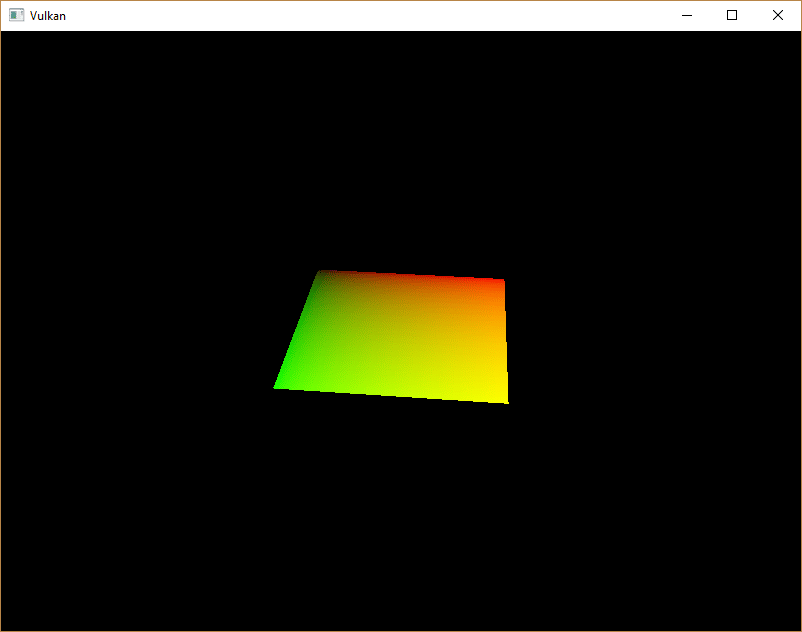
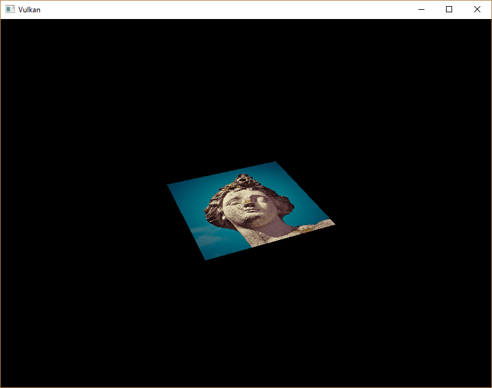
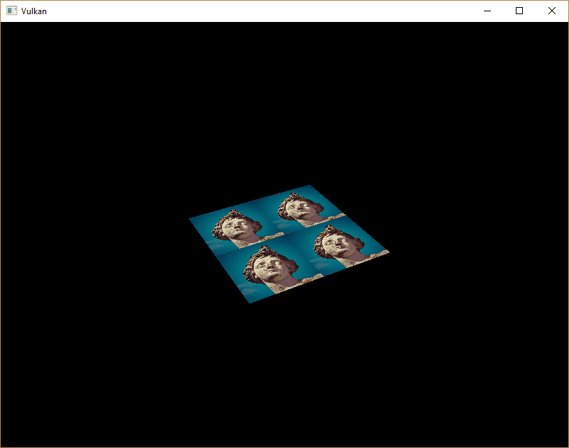
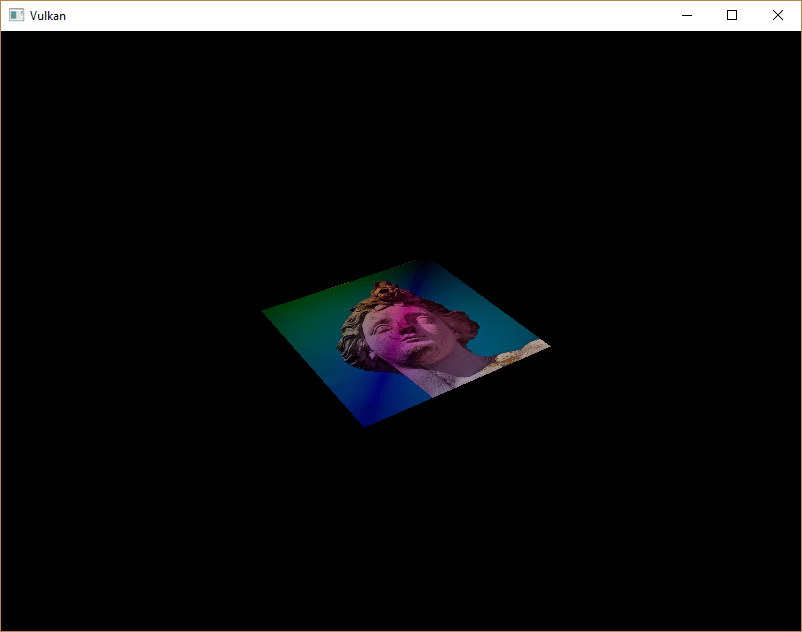

= 组合图像采样器
:toc:
:toclevels: 3
:toc-title: 目录

== 介绍

我们在教程的统一缓冲区部分首次接触了描述符。本章我们将介绍一种新型描述符：组合图像采样器。这种描述符使得着色器能够通过采样器对象（例如我们在上一章创建的采样器对象）访问图像资源。

值得注意的是，Vulkan 通过不同的描述符类型，为着色器中纹理的访问提供了灵活性。虽然本教程中我们将使用组合图像采样器，但 Vulkan 也支持为采样器（`vk::DescriptorType::eSampler`）和采样图像（`vk::DescriptorType::eSampledImage`）分别创建单独的描述符。使用单独的描述符允许您对多个图像重用同一个采样器，或者使用不同的采样参数访问同一图像。当存在许多使用相同采样配置的纹理时，这种方法会更加高效。然而，由于优化了缓存使用，组合图像采样器通常更方便，并且在某些硬件上可以提供更好的性能。

首先，我们将修改描述符集布局、描述符池和描述符集，使其包含这种组合图像采样器描述符。之后，我们将添加 `Vertex` 纹理坐标，替换颜色值，并修改片段着色器，使其从纹理读取颜色，而不是仅仅插值顶点颜色。

== 更新描述符

浏览到 `createDescriptorSetLayout` 函数并添加一个 `vk::DescriptorSetLayoutBinding` 组合图像采样器描述符。我们只需将其放在统一缓冲区之后的绑定中即可：

[source,c++]
----
std::array<vk::DescriptorSetLayoutBinding, 2> bindings{
    {{.binding = 0, .descriptorType = vk::DescriptorType::eUniformBuffer, .descriptorCount = 1, .stageFlags = vk::ShaderStageFlagBits::eVertex},
     {.binding = 1, .descriptorType = vk::DescriptorType::eCombinedImageSampler, .descriptorCount = 1, .stageFlags = vk::ShaderStageFlagBits::eFragment}}};

vk::DescriptorSetLayoutCreateInfo layoutInfo{.bindingCount = static_cast<uint32_t>(bindings.size()), .pBindings = bindings.data()};
----

请务必进行设置 `stageFlags`，以表明我们打算在片段着色器中使用组合图像采样器描述符。片段的颜色将在此处确定。例如，可以在顶点着色器中使用纹理采样，以便通过高度图动态地变形顶点网格。

我们还必须创建一个更大的描述符池，以便为组合图像采样器的分配留出空间：在 `vk::DescriptorPoolCreateInfo` 中再添加一个类型为 `vk::DescriptorType::eCombinedImageSampler` 的 `vk::PoolSize`。转到 `createDescriptorPool` 函数并修改它，使其包含一个用于该描述符的 `vk::DescriptorPoolSize`：

[source,c++]
----
std::array<vk::DescriptorPoolSize, 2> poolSize{{{.type = vk::DescriptorType::eUniformBuffer, .descriptorCount = MAX_FRAMES_IN_FLIGHT},
                                                {.type = vk::DescriptorType::eCombinedImageSampler, .descriptorCount = MAX_FRAMES_IN_FLIGHT}}};
vk::DescriptorPoolCreateInfo          poolInfo{.flags         = vk::DescriptorPoolCreateFlagBits::eFreeDescriptorSet,
                                               .maxSets       = MAX_FRAMES_IN_FLIGHT,
                                               .poolSizeCount = static_cast<uint32_t>(poolSize.size()),
                                               .pPoolSizes    = poolSize.data()};
----

描述符池不足是验证层无法捕获的一个典型问题：从 Vulkan 1.1 开始，如果池不够大，`vk::raii::Device::allocateDescriptorSets` 可能会失败并抛出 `vk::OutOfPoolMemoryError` 异常，但驱动程序也可能尝试在内部解决这个问题。这意味着有时（取决于硬件、池大小和分配大小），驱动程序会允许我们进行超出描述符池限制的分配。而有时， `vk::raii::Device::allocateDescriptorSets` 则会失败并抛出 `vk::OutOfPoolMemoryError` 异常。如果分配在某些机器上成功，但在其他机器上失败，这会尤其令人沮丧。

由于 Vulkan 将分配职责转移给了驱动程序，因此不再严格要求仅分配与相应 `descriptorCount` 成员在创建描述符池时指定的特定类型（例如 `vk::DescriptorType::eCombinedImageSampler` 等）描述符数量相同的描述符。但是，这样做仍然是最佳实践，并且将来如果您启用 `VK_LAYER_KHRONOS_validation` 的 https://vulkan.lunarg.com/doc/view/latest/windows/best_practices.html[最佳实践验证]，系统将对此类问题发出警告。

最后一步是将实际的图像和采样器资源绑定到描述符集中的描述符。转到 `createDescriptorSets` 函数。

[source,c++]
----
for (size_t i = 0; i < MAX_FRAMES_IN_FLIGHT; i++)
{
    vk::DescriptorBufferInfo bufferInfo{.buffer = uniformBuffers[i], .offset = 0, .range = sizeof(UniformBufferObject)};
    vk::DescriptorImageInfo  imageInfo{.sampler = textureSampler, .imageView = textureImageView, .imageLayout = vk::ImageLayout::eShaderReadOnlyOptimal};

    ...
}
----

组合图像采样器结构 `vk::DescriptorImageInfo` 的资源必须像统一缓冲区描述符的缓冲区资源一样，用 `vk::DescriptorBufferInfo` 结构体来指定。这就是上一章中提到的对象汇聚的地方。

[source,c++]
----
std::array<vk::WriteDescriptorSet, 2> descriptorWrites{{{.dstSet          = descriptorSets[i],
                                                         .dstBinding      = 0,
                                                         .dstArrayElement = 0,
                                                         .descriptorCount = 1,
                                                         .descriptorType  = vk::DescriptorType::eUniformBuffer,
                                                         .pBufferInfo     = &bufferInfo},
                                                        {.dstSet          = descriptorSets[i],
                                                         .dstBinding      = 1,
                                                         .dstArrayElement = 0,
                                                         .descriptorCount = 1,
                                                         .descriptorType  = vk::DescriptorType::eCombinedImageSampler,
                                                         .pImageInfo      = &imageInfo}}};
device.updateDescriptorSets(descriptorWrites, {});
----

描述符必须像缓冲区一样，用这些图像信息进行更新。这次我们使用 `pImageInfo` 数组而不是字符串 `pBufferInfo`。现在，描述符已经准备好供着色器使用了！

== 纹理坐标

纹理映射中仍然缺少一个重要的组成部分，那就是每个顶点的实际纹理坐标，通常称为“UV坐标”。纹理坐标决定了图像如何映射到几何体上。

[source,c++]
----
struct Vertex
{
    glm::vec2 pos;
    glm::vec3 color;
    glm::vec2 texCoord;

    static vk::VertexInputBindingDescription getBindingDescription()
    {
        return { 0, sizeof(Vertex), vk::VertexInputRate::eVertex };
    }

    static std::array<vk::VertexInputAttributeDescription, 3> getAttributeDescriptions()
    {
        return {{{.location = 0, .binding = 0, .format = vk::Format::eR32G32Sfloat, .offset = offsetof(Vertex, pos)},
		         {.location = 1, .binding = 0, .format = vk::Format::eR32G32B32Sfloat, .offset = offsetof(Vertex, color)},
		         {.location = 2, .binding = 0, .format = vk::Format::eR32G32Sfloat, .offset = offsetof(Vertex, texCoord)}}};
    }
};
----

修改 `Vertex` 结构体，使其包含 `vec2` 纹理坐标。同时，务必添加一个接口 `vk::VertexInputAttributeDescription`，以便我们可以在顶点着色器中将纹理坐标作为输入。这是为了能够将它们传递给片段着色器，以便在正方形表面进行插值。颜色在着色器部分末尾的另一个示例中使用，但显示图像并不需要它，可以将其移除。只需确保相应地更新 `vertices` 数组和着色器即可。

[source,c++]
----
const std::vector<Vertex> vertices = {
    {{-0.5f, -0.5f}, {1.0f, 0.0f, 0.0f}, {1.0f, 0.0f}},
    {{0.5f, -0.5f}, {0.0f, 1.0f, 0.0f}, {0.0f, 0.0f}},
    {{0.5f, 0.5f}, {0.0f, 0.0f, 1.0f}, {0.0f, 1.0f}},
    {{-0.5f, 0.5f}, {1.0f, 1.0f, 1.0f}, {1.0f, 1.0f}}
};
----

在本教程中，我将使用从左上角 `0, 0` 到右下角 `1, 1` 的坐标，简单地用纹理填充正方形。您可以随意尝试不同的坐标。尝试使用比 `1` 更大或比 `0` 更小的坐标，看看寻址模式是如何工作的！

== 着色器

最后一步是修改着色器，使其能够从纹理中采样颜色。我们首先需要修改顶点着色器，使其能够将纹理坐标传递给片段着色器：

[source,slang]
----
struct VSInput {
    float2 inPos;
    float3 inColor;
    float2 inTexCoord;
};

struct UniformBuffer {
    float4x4 model;
    float4x4 view;
    float4x4 proj;
};
ConstantBuffer<UniformBuffer> ubo;

struct VSOutput
{
    float4 pos : SV_Position;
    float3 fragColor;
    float2 fragTexCoord;
};

[shader("vertex")]
VSOutput vertMain(VSInput input) {
    VSOutput output;
    output.pos = mul(ubo.proj, mul(ubo.view, mul(ubo.model, float4(input.inPos, 0.0, 1.0))));
    output.fragColor = input.inColor;
    output.fragTexCoord = input.inTexCoord;
    return output;
}

[shader("fragment")]
float4 fragMain(VSOutput vertIn) : SV_TARGET {
   return float4(vertIn.fragTexCoord, 0.0, 1.0);
}
----

你应该会看到类似下图的内容。记得重新编译着色器！

绿色通道代表水平坐标，红色通道代表垂直坐标。黑色和黄色角点确认纹理坐标已正确地从正方形的某一点插值0, 0到1, 1另一点。用颜色可视化数据，就好比是着色器编程中的printf调试，暂且这么说吧！

采样器在 Slang 中表示组合图像采样器描述符。在片段着色器中添加对其的引用：

[source,slang]
----
Sampler2D texture;
----

还有其他类型的图像也有对应的格式 `sampler1D` 和 `sampler3D` 类型。请务必在此处使用正确的装订方式。

[source,slang]
----
[shader("fragment")]
float4 fragMain(VSOutput vertIn) : SV_TARGET {
   return texture.Sample(vertIn.fragTexCoord);
}
----

纹理采样使用内置texture函数完成。该函数接受一个图像 `sampler` 和一个坐标作为参数。采样器会在后台自动处理过滤和变换。现在运行应用程序后，您应该可以在正方形上看到纹理：

尝试通过将纹理坐标缩放到大于某个阈值的值来改变寻址模式。例如，以下片段着色器在使用以下模式时会产生下图所示的结果 `VK_SAMPLER_ADDRESS_MODE_REPEAT`：

[source,slang]
----
[shader("fragment")]
float4 fragMain(VSOutput vertIn) : SV_TARGET {
   return texture.Sample(vertIn.fragTexCoord * 2.0);
}
----

您还可以使用顶点颜色来操控纹理颜色：

[source,slang]
----
[shader("fragment")]
float4 fragMain(VSOutput vertIn) : SV_TARGET {
   return float4(vertIn.fragColor * texture.Sample(vertIn.fragTexCoord).rgb, 1.0);
}
----

我在这里将 RGB 通道和 alpha 通道分开，这样就不会缩放 alpha 通道。

现在你知道如何访问着色器中的图像了！当与写入帧缓冲区的图像结合使用时，这项技术非常强大。你可以将这些图像用作输入，在 3D 世界中实现诸如后期处理和相机显示等炫酷效果。

xref:../深度缓冲.adoc[下一章]我们将学习如何添加深度缓冲以正确排序对象。

