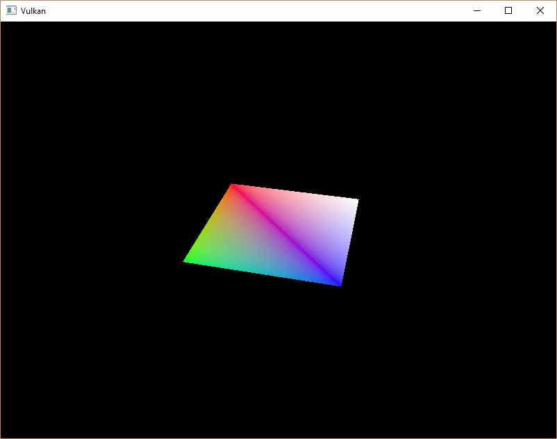

= 描述符池和集
:toc:
:toclevels: 3
:toc-title: 目录

== 介绍

上一章的描述符集布局描述了可以绑定的描述符类型。本章我们将为每个 `vk::raii::Buffer` 资源创建一个描述符集，并将其绑定到统一缓冲区描述符。

== 描述符池

描述符集不能直接创建，必须从类似命令缓冲区的池中分配。描述符集的对应物不出所料地被称为描述符池。我们将编写一个新函数 `createDescriptorPool` 来设置它。

[source,c++]
----
void initVulkan()
{
    ...
    createUniformBuffers();
    createDescriptorPool();
    ...
}

...

void createDescriptorPool()
{
}
----

首先，我们需要使用结构体来描述我们的描述符集将包含哪些描述符类型以及它们的数量 `vk::DescriptorPoolSize`。

[source,c++]
----
vk::DescriptorPoolSize poolSize{ .type = vk::DescriptorType::eUniformBuffer, .descriptorCount = MAX_FRAMES_IN_FLIGHT };
----

我们将为每个帧分配一个这样的描述符 `vk::DescriptorPoolCreateInfo`。此池大小结构由主引用：

[source,c++]
----
vk::DescriptorPoolCreateInfo poolInfo{ .flags = vk::DescriptorPoolCreateFlagBits::eFreeDescriptorSet, .maxSets = MAX_FRAMES_IN_FLIGHT, .poolSizeCount = 1, .pPoolSizes = &poolSize };
----

除了可用的单个描述符的最大数量之外，我们还需要指定可以分配的描述符集的最大数量。

该结构体有一个类似于命令池的可选标志，用于决定是否可以释放单个描述符集。由于 `vk::raii::DescriptorSets` 销毁时会销毁底层资源，我们需要将 `vk::DescriptorSet` 设置为 `vk::DescriptorPoolCreateFlagBits::eFreeDescriptorSet` 以允许释放。

[source,c++]
----
vk::raii::DescriptorPool descriptorPool = nullptr;

...

descriptorPool = vk::raii::DescriptorPool(device, poolInfo);
----

添加一个新的类成员来存储描述符池的句柄，并调用 `vk::raii::DescriptorPool` 构造函数来创建它。

== 描述符集

现在我们可以分配描述符集本身了。为此，请添加一个函数 `createDescriptorSets`：

[source,c++]
----
void initVulkan()
{
    ...
    createDescriptorPool();
    createDescriptorSets();
    ...
}

...

void createDescriptorSets()
{
}
----

描述符集的分配用一个 `vk::DescriptorSetAllocateInfo` 结构体来描述。你需要指定要从中分配的描述符池、要分配的描述符集的数量以及它们所基于的描述符集布局：

[source,c++]
----
std::vector<vk::DescriptorSetLayout> layouts(MAX_FRAMES_IN_FLIGHT, *descriptorSetLayout);
vk::DescriptorSetAllocateInfo        allocInfo{.descriptorPool     = descriptorPool,
                                               .descriptorSetCount = static_cast<uint32_t>(layouts.size()),
                                               .pSetLayouts        = layouts.data()};
----

在本例中，我们将为飞行中的每一帧创建一个描述符集，所有描述符集都采用相同的布局。遗憾的是，我们需要所有布局副本，因为下一个函数需要一个与描述符集数量相匹配的数组。

添加一个类成员来保存描述符集句柄，并使用以下 `vk::raii::Device::allocateDescriptorSets` 方式分配它们：

[source,c++]
----
vk::raii::DescriptorPool             descriptorPool = nullptr;
std::vector<vk::raii::DescriptorSet> descriptorSets;

...

descriptorSets = device.allocateDescriptorSets(allocInfo);
----

描述符集已分配完毕，但其中的描述符仍需配置。接下来，我们将添加一个循环来填充每个描述符：

[source,c++]
----
for (size_t i = 0; i < MAX_FRAMES_IN_FLIGHT; i++)
{
}
----

引用缓冲区的描述符（例如我们的统一缓冲区描述符）通过 `vk::DescriptorBufferInfo` 结构体进行配置。该结构体指定缓冲区以及其中包含描述符数据的区域。

[source,c++]
----
for (size_t i = 0; i < MAX_FRAMES_IN_FLIGHT; i++)
{
    vk::DescriptorBufferInfo bufferInfo{ .buffer = uniformBuffers[i], .offset = 0, .range = sizeof(UniformBufferObject) };
}
----

如果像本例中一样覆盖整个缓冲区，也可以使用该 `vk::WholeSize` 值作为范围。描述符的配置通过一个 `vk::raii::Device::updateDescriptorSets` 函数进行更新，该函数接受一个 `vk::WriteDescriptorSet` 结构体数组作为参数。

[source,c++]
----
vk::DescriptorBufferInfo bufferInfo{.buffer = uniformBuffers[i], .offset = 0, .range = sizeof(UniformBufferObject)};
vk::WriteDescriptorSet   descriptorWrite{.dstSet          = descriptorSets[i],
                                         .dstBinding      = 0,
                                         .dstArrayElement = 0,
                                         .descriptorCount = 1,
                                         .descriptorType  = vk::DescriptorType::eUniformBuffer,
                                         .pBufferInfo     = &bufferInfo};
----

前两个字段指定要更新的描述符集和绑定。我们为统一缓冲区绑定指定了索引 `0`。请记住，描述符可以是数组，因此我们还需要指定要更新的数组中的第一个索引。我们没有使用数组，所以索引很简单。

我们需要再次指定描述符的类型。可以一次性更新数组中的多个描述符，从索引 `dstArrayElement` 开始。该 `descriptorCount` 字段指定要更新的数组元素数量。

最后一个字段引用一个包含 `descriptorCount` 结构体的数组，这些结构体实际配置描述符。具体需要使用三个结构体中的哪一个取决于描述符的类型。 `pBufferInfo` 字段用于引用缓冲区数据的描述符。此结构体中还有其他元素，但本示例中未使用： `pImageInfo` 用于引用图像数据的描述符，`pTexelBufferView` 用于引用缓冲区视图的描述符。我们的描述符基于缓冲区，因此我们只使用 `pBufferInfo` 。

[source,c++]
----
device.updateDescriptorSets(descriptorWrite, {});
----

更新操作通过 `vk::raii::Device::updateDescriptorSets` 方法执行。它接受两个数组作为参数：一个数组包含 `vk::WriteDescriptorSet` 标签，另一个数组包含 `vk::CopyDescriptorSet` 标签。顾名思义，后者可用于将描述符相互复制。

== 使用描述符集

现在我们需要更新 `recordCommandBuffer` 函数，以便将每一帧的正确描述符集绑定到着色器中的描述符。 `vk::raii::CommandBuffer::bindDescriptorSets` 需要在调用 `vk::raii::CommandBuffer::drawIndexed` 之前完成：

[source,c++]
----
commandBuffers[frameIndex].bindDescriptorSets(vk::PipelineBindPoint::eGraphics, pipelineLayout, 0, *descriptorSets[frameIndex], nullptr);
commandBuffer.drawIndexed(static_cast<uint32_t>(indices.size()), 1, 0, 0, 0);
----

与顶点缓冲区和索引缓冲区不同，描述符集并非图形管线所独有。因此，我们需要指定是将描述符集绑定到图形管线还是计算管线。下一个参数是描述符所基于的布局。接下来的两个参数分别指定第一个描述符集的索引和要绑定的描述符集数组。我们稍后会详细介绍。最后一个参数指定用于动态描述符的偏移量数组。我们将在后续章节中讨论这些偏移量。

如果你现在运行程序，你会发现很遗憾，什么都看不到。问题在于，由于我们在投影矩阵中进行了 Y 轴翻转，顶点现在是按逆时针方向绘制的，而不是顺时针方向。这会导致背面剔除，从而阻止任何几何体的绘制。请转到该 `createGraphicsPipeline` 函数并修改 `vk::PipelineRasterizationStateCreateInfo` 的 `frontFace` 来解决这个问题：

[source,c++]
----
vk::PipelineRasterizationStateCreateInfo rasterizer{.depthClampEnable        = vk::False,
                                                    .rasterizerDiscardEnable = vk::False,
                                                    .polygonMode             = vk::PolygonMode::eFill,
                                                    .cullMode                = vk::CullModeFlagBits::eBack,
                                                    .frontFace               = vk::FrontFace::eCounterClockwise,
                                                    .depthBiasEnable         = vk::False,
                                                    .lineWidth               = 1.0f};
----

再次运行程序，现在你应该会看到以下内容：

由于投影矩阵现在会校正宽高比，所以矩形变成了正方形。 `updateUniformBuffer` 负责屏幕尺寸调整，因此我们不需要重新创建描述符集 `recreateSwapChain`。

== 对齐要求

我们之前忽略的一点是，C++ 结构体中的数据应该如何与着色器中的 uniform 变量定义相匹配。看起来似乎很简单，只需在两者中使用相同的类型即可：

[source,c++]
----
struct UniformBufferObject
{
    glm::mat4 model;
    glm::mat4 view;
    glm::mat4 proj;
};

struct UniformBuffer
{
    float4x4 model;
    float4x4 view;
    float4x4 proj;
};
ConstantBuffer<UniformBuffer> ubo;
----

然而，事情远不止如此。例如，尝试将结构体和着色器修改成如下所示：

[source,c++]
----
struct UniformBufferObject
{
    glm::vec2 foo;
    glm::mat4 model;
    glm::mat4 view;
    glm::mat4 proj;
};

struct UniformBuffer {
    float2 foo;
    float4x4 model;
    float4x4 view;
    float4x4 proj;
};
ConstantBuffer<UniformBuffer> ubo;
----
重新编译你的着色器和程序并运行，你会发现你之前绘制的彩色方块消失了！这是因为我们没有考虑到对齐要求。

Vulkan 要求结构体中的数据以特定方式在内存中对齐，例如：

- 标量必须按 N 对齐（对于 32 位浮点数，N = 4 字节）。
- `float2` 必须按 2N（= 8 字节）对齐
- `float3` 或 `float4` 必须按 4N（= 16 字节）对齐
- 嵌套结构必须按照其成员的基本对齐方式进行对齐，向上取整到 16 的倍数
- 矩阵 `float4x4` 必须与 `float4` 具有相同的对齐方式。

您可以在 https://docs.vulkan.org/spec/latest/chapters/interfaces.html#interfaces-resources-layout[规范] 中找到完整的对齐要求列表。

我们最初的着色器只有三个 `mat4` 字段，就已经满足了对齐要求。因为每个字段的 `mat4` 大小都是 4 x 4 x 4 = 64 字节，`model` 、 `view` 、 `proj` 偏移量分别为 16、64 和128。这些值都是 16 的倍数，所以它才能正常工作。

新的结构体以一个 `vec2` 只有 8 字节大小的元素开始，因此导致所有偏移量都错乱。现在，`model`、 `view` 、 `proj` 该元素的偏移量分别为16、26和36 ，这些值都不是 16 的倍数。为了解决这个问题，我们可以使用C++11 中引入的说明符 `alignas`：

[source,c++]
----
struct UniformBufferObject
{
    glm::vec2 foo;
    alignas(16) glm::mat4 model;
    glm::mat4 view;
    glm::mat4 proj;
};
----

如果你现在再次编译并运行你的程序，你应该会看到着色器再次正确接收其矩阵值。

幸运的是，大多数情况下我们不必考虑这些对齐要求。我们可以在引入 GLM 之前定义 `GLM_FORCE_DEFAULT_ALIGNED_GENTYPES`：

[source,c++]
----
#define GLM_FORCE_DEFAULT_ALIGNED_GENTYPES
#include <glm/glm.hpp>
----

这将强制 GLM 使用一个已经为我们指定了对齐要求的版本 `vec2`。如果您添加了 `mat4` 定义，则可以删除 `alignas` 指定符，您的程序应该仍然可以正常运行。

遗憾的是，如果开始使用嵌套结构，这种方法就会失效。请看以下 C++ 代码中的定义：

[source,c++]
----
struct Foo
{
    glm::vec2 v;
};

struct UniformBufferObject
{
    Foo f1;
    Foo f2;
};
----

以及以下着色器定义：

[source,c++]
----
struct Foo
{
    vec2 v;
};

struct UniformBuffer
{
    Foo f1;
    Foo f2;
};
ConstantBuffer<UniformBuffer> ubo;
----

在这种情况下，`f2` 偏移量为 `8`，而由于它是嵌套结构，偏移量应该为 `16`。因此，您必须自行指定对齐方式：

[source,c++]
----
struct UniformBufferObject
{
    Foo f1;
    alignas(16) Foo f2;
};
----

这些陷阱恰恰说明了为什么一定要明确地进行对齐。这样，你就不会因为对齐错误出现的各种奇怪症状而措手不及。

[source,c++]
----
struct UniformBufferObject
{
    alignas(16) glm::mat4 model;
    alignas(16) glm::mat4 view;
    alignas(16) glm::mat4 proj;
};
----

移除该 `foo` 字段后，请记得重新编译着色器。

== 多描述符集

正如一些结构和函数调用所暗示的那样，实际上可以同时绑定多个描述符集。创建管线布局时，需要为每个描述符集指定一个描述符集布局。然后，着色器可以像这样引用特定的描述符集：

[source,c++]
----
struct UniformBuffer
{
};
ConstantBuffer<UniformBuffer> ubo;
----

你可以利用此功能将每个对象不同的描述符和共享的描述符分别放入不同的描述符集中。这样，你就可以避免在绘制调用之间重新绑定大部分描述符，从而提高效率。

在xref:../纹理映射/图片.adoc[接下来的章节]中，我们将以刚刚学到的知识为基础，为场景添加纹理。

