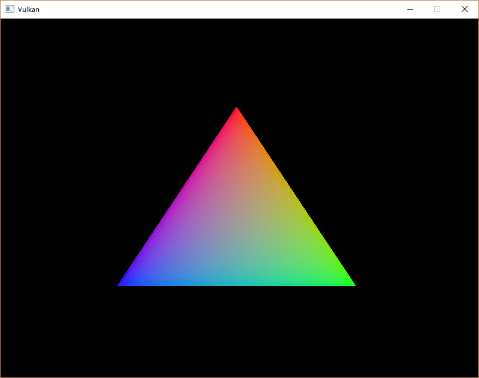
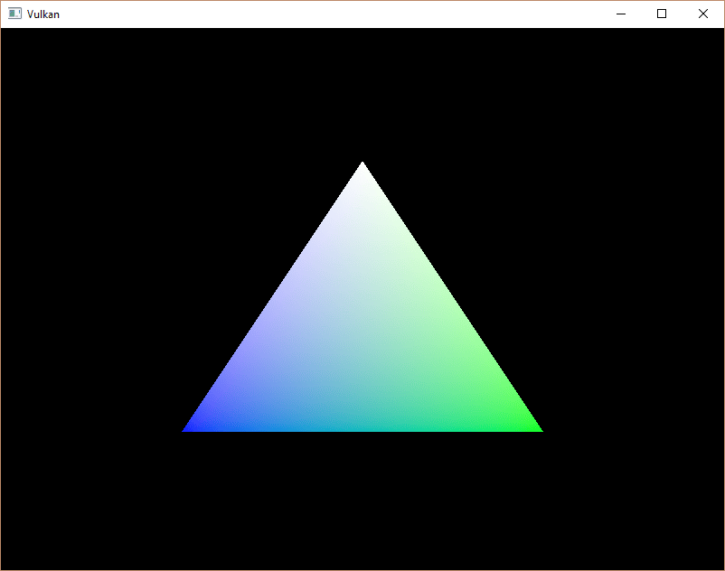

= 创建顶点缓冲区
:toc:
:toclevels: 3
:toc-title: 目录

== 介绍
Vulkan 中的缓冲区是用于存储任意数据的内存区域，这些数据可以被显卡读取。它们可以用来存储顶点数据（我们将在本章中介绍），还可以用于许多其他用途，我们将在后续章节中探讨。与我们之前讨论的 Vulkan 对象不同，缓冲区不会自动分配内存。前几章的内容表明，Vulkan API 几乎将所有控制权都交给了程序员，内存管理就是其中之一。

== 创建缓冲区
创建一个新函数 `createVertexBuffer`，并在 `initVulkan` 的 `createCommandBuffers` 前面调用它。
[source,c++]
----
void initVulkan(){
    createInstance();
    setupDebugMessenger();
    createSurface();
    pickPhysicalDevice();
    createLogicalDevice();
    createSwapChain();
    createImageViews();
    createGraphicsPipeline();
    createCommandPool();
    createVertexBuffer();
    createCommandBuffers();
    createSyncObjects();
}
...
void createVertexBuffer(){

}
----
创建缓冲区需要我们填充 `vk::BufferCreateInfo` 结构。
[source,c++]
----
vk::BufferCreateInfo bufferInfo{.size        = sizeof(vertices[0]) * vertices.size(),
                                .usage       = vk::BufferUsageFlagBits::eVertexBuffer,
                                .sharingMode = vk::SharingMode::eExclusive};
----
该 `size` 字段指定缓冲区的大小（以字节为单位）。使用 `sizeof` 获取.

该 `usage` 字段指示缓冲区中的数据将用于哪些用途。可以使用按位或运算指定多个用途。我们的用例是顶点缓冲区，我们将在后续章节中探讨其他用途。

与交换链中的图像类似，缓冲区也可以由特定的队列族拥有，或者同时在多个队列族之间共享。缓冲区只会从图形队列中使用，因此我们可以坚持独占访问。

还有一个 `flags` 字段用于配置稀疏缓冲区内存。目前它并不相关，所以我们将其保留为默认值 `0`。

现在我们可以使用构造函数创建缓冲区 `vk::raii::Buffer`。定义一个类成员 `vertexBuffer` 来保存缓冲区句柄并调用它。

[source, c++]
----
vk::raii::Buffer vertexBuffer = nullptr;

...

void createVertexBuffer() {
		vk::BufferCreateInfo bufferInfo{.size        = sizeof(vertices[0]) * vertices.size(),
		                                .usage       = vk::BufferUsageFlagBits::eVertexBuffer,
		                                .sharingMode = vk::SharingMode::eExclusive};
    vertexBuffer = vk::raii::Buffer(device, bufferInfo);
}
----
缓冲区应在程序结束前一直可用于渲染命令，并且它不依赖于交换链。

== 内存需求
缓冲区已创建，但尚未分配任何内存。为缓冲区分配内存的第一步是使用名为 `vk::raii::Buffer::getMemoryRequirements` 的函数查询其内存需求。

[source,c++]
----
vk::MemoryRequirements memRequirements = vertexBuffer.getMemoryRequirements();
----
该 `vk::MemoryRequirements` 结构体包含三个字段：

- `size` 所需内存的大小（以字节为单位）可能与此不同 `bufferInfo.size`。
- `alignment`：缓冲区在已分配内存区域中的起始偏移量（以字节为单位）取决于 `bufferInfo.usage` 和 `bufferInfo.flags`。
- `memoryTypeBits`：适用于缓冲区的内存类型的位域。

显卡可以提供不同类型的内存供用户分配。每种类型的内存允许的操作和性能特征各不相同。我们需要结合缓冲区的要求和应用程序自身的需求，找到合适的内存类型。为此，我们创建一个新函数 `findMemoryType`。

[source,c++]
----
uint32_t findMemoryType(uint32_t typeFilter, vk::MemoryPropertyFlags properties) {

}
----
首先，我们需要使用查询有关可用内存类型的信息 `vk::raii::PhysicalDevice::getMemoryProperties`。

[source,c++]
----
vk::PhysicalDeviceMemoryProperties memProperties = physicalDevice.getMemoryProperties();
----
该 `vk::PhysicalDeviceMemoryProperties` 结构包含两个数组 `memoryTypes`、`memoryHeaps`。内存堆是独立的内存资源，类似于专用的显存 (VRAM) 和用于显存耗尽时的 RAM 交换空间。不同类型的内存存在于这些堆中。目前我们只关注内存类型，而不考虑它所在的堆，但您可以想象，这会影响性能。

我们首先来找一种适合缓冲区本身的内存类型：

[source,c++]
----
for (uint32_t i = 0; i < memProperties.memoryTypeCount; i++)
{
    if ((typeFilter & (1 << i)))
    {
        return i;
    }
}

throw std::runtime_error("没有合适类型显存");
----
该 `typeFilter` 参数将用于指定合适的内存类型的位域。这意味着我们可以通过遍历这些内存类型并检查相应的位是否设置为真来找到合适的内存类型的索引。

然而，我们不仅需要一种适合顶点缓冲区的内存类型，还需要能够将顶点数据写入该内存。该 `memoryTypes` 数组由结构体组成，`vk::MemoryType` 这些结构体指定了每种内存类型的堆和属性。这些属性定义了内存的特殊功能，例如能够映射内存以便我们可以从 CPU 写入。此属性用 `vk::MemoryPropertyFlagBits::eHostVisible` 表示，但我们还需要使用 `vk::MemoryPropertyFlagBits::eHostCoherent` 属性。当我们映射内存时，就会明白为什么了。

现在我们可以修改循环，使其也检查是否支持此属性：

[source,c++]
----
for (uint32_t i = 0; i < memProperties.memoryTypeCount; i++)
{
    if ((typeFilter & (1 << i)) && (memProperties.memoryTypes[i].propertyFlags & properties) == properties)
    {
        return i;
    }
}
----
我们可能需要多个属性，因此应该检查按位与运算的结果不仅非零，而且是否等于所需属性的位域。如果存在适合缓冲区且具备所有必要属性的内存类型，则返回其索引；否则，抛出异常。

== 内存分配
现在我们有了确定正确内存类型的方法，因此我们可以通过填充 `vk::MemoryAllocateInfo` 结构来实际分配内存。

[source,c++]
----
vk::MemoryAllocateInfo memoryAllocateInfo{
    .allocationSize  = memRequirements.size,
    .memoryTypeIndex = findMemoryType(memRequirements.memoryTypeBits, vk::MemoryPropertyFlagBits::eHostVisible | vk::MemoryPropertyFlagBits::eHostCoherent)};
----
现在内存分配非常简单，只需指定大小和类型即可，这两者都取决于顶点缓冲区的内存需求和所需属性。创建一个 `vk::raii::DeviceMemory` 类成员来存储内存句柄，并在构造函数中分配内存。

[source,c++]
----
vk::raii::Buffer       vertexBuffer       = nullptr;
vk::raii::DeviceMemory vertexBufferMemory = nullptr;

...

vertexBufferMemory = vk::raii::DeviceMemory(device, memoryAllocateInfo);
----
如果内存分配成功，那么我们现在可以使用以下 `vk::raii::Buffer::bindBufferMemory` 方法将该内存与缓冲区关联起来：

[source,c++]
----
vertexBuffer.bindMemory(*vertexBufferMemory, 0);
----
第一个参数的含义不言自明，第二个参数是内存区域内的偏移量。由于这块内存是专门为这个顶点缓冲区分配的，因此偏移量就是0。如果偏移量非零，则必须能被 `memRequirements.alignment` 整除。

== 填充顶点缓冲区
现在需要将顶点数据复制到缓冲区。这是通过 `vk::raii::DeviceMemory::mapMemory` 将 https://en.wikipedia.org/wiki/Memory-mapped_I/O[缓冲区内存映射] 到 CPU 可访问内存来实现的。

[source,c++]
----
void* data = vertexBufferMemory.mapMemory(0, bufferInfo.size);
----
此函数允许我们访问由偏移量和大小定义的指定内存资源区域。此处的偏移量和大小分别为 `0` 和 `bufferInfo.size`。

[source,c++]
----
void* data = vertexBufferMemory.mapMemory(0, bufferInfo.size);
memcpy(data, vertices.data(), bufferInfo.size);
vertexBufferMemory.unmapMemory();
----
现在，您可以简单地用 `memcpy` 将顶点数据复制到映射内存，然后使用 `vk::raii::DeviceMemory::unmapMemory` 命令再次取消映射。遗憾的是，驱动程序可能不会立即将数据复制到缓冲区内存中，例如，由于缓存的原因。此外，写入缓冲区的数据可能尚未在映射内存中显示。有两种方法可以解决这个问题：

- 使用与主机一致的内存堆，用以下方式表示：`vk::MemoryPropertyFlagBits::eHostCoherent`
- `vk::raii::Device::flushMappedMemoryRanges` 在写入映射内存后调用，并 `vk::raii::Device::invalidateMappedMemoryRanges` 在从映射内存读取之前调用。

我们采用了第一种方法，这种方法确保映射的内存始终与已分配内存的内容一致。请注意，这种方法可能会导致性能略低于显式刷新，但我们将在下一章中解释为什么这无关紧要。

刷新内存范围或使用一致性内存堆意味着驱动程序会感知到我们对缓冲区的写入操作，但这并不意味着这些操作在 GPU 上已经可见。数据传输到 GPU 是一个后台操作，规范只是 https://docs.vulkan.org/spec/latest/chapters/synchronization.html#synchronization-submission-host-writes[告诉我们]，在下次调用时，`vk::raii::Queue::submit` 操作保证完成。

== 绑定顶点缓冲区
现在剩下的工作就是在渲染操作期间绑定顶点缓冲区。我们将扩展该 `recordCommandBuffer` 函数来实现这一点。

[source,c++]
----
commandBuffer.bindPipeline(vk::PipelineBindPoint::eGraphics, *graphicsPipeline);

commandBuffer.bindVertexBuffers(0, *vertexBuffer, {0});

commandBuffer.draw(static_cast<uint32_t>(vertices.size()), 1, 0, 0);
----
该 `vk::raii::CommandBuffer::bindVertexBuffers` 函数用于将顶点缓冲区绑定到绑定，例如我们在上一章中设置的绑定。第一个参数是绑定中的偏移量。第二个参数是要绑定的缓冲区数组。最后一个参数是大小相同的字节偏移量数组，用于从这些偏移量开始读取顶点数据。您还应该修改调用，将 `vk::CommandBuffer::draw` 缓冲区中的顶点数替换为硬编码的顶点数 `3`。

现在运行程序，你应该会再次看到熟悉的三角形：

尝试通过修改数组将顶部顶点的颜色更改为白色vertices：

[source,c++]
----
const std::vector<Vertex> vertices = {
    {{0.0f, -0.5f}, {1.0f, 1.0f, 1.0f}},
    {{0.5f, 0.5f}, {0.0f, 1.0f, 0.0f}},
    {{-0.5f, 0.5f}, {0.0f, 0.0f, 1.0f}}
};
----
再次运行该程序，您应该会看到以下内容：

xref:[下一章]，我们将探讨一种将顶点数据复制到顶点缓冲区的不同方法，这种方法性能更好，但需要更多的工作。