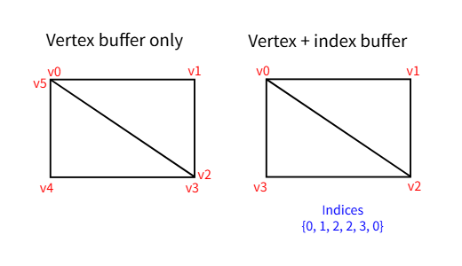
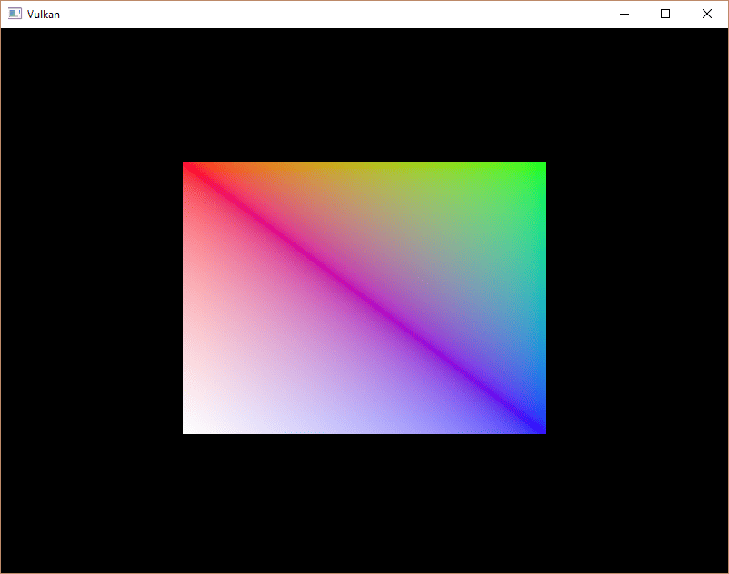

= 索引缓冲区
:toc:
:toclevels: 3
:toc-title: 目录

== 介绍
在实际应用中渲染的 3D 网格通常会在多个三角形之间共享顶点。即使是绘制矩形这样简单的操作，也会出现这种情况：

绘制一个矩形需要两个三角形，这意味着我们需要一个包含六个顶点的顶点缓冲区。问题在于两个顶点的数据需要重复存储，导致 50% 的数据冗余。对于更复杂的网格，情况会更加糟糕，因为顶点平均会在三个三角形中重复使用。解决这个问题的方法是使用索引缓冲区。

索引缓冲区本质上是一个指向顶点缓冲区的指针数组。它允许你重新排列顶点数据，并为多个顶点重用现有数据。上图展示了如果顶点缓冲区包含矩形的四个唯一顶点，那么索引缓冲区会是什么样子。前三个索引定义了右上三角形，后三个索引定义了左下三角形的顶点。

== 创建索引缓冲区
本章我们将修改顶点数据并添加索引数据，以绘制一个如图所示的矩形。修改顶点数据以表示四个角点：

[source,c++]
----
const std::vector<Vertex> vertices = {
    {{-0.5f, -0.5f}, {1.0f, 0.0f, 0.0f}},
    {{0.5f, -0.5f}, {0.0f, 1.0f, 0.0f}},
    {{0.5f, 0.5f}, {0.0f, 0.0f, 1.0f}},
    {{-0.5f, 0.5f}, {1.0f, 1.0f, 1.0f}}
};
----

左上角是红色，右上角是绿色，右下角是蓝色，左下角是白色。我们将添加一个新数组 `indices` 来表示索引缓冲区的内容。它应该与图中的索引相匹配，以便绘制右上角的三角形和左下角的三角形。

[source,c++]
----
const std::vector<uint16_t> indices = {
    0, 1, 2, 2, 3, 0
};
----

根据索引缓冲区中的条目数量，可以使用 `uint16_t` 或 `uint32_t` 作为索引缓冲区。目前我们可以坚持使用 `uint16_t`，因为我们使用 `vertices` 的唯一顶点少于 65535 个。

与顶点数据一样，索引也需要上传到某个位置，GPU 才能访问它们。定义两个新的 `vk::raii::Buffer` 类成员来保存索引缓冲区所需的资源：

[source,c++]
----
vk::raii::Buffer       vertexBuffer       = nullptr;
vk::raii::DeviceMemory vertexBufferMemory = nullptr;
vk::raii::Buffer       indexBuffer        = nullptr;
vk::raii::DeviceMemory indexBufferMemory  = nullptr;
----

我们现在要添加的函数 `createIndexBuffer` 几乎与 `createVertexBuffer` 函数完全相同：

[source,c++]
----
void initVulkan()
{
    ...
    createVertexBuffer();
    createIndexBuffer();
    ...
}

void createIndexBuffer()
{
		vk::DeviceSize bufferSize = sizeof(indices[0]) * indices.size();

		auto [stagingBuffer, stagingBufferMemory] =
		    createBuffer(bufferSize, vk::BufferUsageFlagBits::eTransferSrc, vk::MemoryPropertyFlagBits::eHostVisible | vk::MemoryPropertyFlagBits::eHostCoherent);

		void *data = stagingBufferMemory.mapMemory(0, bufferSize);
		memcpy(data, indices.data(), (size_t) bufferSize);
		stagingBufferMemory.unmapMemory();

		std::tie(indexBuffer, indexBufferMemory) =
		    createBuffer(bufferSize, vk::BufferUsageFlagBits::eIndexBuffer | vk::BufferUsageFlagBits::eTransferDst, vk::MemoryPropertyFlagBits::eDeviceLocal);

		copyBuffer(stagingBuffer, indexBuffer, bufferSize);
}
----

只有两点显著区别。现在，`bufferSize` 等于索引数量乘以索引类型的大小，可以是 `uint16_t` 或 `uint32_t`。`indexBuffer` 的用法应该改为 `vk::BufferUsageFlagBits::eIndexBuffer` 而不是 `vk::BufferUsageFlagBits::eVertex`，这很合理。除此之外，流程完全相同。我们创建一个暂存缓冲区，将 `Buffer` 的内容复制到 `indices`，然后再将其复制到最终的设备本地索引缓冲区。

== 使用索引缓冲区
使用索引缓冲区进行绘制需要对代码 `recordCommandBuffer` 进行两项更改。首先，我们需要绑定索引缓冲区，就像绑定顶点缓冲区一样。不同之处在于，索引缓冲区只能使用一个。遗憾的是，我们无法为每个顶点属性使用不同的索引，因此即使只有一个属性发生变化，我们也必须完全复制顶点数据。

[source,c++]
----
commandBuffers[frameIndex].bindVertexBuffers(0, *vertexBuffer, {0});
commandBuffers[frameIndex].bindIndexBuffer(*indexBuffer, 0, vk::IndexType::eUint16);
----

索引缓冲区通过 `vk::raii::CommandBuffer::bindIndexBuffer` 绑定实现，其参数包括索引缓冲区本身、缓冲区内的字节偏移量以及索引数据类型。如前所述，可能的类型有 `vk::IndexType::eUint16` 和 `vk::IndexType::eUint32`。

仅仅绑定索引缓冲区还不会改变任何事情，我们还需要修改绘图命令，告诉 Vulkan 使用索引缓冲区。删除该 `vk::raii::CommandBuffer::draw` 行并将其替换为 `vk::raii::CommandBuffer::drawIndexed`：

[source,c++]
----
commandBuffer.drawIndexed(static_cast<uint32_t>(indices.size()), 1, 0, 0, 0);
----

调用此函数与调用 `vk::raii::CommandBuffer::draw` 非常相似。前两个参数分别指定索引数和实例数。由于我们不使用实例化，因此只需指定实例数为1即可。索引数表示将传递给顶点着色器的顶点数。下一个参数指定索引缓冲区中的偏移量，使用 `1` 值将使显卡从第二个索引开始读取。倒数第二个参数指定在进入顶点缓冲区之前要添加到顶点索引的偏移量。最后一个参数指定实例化的偏移量，但我们不使用实例化。

现在运行你的程序，你应该会看到以下内容：

现在您已经了解如何通过使用索引缓冲区重用顶点来节省内存。这在后续章节中加载复杂的3D模型时将变得尤为重要。

上一章已经提到，你应该从单个内存分配中分配多个资源（例如缓冲区），但实际上你应该更进一步。 https://developer.nvidia.com/vulkan-memory-management[驱动程序开发人员建议]你将多个缓冲区（例如顶点缓冲区和索引缓冲区）存储在同一个 `vk::raii::Buffer` 内存块中，并在类似 `vk::raii::CommandBuffer::bindVertexBuffers` 的命令中使用偏移量。这样做的好处是，由于数据更集中，因此对缓存更加友好。如果多个资源在同一渲染操作期间没有被使用，甚至可以将它们重用到同一块内存中（当然，前提是它们的内存数据会被刷新）。这被称为别名化，一些 Vulkan 函数提供了显式标志来指定你想要这样做。

xref:../统一缓冲区/描述符布局和缓冲区.adoc[下一章]我们将学习如何将频繁变化的参数传递给 GPU。

